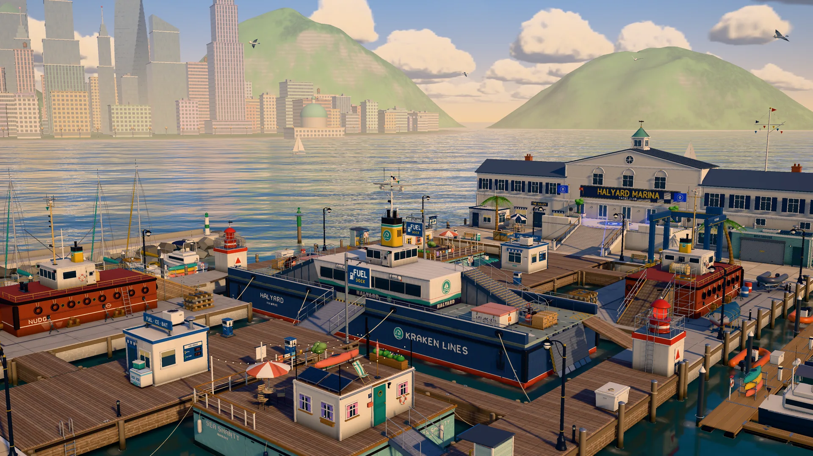
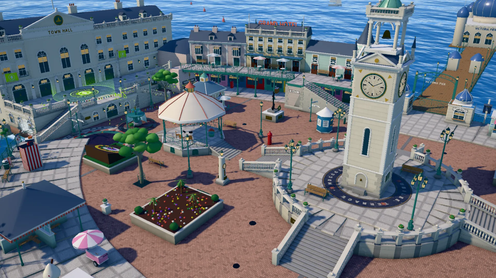
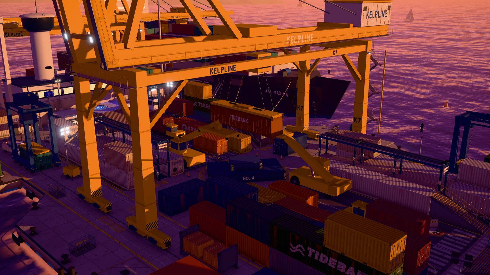

<p align="center">
  
</p>

<h1 align="center">INKWAVE</h1>

<p align="center">
  브라우저에서 즐기는 스플래툰 스타일의 독창적인 4대4 영역 쟁탈 슈팅 게임이다.<br>
  바닥을 칠하고, 아군 잉크 속을 헤엄치며, 상대 팀보다 넓은 영역을 차지한다.
</p>

<p align="center">
  <a href="https://inkwave-aah.pages.dev"><b>▶ 지금 플레이하기</b></a> ·
  <a href="#controls">조작법</a> ·
  <a href="#playing-online">온라인 플레이</a> ·
  <a href="#running-locally">로컬 실행</a> ·
  <a href="#how-it-works">동작 원리</a> ·
  <a href="CONTRIBUTING.md">기여 방법</a>
</p>

<p align="center">
  <a href="https://github.com/jaydendavisnc/inkwave/actions/workflows/ci.yml"></a>
  
  
  <a href="LICENSE"></a>
</p>

---

<a id="features"></a>

## 게임 특징

- **4대4 게임 모드**를 제공한다. 영역 쟁탈전은 바닥을 가장 넓게 칠한 팀이 승리한다. 구역 점령전은 활성 구역을 점령해 100부터 시작하는 카운트다운을 줄이는 방식이며, 순환하는 보조 구역·페널티·연장전이 적용된다. 세 가지 난이도의 봇을 상대로 플레이할 수 있다.
- **친구와 온라인으로 플레이**할 수 있다. 비공개 방을 만들고 다섯 자리 코드를 공유하면 최대 여덟 명이 각자의 장비와 외형으로 로비에 모인다. 빈자리는 봇이 채우며, 경기 도중 누군가 접속을 끊으면 봇이 해당 캐릭터를 대신 조종한다.
- **오징어 형태**로 변신할 수 있다. 변신 키를 누르고 있으면 아군 잉크에 잠수해 빠르게 헤엄치고 잉크 탱크를 채우며, 잉크가 칠해진 벽을 오르거나 돌고래처럼 뛰어올라 물 위의 틈을 건넌다.
- **서로 다른 손맛을 지닌 무기 열두 종**을 제공한다. 스프리처, 트윈파이어 피스톨, 캐노피 브롤리(산탄총과 발사 가능한 방패), 포퍼 블래스터, 스콜 스피너, 글린트 차저, 타이드라인 보우(세 갈래 화살과 두 단계 충전), 스웰 롤러, 스위시 브러시, 브라인 커틀러스(충전 시 한 방에 쓰러뜨리는 검), 스펀지 미츠(잉크 주먹·충전 도약·벽에 매달리기), 빌지 버킷을 사용할 수 있다. 주 무기는 보조 무기 15종 및 스페셜 19종과 자유롭게 조합할 수 있다.
- **일곱 개 스테이지를 낮이나 해질녘에 플레이**할 수 있다. 타이드워터 광장, 켈프라인 터미널, 할야드 마리나, 솔트팬 분지, 크로스로드 시장, 록게이트 운하, 테라스 고지대는 각각 하나의 장소처럼 구성되어 있으며 고유한 지형을 갖는다. 일부 스테이지는 구역 점령전에서 구조 일부가 달라진다.
- **액체처럼 움직이는 잉크**를 표현한다. 튄 잉크가 퍼지고 가라앉으며, 갓 칠한 잉크는 윤기를 띠다가 마른다. 벽을 따라 잉크가 흘러내리고 헤엄친 자리에는 잉크 표면에 물결이 남는다.
- **한눈에 읽히는 전술 지도**를 제공한다. <kbd>Tab</kbd>을 누르고 있으면 카메라가 위로 올라가 현재 스테이지를 틸트 시프트 디오라마처럼 보여 준다. 아군 위치가 표시되며, 클릭 한 번으로 슈퍼 점프를 할 수 있다.
- **라커에서 캐릭터 외형을 설정**할 수 있다. 촉수 스타일, 머리 장비, 얼굴, 의상을 선택한다.
- **모든 요소를 절차적으로 생성**한다. 캐릭터, 애니메이션, 무기, 텍스처, 소품, 효과음, 음악을 모두 코드로 만든다. 외부에서 가져온 리소스는 글꼴 두 개뿐이다.

<p align="center">
  
  
</p>

<a id="controls"></a>

## 조작법

| 동작 | 키보드 / 마우스 | 게임패드 |
|---|---|---|
| 이동 | <kbd>W</kbd> <kbd>A</kbd> <kbd>S</kbd> <kbd>D</kbd> | 왼쪽 스틱 |
| 조준 | 마우스 | 오른쪽 스틱 |
| 발사 | 왼쪽 클릭 | RT |
| 오징어 형태 | <kbd>Shift</kbd> | LT |
| 점프 / 회피 구르기 | <kbd>Space</kbd> | A |
| 보조 무기(폭탄) | 오른쪽 클릭 / <kbd>E</kbd> | RB |
| 스페셜 | <kbd>F</kbd> | Y |
| 지도 + 슈퍼 점프 | <kbd>Tab</kbd> 또는 <kbd>M</kbd>을 누른 상태에서 <kbd>1</kbd>–<kbd>4</kbd>를 누르거나 위치 표시를 클릭한다. | 보기(View) 버튼 |
| 일시 정지 | <kbd>Esc</kbd> | 시작(Start) 버튼 |

게임패드는 호스팅된 HTTPS 버전에서 사용할 수 있다. 일반 `http://` LAN 주소로 접속하면 브라우저가 게임패드 API를 차단한다.

<a id="playing-online"></a>

## 온라인 플레이

메인 메뉴에서 **온라인(Online)**을 선택한 뒤 **방 만들기(Create a room)**로 방을 만들고 친구에게 코드를 전달한다. 친구가 만든 방에 들어가려면 **방 참가(Join a room)**를 선택하고 코드를 입력한다. 방장은 스테이지, 시간대, 경기 시간, 빈자리를 봇으로 채울지를 설정한다. 다른 참가자는 팀, 무기, 외형을 고르고 준비를 완료한다. 참가자 구성, 감정 표현, 준비 상태는 방 안의 모든 사람에게 실시간으로 표시된다.

방은 작은 중계 서버에서 동작한다. [`server/`](server)에 구현된 Cloudflare Worker가 방마다 하나의 Durable Object를 사용한다. 중계 서버는 메시지만 전달한다. 각 플레이어는 자신의 캐릭터를 시뮬레이션해 상태를 전송하고, 다른 플레이어의 캐릭터는 같은 애니메이션 시스템을 사용해 약 0.1초 늦춘 시점에서 부드럽게 보간해 그린다. 동작 원리와 측정 도구는 [`docs/NET.md`](docs/NET.md)에 설명되어 있다.

서버는 향후 C#으로 다시 만들 예정이다. 현재는 재작성 예정만 기록하며 서버의 상세 설계와 구현 계획은 수립하지 않는다.

자신의 네트워크에서 온라인으로 플레이하려면 게임과 함께 중계 서버를 실행한다.

```bash
npm install      # 최초 한 번 설치한다. 중계 서버는 wrangler로 실행한다.
npm run relay    # 접속 주소는 ws://<이 컴퓨터의 IP 주소>:8787이다.
```

`localhost`나 LAN 주소로 연 페이지는 이 중계 서버를 자동으로 사용한다. 다른 중계 서버를 사용하려면 URL에 `?relay=wss://…`를 지정한다.

<a id="running-locally"></a>

## 로컬 실행

사용자의 실행·성능 측정 요청에 따라 PC 브라우저에서 기존 게임과 데스크톱 성능 정책을 비교 검증했다. 제한된 시작 정책은 메뉴 자동 전투·로비 선행 로딩·전체 효과 사전 준비를 생략하고, 바닥 재질 세부 표현을 단순화한다. 메뉴는 최대 30fps, 전투는 기본 60fps로 제한하며 직접 선택하지 않은 그림자는 끈다. 첫 전투와 새 효과의 셰이더 준비 지연은 남아 있다. 상세 측정과 제약은 [34번 수정 계획](docs_working/데스크톱-성능-게임패드-언어-정적검토-34.md)의 F07에 기록한다.

데스크톱 기본 실행·패키징은 **Tauri 2**를 사용한다. 공통 게임의 기존 JavaScript와 자산을 재사용하며, 새 호스트 연결·준비 도구는 TypeScript, 네이티브 진입점은 Rust로 작성했다. 이 PC의 Rust 1.89 MSVC·Visual Studio C++ 구성요소·Windows SDK·WebView2 설치를 확인했으며 도구 체인을 갱신하지 않았다.

`npm start`는 웹 자산을 준비한 뒤 **Tauri 시작 화면**을 연다. 별도 개발 서버를 띄우지 않으며 시작 화면은 게임·three.js를 불러오지 않는다. 사용자가 `게임 시작`을 눌렀을 때만 낮은 화질의 분할 번들을 불러온다. 첫 전투에는 현재 보이는 캐릭터 메시를 먼저 준비하고, 장비·라커 화면은 열 때 준비한다. 낮은 화질에서는 멀리 있는 캐릭터의 상세도 전환을 단순화한다. 기존 Electron의 설정·프로필은 자동 이전하지 않으며 원본은 보존한다.

Windows에는 **Visual Studio IDE 전체가 필요하지 않다.** Tauri의 공식 MSVC 경로에 필요한 C++ Build Tools와 Windows SDK, WebView2가 필요하다. 이 PC에는 Build Tools 2022의 MSVC x64/x86 및 Windows 11 SDK 구성요소를 설치했고 `npm start`의 빌드와 Tauri 실제 전투 실행을 확인했다. 자세한 요구 사항은 [Tauri 공식 문서](https://tauri.app/start/prerequisites/)를 따른다. 첫 Tauri 측정은 전투 진입 18.0초, 같은 앱의 캐시 적용 재진입은 8.7초였다. 다른 머신과 설치 패키지의 결과를 보장하는 수치는 아니다.

아래 표는 현재 `package.json`의 명령이다. Tauri 개발 실행은 검증했고 설치 패키지 검증은 미실행이다.

| 명령 | 현재 역할과 주의점 |
|---|---|
| `npm install --ignore-scripts` | 잠금 파일의 의존성을 설치한다. Tauri 도구를 포함하며 기존 베이크 도구용 Electron 의존성도 남아 있다. |
| `npm start` | Tauri 시작 화면을 연다. Electron을 실행하지 않는다. Windows에는 Visual Studio C++ 빌드 도구·Windows SDK가 필요하다. |
| `npm run desktop:typecheck` | 새 TypeScript 호스트 연결과 준비 도구를 검사한다. 앱을 기동하지 않는다. 기존 게임 전체의 TypeScript 이전 완료를 뜻하지 않는다. |
| `npm run desktop:prepare` | 타입 검사 후 `.desktop-dist/`에 웹 자산과 호스트 연결을 생성한다. 기존 `dist/`와 원본 자산은 수정하지 않는다. |
| `npm run desktop:check` | 웹 자산 준비 후 Rust를 최대 두 작업으로 검사한다. 앱은 기동하지 않지만 컴파일·다운로드 비용은 발생할 수 있다. |
| `npm run serve` | 기존 웹 개발 서버를 시작한다. 일반 웹은 기존 표현·설정을 사용한다. |
| `npm run package` | Tauri 릴리스와 Windows NSIS 설치 파일을 만든다. 출력은 `src-tauri/target/release/` 아래이며 현재 패키징 검증은 미실행이다. |
| `npm run check` | 기존 JavaScript 구문 검사이다. TypeScript 타입 검사나 게임 동작 검증을 대신하지 않는다. |
| `npm run check-maps` | 기존 맵 정합성 검사이다. 실제 이동·완주·성능 검증을 대신하지 않는다. |
| `npm run build` | 기존 웹 파일을 `dist/`에 수집한다. Tauri 앱 생성이나 TypeScript 컴파일을 수행하지 않는다. |
| `npm run smoke`, `npm run botlab`, `npm run net-test` | 게임을 기동하는 자동 검사이다. 이번 성능 검사에서는 실행하지 않았다. |

수정 후 검사도 먼저 스크립트 내용을 확인하고 앱을 기동하지 않는 검사부터 수행한다. 빌드 성공과 실제 성능·패드 조작 검증은 별도로 판정한다. Tauri로 바꿨다는 이유만으로 실행을 재개하지 않는다.

음원 구성은 [`songs/README.md`](songs/README.md)를 참고한다. Tauri 전환 시에도 로컬 음원의 오프라인 로딩·탐색·반복 재생을 검증한다. 기존 자동 시작·자동 조종 URL 옵션은 실행 제한을 우회하는 방법으로 사용하지 않는다.

<a id="how-it-works"></a>

## 동작 원리

- **텍스처 공간에 잉크를 칠한다.** 칠할 수 있는 각 표면은 하나의 4K 텍스처 아틀라스 안에 자기 영역을 갖는다. GPU가 이 영역에 잉크 자국을 그리는 동안 CPU의 저해상도 격자는 영역 점수와 게임 판정에 사용하는 조회 결과를 동기화한다. 레벨 셰이더는 잉크 고유의 높이, 광택, 젖은 정도를 반영해 표면 위에 잉크를 덧입힌다. [`src/world/paint.js`](src/world/paint.js)와 [`src/world/inkShading.js`](src/world/inkShading.js)를 참고한다.
- **스테이지를 데이터로 정의한다.** 지형 데이터는 경기장 절반을 구성하는 상자와 경사로 목록이다. 나머지 절반은 이를 180° 회전해 만들므로 두 팀은 항상 동일한 조건의 지형에서 플레이한다. 주변광 차폐는 `tools/bake-ao.mjs`로 오프라인에서 미리 계산한다. [`src/world/maps.js`](src/world/maps.js)를 참고한다.
- **캐릭터를 전적으로 절차적으로 생성한다.** 지오메트리, 재질, 뼈대 60개로 구성된 리그, 이동·오징어 형태·무기 자세·부가 움직임을 포함한 모든 애니메이션을 코드로 정의한다. 스프링 기반 자세 시스템이 움직임을 구동한다. [`docs/RIG.md`](docs/RIG.md)를 참고한다.
- **시스템은 이벤트로 소통한다.** 무기, 캐릭터, 경기 시스템이 타입이 정의된 이벤트를 발생시키고 효과, HUD, 오디오 시스템이 이를 구독한다. 이벤트와 시스템 사이의 규약은 [`docs/EVENTS.md`](docs/EVENTS.md)와 [`docs/CONTRACTS.md`](docs/CONTRACTS.md)에 정리되어 있다.
- **프레임 단위로 재현 가능한 도구를 제공한다.** 게임은 정지 및 한 프레임씩 진행하는 디버그 인터페이스를 제공한다. 이를 통해 연속 장면 이미지, 조작감 측정, 봇 시뮬레이션을 프레임 단위로 재현할 수 있다. 관련 도구는 `tools/film.py`와 `tools/measure-handling.mjs`이다.

렌더링에는 three.js r186을 사용한다. 라이브러리를 저장소에 포함하며, 임포트 맵을 사용하는 일반 ES 모듈로 구성한다. GTAO(주변광 차폐), 블룸, 자체 색보정 패스를 적용한다.

사용 기술, 클라이언트 구현 방식, 서버 구조도와 온라인 통신 흐름은 [서버·클라이언트 기술과 구조](docs_working/서버-클라이언트-기술과-구조-1.md)에 정리되어 있다.

웹 우선 개발과 향후 안드로이드·아이폰 지원 방침은 [클라이언트 전환 계획](docs_working/클라이언트-멀티플랫폼-전환계획-31.md)과 [클라이언트 구현 설계](docs_working/클라이언트-멀티플랫폼-구현설계-32.md)에 정리되어 있다. 게임패드가 없을 때의 가상 키와 Xbox 360 기준 조작, 스테이지 1 이후 검토 및 별도 요청 후 안드로이드 빌드 조건을 다룬다. 새 정책은 설계 단계이며 구현·실기기 검증은 남아 있다.

실제 구현 순서와 태스크별 구현 방법·완료 조건·검증 방법은 [클라이언트·캠페인 상세 구현 계획](docs_working/클라이언트-캠페인-상세구현계획-33.md)을 따른다. 여러 태스크를 함께 요청하더라도 태스크 하나를 완료할 때마다 해당 항목을 즉시 체크한다.

데스크톱 앱의 긴 로딩·렉·게임패드 문제에 대한 코드 근거와 한국어 기본값·영어 옵션 구현 계획은 [데스크톱 성능·게임패드·언어 정적 검토](docs_working/데스크톱-성능-게임패드-언어-정적검토-34.md)에 정리되어 있다. 기본 실행·패키징은 **Tauri 2**로 연결했고 필요한 Rust·Cargo를 허용한다. 기존 저장 이전·실환경 검증과 성능·패드·언어 개선은 남아 있다. 수정과 실행 조건 확인 전에는 앱·게임·GPU 진단을 실행하지 않는다.

기존 리소스를 활용하는 스테이지 진행형 싱글 플레이 구상은 [PvE 캠페인 기획 — 되찾는 물결](docs_working/PvP-GDD/싱글플레이-PvE-캠페인-기획-2.md)에 정리되어 있다. 이 문서의 목차에서 21개 스테이지와 게임플레이·NPC·아이템·성장·파밍 상세 문서를 볼 수 있다. 그림의 표현 방향과 생성된 러프는 [일러스트 시각설계](docs_working/PvP-GDD/campaign/일러스트-시각설계-29.md)에 정리되어 있다.

<a id="browser-support"></a>

## 지원 브라우저

Chrome과 Edge를 주요 대상으로 하며 Firefox에서도 동작한다. Safari에서도 실행할 수 있지만 속도가 더 느리다. 높음(High) 화질에는 외장 GPU나 최신 내장 GPU를 권장한다. 설정 메뉴에서 중간(Medium) 및 낮음(Low) 화질을 선택할 수 있다.

<a id="contributing"></a>

## 기여 방법

이슈와 풀 리퀘스트를 환영한다. 프로젝트 구조와 먼저 실행해야 할 검사는 [기여 안내](CONTRIBUTING.md)를 참고한다.

<a id="license"></a>

## 라이선스

[MIT 라이선스](LICENSE) © 2026 Jayden Davis. INKWAVE는 독립 프로젝트이며 닌텐도와 제휴 관계가 없다. 스플래툰은 닌텐도의 상표이다.
