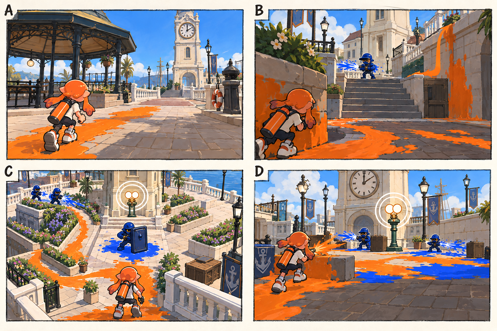

# 스테이지 1-1 — 멈춘 시계 아래

- [x] 장면·목표·동선·등장 적·보상을 상세화한다.
- [x] 러프 장면판을 생성하고 장면 설명과 대조한다.
- [x] 연결 링크와 기획 수치를 검토한다.

[전체 기획과 목차](../../싱글플레이-PvE-캠페인-기획-2.md) · [플레이 규칙](../systems/게임플레이-상세-24.md) · [그림 범례](../일러스트-시각설계-29.md)

이 문서는 추가할 캠페인의 기획이다. 아래 그림은 기획용 러프이며 실제 구현 화면이 아니다. 기존 지도 이미지와 구분해 읽는다. 좌표·엄폐 위치·적 수·체력·시간은 실제 맵과 플레이 검증 후 조정할 초기값이다.

## 1. 이 임무에서 경험하는 것

비어 있는 광장에 자신의 잉크 길을 처음 만들고, 멈춘 통신등 두 개를 켜는 입문 임무이다.

| 항목 | 내용 |
|---|---|
| 지역과 시간대 | 타이드워터 광장, 낮 / 지도 ID: tidewater이다. |
| 유형 | 일반 목표 진행 임무이다. |
| 예상 시간 | 8~10분을 초기 목표로 한다. |
| 주 목표 | 중계기 A·B를 복구하고 시계탑 아래 출구에 도달한다. |
| 권장 행동 | CP → 칠할 수 있는 낮은 벽 → X → B의 측면 |
| 완료 후 변화 | 세 슬롯의 일반 모듈 3개를 확정 지급한다. 최초에는 무작위 완료 모듈을 별도로 더하지 않는다. |

## 2. 네 장면으로 보는 플레이

> 그림 검수: 광장·계단 옆 벽·꽃밭 우회와 방어 중 퇴로를 확인했다. D는 첫 웨이브 2명과 교전하는 순간이며, 두 번째 웨이브와 최종 점등은 본문의 순서를 따른다. A의 잠수 속도 비교와 C의 선택 상자 표식은 본문에서 보완한다.

장면판은 왼쪽 위 A → 오른쪽 위 B → 왼쪽 아래 C → 오른쪽 아래 D 순서로 읽는다. 화살표는 플레이어의 선택 동선이며, 반투명 위험선·원은 공격 전 예고이다. 작은 문자와 수치보다 아래의 설명을 기준으로 해석한다.

| 그림 | 읽어야 할 행동 |
|---|---|
| A — 잉크 한 줄의 차이 | 마른 바닥을 칠한 뒤 사람 형태와 잠수 이동의 속도 차이를 직접 비교한다. |
| B — 계단과 옆 벽 | 엄폐 뒤에서 사격하거나 벽을 칠해 옆 고지로 올라간다. |
| C — 짧은 길과 긴 길 | 정면 방패병을 돌아가거나 우회로의 사격병 두 명을 처리하고 X를 회수한다. |
| D — 다시 켜지는 시계 | 한쪽 퇴로를 남기고 사격병 2명, 이어서 사격병 1명·도색병 1명을 상대한다. |

## 3. 기존 배경과 공간 구성

위 이미지는 기존 게임의 배경 참고이다. 신규 목표·적·장치의 배치를 확정한 사진이 아니다. 큰 지형과 건물·선박·소품을 재사용하고 아래 관계에 맞는 실제 공간을 선택한다.

| 표식 | 위치의 역할 |
|---|---|
| S | 남쪽 정자 앞의 안전 구역 |
| A | 시청 계단 아래 첫 중계기 |
| CP | A 뒤쪽 벤치와 흰 난간 |
| B | 시계탑 북쪽 두 번째 중계기 |
| X | 화단 옆 우회 통로의 회수 상자 |
| E | 시계탑 아래 귀환 표식 |

**주 경로:** S → 정면 사격병 → A → CP → B → E이다.

**다른 선택:** CP → 칠할 수 있는 낮은 벽 → X → B의 측면

통로 폐쇄는 시각 표식과 임무 구역 경계로 표현한다. 점프나 무기 이동기로 우연히 뒤 구역에 도착해도 순서를 건너뛰어 완료되지 않게 하며, 플레이어가 막혔다면 되돌아갈 수 있는 경로를 남긴다.

## 4. 목표와 진행 조건

각 장치의 작은 바닥 구역을 60% 이상 칠한 뒤 2초 머무른다. B는 경계 웨이브 두 번을 정리하면 최종 가동된다.

- 화면에는 현재 수행할 목표 하나를 우선 표시하고 완료한 목표는 작은 체크로 남긴다.
- 필수 장치와 적은 지도·화면 양쪽에서 식별할 수 있게 한다. 선택 보상은 별표로 구분한다.
- 장치 접근 가동은 별도 조작키 없이 범위 안에서 2초 머무르는 방식이다. 위험을 피하려고 나가면 즉시 중단한다.
- 특정 주 무기만 닿는 필수 표적을 만들지 않는다. 직접 공격이 어려우면 접근 가능한 낮은 표적이나 경로를 제공한다.

## 5. 장면별 상세 플레이

### A. 잉크 한 줄의 차이

정자 너머로 시계탑과 흰 난간이 보이는 낮은 3인칭 화면이다.

| 구분 | 장면 안에서 일어나는 일 |
|---|---|
| 플레이어 행동 | 마른 바닥을 칠한 뒤 사람 형태와 잠수 이동의 속도 차이를 직접 비교한다. |
| 적과 기믹 | 적은 없다. 끊어진 길과 잠수 회복 표시만 제공한다. |
| 화면·소리의 전달 | 잉크 용량·체력·복구할 중계기 0/2를 표시한다. |
| 다음 장면으로 가는 조건 | 첫 중계기 방향으로 안전 구역을 나서면 다음 구간으로 간다. |

### B. 계단과 옆 벽

A로 이어지는 계단 정면에 사격병이 보이고 옆 벽은 비어 있다.

| 구분 | 장면 안에서 일어나는 일 |
|---|---|
| 플레이어 행동 | 엄폐 뒤에서 사격하거나 벽을 칠해 옆 고지로 올라간다. |
| 적과 기믹 | 사격병 1명이 짧게 연사하고 쉰다. 추가 적은 없다. |
| 화면·소리의 전달 | 장치 주변 바닥의 도색률과 2초 가동 원을 보여 준다. |
| 다음 장면으로 가는 조건 | A 복구와 체크포인트 활성화가 완료되면 B를 표시한다. |

### C. 짧은 길과 긴 길

시계탑 앞 갈림길에서 방패 실루엣과 화단 우회로가 동시에 보인다.

| 구분 | 장면 안에서 일어나는 일 |
|---|---|
| 플레이어 행동 | 정면 방패병을 돌아가거나 우회로의 사격병 두 명을 처리하고 X를 회수한다. |
| 적과 기믹 | 정면과 우회로는 선택한 경로의 적만 먼저 활성화한다. 동시 활성은 최대 3명이다. |
| 화면·소리의 전달 | 선택 상자의 별표와 주 목표 화살표를 서로 다른 모양으로 표시한다. |
| 다음 장면으로 가는 조건 | B의 활성 구역에 진입하면 선택 경로를 확정하고 방어 구간으로 간다. |

### D. 다시 켜지는 시계

시계탑을 배경으로 B 주변의 주황 잉크와 파란 적 잉크가 부딪힌다.

| 구분 | 장면 안에서 일어나는 일 |
|---|---|
| 플레이어 행동 | 한쪽 퇴로를 남기고 사격병 2명, 이어서 사격병 1명·도색병 1명을 상대한다. |
| 적과 기믹 | 두 웨이브 사이에 4초를 주며 화면 밖 가까운 위치에서 적이 즉시 발사하지 않는다. |
| 화면·소리의 전달 | 마지막 적 정리 뒤 가동 원이 열리고 통신등이 점등된다. |
| 다음 장면으로 가는 조건 | B 가동 후 E에 진입하면 완료한다. |

## 6. 적 배치와 난도

- A 구간: 적은 없다. 끊어진 길과 잠수 회복 표시만 제공한다.
- B 구간: 사격병 1명이 짧게 연사하고 쉰다. 추가 적은 없다.
- C 구간: 정면과 우회로는 선택한 경로의 적만 먼저 활성화한다. 동시 활성은 최대 3명이다.
- D 구간: 두 웨이브 사이에 4초를 주며 화면 밖 가까운 위치에서 적이 즉시 발사하지 않는다.

적의 단순 체력보다 사선·높이·도색 역할로 난도를 만든다. 사격병은 짧은 연사 뒤 0.8초 이상의 정비 시간을 제공한다. 감시병은 방향과 발사 시간을 먼저 알리고, 보스가 아닌 일반 적은 쓰러지면 이 구간에서 다시 출현하지 않는다.

## 7. 대사와 이야기의 변화

**입장 통신:** 틸: 시계는 멈췄는데 정리 명령만 계속 들린다. 먼저 광장에 우리 길을 만들어 보자.

**완료 통신:** 모라: 새 부품보다 네가 만든 길이 먼저였구나. 그 통신을 따라 시장 쪽 기록을 찾아보자.

전투 중 긴 대사는 하지 않는다. 공격 예고가 시작되면 통신 자막을 미루며, 완료 대화는 건너뛰고 기록 창에서 다시 읽을 수 있다.

**선택 기록 — 광장의 첫 방송:** 폭풍 당일 광장은 대피 장소였다. 정화 명령이 나간 뒤에도 안내 방송의 반복만 남았다.

선택 기록은 이 일반 임무의 선택 상자 하나와 함께 배치한다. 필수 회수 자료와 다른 수집물이며 엔딩 진입 조건으로 요구하지 않는다.

## 8. 보상과 다음 임무

| 항목 | 지급 규칙 |
|---|---|
| 첫 완료 경험치 | 기본 반복분과 첫 완료 추가분을 합해 600이다. |
| 반복 완료 경험치 | 120이다. |
| 첫 완료 부품 | 기본 40 + 첫 완료 추가 20 = 60개이다. |
| 반복 완료 부품 | 40개이다. |
| 완료 모듈 | 첫 완료는 일반 기본 모듈 3개로 대체한다. 이후에는 무작위 1개이다. |
| 공명핵 | 기본 완료에서는 지급하지 않는다. |
| 추가 보상 | 선택 상자 완료 시 무작위 모듈 1개·부품 10개·선택 기록 1개를 추가한다. |
| 파밍 계열 | 목표 작업·기초 생존 계열이다. |

세 슬롯의 일반 모듈 3개를 확정 지급한다. 최초에는 무작위 완료 모듈을 별도로 더하지 않는다.

전투 중 보상은 현재 임무의 미확정 목록에 저장하고 완료 화면에서 확정한다. 실패·재시작으로 같은 상자의 모듈을 재추첨하지 않는다. 경험치·부품은 적 처치 횟수만으로 별도 증가하지 않는다.

## 9. 체크포인트와 재도전

A가 켜진 뒤 저장한다. B에서 실패하면 A는 켜진 상태로 시작한다.

B를 가동하다 밀려나면 2초 가동만 다시 시작한다. 이미 확보한 A와 선택 상자 회수 기록은 체크포인트 기준으로 유지한다.

체크포인트 대기에서는 장비와 특성을 바꿀 수 있다. 체력·잉크는 채우고 스페셜은 저장된 구간 시작값으로 복원한다. 현재 구간의 적·장치·임무용 잉크는 함께 복원하며, 공격 중인 적 앞에 바로 플레이어를 놓지 않는다.

## 10. 일러스트와 실제 제작의 경계

- 배경의 중심 실루엣은 기존 타이드워터 광장의 건물·소품을 따른다.
- 플레이어는 주황 잉크, 잔향 적은 코발트색 잉크로 시안을 통일한다. 실제 게임에서는 팀 팔레트와 색각 설정을 적용한다.
- 목표는 흰 이중 원, 선택 상자는 별, 공격 위험은 사선·원 테두리로 구분한다. 색 하나만으로 의미를 전달하지 않는다.
- 그림의 빛나는 표식·상호작용·임무 순서·개별 AI는 추가 기획이다. 현재 게임에서 이미 동작하는 기능이라고 해석하지 않는다.
- 이미지가 설명과 다르게 생성한 작은 장식·문자·문 개폐는 필수 기능으로 추가하지 않는다. 장면의 행동·공간 관계를 우선한다.

[그림 생성 지시서](../그림-생성-프롬프트-30.md) · [아이템](../systems/아이템-상세-26.md) · [성장](../systems/성장-상세-27.md) · [파밍](../systems/파밍과-보상-상세-28.md)
