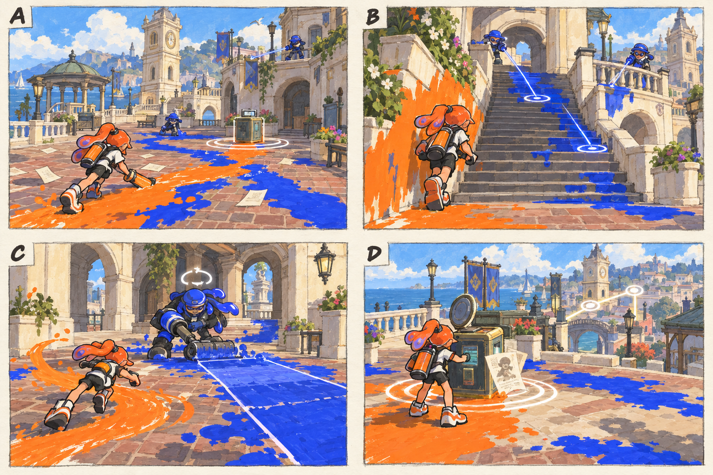

# 스테이지 1-2 — 지워지는 발자국

- [x] 장면·목표·동선·등장 적·보상을 상세화한다.
- [x] 러프 장면판을 생성하고 장면 설명과 대조한다.
- [x] 연결 링크와 기획 수치를 검토한다.

[전체 기획과 목차](../../싱글플레이-PvE-캠페인-기획-2.md) · [플레이 규칙](../systems/게임플레이-상세-24.md) · [그림 범례](../일러스트-시각설계-29.md)

이 문서는 추가할 캠페인의 기획이다. 아래 그림은 기획용 러프이며 실제 구현 화면이 아니다. 기존 지도 이미지와 구분해 읽는다. 좌표·엄폐 위치·적 수·체력·시간은 실제 맵과 플레이 검증 후 조정할 초기값이다.

## 1. 이 임무에서 경험하는 것

광장 바닥의 지워지는 흔적을 따라 고지로 올라가며 옆길의 가치를 배우는 첫 정예 임무이다.

| 항목 | 내용 |
|---|---|
| 지역과 시간대 | 타이드워터 광장, 낮 / 지도 ID: tidewater이다. |
| 유형 | 일반 진행과 중간보스 임무이다. |
| 예상 시간 | 10~12분을 초기 목표로 한다. |
| 주 목표 | 진행용 기록 2개를 회수하고 청소반장을 제압한 뒤 북쪽 통신함을 연다. |
| 권장 행동 | 좁은 계단에 갇히지 말고 회랑 옆으로 이동한다. 롤러 뒤쪽과 옆쪽이 안전하며 정면 화력만으로도 천천히 피해를 줄 수 있다. |
| 완료 후 변화 | 정예 체력바와 공격 예고 도움말, 첫 무료 특성 재배분 안내를 연다. |

## 2. 네 장면으로 보는 플레이

> 그림 검수: 서로 다른 높이의 적, 계단 옆 도색 벽, 롤러 정예의 직선 예고와 측면 회피, 기록 회수를 확인했다. 기록 수와 정예의 후속 휘두름·재정비 시간은 본문을 따른다.

장면판은 왼쪽 위 A → 오른쪽 위 B → 왼쪽 아래 C → 오른쪽 아래 D 순서로 읽는다. 화살표는 플레이어의 선택 동선이며, 반투명 위험선·원은 공격 전 예고이다. 작은 문자와 수치보다 아래의 설명을 기준으로 해석한다.

| 그림 | 읽어야 할 행동 |
|---|---|
| A — 지워지는 길 | 적의 도색선을 자신의 색으로 바꾸며 첫 기록함으로 이동한다. |
| B — 계단 위의 사선 | 계단 엄폐를 오르거나 옆 벽을 타고 같은 높이로 접근한다. |
| C — 청소반장의 돌진 | 돌진선을 옆으로 피하고 정예가 방향을 바꾸는 동안 뒤를 공격한다. |
| D — 남은 발자국 | 남은 적을 정리하고 통신함에 접근한다. |

## 3. 기존 배경과 공간 구성

위 이미지는 기존 게임의 배경 참고이다. 신규 목표·적·장치의 배치를 확정한 사진이 아니다. 큰 지형과 건물·선박·소품을 재사용하고 아래 관계에 맞는 실제 공간을 선택한다.

| 표식 | 위치의 역할 |
|---|---|
| S | 해변 산책로 입구 |
| A | 정자 뒤 첫 기록함 |
| CP | 시청 쪽 낮은 테라스 |
| B | 높은 회랑으로 가는 두 갈래 계단 |
| X | 화단 후방의 선택 상자 |
| E | 회랑 끝 통신함 |

**주 경로:** S → A → CP → B의 계단 → 청소반장 → E이다.

**다른 선택:** CP → 화단 외벽을 칠해 X → 회랑의 후방

통로 폐쇄는 시각 표식과 임무 구역 경계로 표현한다. 점프나 무기 이동기로 우연히 뒤 구역에 도착해도 순서를 건너뛰어 완료되지 않게 하며, 플레이어가 막혔다면 되돌아갈 수 있는 경로를 남긴다.

## 4. 목표와 진행 조건

기록함 둘은 주변 경계 적을 정리한 뒤 2초 접근해 회수한다. 청소반장을 제압하면 마지막 통신함이 열린다.

- 화면에는 현재 수행할 목표 하나를 우선 표시하고 완료한 목표는 작은 체크로 남긴다.
- 필수 장치와 적은 지도·화면 양쪽에서 식별할 수 있게 한다. 선택 보상은 별표로 구분한다.
- 장치 접근 가동은 별도 조작키 없이 범위 안에서 2초 머무르는 방식이다. 위험을 피하려고 나가면 즉시 중단한다.
- 특정 주 무기만 닿는 필수 표적을 만들지 않는다. 직접 공격이 어려우면 접근 가능한 낮은 표적이나 경로를 제공한다.

## 5. 장면별 상세 플레이

### A. 지워지는 길

산책로의 파란 도색선이 광장 안쪽으로 이어지고 종이 조각은 남아 있다.

| 구분 | 장면 안에서 일어나는 일 |
|---|---|
| 플레이어 행동 | 적의 도색선을 자신의 색으로 바꾸며 첫 기록함으로 이동한다. |
| 적과 기믹 | 도색병 1명과 사격병 1명이 서로 다른 높이에서 접근한다. |
| 화면·소리의 전달 | 필수 기록 0/2와 기록함 윤곽을 표시한다. |
| 다음 장면으로 가는 조건 | 첫 기록을 회수하면 회랑이 주 목표가 된다. |

### B. 계단 위의 사선

위쪽 사격병이 계단을 내려다보고 옆 화단 벽은 칠할 수 있다.

| 구분 | 장면 안에서 일어나는 일 |
|---|---|
| 플레이어 행동 | 계단 엄폐를 오르거나 옆 벽을 타고 같은 높이로 접근한다. |
| 적과 기믹 | 사격병 2명이 번갈아 쏘며 동시 연사를 피한다. |
| 화면·소리의 전달 | 고지에 도착하면 적의 측면과 선택 상자가 함께 보인다. |
| 다음 장면으로 가는 조건 | 두 번째 기록을 회수하면 정예 구역의 표식이 켜진다. |

### C. 청소반장의 돌진

작은 회랑 광장에서 넓은 롤러를 든 잔향 정예가 앞으로 숙인다.

| 구분 | 장면 안에서 일어나는 일 |
|---|---|
| 플레이어 행동 | 돌진선을 옆으로 피하고 정예가 방향을 바꾸는 동안 뒤를 공격한다. |
| 적과 기믹 | 정예 1명이다. 직선 도색 돌진 → 브러시 모양의 넓은 휘두름 → 2초 재정비를 반복한다. |
| 화면·소리의 전달 | 직선 바닥 예고와 정예 머리 위 회전 아이콘을 보여 준다. |
| 다음 장면으로 가는 조건 | 정예 체력이 절반 이하가 되면 마지막 도색병 1명을 한 번만 부른다. |

### D. 남은 발자국

정예가 풀어진 잉크 너머로 통신함과 낡은 명단이 보인다.

| 구분 | 장면 안에서 일어나는 일 |
|---|---|
| 플레이어 행동 | 남은 적을 정리하고 통신함에 접근한다. |
| 적과 기믹 | 추가 웨이브는 없다. 회수 전투를 다시 요구하지 않는다. |
| 화면·소리의 전달 | 명단 한 줄이 복원되고 시장 방향 연결선이 켜진다. |
| 다음 장면으로 가는 조건 | E에서 2초 머무르면 완료한다. |

## 6. 핵심 적의 공략

**청소반장 / 도색 정예**이다. 초기 체력 420을 기준으로 조정한다.

1. 몸을 숙이고 1초 동안 직선 도색 경로를 예고한다.
2. 전진 후 넓게 한 번 휘두르며, 이후 2초간 제자리에서 롤러를 정비한다.
3. 체력 절반에서 도색병 1명을 한 번만 부르고 같은 대응 규칙을 유지한다.

좁은 계단에 갇히지 말고 회랑 옆으로 이동한다. 롤러 뒤쪽과 옆쪽이 안전하며 정면 화력만으로도 천천히 피해를 줄 수 있다.

예고는 최소 0.9초를 기본으로 하고 장면에 따로 정한 값이 더 길면 그 값을 사용한다. 재정비 중에는 예고 없이 즉시 반격하지 않는다. 정해진 지원 출현을 소진한 뒤에는 추가 소환이 반복되지 않는다.

## 7. 대사와 이야기의 변화

**입장 통신:** 틸: 지워지는 건 얼룩만이 아니다. 사람들의 귀환 기록까지 사라지고 있다.

**완료 통신:** 아카이브: 회수 대상 목록에서 주민 기록이 발견된다. 모라: 기록을 물건처럼 지우고 있었던 거야.

전투 중 긴 대사는 하지 않는다. 공격 예고가 시작되면 통신 자막을 미루며, 완료 대화는 건너뛰고 기록 창에서 다시 읽을 수 있다.

**선택 기록 — 돌아온 사람들의 명단:** 통신망에는 빈칸으로 남았지만 난간 안쪽에 붙은 종이 명단에는 모두 귀환했다고 적혀 있다.

선택 기록은 이 일반 임무의 선택 상자 하나와 함께 배치한다. 필수 회수 자료와 다른 수집물이며 엔딩 진입 조건으로 요구하지 않는다.

## 8. 보상과 다음 임무

| 항목 | 지급 규칙 |
|---|---|
| 첫 완료 경험치 | 기본 반복분과 첫 완료 추가분을 합해 600이다. |
| 반복 완료 경험치 | 120이다. |
| 첫 완료 부품 | 기본 40 + 첫 완료 추가 20 = 60개이다. |
| 반복 완료 부품 | 40개이다. |
| 완료 모듈 | 무작위 모듈 1개이다. |
| 공명핵 | 기본 완료에서는 지급하지 않는다. |
| 추가 보상 | 선택 상자 완료 시 무작위 모듈 1개·부품 10개·선택 기록 1개를 추가한다. |
| 파밍 계열 | 목표 작업·기초 생존 계열이다. |

정예 체력바와 공격 예고 도움말, 첫 무료 특성 재배분 안내를 연다.

전투 중 보상은 현재 임무의 미확정 목록에 저장하고 완료 화면에서 확정한다. 실패·재시작으로 같은 상자의 모듈을 재추첨하지 않는다. 경험치·부품은 적 처치 횟수만으로 별도 증가하지 않는다.

## 9. 체크포인트와 재도전

첫 기록 회수 후와 정예 전투 직전에 저장한다.

정예에서 실패해도 두 필수 기록은 되돌리지 않는다. 정예와 마지막 지원 적만 전투 시작 상태로 복원한다.

체크포인트 대기에서는 장비와 특성을 바꿀 수 있다. 체력·잉크는 채우고 스페셜은 저장된 구간 시작값으로 복원한다. 현재 구간의 적·장치·임무용 잉크는 함께 복원하며, 공격 중인 적 앞에 바로 플레이어를 놓지 않는다.

## 10. 일러스트와 실제 제작의 경계

- 배경의 중심 실루엣은 기존 타이드워터 광장의 건물·소품을 따른다.
- 플레이어는 주황 잉크, 잔향 적은 코발트색 잉크로 시안을 통일한다. 실제 게임에서는 팀 팔레트와 색각 설정을 적용한다.
- 목표는 흰 이중 원, 선택 상자는 별, 공격 위험은 사선·원 테두리로 구분한다. 색 하나만으로 의미를 전달하지 않는다.
- 그림의 빛나는 표식·상호작용·임무 순서·개별 AI는 추가 기획이다. 현재 게임에서 이미 동작하는 기능이라고 해석하지 않는다.
- 이미지가 설명과 다르게 생성한 작은 장식·문자·문 개폐는 필수 기능으로 추가하지 않는다. 장면의 행동·공간 관계를 우선한다.

[그림 생성 지시서](../그림-생성-프롬프트-30.md) · [아이템](../systems/아이템-상세-26.md) · [성장](../systems/성장-상세-27.md) · [파밍](../systems/파밍과-보상-상세-28.md)
