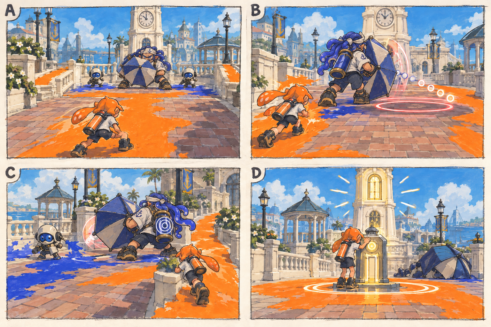

# 스테이지 1-3 — 광장의 통행금지

- [x] 장면·목표·동선·등장 적·보상을 상세화한다.
- [x] 러프 장면판을 생성하고 장면 설명과 대조한다.
- [x] 연결 링크와 기획 수치를 검토한다.

[전체 기획과 목차](../../싱글플레이-PvE-캠페인-기획-2.md) · [플레이 규칙](../systems/게임플레이-상세-24.md) · [그림 범례](../일러스트-시각설계-29.md)

이 문서는 추가할 캠페인의 기획이다. 아래 그림은 기획용 러프이며 실제 구현 화면이 아니다. 기존 지도 이미지와 구분해 읽는다. 좌표·엄폐 위치·적 수·체력·시간은 실제 맵과 플레이 검증 후 조정할 초기값이다.

## 1. 이 임무에서 경험하는 것

정면을 막는 우산 대장에게 도색한 측면 통로로 접근해 첫 보스의 빈틈을 읽는 임무이다.

| 항목 | 내용 |
|---|---|
| 지역과 시간대 | 타이드워터 광장, 낮 / 지도 ID: tidewater이다. |
| 유형 | 스테이지 보스 임무이다. |
| 예상 시간 | 6~9분을 초기 목표로 한다. |
| 주 목표 | 통행대장 바리를 제압하고 중앙 통신 장치를 정상화한다. |
| 권장 행동 | 한쪽 길만 칠하지 말고 보스가 보는 방향의 반대쪽으로 바꿔 이동한다. 보스 뒤 표식은 낮게 두어 롤러도 닿게 한다. |
| 완료 후 변화 | 크로스로드 시장과 보스 서명 모듈 복구자의 표식을 확정 해금한다. |

## 2. 네 장면으로 보는 플레이

> 그림 검수: 우산 대장을 기존 캐릭터 체형으로 수정하고 전면 방패·후방 약점·측면 접근·복구 단말을 확인했다. B의 구슬 모양은 발사 방향을 나타내는 러프 예고이며 별도 공격을 추가하지 않는다.

장면판은 왼쪽 위 A → 오른쪽 위 B → 왼쪽 아래 C → 오른쪽 아래 D 순서로 읽는다. 화살표는 플레이어의 선택 동선이며, 반투명 위험선·원은 공격 전 예고이다. 작은 문자와 수치보다 아래의 설명을 기준으로 해석한다.

| 그림 | 읽어야 할 행동 |
|---|---|
| A — 통행 금지선 | 입장 전 바닥을 칠하고 양쪽 회피 동선을 읽는다. |
| B — 방패를 기다리는 순간 | 정면에서 짧게 압박한 뒤 펼친 방패의 반대쪽으로 이동한다. |
| C — 빼앗기는 퇴로 | 지원 적을 빠르게 처리하거나 다른 쪽 길을 칠해 후방으로 들어간다. |
| D — 첫 번째 해제 | 중앙 단말을 가동하고 작업장으로 돌아간다. |

## 3. 기존 배경과 공간 구성

위 이미지는 기존 게임의 배경 참고이다. 신규 목표·적·장치의 배치를 확정한 사진이 아니다. 큰 지형과 건물·선박·소품을 재사용하고 아래 관계에 맞는 실제 공간을 선택한다.

| 표식 | 위치의 역할 |
|---|---|
| S | 정자 쪽 진입 구역 |
| A | 전투장 앞 장비 정비 표식 |
| CP | 보스장 바깥 벤치 |
| B | 시계탑 기단 앞 넓은 전투장 |
| X | 전투장 좌우의 짧은 도색 우회로 |
| E | 보스 후방 중앙 단말 |

**주 경로:** S → A·CP → B → 중앙 단말 E이다.

**다른 선택:** B에서 왼쪽 또는 오른쪽 난간 통로로 우회한다. 별도 선택 상자는 없다.

통로 폐쇄는 시각 표식과 임무 구역 경계로 표현한다. 점프나 무기 이동기로 우연히 뒤 구역에 도착해도 순서를 건너뛰어 완료되지 않게 하며, 플레이어가 막혔다면 되돌아갈 수 있는 경로를 남긴다.

## 4. 목표와 진행 조건

보스가 발사한 방패를 피하고 후방 약점·방패 회수 빈틈을 공격한다. 제압 후 E에 2초 접근한다.

- 화면에는 현재 수행할 목표 하나를 우선 표시하고 완료한 목표는 작은 체크로 남긴다.
- 필수 장치와 적은 지도·화면 양쪽에서 식별할 수 있게 한다. 선택 보상은 별표로 구분한다.
- 장치 접근 가동은 별도 조작키 없이 범위 안에서 2초 머무르는 방식이다. 위험을 피하려고 나가면 즉시 중단한다.
- 특정 주 무기만 닿는 필수 표적을 만들지 않는다. 직접 공격이 어려우면 접근 가능한 낮은 표적이나 경로를 제공한다.

## 5. 장면별 상세 플레이

### A. 통행 금지선

시계탑 앞에 우산 대장과 낮은 난간 양쪽 길이 함께 보인다.

| 구분 | 장면 안에서 일어나는 일 |
|---|---|
| 플레이어 행동 | 입장 전 바닥을 칠하고 양쪽 회피 동선을 읽는다. |
| 적과 기믹 | 진입 사격병 2명만 배치한다. 보스 공격은 아직 시작하지 않는다. |
| 화면·소리의 전달 | 보스 예고와 장비 변경 표식을 표시한다. |
| 다음 장면으로 가는 조건 | 진입 적 정리와 CP 확인 뒤 전투장으로 들어간다. |

### B. 방패를 기다리는 순간

대장이 우산을 펼쳐 정면을 막고 주황 잉크 길이 양옆으로 뻗는다.

| 구분 | 장면 안에서 일어나는 일 |
|---|---|
| 플레이어 행동 | 정면에서 짧게 압박한 뒤 펼친 방패의 반대쪽으로 이동한다. |
| 적과 기믹 | 우산 전개 → 느린 전진 → 방패 발사 순서이다. |
| 화면·소리의 전달 | 방패 발사 전 1초 예고와 뒤쪽 원형 약점 표시를 보여 준다. |
| 다음 장면으로 가는 조건 | 방패를 발사하면 3초 노출 시간이 시작된다. |

### C. 빼앗기는 퇴로

보스가 반대쪽으로 방향을 돌리고 도색병이 한 번 출현한다.

| 구분 | 장면 안에서 일어나는 일 |
|---|---|
| 플레이어 행동 | 지원 적을 빠르게 처리하거나 다른 쪽 길을 칠해 후방으로 들어간다. |
| 적과 기믹 | 체력 절반에서 도색병 1명을 최대 두 번의 고정 이벤트로 부른다. |
| 화면·소리의 전달 | 지원 방향과 보스 약점 노출 남은 시간을 함께 표시한다. |
| 다음 장면으로 가는 조건 | 보스를 제압하면 공격과 지원 출현을 모두 멈춘다. |

### D. 첫 번째 해제

우산이 접히고 시계탑의 통신등이 밝아진다.

| 구분 | 장면 안에서 일어나는 일 |
|---|---|
| 플레이어 행동 | 중앙 단말을 가동하고 작업장으로 돌아간다. |
| 적과 기믹 | 추가 적은 없다. |
| 화면·소리의 전달 | 복구자의 표식과 다음 지역 해금을 보상 카드로 보여 준다. |
| 다음 장면으로 가는 조건 | E 가동과 완료 대화 뒤 결과 화면으로 간다. |

## 6. 핵심 적의 공략

**통행대장 바리 / 인간형 스테이지 보스**이다. 초기 체력 1800, 본전투 90~150초를 목표로 조정한다.

1. 우산 방어 중에는 정면 효율이 낮지만 일반 공격으로도 피해를 줄 수 있다.
2. 방패 발사 후 3초 동안 후방 표식이 열리며 접근·정밀 공격 모두 효과적이다.
3. 체력 50% 이하에서 좌우 우회로를 번갈아 압박하고 도색병 지원을 두 번만 배치한다.

한쪽 길만 칠하지 말고 보스가 보는 방향의 반대쪽으로 바꿔 이동한다. 보스 뒤 표식은 낮게 두어 롤러도 닿게 한다.

예고는 최소 0.9초를 기본으로 하고 장면에 따로 정한 값이 더 길면 그 값을 사용한다. 재정비 중에는 예고 없이 즉시 반격하지 않는다. 정해진 지원 출현을 소진한 뒤에는 추가 소환이 반복되지 않는다.

## 7. 대사와 이야기의 변화

**입장 통신:** 바리: 통행 기록을 초기화한다. 모라: 앞을 막는 것만 보고 멈추지 마. 네가 길을 만들 수 있어.

**완료 통신:** 틸: 시장에서 응답이 온다. 이번에는 사람의 목소리다.

전투 중 긴 대사는 하지 않는다. 공격 예고가 시작되면 통신 자막을 미루며, 완료 대화는 건너뛰고 기록 창에서 다시 읽을 수 있다.

## 8. 보상과 다음 임무

| 항목 | 지급 규칙 |
|---|---|
| 첫 완료 경험치 | 기본 반복분과 첫 완료 추가분을 합해 600이다. |
| 반복 완료 경험치 | 180이다. |
| 첫 완료 부품 | 기본 60 + 첫 완료 추가 20 = 80개이다. |
| 반복 완료 부품 | 60개이다. |
| 완료 모듈 | 무작위 모듈 1개이다. |
| 공명핵 | 완료마다 1개이다. |
| 추가 보상 | 첫 완료에 복구자의 표식 1개를 확정 지급한다. 선택 상자는 없다. |
| 파밍 계열 | 목표 작업·기초 생존 계열이다. |

크로스로드 시장과 보스 서명 모듈 복구자의 표식을 확정 해금한다.

전투 중 보상은 현재 임무의 미확정 목록에 저장하고 완료 화면에서 확정한다. 실패·재시작으로 같은 상자의 모듈을 재추첨하지 않는다. 경험치·부품은 적 처치 횟수만으로 별도 증가하지 않는다.

## 9. 체크포인트와 재도전

보스 입장 직전에 저장한다. 재도전은 연출을 짧게 건너뛸 수 있다.

사망 시 보스·지원 횟수·전투장 잉크를 초기화한다. 진입 전투와 대사는 반복하지 않는다.

체크포인트 대기에서는 장비와 특성을 바꿀 수 있다. 체력·잉크는 채우고 스페셜은 저장된 구간 시작값으로 복원한다. 현재 구간의 적·장치·임무용 잉크는 함께 복원하며, 공격 중인 적 앞에 바로 플레이어를 놓지 않는다.

## 10. 일러스트와 실제 제작의 경계

- 배경의 중심 실루엣은 기존 타이드워터 광장의 건물·소품을 따른다.
- 플레이어는 주황 잉크, 잔향 적은 코발트색 잉크로 시안을 통일한다. 실제 게임에서는 팀 팔레트와 색각 설정을 적용한다.
- 목표는 흰 이중 원, 선택 상자는 별, 공격 위험은 사선·원 테두리로 구분한다. 색 하나만으로 의미를 전달하지 않는다.
- 그림의 빛나는 표식·상호작용·임무 순서·개별 AI는 추가 기획이다. 현재 게임에서 이미 동작하는 기능이라고 해석하지 않는다.
- 이미지가 설명과 다르게 생성한 작은 장식·문자·문 개폐는 필수 기능으로 추가하지 않는다. 장면의 행동·공간 관계를 우선한다.

[그림 생성 지시서](../그림-생성-프롬프트-30.md) · [아이템](../systems/아이템-상세-26.md) · [성장](../systems/성장-상세-27.md) · [파밍](../systems/파밍과-보상-상세-28.md)
