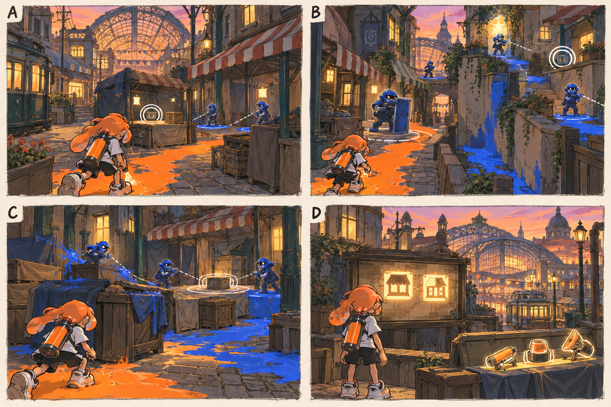

# 스테이지 2-1 — 비어 있는 가판대

- [x] 장면·목표·동선·등장 적·보상을 상세화한다.
- [x] 러프 장면판을 생성하고 장면 설명과 대조한다.
- [x] 연결 링크와 기획 수치를 검토한다.

[전체 기획과 목차](../../싱글플레이-PvE-캠페인-기획-2.md) · [플레이 규칙](../systems/게임플레이-상세-24.md) · [그림 범례](../일러스트-시각설계-29.md)

이 문서는 추가할 캠페인의 기획이다. 아래 그림은 기획용 러프이며 실제 구현 화면이 아니다. 기존 지도 이미지와 구분해 읽는다. 좌표·엄폐 위치·적 수·체력·시간은 실제 맵과 플레이 검증 후 조정할 초기값이다.

## 1. 이 임무에서 경험하는 것

좁은 골목의 가까운 위험 경로와 시장 외곽의 안전 경로 중 하나를 택하며 기록을 회수하는 탐색 임무이다.

| 항목 | 내용 |
|---|---|
| 지역과 시간대 | 크로스로드 시장, 해질녘 / 지도 ID: crossmarket이다. |
| 유형 | 일반 목표 진행 임무이다. |
| 예상 시간 | 9~12분을 초기 목표로 한다. |
| 주 목표 | 필수 거래 기록함 2개를 회수하고 시장홀 입구로 이동한다. |
| 권장 행동 | A 뒤의 좁은 벽타기 통로 → X → B 측면 |
| 완료 후 변화 | 쌍권총·브러시·우산을 확정 해금한다. |

## 2. 네 장면으로 보는 플레이

> 그림 검수: 유리 시장홀·전차·차양, 정면 방패와 외곽 높이차, 기록함 방어와 완료 지도를 확인했다. B는 두 후보 경로의 배치 개요이며 실제 활성은 선택 경로만 적용한다. D의 무기 실루엣은 해금 안내이며 현장 추가 드롭이 아니다.

장면판은 왼쪽 위 A → 오른쪽 위 B → 왼쪽 아래 C → 오른쪽 아래 D 순서로 읽는다. 화살표는 플레이어의 선택 동선이며, 반투명 위험선·원은 공격 전 예고이다. 작은 문자와 수치보다 아래의 설명을 기준으로 해석한다.

| 그림 | 읽어야 할 행동 |
|---|---|
| A — 켜진 창문, 빈 골목 | 가까운 적을 확인하고 A의 가판대를 향해 잉크 길을 만든다. |
| B — 차양 뒤를 고르는 길 | 방패 발사를 기다리거나 외곽의 높이 차이를 이용한다. |
| C — 기록함의 작은 방어전 | 도색병을 먼저 처리해 기록함 가동 원에 안전한 공간을 만든다. |
| D — 시장 지도에 돌아온 이름 | 남은 선택 상자를 확인하거나 곧바로 E로 간다. |

## 3. 기존 배경과 공간 구성

위 이미지는 기존 게임의 배경 참고이다. 신규 목표·적·장치의 배치를 확정한 사진이 아니다. 큰 지형과 건물·선박·소품을 재사용하고 아래 관계에 맞는 실제 공간을 선택한다.

| 표식 | 위치의 역할 |
|---|---|
| S | 줄무늬 차양 골목 입구 |
| A | 왼쪽 작은 가판대의 필수 기록 |
| CP | 전차 정류장 옆 안전 구역 |
| B | 시장홀 측면 두 번째 기록 |
| X | 지붕 아래 선택 보관함 |
| E | 시장홀 앞 통신 표식 |

**주 경로:** S → A → 전차 옆 CP → B → E이다.

**다른 선택:** A 뒤의 좁은 벽타기 통로 → X → B 측면

통로 폐쇄는 시각 표식과 임무 구역 경계로 표현한다. 점프나 무기 이동기로 우연히 뒤 구역에 도착해도 순서를 건너뛰어 완료되지 않게 하며, 플레이어가 막혔다면 되돌아갈 수 있는 경로를 남긴다.

## 4. 목표와 진행 조건

두 기록함은 주변의 지정 경계 적을 정리한 뒤 2초 접근해 연다. 선택 기록함 X는 필수 목표와 별도이다.

- 화면에는 현재 수행할 목표 하나를 우선 표시하고 완료한 목표는 작은 체크로 남긴다.
- 필수 장치와 적은 지도·화면 양쪽에서 식별할 수 있게 한다. 선택 보상은 별표로 구분한다.
- 장치 접근 가동은 별도 조작키 없이 범위 안에서 2초 머무르는 방식이다. 위험을 피하려고 나가면 즉시 중단한다.
- 특정 주 무기만 닿는 필수 표적을 만들지 않는다. 직접 공격이 어려우면 접근 가능한 낮은 표적이나 경로를 제공한다.

## 5. 장면별 상세 플레이

### A. 켜진 창문, 빈 골목

노을의 유리 시장홀을 배경으로 닫힌 가판대와 두 갈래 골목이 보인다.

| 구분 | 장면 안에서 일어나는 일 |
|---|---|
| 플레이어 행동 | 가까운 적을 확인하고 A의 가판대를 향해 잉크 길을 만든다. |
| 적과 기믹 | 사격병 2명이 차양 아래에서 번갈아 쏜다. |
| 화면·소리의 전달 | 기록 0/2, 선택 상자는 별표로 표시한다. |
| 다음 장면으로 가는 조건 | A를 열면 전차 뒤 체크포인트를 안내한다. |

### B. 차양 뒤를 고르는 길

짧은 정면에는 방패병, 긴 외곽에는 사격병과 칠할 벽이 보인다.

| 구분 | 장면 안에서 일어나는 일 |
|---|---|
| 플레이어 행동 | 방패 발사를 기다리거나 외곽의 높이 차이를 이용한다. |
| 적과 기믹 | 선택한 갈림길에만 경계 적을 우선 활성화한다. |
| 화면·소리의 전달 | 주 목표와 선택 보관함의 거리·방향을 분리한다. |
| 다음 장면으로 가는 조건 | CP에 도달하면 이미 회수한 기록을 저장한다. |

### C. 기록함의 작은 방어전

B를 둘러싼 파란 잉크와 빈 가판대가 엄폐를 만든다.

| 구분 | 장면 안에서 일어나는 일 |
|---|---|
| 플레이어 행동 | 도색병을 먼저 처리해 기록함 가동 원에 안전한 공간을 만든다. |
| 적과 기믹 | 도색병 1명·사격병 2명이다. 추가 웨이브는 없다. |
| 화면·소리의 전달 | 경계 적 3/3 정리 뒤 가동 표시가 열린다. |
| 다음 장면으로 가는 조건 | B를 열면 E로 귀환할 수 있다. |

### D. 시장 지도에 돌아온 이름

단말의 가게 아이콘 두 개가 다시 켜지고 멀리 유리 지붕이 반짝인다.

| 구분 | 장면 안에서 일어나는 일 |
|---|---|
| 플레이어 행동 | 남은 선택 상자를 확인하거나 곧바로 E로 간다. |
| 적과 기믹 | 완료 적 재출현은 없다. |
| 화면·소리의 전달 | 새 무기 3종과 다음 목표를 보여 준다. |
| 다음 장면으로 가는 조건 | E 진입으로 완료한다. |

## 6. 적 배치와 난도

- A 구간: 사격병 2명이 차양 아래에서 번갈아 쏜다.
- B 구간: 선택한 갈림길에만 경계 적을 우선 활성화한다.
- C 구간: 도색병 1명·사격병 2명이다. 추가 웨이브는 없다.
- D 구간: 완료 적 재출현은 없다.

적의 단순 체력보다 사선·높이·도색 역할로 난도를 만든다. 사격병은 짧은 연사 뒤 0.8초 이상의 정비 시간을 제공한다. 감시병은 방향과 발사 시간을 먼저 알리고, 보스가 아닌 일반 적은 쓰러지면 이 구간에서 다시 출현하지 않는다.

## 7. 대사와 이야기의 변화

**입장 통신:** 틸: 다들 대피했지만 돌아갈 자리를 증명할 기록이 사라졌다. 가게가 있었다는 흔적부터 되찾자.

**완료 통신:** 모라: 문이 닫힌 게 아니라 주소가 지워졌던 거야. 틸: 다음 신호는 유리 지붕 위에서 온다.

전투 중 긴 대사는 하지 않는다. 공격 예고가 시작되면 통신 자막을 미루며, 완료 대화는 건너뛰고 기록 창에서 다시 읽을 수 있다.

**선택 기록 — 빈 가게의 영수증:** 회수 목록에는 버려진 물건으로 분류되었지만 영수증 뒷면에는 돌아올 날짜가 적혀 있다.

선택 기록은 이 일반 임무의 선택 상자 하나와 함께 배치한다. 필수 회수 자료와 다른 수집물이며 엔딩 진입 조건으로 요구하지 않는다.

## 8. 보상과 다음 임무

| 항목 | 지급 규칙 |
|---|---|
| 첫 완료 경험치 | 기본 반복분과 첫 완료 추가분을 합해 600이다. |
| 반복 완료 경험치 | 120이다. |
| 첫 완료 부품 | 기본 40 + 첫 완료 추가 20 = 60개이다. |
| 반복 완료 부품 | 40개이다. |
| 완료 모듈 | 무작위 모듈 1개이다. |
| 공명핵 | 기본 완료에서는 지급하지 않는다. |
| 추가 보상 | 선택 상자 완료 시 무작위 모듈 1개·부품 10개·선택 기록 1개를 추가한다. |
| 파밍 계열 | 장치 공격·약점 계열이다. |

쌍권총·브러시·우산을 확정 해금한다.

전투 중 보상은 현재 임무의 미확정 목록에 저장하고 완료 화면에서 확정한다. 실패·재시작으로 같은 상자의 모듈을 재추첨하지 않는다. 경험치·부품은 적 처치 횟수만으로 별도 증가하지 않는다.

## 9. 체크포인트와 재도전

A 회수 후와 B 근처의 전차 뒤에서 저장한다.

기록을 들고 달리는 운반 상태는 없다. 실패 시 마지막 체크포인트 이후 구간만 되돌리고 앞서 회수한 필수 기록은 유지한다.

체크포인트 대기에서는 장비와 특성을 바꿀 수 있다. 체력·잉크는 채우고 스페셜은 저장된 구간 시작값으로 복원한다. 현재 구간의 적·장치·임무용 잉크는 함께 복원하며, 공격 중인 적 앞에 바로 플레이어를 놓지 않는다.

## 10. 일러스트와 실제 제작의 경계

- 배경의 중심 실루엣은 기존 크로스로드 시장의 건물·소품을 따른다.
- 플레이어는 주황 잉크, 잔향 적은 코발트색 잉크로 시안을 통일한다. 실제 게임에서는 팀 팔레트와 색각 설정을 적용한다.
- 목표는 흰 이중 원, 선택 상자는 별, 공격 위험은 사선·원 테두리로 구분한다. 색 하나만으로 의미를 전달하지 않는다.
- 그림의 빛나는 표식·상호작용·임무 순서·개별 AI는 추가 기획이다. 현재 게임에서 이미 동작하는 기능이라고 해석하지 않는다.
- 이미지가 설명과 다르게 생성한 작은 장식·문자·문 개폐는 필수 기능으로 추가하지 않는다. 장면의 행동·공간 관계를 우선한다.

[그림 생성 지시서](../그림-생성-프롬프트-30.md) · [아이템](../systems/아이템-상세-26.md) · [성장](../systems/성장-상세-27.md) · [파밍](../systems/파밍과-보상-상세-28.md)
