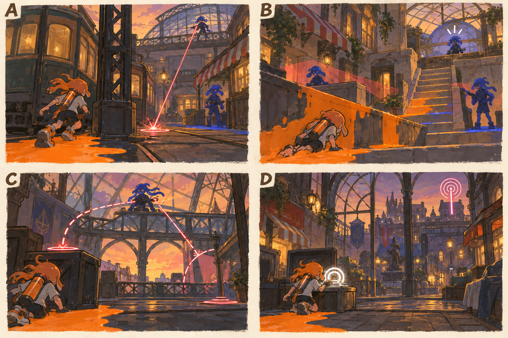

# 스테이지 2-2 — 유리 지붕의 감시자

- [x] 장면·목표·동선·등장 적·보상을 상세화한다.
- [x] 러프 장면판을 생성하고 장면 설명과 대조한다.
- [x] 연결 링크와 기획 수치를 검토한다.

[전체 기획과 목차](../../싱글플레이-PvE-캠페인-기획-2.md) · [플레이 규칙](../systems/게임플레이-상세-24.md) · [그림 범례](../일러스트-시각설계-29.md)

이 문서는 추가할 캠페인의 기획이다. 아래 그림은 기획용 러프이며 실제 구현 화면이 아니다. 기존 지도 이미지와 구분해 읽는다. 좌표·엄폐 위치·적 수·체력·시간은 실제 맵과 플레이 검증 후 조정할 초기값이다.

## 1. 이 임무에서 경험하는 것

높은 감시병의 사선을 엄폐로 끊으며 같은 높이를 차지하는 임무이다.

| 항목 | 내용 |
|---|---|
| 지역과 시간대 | 크로스로드 시장, 해질녘 / 지도 ID: crossmarket이다. |
| 유형 | 일반 진행과 중간보스 임무이다. |
| 예상 시간 | 10~13분을 초기 목표로 한다. |
| 주 목표 | 외곽 중계기 2개를 복구하고 유리눈 감시자를 제압해 지붕 송신기로 접근한다. |
| 권장 행동 | 엄폐를 한 번에 두 개씩 건너뛰지 않는다. 근접 무기는 같은 높이까지 접근할 수 있는 옆 벽을 이용한다. |
| 완료 후 변화 | 감시병 위험선과 발사 후 재정비 표식을 도움말에 추가한다. |

## 2. 네 장면으로 보는 플레이

> 그림 검수: 전차·기둥 엄폐, 도색 벽을 통한 높이 접근, 감시자의 두 사선과 기록 회수를 확인했다. C의 점선은 직전 사선의 잔상이며 두 발은 순차 발사한다. 재정비 시간은 본문을 따른다.

장면판은 왼쪽 위 A → 오른쪽 위 B → 왼쪽 아래 C → 오른쪽 아래 D 순서로 읽는다. 화살표는 플레이어의 선택 동선이며, 반투명 위험선·원은 공격 전 예고이다. 작은 문자와 수치보다 아래의 설명을 기준으로 해석한다.

| 그림 | 읽어야 할 행동 |
|---|---|
| A — 첫 사선 | 전차와 철골 기둥 사이를 짧게 이동한다. |
| B — 높이를 바꾸는 벽 | 계단을 차례로 오르거나 벽으로 잠수 이동해 CP에 도착한다. |
| C — 두 발 뒤의 빈틈 | 첫 발과 두 번째 발을 피한 뒤 긴 재정비에 접근한다. |
| D — 창 너머의 명령 | 통신 기록을 회수하고 다음 보스의 송신기 표식을 확인한다. |

## 3. 기존 배경과 공간 구성

위 이미지는 기존 게임의 배경 참고이다. 신규 목표·적·장치의 배치를 확정한 사진이 아니다. 큰 지형과 건물·선박·소품을 재사용하고 아래 관계에 맞는 실제 공간을 선택한다.

| 표식 | 위치의 역할 |
|---|---|
| S | 시장홀 서쪽 낮은 길 |
| A | 차양 기둥 뒤 첫 중계기 |
| CP | 철제 계단 중간의 안전한 플랫폼 |
| B | 유리 지붕 옆 감시 거점 |
| X | 반대 골목의 높은 선택 상자 |
| E | 정차 전차 위쪽 송신함 |

**주 경로:** S → A → 철골 엄폐 → CP → B → E이다.

**다른 선택:** CP → 옆 벽을 타고 X → B와 같은 높이의 측면

통로 폐쇄는 시각 표식과 임무 구역 경계로 표현한다. 점프나 무기 이동기로 우연히 뒤 구역에 도착해도 순서를 건너뛰어 완료되지 않게 하며, 플레이어가 막혔다면 되돌아갈 수 있는 경로를 남긴다.

## 4. 목표와 진행 조건

A와 계단 쪽 중계기를 순서대로 가동한다. 정예가 지키는 송신함은 감시자 제압 후 열린다.

- 화면에는 현재 수행할 목표 하나를 우선 표시하고 완료한 목표는 작은 체크로 남긴다.
- 필수 장치와 적은 지도·화면 양쪽에서 식별할 수 있게 한다. 선택 보상은 별표로 구분한다.
- 장치 접근 가동은 별도 조작키 없이 범위 안에서 2초 머무르는 방식이다. 위험을 피하려고 나가면 즉시 중단한다.
- 특정 주 무기만 닿는 필수 표적을 만들지 않는다. 직접 공격이 어려우면 접근 가능한 낮은 표적이나 경로를 제공한다.

## 5. 장면별 상세 플레이

### A. 첫 사선

유리 홀 위의 감시병과 바닥을 가르는 얇은 위험선이 보인다.

| 구분 | 장면 안에서 일어나는 일 |
|---|---|
| 플레이어 행동 | 전차와 철골 기둥 사이를 짧게 이동한다. |
| 적과 기믹 | 감시병 1명은 0.9초 조준 후 발사하고, 사격병 1명이 가까운 길을 지킨다. |
| 화면·소리의 전달 | 위험선 끝에 발사 직전 깜박임을 표시한다. |
| 다음 장면으로 가는 조건 | A 가동 후 다음 엄폐를 안내한다. |

### B. 높이를 바꾸는 벽

앞 계단은 사선에 노출되고 옆의 낮은 벽은 끊김 없이 칠할 수 있다.

| 구분 | 장면 안에서 일어나는 일 |
|---|---|
| 플레이어 행동 | 계단을 차례로 오르거나 벽으로 잠수 이동해 CP에 도착한다. |
| 적과 기믹 | 사격병 2명이며 감시병의 공격은 계단 뒤에서 가려진다. |
| 화면·소리의 전달 | 같은 높이가 되면 감시병의 방어가 약하다는 것을 보여 준다. |
| 다음 장면으로 가는 조건 | CP 활성화 뒤 정예 거점 문양이 켜진다. |

### C. 두 발 뒤의 빈틈

유리눈 감시자가 유리 골조 사이에서 차저를 든다.

| 구분 | 장면 안에서 일어나는 일 |
|---|---|
| 플레이어 행동 | 첫 발과 두 번째 발을 피한 뒤 긴 재정비에 접근한다. |
| 적과 기믹 | 정예 1명이다. 두 발의 예고 방향이 서로 같지 않지만 즉시 추적하지 않는다. |
| 화면·소리의 전달 | 두 번째 발 뒤 2.5초 재정비 아이콘을 표시한다. |
| 다음 장면으로 가는 조건 | 정예 제압 시 송신함이 열린다. |

### D. 창 너머의 명령

송신함의 반복 파형과 어두운 시장 중앙이 함께 보인다.

| 구분 | 장면 안에서 일어나는 일 |
|---|---|
| 플레이어 행동 | 통신 기록을 회수하고 다음 보스의 송신기 표식을 확인한다. |
| 적과 기믹 | 남은 전투는 없다. |
| 화면·소리의 전달 | 다음 임무의 활성 송신기 아이콘을 미리 보여 준다. |
| 다음 장면으로 가는 조건 | E 기록 회수로 완료한다. |

## 6. 핵심 적의 공략

**유리눈 감시자 / 감시 정예**이다. 초기 체력 380을 기준으로 조정한다.

1. 약 1초의 직선 조준 뒤 발사하며, 다음 조준은 이미 플레이어가 이동할 공간을 남긴다.
2. 두 번째 발 후 2.5초 동안 장비를 조정한다.
3. 체력 절반 이하에서도 사선 읽기 규칙은 유지하고 사격 위치만 한 번 바꾼다.

엄폐를 한 번에 두 개씩 건너뛰지 않는다. 근접 무기는 같은 높이까지 접근할 수 있는 옆 벽을 이용한다.

예고는 최소 0.9초를 기본으로 하고 장면에 따로 정한 값이 더 길면 그 값을 사용한다. 재정비 중에는 예고 없이 즉시 반격하지 않는다. 정해진 지원 출현을 소진한 뒤에는 추가 소환이 반복되지 않는다.

## 7. 대사와 이야기의 변화

**입장 통신:** 틸: 저 선을 따라 달리지 말고 선이 끊기는 곳을 찾아라. 유리는 투명하지만 골조는 네 편이다.

**완료 통신:** 아카이브: 보호 대상의 이름이 회수 대상에 덮어 쓰였다. 틸: 이 방송을 누가 계속 내보내는지 확인하자.

전투 중 긴 대사는 하지 않는다. 공격 예고가 시작되면 통신 자막을 미루며, 완료 대화는 건너뛰고 기록 창에서 다시 읽을 수 있다.

**선택 기록 — 유리 지붕의 점검표:** 사람의 이름을 읽어야 할 점검기가 색의 차이를 오염 등급으로만 기록하고 있었다.

선택 기록은 이 일반 임무의 선택 상자 하나와 함께 배치한다. 필수 회수 자료와 다른 수집물이며 엔딩 진입 조건으로 요구하지 않는다.

## 8. 보상과 다음 임무

| 항목 | 지급 규칙 |
|---|---|
| 첫 완료 경험치 | 기본 반복분과 첫 완료 추가분을 합해 600이다. |
| 반복 완료 경험치 | 120이다. |
| 첫 완료 부품 | 기본 40 + 첫 완료 추가 20 = 60개이다. |
| 반복 완료 부품 | 40개이다. |
| 완료 모듈 | 무작위 모듈 1개이다. |
| 공명핵 | 기본 완료에서는 지급하지 않는다. |
| 추가 보상 | 선택 상자 완료 시 무작위 모듈 1개·부품 10개·선택 기록 1개를 추가한다. |
| 파밍 계열 | 장치 공격·약점 계열이다. |

감시병 위험선과 발사 후 재정비 표식을 도움말에 추가한다.

전투 중 보상은 현재 임무의 미확정 목록에 저장하고 완료 화면에서 확정한다. 실패·재시작으로 같은 상자의 모듈을 재추첨하지 않는다. 경험치·부품은 적 처치 횟수만으로 별도 증가하지 않는다.

## 9. 체크포인트와 재도전

첫 중계기와 정예 전투 앞 플랫폼에서 저장한다.

사선에 맞고 떨어져도 처음부터 지붕 길을 다시 오르지 않는다. 정예 앞 CP에서 재시작한다.

체크포인트 대기에서는 장비와 특성을 바꿀 수 있다. 체력·잉크는 채우고 스페셜은 저장된 구간 시작값으로 복원한다. 현재 구간의 적·장치·임무용 잉크는 함께 복원하며, 공격 중인 적 앞에 바로 플레이어를 놓지 않는다.

## 10. 일러스트와 실제 제작의 경계

- 배경의 중심 실루엣은 기존 크로스로드 시장의 건물·소품을 따른다.
- 플레이어는 주황 잉크, 잔향 적은 코발트색 잉크로 시안을 통일한다. 실제 게임에서는 팀 팔레트와 색각 설정을 적용한다.
- 목표는 흰 이중 원, 선택 상자는 별, 공격 위험은 사선·원 테두리로 구분한다. 색 하나만으로 의미를 전달하지 않는다.
- 그림의 빛나는 표식·상호작용·임무 순서·개별 AI는 추가 기획이다. 현재 게임에서 이미 동작하는 기능이라고 해석하지 않는다.
- 이미지가 설명과 다르게 생성한 작은 장식·문자·문 개폐는 필수 기능으로 추가하지 않는다. 장면의 행동·공간 관계를 우선한다.

[그림 생성 지시서](../그림-생성-프롬프트-30.md) · [아이템](../systems/아이템-상세-26.md) · [성장](../systems/성장-상세-27.md) · [파밍](../systems/파밍과-보상-상세-28.md)
