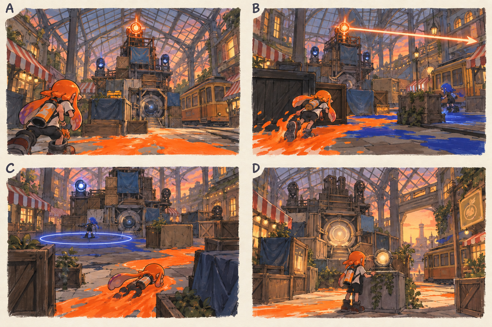

# 스테이지 2-3 — 시장의 마지막 방송

- [x] 장면·목표·동선·등장 적·보상을 상세화한다.
- [x] 러프 장면판을 생성하고 장면 설명과 대조한다.
- [x] 연결 링크와 기획 수치를 검토한다.

[전체 기획과 목차](../../싱글플레이-PvE-캠페인-기획-2.md) · [플레이 규칙](../systems/게임플레이-상세-24.md) · [그림 범례](../일러스트-시각설계-29.md)

이 문서는 추가할 캠페인의 기획이다. 아래 그림은 기획용 러프이며 실제 구현 화면이 아니다. 기존 지도 이미지와 구분해 읽는다. 좌표·엄폐 위치·적 수·체력·시간은 실제 맵과 플레이 검증 후 조정할 초기값이다.

## 1. 이 임무에서 경험하는 것

빛나는 송신기를 순서대로 꺼 중심핵을 여는 첫 고정 장치 보스전이다.

| 항목 | 내용 |
|---|---|
| 지역과 시간대 | 크로스로드 시장, 해질녘 / 지도 ID: crossmarket이다. |
| 유형 | 스테이지 보스 임무이다. |
| 예상 시간 | 7~10분을 초기 목표로 한다. |
| 주 목표 | 배전탑 오르골의 송신기 3개를 차례로 정지시키고 중심핵을 파괴한다. |
| 권장 행동 | 공격 중 핵만 쏘지 말고 활성 송신기를 끈다. 각 송신기는 낮은 받침대에 두어 모든 무기가 접근할 수 있다. |
| 완료 후 변화 | 켈프라인 터미널과 회수반 렌즈를 확정 해금한다. |

## 2. 네 장면으로 보는 플레이

> 그림 검수: 송신기 한 개만 활성화하고 C에서 광선을 제거해 원형 예고와 분리했다. 고정 탑·낮은 핵·엄폐·안전 통로·위험 해제를 확인했다. 핵 개방 후 공격과 송신기 순서는 본문을 따른다.

장면판은 왼쪽 위 A → 오른쪽 위 B → 왼쪽 아래 C → 오른쪽 아래 D 순서로 읽는다. 화살표는 플레이어의 선택 동선이며, 반투명 위험선·원은 공격 전 예고이다. 작은 문자와 수치보다 아래의 설명을 기준으로 해석한다.

| 그림 | 읽어야 할 행동 |
|---|---|
| A — 방송하는 기계 | 입구에서 현재 빛나는 송신기와 엄폐를 확인한다. |
| B — 한 줄의 위험 | 가로로 잉크 길을 만들고 광선 뒤에 송신기를 가동한다. |
| C — 두 방향 사이 | 원 밖으로 잠수 이동한 뒤 가까운 엄폐를 이용해 다음 송신기로 간다. |
| D — 목소리가 꺼진 시장 | E에서 배포 기록을 읽는다. |

## 3. 기존 배경과 공간 구성

위 이미지는 기존 게임의 배경 참고이다. 신규 목표·적·장치의 배치를 확정한 사진이 아니다. 큰 지형과 건물·선박·소품을 재사용하고 아래 관계에 맞는 실제 공간을 선택한다.

| 표식 | 위치의 역할 |
|---|---|
| S | 시장홀 앞 전차 정류장 |
| A | 세 송신기가 보이는 보스장 입구 |
| CP | 전차 후방 정비 구역 |
| B | 중앙 배전탑과 낮은 중심핵 |
| X | 좌·중·우 송신기 받침대 |
| E | 배전탑 후방 배포 기록함 |

**주 경로:** S → CP → 활성 송신기 1 → 2 → 3 → 중심핵 → E이다.

**다른 선택:** 각 송신기 사이의 엄폐를 기준으로 시계·반시계 방향을 자유롭게 고른다.

통로 폐쇄는 시각 표식과 임무 구역 경계로 표현한다. 점프나 무기 이동기로 우연히 뒤 구역에 도착해도 순서를 건너뛰어 완료되지 않게 하며, 플레이어가 막혔다면 되돌아갈 수 있는 경로를 남긴다.

## 4. 목표와 진행 조건

현재 활성 송신기 바닥을 60% 칠하고 2초 머무르면 중심핵이 열린다. 페이즈별로 다음 송신기가 켜진다. 이미 끈 송신기는 다시 켜지지 않는다.

- 화면에는 현재 수행할 목표 하나를 우선 표시하고 완료한 목표는 작은 체크로 남긴다.
- 필수 장치와 적은 지도·화면 양쪽에서 식별할 수 있게 한다. 선택 보상은 별표로 구분한다.
- 장치 접근 가동은 별도 조작키 없이 범위 안에서 2초 머무르는 방식이다. 위험을 피하려고 나가면 즉시 중단한다.
- 특정 주 무기만 닿는 필수 표적을 만들지 않는다. 직접 공격이 어려우면 접근 가능한 낮은 표적이나 경로를 제공한다.

## 5. 장면별 상세 플레이

### A. 방송하는 기계

시장홀 유리 지붕 아래 기존 펌프·상자를 엮은 탑과 송신기 3개가 보인다.

| 구분 | 장면 안에서 일어나는 일 |
|---|---|
| 플레이어 행동 | 입구에서 현재 빛나는 송신기와 엄폐를 확인한다. |
| 적과 기믹 | 탑은 고정되어 움직이지 않으며 중심핵이 낮은 위치에 있다. |
| 화면·소리의 전달 | 활성 송신기 1/3과 비활성 핵 아이콘을 표시한다. |
| 다음 장면으로 가는 조건 | 입장 후 첫 위험선이 1초 동안 예고된다. |

### B. 한 줄의 위험

활성 송신기에서 가느다란 광선 방향을 먼저 보여 준다.

| 구분 | 장면 안에서 일어나는 일 |
|---|---|
| 플레이어 행동 | 가로로 잉크 길을 만들고 광선 뒤에 송신기를 가동한다. |
| 적과 기믹 | 첫 단계는 광선 1개와 사격병 1명만 사용한다. |
| 화면·소리의 전달 | 광선 이동 방향과 안전한 엄폐 뒤 공간을 보여 준다. |
| 다음 장면으로 가는 조건 | 송신기 가동 후 중심핵이 8초간 열린다. |

### C. 두 방향 사이

두 번째·세 번째 송신기가 차례로 활성화되고 원형 위험 표시가 더해진다.

| 구분 | 장면 안에서 일어나는 일 |
|---|---|
| 플레이어 행동 | 원 밖으로 잠수 이동한 뒤 가까운 엄폐를 이용해 다음 송신기로 간다. |
| 적과 기믹 | 광선과 원형 공격은 교대로 실행하고 안전 통로 한 개 이상을 남긴다. |
| 화면·소리의 전달 | 이미 끈 송신기는 불빛과 소리가 사라진다. |
| 다음 장면으로 가는 조건 | 핵 노출과 공격을 반복해 핵을 파괴한다. |

### D. 목소리가 꺼진 시장

탑의 반복 파형이 멎고 가게 이름을 나타내는 작은 표시가 돌아온다.

| 구분 | 장면 안에서 일어나는 일 |
|---|---|
| 플레이어 행동 | E에서 배포 기록을 읽는다. |
| 적과 기믹 | 잔여 위험 효과를 즉시 해제한다. |
| 화면·소리의 전달 | 회수반 렌즈와 새 지역 연결을 표시한다. |
| 다음 장면으로 가는 조건 | 기록 확인 뒤 완료한다. |

## 6. 핵심 적의 공략

**배전탑 오르골 / 고정 장치 보스**이다. 중심핵 초기 체력 2400, 본전투 120~180초를 목표로 조정한다.

1. 첫 송신기는 직선 광선 하나만 사용해 가동법을 가르친다.
2. 두 번째는 지면 원형 공격을 사이에 끼우고 송신기 가동 뒤 8초 노출을 제공한다.
3. 세 번째는 두 방출점을 번갈아 사용한다. 세 송신기를 모두 끄면 핵은 계속 노출되어 장기 무적 반복을 막는다.

공격 중 핵만 쏘지 말고 활성 송신기를 끈다. 각 송신기는 낮은 받침대에 두어 모든 무기가 접근할 수 있다.

예고는 최소 0.9초를 기본으로 하고 장면에 따로 정한 값이 더 길면 그 값을 사용한다. 재정비 중에는 예고 없이 즉시 반격하지 않는다. 정해진 지원 출현을 소진한 뒤에는 추가 소환이 반복되지 않는다.

## 7. 대사와 이야기의 변화

**입장 통신:** 아카이브: 색상 편차를 제거한다. 틸: 방송의 주체는 사람이 아니었어. 신호를 하나씩 끊자.

**완료 통신:** 아카이브: 배포 경로—켈프라인. 모라: 명령이 배에 실려 들어왔다는 뜻이야.

전투 중 긴 대사는 하지 않는다. 공격 예고가 시작되면 통신 자막을 미루며, 완료 대화는 건너뛰고 기록 창에서 다시 읽을 수 있다.

## 8. 보상과 다음 임무

| 항목 | 지급 규칙 |
|---|---|
| 첫 완료 경험치 | 기본 반복분과 첫 완료 추가분을 합해 600이다. |
| 반복 완료 경험치 | 180이다. |
| 첫 완료 부품 | 기본 60 + 첫 완료 추가 20 = 80개이다. |
| 반복 완료 부품 | 60개이다. |
| 완료 모듈 | 무작위 모듈 1개이다. |
| 공명핵 | 완료마다 1개이다. |
| 추가 보상 | 첫 완료에 회수반 렌즈 1개를 확정 지급한다. 선택 상자는 없다. |
| 파밍 계열 | 장치 공격·약점 계열이다. |

켈프라인 터미널과 회수반 렌즈를 확정 해금한다.

전투 중 보상은 현재 임무의 미확정 목록에 저장하고 완료 화면에서 확정한다. 실패·재시작으로 같은 상자의 모듈을 재추첨하지 않는다. 경험치·부품은 적 처치 횟수만으로 별도 증가하지 않는다.

## 9. 체크포인트와 재도전

전차 뒤에서 저장한다. 본전투 실패 시 세 송신기와 핵 체력을 복원한다.

송신기의 마지막 가동이 끊겨도 바닥 도색률은 해당 시도 안에서 유지한다. 사망한 경우에는 보스장 시작 상태로 돌아간다.

체크포인트 대기에서는 장비와 특성을 바꿀 수 있다. 체력·잉크는 채우고 스페셜은 저장된 구간 시작값으로 복원한다. 현재 구간의 적·장치·임무용 잉크는 함께 복원하며, 공격 중인 적 앞에 바로 플레이어를 놓지 않는다.

## 10. 일러스트와 실제 제작의 경계

- 배경의 중심 실루엣은 기존 크로스로드 시장의 건물·소품을 따른다.
- 플레이어는 주황 잉크, 잔향 적은 코발트색 잉크로 시안을 통일한다. 실제 게임에서는 팀 팔레트와 색각 설정을 적용한다.
- 목표는 흰 이중 원, 선택 상자는 별, 공격 위험은 사선·원 테두리로 구분한다. 색 하나만으로 의미를 전달하지 않는다.
- 그림의 빛나는 표식·상호작용·임무 순서·개별 AI는 추가 기획이다. 현재 게임에서 이미 동작하는 기능이라고 해석하지 않는다.
- 이미지가 설명과 다르게 생성한 작은 장식·문자·문 개폐는 필수 기능으로 추가하지 않는다. 장면의 행동·공간 관계를 우선한다.

[그림 생성 지시서](../그림-생성-프롬프트-30.md) · [아이템](../systems/아이템-상세-26.md) · [성장](../systems/성장-상세-27.md) · [파밍](../systems/파밍과-보상-상세-28.md)
