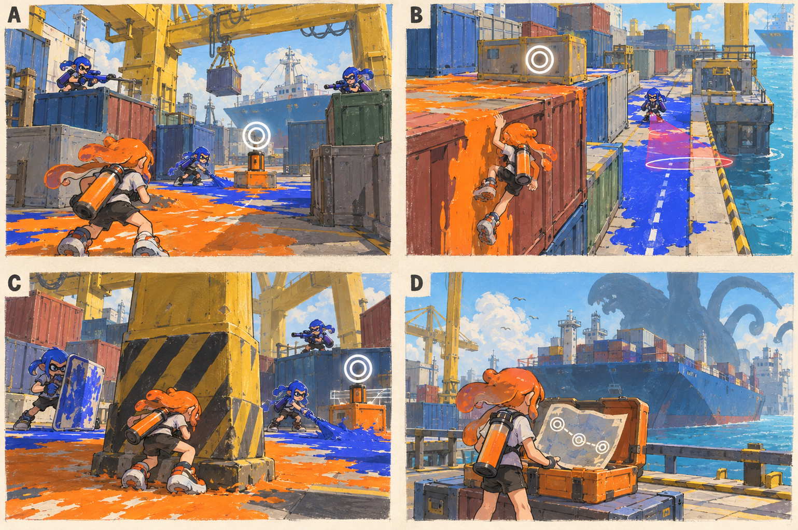

# 스테이지 3-1 — 목적지 없는 화물

- [x] 장면·목표·동선·등장 적·보상을 상세화한다.
- [x] 러프 장면판을 생성하고 장면 설명과 대조한다.
- [x] 연결 링크와 기획 수치를 검토한다.

[전체 기획과 목차](../../싱글플레이-PvE-캠페인-기획-2.md) · [플레이 규칙](../systems/게임플레이-상세-24.md) · [그림 범례](../일러스트-시각설계-29.md)

이 문서는 추가할 캠페인의 기획이다. 아래 그림은 기획용 러프이며 실제 구현 화면이 아니다. 기존 지도 이미지와 구분해 읽는다. 좌표·엄폐 위치·적 수·체력·시간은 실제 맵과 플레이 검증 후 조정할 초기값이다.

## 1. 이 임무에서 경험하는 것

컨테이너 사이의 교차로에서 세 중계점을 차례로 되살려 야적장을 관통하는 임무이다.

| 항목 | 내용 |
|---|---|
| 지역과 시간대 | 켈프라인 터미널, 낮 / 지도 ID: kelpline이다. |
| 유형 | 일반 목표 진행 임무이다. |
| 예상 시간 | 10~13분을 초기 목표로 한다. |
| 주 목표 | 화물 경로의 중계기 3개를 순서대로 복구하고 배포 서류를 회수한다. |
| 권장 행동 | A → 도색 가능한 컨테이너 옆면 → X → 두 번째 중계기 후방 |
| 완료 후 변화 | 블래스터·활·버킷을 확정 해금한다. |

## 2. 네 장면으로 보는 플레이

> 그림 검수: 노란 크레인·컨테이너·벽 접근·기둥 엄폐와 복구 지점 연결을 확인했다. C는 기둥에 가려진 적을 포함한 배치 개념으로 최대 활성 수 4명은 본문을 따른다. D의 큰 그림자는 보스의 존재만 알리는 비정형 예고이며 새 괴물 설계가 아니다.

장면판은 왼쪽 위 A → 오른쪽 위 B → 왼쪽 아래 C → 오른쪽 아래 D 순서로 읽는다. 화살표는 플레이어의 선택 동선이며, 반투명 위험선·원은 공격 전 예고이다. 작은 문자와 수치보다 아래의 설명을 기준으로 해석한다.

| 그림 | 읽어야 할 행동 |
|---|---|
| A — 노란 크레인 아래 | 우선 한 교차로를 칠해 시야와 잠수 퇴로를 만든다. |
| B — 화물 위의 우회 | 상자를 향해 오르거나 바닥 엄폐를 따라 바로 간다. |
| C — 기둥을 돌며 싸우기 | 기둥으로 둘의 시야를 분리하고 마지막 중계기를 복구한다. |
| D — 이어진 배포선 | 서류함을 열고 다음 적재 구역 신호를 확인한다. |

## 3. 기존 배경과 공간 구성

위 이미지는 기존 게임의 배경 참고이다. 신규 목표·적·장치의 배치를 확정한 사진이 아니다. 큰 지형과 건물·선박·소품을 재사용하고 아래 관계에 맞는 실제 공간을 선택한다.

| 표식 | 위치의 역할 |
|---|---|
| S | 노란 크레인 남쪽의 낮은 진입로 |
| A | 파란 컨테이너 교차로 첫 중계기 |
| CP | 두 번째 중계기 옆 창고 벽 |
| B | 크레인 기둥 아래 마지막 중계기 |
| X | 낮은 컨테이너 옥상의 선택 상자 |
| E | 선박 쪽 서류함 |

**주 경로:** S → A → 중계기 2·CP → B → E이다.

**다른 선택:** A → 도색 가능한 컨테이너 옆면 → X → 두 번째 중계기 후방

통로 폐쇄는 시각 표식과 임무 구역 경계로 표현한다. 점프나 무기 이동기로 우연히 뒤 구역에 도착해도 순서를 건너뛰어 완료되지 않게 하며, 플레이어가 막혔다면 되돌아갈 수 있는 경로를 남긴다.

## 4. 목표와 진행 조건

1·2·3번을 순차 가동한다. 완료한 지점은 영구 확보되어 뒤로 돌아가 지킬 필요가 없다.

- 화면에는 현재 수행할 목표 하나를 우선 표시하고 완료한 목표는 작은 체크로 남긴다.
- 필수 장치와 적은 지도·화면 양쪽에서 식별할 수 있게 한다. 선택 보상은 별표로 구분한다.
- 장치 접근 가동은 별도 조작키 없이 범위 안에서 2초 머무르는 방식이다. 위험을 피하려고 나가면 즉시 중단한다.
- 특정 주 무기만 닿는 필수 표적을 만들지 않는다. 직접 공격이 어려우면 접근 가능한 낮은 표적이나 경로를 제공한다.

## 5. 장면별 상세 플레이

### A. 노란 크레인 아래

큰 노란 크레인과 층진 컨테이너가 좁은 교차로를 만든다.

| 구분 | 장면 안에서 일어나는 일 |
|---|---|
| 플레이어 행동 | 우선 한 교차로를 칠해 시야와 잠수 퇴로를 만든다. |
| 적과 기믹 | 사격병 2명과 도색병 1명이다. |
| 화면·소리의 전달 | 중계기 0/3과 현재 지점만 강조한다. |
| 다음 장면으로 가는 조건 | A 가동 후 다음 구간 경계가 열린다. |

### B. 화물 위의 우회

낮은 컨테이너 옆면과 위쪽 선택 상자가 함께 보인다.

| 구분 | 장면 안에서 일어나는 일 |
|---|---|
| 플레이어 행동 | 상자를 향해 오르거나 바닥 엄폐를 따라 바로 간다. |
| 적과 기믹 | 감시병 1명이 긴 직선 구간을 보지만 높은 옆길은 덜 노출된다. |
| 화면·소리의 전달 | 낙하 위험 가장자리와 칠할 벽을 구분한다. |
| 다음 장면으로 가는 조건 | 두 번째 지점에 도착하면 그 지점 경계 적만 활성화한다. |

### C. 기둥을 돌며 싸우기

크레인 기둥 양쪽에서 방패병과 사격병이 등장한다.

| 구분 | 장면 안에서 일어나는 일 |
|---|---|
| 플레이어 행동 | 기둥으로 둘의 시야를 분리하고 마지막 중계기를 복구한다. |
| 적과 기믹 | 방패병 1명·사격병 2명·도색병 1명으로 최대 4명이다. |
| 화면·소리의 전달 | 완료한 지점은 지도에 체크 표시로 남는다. |
| 다음 장면으로 가는 조건 | 세 번째 중계기 가동 뒤 서류함으로 이동한다. |

### D. 이어진 배포선

세 지점이 지도로 연결되고 선박 너머에서 큰 그림자가 움직인다.

| 구분 | 장면 안에서 일어나는 일 |
|---|---|
| 플레이어 행동 | 서류함을 열고 다음 적재 구역 신호를 확인한다. |
| 적과 기믹 | 거대 보스는 배경 예고만 주며 아직 공격하지 않는다. |
| 화면·소리의 전달 | 새 무기 해금과 다음 임무를 표시한다. |
| 다음 장면으로 가는 조건 | E에서 기록을 받으면 완료한다. |

## 6. 적 배치와 난도

- A 구간: 사격병 2명과 도색병 1명이다.
- B 구간: 감시병 1명이 긴 직선 구간을 보지만 높은 옆길은 덜 노출된다.
- C 구간: 방패병 1명·사격병 2명·도색병 1명으로 최대 4명이다.
- D 구간: 거대 보스는 배경 예고만 주며 아직 공격하지 않는다.

적의 단순 체력보다 사선·높이·도색 역할로 난도를 만든다. 사격병은 짧은 연사 뒤 0.8초 이상의 정비 시간을 제공한다. 감시병은 방향과 발사 시간을 먼저 알리고, 보스가 아닌 일반 적은 쓰러지면 이 구간에서 다시 출현하지 않는다.

## 7. 대사와 이야기의 변화

**입장 통신:** 틸: 화물표에는 목적지가 비어 있어. 들어온 길부터 다시 연결해 보자.

**완료 통신:** 모라: 회수 명령이 배와 설비에 동시에 퍼졌어. 저 안쪽에 아직 움직이는 신호가 있다.

전투 중 긴 대사는 하지 않는다. 공격 예고가 시작되면 통신 자막을 미루며, 완료 대화는 건너뛰고 기록 창에서 다시 읽을 수 있다.

**선택 기록 — 목적지 없는 운송장:** 화물은 원래 도시로 돌아갈 정화 부품이었다. 누군가 목적지를 중앙 회수망으로 바꾸었다.

선택 기록은 이 일반 임무의 선택 상자 하나와 함께 배치한다. 필수 회수 자료와 다른 수집물이며 엔딩 진입 조건으로 요구하지 않는다.

## 8. 보상과 다음 임무

| 항목 | 지급 규칙 |
|---|---|
| 첫 완료 경험치 | 기본 반복분과 첫 완료 추가분을 합해 600이다. |
| 반복 완료 경험치 | 120이다. |
| 첫 완료 부품 | 기본 40 + 첫 완료 추가 20 = 60개이다. |
| 반복 완료 부품 | 40개이다. |
| 완료 모듈 | 무작위 모듈 1개이다. |
| 공명핵 | 기본 완료에서는 지급하지 않는다. |
| 추가 보상 | 선택 상자 완료 시 무작위 모듈 1개·부품 10개·선택 기록 1개를 추가한다. |
| 파밍 계열 | 보스 기절 공략 계열이다. |

블래스터·활·버킷을 확정 해금한다.

전투 중 보상은 현재 임무의 미확정 목록에 저장하고 완료 화면에서 확정한다. 실패·재시작으로 같은 상자의 모듈을 재추첨하지 않는다. 경험치·부품은 적 처치 횟수만으로 별도 증가하지 않는다.

## 9. 체크포인트와 재도전

첫 중계기와 두 번째 중계기 가동 후 저장한다.

뒤쪽 중계기는 이탈해도 빼앗기지 않는다. 물에 빠지면 마지막 중계기 CP에서 해당 구간만 재시작한다.

체크포인트 대기에서는 장비와 특성을 바꿀 수 있다. 체력·잉크는 채우고 스페셜은 저장된 구간 시작값으로 복원한다. 현재 구간의 적·장치·임무용 잉크는 함께 복원하며, 공격 중인 적 앞에 바로 플레이어를 놓지 않는다.

## 10. 일러스트와 실제 제작의 경계

- 배경의 중심 실루엣은 기존 켈프라인 터미널의 건물·소품을 따른다.
- 플레이어는 주황 잉크, 잔향 적은 코발트색 잉크로 시안을 통일한다. 실제 게임에서는 팀 팔레트와 색각 설정을 적용한다.
- 목표는 흰 이중 원, 선택 상자는 별, 공격 위험은 사선·원 테두리로 구분한다. 색 하나만으로 의미를 전달하지 않는다.
- 그림의 빛나는 표식·상호작용·임무 순서·개별 AI는 추가 기획이다. 현재 게임에서 이미 동작하는 기능이라고 해석하지 않는다.
- 이미지가 설명과 다르게 생성한 작은 장식·문자·문 개폐는 필수 기능으로 추가하지 않는다. 장면의 행동·공간 관계를 우선한다.

[그림 생성 지시서](../그림-생성-프롬프트-30.md) · [아이템](../systems/아이템-상세-26.md) · [성장](../systems/성장-상세-27.md) · [파밍](../systems/파밍과-보상-상세-28.md)
