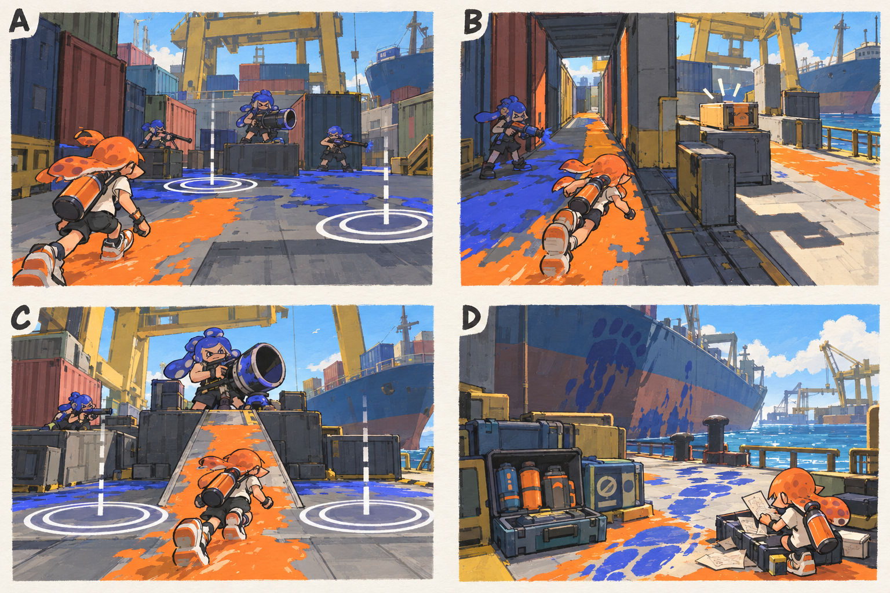

# 스테이지 3-2 — 적재 구역 봉쇄

- [x] 장면·목표·동선·등장 적·보상을 상세화한다.
- [x] 러프 장면판을 생성하고 장면 설명과 대조한다.
- [x] 연결 링크와 기획 수치를 검토한다.

[전체 기획과 목차](../../싱글플레이-PvE-캠페인-기획-2.md) · [플레이 규칙](../systems/게임플레이-상세-24.md) · [그림 범례](../일러스트-시각설계-29.md)

이 문서는 추가할 캠페인의 기획이다. 아래 그림은 기획용 러프이며 실제 구현 화면이 아니다. 기존 지도 이미지와 구분해 읽는다. 좌표·엄폐 위치·적 수·체력·시간은 실제 맵과 플레이 검증 후 조정할 초기값이다.

## 1. 이 임무에서 경험하는 것

낙하 예고와 좁은 안전 공간을 읽으며 포격 정예에게 접근하는 항만 전투이다.

| 항목 | 내용 |
|---|---|
| 지역과 시간대 | 켈프라인 터미널, 낮 / 지도 ID: kelpline이다. |
| 유형 | 일반 진행과 중간보스 임무이다. |
| 예상 시간 | 10~14분을 초기 목표로 한다. |
| 주 목표 | 화물 통로를 확보하고 봉쇄 기록을 회수한 뒤 적재장 포수를 제압한다. |
| 권장 행동 | 원을 보고 계속 뒤로만 물러나지 말고 원을 한쪽에 모은 뒤 옆으로 이동한다. 장전 중 낮은 경사로로 접근할 수 있다. |
| 완료 후 변화 | 거대 보스의 통 낙하와 위험 원형 표시를 미리 익힌다. |

## 2. 네 장면으로 보는 플레이

> 그림 검수: 시간차 낙하 원·안전한 우회·경사로 접근·정비 구간을 확인했다. 원 두 개는 낙하 순서의 개념 표시이며 본문의 시간차를 적용한다. D의 탱크는 장비 진열이며 소비형 회복약이 아니다.

장면판은 왼쪽 위 A → 오른쪽 위 B → 왼쪽 아래 C → 오른쪽 아래 D 순서로 읽는다. 화살표는 플레이어의 선택 동선이며, 반투명 위험선·원은 공격 전 예고이다. 작은 문자와 수치보다 아래의 설명을 기준으로 해석한다.

| 그림 | 읽어야 할 행동 |
|---|---|
| A — 첫 번째 낙하 원 | 원이 없는 바닥을 칠하고 경계 적에게 접근한다. |
| B — 안전 공간의 선택 | 빠르게 직선으로 지나가거나 우회 상자를 회수하고 넓은 엄폐로 간다. |
| C — 적재장 포수 | 첫 원과 두 번째 원을 피한 뒤 경사로로 접근해 장전 빈틈을 친다. |
| D — 껍질의 흔적 | 서류를 회수하고 거대 전투를 준비한다. |

## 3. 기존 배경과 공간 구성

위 이미지는 기존 게임의 배경 참고이다. 신규 목표·적·장치의 배치를 확정한 사진이 아니다. 큰 지형과 건물·선박·소품을 재사용하고 아래 관계에 맞는 실제 공간을 선택한다.

| 표식 | 위치의 역할 |
|---|---|
| S | 컨테이너 벽 안쪽 진입로 |
| A | 작은 포격 구역 앞 엄폐 |
| CP | 선박 아래 안전한 기둥 뒤 |
| B | 적재장 포수의 높은 받침대 |
| X | 반대편 컨테이너 골목의 선택 상자 |
| E | 포수 뒤 봉쇄 기록함 |

**주 경로:** S → A → CP → B의 낮은 접근 경사로 → E이다.

**다른 선택:** A → 컨테이너 뒤쪽 X → CP의 반대 엄폐

통로 폐쇄는 시각 표식과 임무 구역 경계로 표현한다. 점프나 무기 이동기로 우연히 뒤 구역에 도착해도 순서를 건너뛰어 완료되지 않게 하며, 플레이어가 막혔다면 되돌아갈 수 있는 경로를 남긴다.

## 4. 목표와 진행 조건

표시된 경계 적을 정리해 통로를 열고 기록을 회수한다. 정예를 제압하면 마지막 기록함이 열린다.

- 화면에는 현재 수행할 목표 하나를 우선 표시하고 완료한 목표는 작은 체크로 남긴다.
- 필수 장치와 적은 지도·화면 양쪽에서 식별할 수 있게 한다. 선택 보상은 별표로 구분한다.
- 장치 접근 가동은 별도 조작키 없이 범위 안에서 2초 머무르는 방식이다. 위험을 피하려고 나가면 즉시 중단한다.
- 특정 주 무기만 닿는 필수 표적을 만들지 않는다. 직접 공격이 어려우면 접근 가능한 낮은 표적이나 경로를 제공한다.

## 5. 장면별 상세 플레이

### A. 첫 번째 낙하 원

컨테이너 사이 바닥에 원 두 개가 시간차로 생긴다.

| 구분 | 장면 안에서 일어나는 일 |
|---|---|
| 플레이어 행동 | 원이 없는 바닥을 칠하고 경계 적에게 접근한다. |
| 적과 기믹 | 포격병 1명·사격병 2명이다. 원은 플레이어의 이전 위치에 떨어진다. |
| 화면·소리의 전달 | 원 테두리에서 안쪽으로 줄어드는 시간을 표시한다. |
| 다음 장면으로 가는 조건 | 경계 적을 정리하면 CP 방향이 열린다. |

### B. 안전 공간의 선택

좁은 직선 통로와 기둥 뒤 넓은 엄폐 길이 갈라진다.

| 구분 | 장면 안에서 일어나는 일 |
|---|---|
| 플레이어 행동 | 빠르게 직선으로 지나가거나 우회 상자를 회수하고 넓은 엄폐로 간다. |
| 적과 기믹 | 추가 도색병 1명이 퇴로를 칠한다. |
| 화면·소리의 전달 | 주 목표 경로 한 개는 항상 낙하 범위 밖에 남긴다. |
| 다음 장면으로 가는 조건 | 필수 기록 회수 후 정예 CP를 켠다. |

### C. 적재장 포수

낮은 받침대 위 정예가 통을 준비하고 바닥 두 곳을 차례로 지정한다.

| 구분 | 장면 안에서 일어나는 일 |
|---|---|
| 플레이어 행동 | 첫 원과 두 번째 원을 피한 뒤 경사로로 접근해 장전 빈틈을 친다. |
| 적과 기믹 | 포격 정예 1명이며 지원 사격병 1명을 한 번만 부른다. |
| 화면·소리의 전달 | 통 두 개 후 3초의 재장전 표식을 보여 준다. |
| 다음 장면으로 가는 조건 | 정예를 제압하면 낙하와 잔여 위험을 멈춘다. |

### D. 껍질의 흔적

봉쇄 기록과 거대한 발자국이 선박 쪽으로 이어진다.

| 구분 | 장면 안에서 일어나는 일 |
|---|---|
| 플레이어 행동 | 서류를 회수하고 거대 전투를 준비한다. |
| 적과 기믹 | 추가 전투 없이 정비 표식을 보여 준다. |
| 화면·소리의 전달 | 물약 대신 장비와 특성 변경으로 준비하도록 안내한다. |
| 다음 장면으로 가는 조건 | E 회수로 완료한다. |

## 6. 핵심 적의 공략

**적재장 포수 / 포격 정예**이다. 초기 체력 480을 기준으로 조정한다.

1. 1초 예고 뒤 이전 위치에 통 두 개를 시간차로 낙하시킨다.
2. 통을 던진 뒤 3초 동안 장전한다. 가까이 접근해도 즉시 다른 공격으로 취소하지 않는다.
3. 절반 체력에서 사격병 1명을 한 번 부르되 같은 안전 경로를 남긴다.

원을 보고 계속 뒤로만 물러나지 말고 원을 한쪽에 모은 뒤 옆으로 이동한다. 장전 중 낮은 경사로로 접근할 수 있다.

예고는 최소 0.9초를 기본으로 하고 장면에 따로 정한 값이 더 길면 그 값을 사용한다. 재정비 중에는 예고 없이 즉시 반격하지 않는다. 정해진 지원 출현을 소진한 뒤에는 추가 소환이 반복되지 않는다.

## 7. 대사와 이야기의 변화

**입장 통신:** 틸: 바닥에 찍히는 원을 봐. 떨어지는 것을 쫓지 말고 네가 설 자리를 먼저 만들어.

**완료 통신:** 모라: 포격 장치의 신호가 전부 한 껍질로 모인다. 살아 있는 걸 장비처럼 쓰고 있어.

전투 중 긴 대사는 하지 않는다. 공격 예고가 시작되면 통신 자막을 미루며, 완료 대화는 건너뛰고 기록 창에서 다시 읽을 수 있다.

**선택 기록 — 정화 대상 목록의 생물:** 계측기가 생명 반응을 장비의 진동으로 분류했다. 큰 껍질 안에는 아직 살아 있는 심장이 있다.

선택 기록은 이 일반 임무의 선택 상자 하나와 함께 배치한다. 필수 회수 자료와 다른 수집물이며 엔딩 진입 조건으로 요구하지 않는다.

## 8. 보상과 다음 임무

| 항목 | 지급 규칙 |
|---|---|
| 첫 완료 경험치 | 기본 반복분과 첫 완료 추가분을 합해 600이다. |
| 반복 완료 경험치 | 120이다. |
| 첫 완료 부품 | 기본 40 + 첫 완료 추가 20 = 60개이다. |
| 반복 완료 부품 | 40개이다. |
| 완료 모듈 | 무작위 모듈 1개이다. |
| 공명핵 | 기본 완료에서는 지급하지 않는다. |
| 추가 보상 | 선택 상자 완료 시 무작위 모듈 1개·부품 10개·선택 기록 1개를 추가한다. |
| 파밍 계열 | 보스 기절 공략 계열이다. |

거대 보스의 통 낙하와 위험 원형 표시를 미리 익힌다.

전투 중 보상은 현재 임무의 미확정 목록에 저장하고 완료 화면에서 확정한다. 실패·재시작으로 같은 상자의 모듈을 재추첨하지 않는다. 경험치·부품은 적 처치 횟수만으로 별도 증가하지 않는다.

## 9. 체크포인트와 재도전

통로 확보 뒤와 포수 전투 직전에 저장한다.

낙하 피해로 죽어도 처음 컨테이너 통로까지 돌아가지 않는다. 정예 전투 앞에서 재도전한다.

체크포인트 대기에서는 장비와 특성을 바꿀 수 있다. 체력·잉크는 채우고 스페셜은 저장된 구간 시작값으로 복원한다. 현재 구간의 적·장치·임무용 잉크는 함께 복원하며, 공격 중인 적 앞에 바로 플레이어를 놓지 않는다.

## 10. 일러스트와 실제 제작의 경계

- 배경의 중심 실루엣은 기존 켈프라인 터미널의 건물·소품을 따른다.
- 플레이어는 주황 잉크, 잔향 적은 코발트색 잉크로 시안을 통일한다. 실제 게임에서는 팀 팔레트와 색각 설정을 적용한다.
- 목표는 흰 이중 원, 선택 상자는 별, 공격 위험은 사선·원 테두리로 구분한다. 색 하나만으로 의미를 전달하지 않는다.
- 그림의 빛나는 표식·상호작용·임무 순서·개별 AI는 추가 기획이다. 현재 게임에서 이미 동작하는 기능이라고 해석하지 않는다.
- 이미지가 설명과 다르게 생성한 작은 장식·문자·문 개폐는 필수 기능으로 추가하지 않는다. 장면의 행동·공간 관계를 우선한다.

[그림 생성 지시서](../그림-생성-프롬프트-30.md) · [아이템](../systems/아이템-상세-26.md) · [성장](../systems/성장-상세-27.md) · [파밍](../systems/파밍과-보상-상세-28.md)
