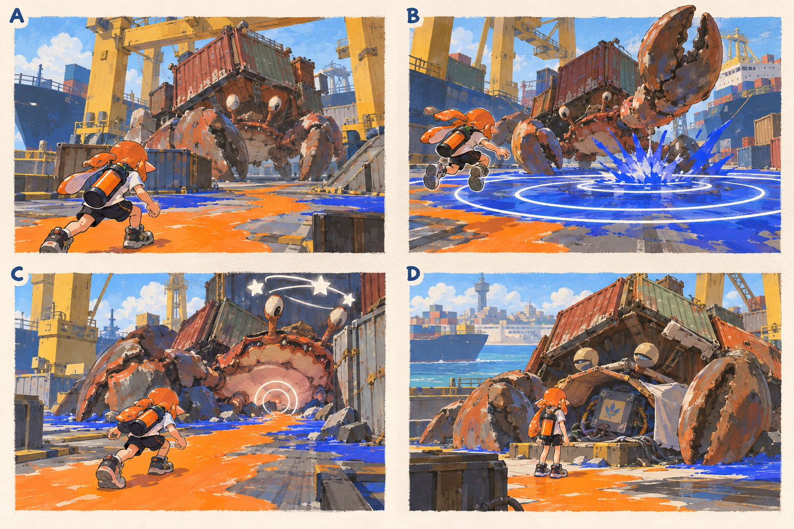

# 스테이지 3-3 — 껍질 속의 명령

- [x] 장면·목표·동선·등장 적·보상을 상세화한다.
- [x] 러프 장면판을 생성하고 장면 설명과 대조한다.
- [x] 연결 링크와 기획 수치를 검토한다.

[전체 기획과 목차](../../싱글플레이-PvE-캠페인-기획-2.md) · [플레이 규칙](../systems/게임플레이-상세-24.md) · [그림 범례](../일러스트-시각설계-29.md)

이 문서는 추가할 캠페인의 기획이다. 아래 그림은 기획용 러프이며 실제 구현 화면이 아니다. 기존 지도 이미지와 구분해 읽는다. 좌표·엄폐 위치·적 수·체력·시간은 실제 맵과 플레이 검증 후 조정할 초기값이다.

## 1. 이 임무에서 경험하는 것

거대한 소라게의 돌진을 벽으로 유도하고 낮은 배 약점을 공격하는 첫 대형 보스전이다.

| 항목 | 내용 |
|---|---|
| 지역과 시간대 | 켈프라인 터미널, 낮 / 지도 ID: kelpline이다. |
| 유형 | 스테이지 보스 임무이다. |
| 예상 시간 | 7~10분을 초기 목표로 한다. |
| 주 목표 | 하역왕 HULLBREAKER의 통제 장비를 파괴한다. |
| 권장 행동 | 플레이어가 벽에 갇히도록 돌진을 유도하지 않는다. 벽과 몸 사이가 아니라 옆으로 피하며, 배 약점은 근접 무기 높이까지 내려온다. |
| 완료 후 변화 | 할야드 마리나와 파쇄 결정을 확정 해금한다. |

## 2. 네 장면으로 보는 플레이

> 그림 검수: 컨테이너 껍질·비대칭 집게·충격파 점프·벽 충돌 뒤 낮은 배 약점·해방 연출을 확인했다. C는 기절 순간으로 지원 소형 게를 생략했으며 기절 시간과 후반 소환 제한은 본문을 따른다.

장면판은 왼쪽 위 A → 오른쪽 위 B → 왼쪽 아래 C → 오른쪽 아래 D 순서로 읽는다. 화살표는 플레이어의 선택 동선이며, 반투명 위험선·원은 공격 전 예고이다. 작은 문자와 수치보다 아래의 설명을 기준으로 해석한다.

| 그림 | 읽어야 할 행동 |
|---|---|
| A — 껍질이 일어선다 | 첫 3초는 이동만 가능하게 해 전투 공간과 엄폐를 본다. |
| B — 강타의 원을 넘다 | 예고를 보고 잉크 길을 따라 이동하거나 원을 점프로 넘는다. |
| C — 벽에 열린 배 | 벽 앞에서 옆으로 피한 뒤 4초 기절 창에 접근해 약점을 공격한다. |
| D — 살아 있는 껍질 | 안전해진 장비에 접근해 정비반 표식을 읽는다. |

## 3. 기존 배경과 공간 구성

위 이미지는 기존 게임의 배경 참고이다. 신규 목표·적·장치의 배치를 확정한 사진이 아니다. 큰 지형과 건물·선박·소품을 재사용하고 아래 관계에 맞는 실제 공간을 선택한다.

| 표식 | 위치의 역할 |
|---|---|
| S | 화물선 쪽 진입 정비 구역 |
| A | 크레인 기둥과 단단한 충돌 벽 |
| CP | 보스장 밖 장비 변경 표식 |
| B | BossNav 검증이 필요한 넓은 적재 전투장 |
| X | 좌우 엄폐 컨테이너 두 개 |
| E | 쓰러진 껍질 옆의 통제 장비 |

**주 경로:** S·CP → 넓은 전투장 B → 충돌 벽 A를 이용한 약점 공략 → E이다.

**다른 선택:** 좌우 엄폐 중 하나를 골라 통 낙하를 유도하고 반대쪽 공간으로 이동한다. 선택 상자는 없다.

통로 폐쇄는 시각 표식과 임무 구역 경계로 표현한다. 점프나 무기 이동기로 우연히 뒤 구역에 도착해도 순서를 건너뛰어 완료되지 않게 하며, 플레이어가 막혔다면 되돌아갈 수 있는 경로를 남긴다.

## 4. 목표와 진행 조건

강타·통 낙하·돌진을 읽으며 보스 체력을 소진한다. 통제 장비가 파괴되면 완료 연출로 이어진다.

- 화면에는 현재 수행할 목표 하나를 우선 표시하고 완료한 목표는 작은 체크로 남긴다.
- 필수 장치와 적은 지도·화면 양쪽에서 식별할 수 있게 한다. 선택 보상은 별표로 구분한다.
- 장치 접근 가동은 별도 조작키 없이 범위 안에서 2초 머무르는 방식이다. 위험을 피하려고 나가면 즉시 중단한다.
- 특정 주 무기만 닿는 필수 표적을 만들지 않는다. 직접 공격이 어려우면 접근 가능한 낮은 표적이나 경로를 제공한다.

## 5. 장면별 상세 플레이

### A. 껍질이 일어선다

노란 크레인과 화물선 아래에서 녹슨 컨테이너를 멘 소라게가 등장한다.

| 구분 | 장면 안에서 일어나는 일 |
|---|---|
| 플레이어 행동 | 첫 3초는 이동만 가능하게 해 전투 공간과 엄폐를 본다. |
| 적과 기믹 | 등장 연출 중 피해를 주지 않는다. |
| 화면·소리의 전달 | 보스 체력과 강타 방향을 처음 표시한다. |
| 다음 장면으로 가는 조건 | 연출 종료와 함께 강타를 한 번 보여 준다. |

### B. 강타의 원을 넘다

큰 집게와 바닥으로 퍼지는 원형 잉크 충격파가 보인다.

| 구분 | 장면 안에서 일어나는 일 |
|---|---|
| 플레이어 행동 | 예고를 보고 잉크 길을 따라 이동하거나 원을 점프로 넘는다. |
| 적과 기믹 | 초기 페이즈는 강타·통 낙하만 사용한다. |
| 화면·소리의 전달 | 점프할 원의 두께와 닿는 순간을 명확히 표시한다. |
| 다음 장면으로 가는 조건 | 체력 66%에서 돌진이 추가된다. |

### C. 벽에 열린 배

돌진선 끝의 단단한 컨테이너 벽과 노출된 낮은 배가 함께 보인다.

| 구분 | 장면 안에서 일어나는 일 |
|---|---|
| 플레이어 행동 | 벽 앞에서 옆으로 피한 뒤 4초 기절 창에 접근해 약점을 공격한다. |
| 적과 기믹 | 후반 소형 게는 최대 3마리이며 강한 공격과 동시에 소환하지 않는다. |
| 화면·소리의 전달 | 기절 아이콘과 낮은 약점 고리를 보여 준다. |
| 다음 장면으로 가는 조건 | 체력 0이면 모든 공격과 잔여 효과를 멈춘다. |

### D. 살아 있는 껍질

보스가 주저앉고 통제 장치가 부서지며 도시 신호가 약해진다.

| 구분 | 장면 안에서 일어나는 일 |
|---|---|
| 플레이어 행동 | 안전해진 장비에 접근해 정비반 표식을 읽는다. |
| 적과 기믹 | 소라게는 해방 연출의 대상으로 남고 추가 공격을 하지 않는다. |
| 화면·소리의 전달 | 모라의 짧은 침묵 뒤 다음 지역을 표시한다. |
| 다음 장면으로 가는 조건 | 기록 확인과 보상으로 완료한다. |

## 6. 핵심 적의 공략

**하역왕 HULLBREAKER / 거대 소라게 보스**이다. 솔로 초기 체력 18000, 본전투 180~300초를 목표로 조정한다.

1. 100~66%: 강타와 통 낙하를 번갈아 사용한다.
2. 66~33%: 돌진을 추가하고 벽 충돌 후 약 4초 기절을 제공한다.
3. 33% 이하: 같은 패턴의 간격을 조금 줄이고 최대 3마리의 소형 게를 제한적으로 추가한다. 광선·회전은 아직 쓰지 않는다.

플레이어가 벽에 갇히도록 돌진을 유도하지 않는다. 벽과 몸 사이가 아니라 옆으로 피하며, 배 약점은 근접 무기 높이까지 내려온다.

예고는 최소 0.9초를 기본으로 하고 장면에 따로 정한 값이 더 길면 그 값을 사용한다. 재정비 중에는 예고 없이 즉시 반격하지 않는다. 정해진 지원 출현을 소진한 뒤에는 추가 소환이 반복되지 않는다.

## 7. 대사와 이야기의 변화

**입장 통신:** 모라: 저건 괴물이 아니라 실려 온 명령에 묶여 있는 생물이야. 껍질의 장치를 노려.

**완료 통신:** 틸: 통제 신호가 끊겼다. 모라: 저 부품의 표식… 마리나 정비반 것이다.

전투 중 긴 대사는 하지 않는다. 공격 예고가 시작되면 통신 자막을 미루며, 완료 대화는 건너뛰고 기록 창에서 다시 읽을 수 있다.

## 8. 보상과 다음 임무

| 항목 | 지급 규칙 |
|---|---|
| 첫 완료 경험치 | 기본 반복분과 첫 완료 추가분을 합해 600이다. |
| 반복 완료 경험치 | 180이다. |
| 첫 완료 부품 | 기본 60 + 첫 완료 추가 20 = 80개이다. |
| 반복 완료 부품 | 60개이다. |
| 완료 모듈 | 무작위 모듈 1개이다. |
| 공명핵 | 완료마다 1개이다. |
| 추가 보상 | 첫 완료에 파쇄 결정 1개를 확정 지급한다. 선택 상자는 없다. |
| 파밍 계열 | 보스 기절 공략 계열이다. |

할야드 마리나와 파쇄 결정을 확정 해금한다.

전투 중 보상은 현재 임무의 미확정 목록에 저장하고 완료 화면에서 확정한다. 실패·재시작으로 같은 상자의 모듈을 재추첨하지 않는다. 경험치·부품은 적 처치 횟수만으로 별도 증가하지 않는다.

## 9. 체크포인트와 재도전

전투장 입장 바로 앞에서 저장한다.

보스 체력·소환 횟수·잉크를 전투 시작 상태로 복원한다. 진입 전투나 필수 대화는 반복하지 않는다.

체크포인트 대기에서는 장비와 특성을 바꿀 수 있다. 체력·잉크는 채우고 스페셜은 저장된 구간 시작값으로 복원한다. 현재 구간의 적·장치·임무용 잉크는 함께 복원하며, 공격 중인 적 앞에 바로 플레이어를 놓지 않는다.

## 10. 일러스트와 실제 제작의 경계

- 배경의 중심 실루엣은 기존 켈프라인 터미널의 건물·소품을 따른다.
- 플레이어는 주황 잉크, 잔향 적은 코발트색 잉크로 시안을 통일한다. 실제 게임에서는 팀 팔레트와 색각 설정을 적용한다.
- 목표는 흰 이중 원, 선택 상자는 별, 공격 위험은 사선·원 테두리로 구분한다. 색 하나만으로 의미를 전달하지 않는다.
- 그림의 빛나는 표식·상호작용·임무 순서·개별 AI는 추가 기획이다. 현재 게임에서 이미 동작하는 기능이라고 해석하지 않는다.
- 이미지가 설명과 다르게 생성한 작은 장식·문자·문 개폐는 필수 기능으로 추가하지 않는다. 장면의 행동·공간 관계를 우선한다.

[그림 생성 지시서](../그림-생성-프롬프트-30.md) · [아이템](../systems/아이템-상세-26.md) · [성장](../systems/성장-상세-27.md) · [파밍](../systems/파밍과-보상-상세-28.md)
