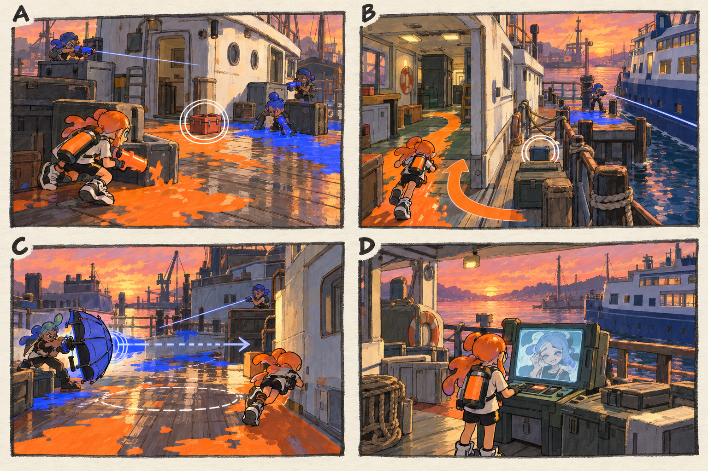

# 스테이지 4-2 — 돌아오지 않은 작업반

- [x] 장면·목표·동선·등장 적·보상을 상세화한다.
- [x] 러프 장면판을 생성하고 장면 설명과 대조한다.
- [x] 연결 링크와 기획 수치를 검토한다.

[전체 기획과 목차](../../싱글플레이-PvE-캠페인-기획-2.md) · [플레이 규칙](../systems/게임플레이-상세-24.md) · [그림 범례](../일러스트-시각설계-29.md)

이 문서는 추가할 캠페인의 기획이다. 아래 그림은 기획용 러프이며 실제 구현 화면이 아니다. 기존 지도 이미지와 구분해 읽는다. 좌표·엄폐 위치·적 수·체력·시간은 실제 맵과 플레이 검증 후 조정할 초기값이다.

## 1. 이 임무에서 경험하는 것

선박과 난간 사이의 좁은 길에서 방패 정예를 흘려보내고 작업반의 대피 기록을 찾는다.

| 항목 | 내용 |
|---|---|
| 지역과 시간대 | 할야드 마리나, 해질녘 / 지도 ID: halyard이다. |
| 유형 | 일반 진행과 중간보스 임무이다. |
| 예상 시간 | 10~13분을 초기 목표로 한다. |
| 주 목표 | 정비 장비 2개를 회수하고 계류 수문장을 제압한다. |
| 권장 행동 | 방패를 쏘아 보낼 때 옆 선실을 돌아 뒤를 잡는다. 좁은 통로에서 밀어내는 공격과 낙하를 겹치지 않는다. |
| 완료 후 변화 | 모라의 고백 대화와 비상 명령의 원본 기록을 해금한다. |

## 2. 네 장면으로 보는 플레이

> 그림 검수: 선실 안쪽 우회, 물가 반대 방향의 방패 회피, 보조 사격병과 안전한 기록 열람을 확인했다. D의 통신 초상은 모라의 임시 표정 시안이며 최종 외형은 NPC 문서를 따른다.

장면판은 왼쪽 위 A → 오른쪽 위 B → 왼쪽 아래 C → 오른쪽 아래 D 순서로 읽는다. 화살표는 플레이어의 선택 동선이며, 반투명 위험선·원은 공격 전 예고이다. 작은 문자와 수치보다 아래의 설명을 기준으로 해석한다.

| 그림 | 읽어야 할 행동 |
|---|---|
| A — 남겨진 장비 | 사격병을 엄폐로 분리한 뒤 상자를 회수한다. |
| B — 물가에 몰리지 않기 | 선실 안쪽으로 칠해 경로를 잡고 X를 선택 회수한다. |
| C — 방패가 지나간 자리 | 방패를 물 쪽으로 피하지 않고 선실 쪽으로 피해 뒤를 노린다. |
| D — 모라의 원본 명령 | 기록을 읽고 작업반의 살아 있는 응답을 듣는다. |

## 3. 기존 배경과 공간 구성

위 이미지는 기존 게임의 배경 참고이다. 신규 목표·적·장치의 배치를 확정한 사진이 아니다. 큰 지형과 건물·선박·소품을 재사용하고 아래 관계에 맞는 실제 공간을 선택한다.

| 표식 | 위치의 역할 |
|---|---|
| S | 육지 쪽 정비 창고 |
| A | 상판 위 첫 장비 상자 |
| CP | 카페리 아래의 넓은 정비 데크 |
| B | 계류 수문장이 막는 고정 통로 |
| X | 사무소 옆 안전한 우회 길의 선택 상자 |
| E | 통로 뒤 작업반 귀환 기록 |

**주 경로:** S → A → CP → 수문장 통로 B → E이다.

**다른 선택:** CP → 옆 선실을 돌아 방패 발사 방향과 반대편으로 접근한다.

통로 폐쇄는 시각 표식과 임무 구역 경계로 표현한다. 점프나 무기 이동기로 우연히 뒤 구역에 도착해도 순서를 건너뛰어 완료되지 않게 하며, 플레이어가 막혔다면 되돌아갈 수 있는 경로를 남긴다.

## 4. 목표와 진행 조건

두 장비를 회수한 뒤 정예가 막는 통로를 연다. 실제 작업반 NPC를 따라가거나 지키는 호위 구간은 없다.

- 화면에는 현재 수행할 목표 하나를 우선 표시하고 완료한 목표는 작은 체크로 남긴다.
- 필수 장치와 적은 지도·화면 양쪽에서 식별할 수 있게 한다. 선택 보상은 별표로 구분한다.
- 장치 접근 가동은 별도 조작키 없이 범위 안에서 2초 머무르는 방식이다. 위험을 피하려고 나가면 즉시 중단한다.
- 특정 주 무기만 닿는 필수 표적을 만들지 않는다. 직접 공격이 어려우면 접근 가능한 낮은 표적이나 경로를 제공한다.

## 5. 장면별 상세 플레이

### A. 남겨진 장비

해질녘의 선실 아래 공구 상자와 젖은 바닥이 보인다.

| 구분 | 장면 안에서 일어나는 일 |
|---|---|
| 플레이어 행동 | 사격병을 엄폐로 분리한 뒤 상자를 회수한다. |
| 적과 기믹 | 사격병 2명·도색병 1명이다. |
| 화면·소리의 전달 | 장비 0/2와 대피 기록 목적을 표시한다. |
| 다음 장면으로 가는 조건 | 두 장비 회수 뒤 정예 통로를 안내한다. |

### B. 물가에 몰리지 않기

부두 끝 좁은 정면과 선실 안쪽 넓은 우회 길이 대비된다.

| 구분 | 장면 안에서 일어나는 일 |
|---|---|
| 플레이어 행동 | 선실 안쪽으로 칠해 경로를 잡고 X를 선택 회수한다. |
| 적과 기믹 | 감시병 1명은 바깥 직선만 보며 안쪽 길은 막지 않는다. |
| 화면·소리의 전달 | 물가 경고와 피격 방향을 분리한다. |
| 다음 장면으로 가는 조건 | CP 도착 후 방패 정예가 등장한다. |

### C. 방패가 지나간 자리

정예가 큰 우산 방패를 통로를 따라 쏘아 보낸다.

| 구분 | 장면 안에서 일어나는 일 |
|---|---|
| 플레이어 행동 | 방패를 물 쪽으로 피하지 않고 선실 쪽으로 피해 뒤를 노린다. |
| 적과 기믹 | 정예 1명과 보조 사격병 1명이다. 방패 발사 전 1초 예고를 준다. |
| 화면·소리의 전달 | 방패 이동선과 3초 재성장 빈틈을 표시한다. |
| 다음 장면으로 가는 조건 | 정예 제압 후 통신함이 열린다. |

### D. 모라의 원본 명령

안전해진 갑판 위 단말과 모라의 통신 초상이 함께 보인다.

| 구분 | 장면 안에서 일어나는 일 |
|---|---|
| 플레이어 행동 | 기록을 읽고 작업반의 살아 있는 응답을 듣는다. |
| 적과 기믹 | 전투를 완전히 멈추고 자막을 읽게 한다. |
| 화면·소리의 전달 | 대사 건너뛰기와 기록 보관을 제공한다. |
| 다음 장면으로 가는 조건 | 귀환 신호 확인 뒤 완료한다. |

## 6. 핵심 적의 공략

**계류 수문장 / 방패 정예**이다. 초기 체력 500을 기준으로 조정한다.

1. 느린 전진 뒤 1초 예고를 주고 방패를 직선으로 발사한다.
2. 방패를 보낸 뒤 3초 동안 측면이 열린다.
3. 체력 절반에서는 반대 방향으로 옮기지만 물가 쪽만을 유일한 회피 경로로 만들지 않는다.

방패를 쏘아 보낼 때 옆 선실을 돌아 뒤를 잡는다. 좁은 통로에서 밀어내는 공격과 낙하를 겹치지 않는다.

예고는 최소 0.9초를 기본으로 하고 장면에 따로 정한 값이 더 길면 그 값을 사용한다. 재정비 중에는 예고 없이 즉시 반격하지 않는다. 정해진 지원 출현을 소진한 뒤에는 추가 소환이 반복되지 않는다.

## 7. 대사와 이야기의 변화

**입장 통신:** 틸: 작업반이 사라진 게 아니라 귀환 기록이 지워졌다. 남아 있는 장비가 마지막 경로를 알려 줄 거야.

**완료 통신:** 모라: 내가 비상 명령을 넓혔어. 사람을 빨리 구하려다 돌아갈 기록까지 회수하게 만든 거야.

전투 중 긴 대사는 하지 않는다. 공격 예고가 시작되면 통신 자막을 미루며, 완료 대화는 건너뛰고 기록 창에서 다시 읽을 수 있다.

**선택 기록 — 귀환한 작업반:** 작업반은 이미 대피소에 도착했다. 명령망에서 지워진 귀환 신호를 되살리면 통신원이 안부를 확인한다.

선택 기록은 이 일반 임무의 선택 상자 하나와 함께 배치한다. 필수 회수 자료와 다른 수집물이며 엔딩 진입 조건으로 요구하지 않는다.

## 8. 보상과 다음 임무

| 항목 | 지급 규칙 |
|---|---|
| 첫 완료 경험치 | 기본 반복분과 첫 완료 추가분을 합해 600이다. |
| 반복 완료 경험치 | 120이다. |
| 첫 완료 부품 | 기본 40 + 첫 완료 추가 20 = 60개이다. |
| 반복 완료 부품 | 40개이다. |
| 완료 모듈 | 무작위 모듈 1개이다. |
| 공명핵 | 기본 완료에서는 지급하지 않는다. |
| 추가 보상 | 선택 상자 완료 시 무작위 모듈 1개·부품 10개·선택 기록 1개를 추가한다. |
| 파밍 계열 | 잠수·재정비 계열이다. |

모라의 고백 대화와 비상 명령의 원본 기록을 해금한다.

전투 중 보상은 현재 임무의 미확정 목록에 저장하고 완료 화면에서 확정한다. 실패·재시작으로 같은 상자의 모듈을 재추첨하지 않는다. 경험치·부품은 적 처치 횟수만으로 별도 증가하지 않는다.

## 9. 체크포인트와 재도전

두 번째 장비 회수 후와 정예 앞 데크에서 저장한다.

낙하와 정예 패배는 CP에서 재시작한다. 이미 회수한 장비와 귀환 기록 수집 상태는 구간 기준으로 보존한다.

체크포인트 대기에서는 장비와 특성을 바꿀 수 있다. 체력·잉크는 채우고 스페셜은 저장된 구간 시작값으로 복원한다. 현재 구간의 적·장치·임무용 잉크는 함께 복원하며, 공격 중인 적 앞에 바로 플레이어를 놓지 않는다.

## 10. 일러스트와 실제 제작의 경계

- 배경의 중심 실루엣은 기존 할야드 마리나의 건물·소품을 따른다.
- 플레이어는 주황 잉크, 잔향 적은 코발트색 잉크로 시안을 통일한다. 실제 게임에서는 팀 팔레트와 색각 설정을 적용한다.
- 목표는 흰 이중 원, 선택 상자는 별, 공격 위험은 사선·원 테두리로 구분한다. 색 하나만으로 의미를 전달하지 않는다.
- 그림의 빛나는 표식·상호작용·임무 순서·개별 AI는 추가 기획이다. 현재 게임에서 이미 동작하는 기능이라고 해석하지 않는다.
- 이미지가 설명과 다르게 생성한 작은 장식·문자·문 개폐는 필수 기능으로 추가하지 않는다. 장면의 행동·공간 관계를 우선한다.

[그림 생성 지시서](../그림-생성-프롬프트-30.md) · [아이템](../systems/아이템-상세-26.md) · [성장](../systems/성장-상세-27.md) · [파밍](../systems/파밍과-보상-상세-28.md)
