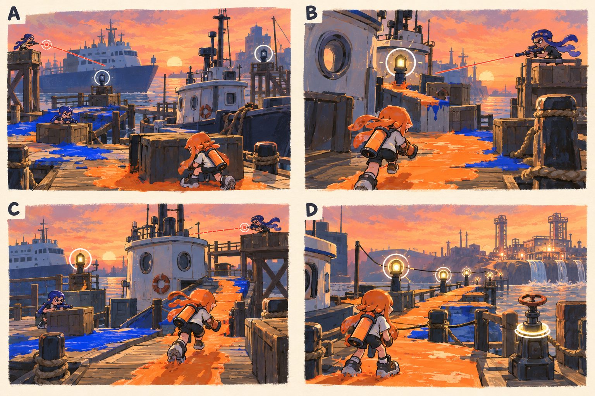

# 스테이지 4-3 — 등대 없는 항로

- [x] 장면·목표·동선·등장 적·보상을 상세화한다.
- [x] 러프 장면판을 생성하고 장면 설명과 대조한다.
- [x] 연결 링크와 기획 수치를 검토한다.

[전체 기획과 목차](../../싱글플레이-PvE-캠페인-기획-2.md) · [플레이 규칙](../systems/게임플레이-상세-24.md) · [그림 범례](../일러스트-시각설계-29.md)

이 문서는 추가할 캠페인의 기획이다. 아래 그림은 기획용 러프이며 실제 구현 화면이 아니다. 기존 지도 이미지와 구분해 읽는다. 좌표·엄폐 위치·적 수·체력·시간은 실제 맵과 플레이 검증 후 조정할 초기값이다.

## 1. 이 임무에서 경험하는 것

부두 양끝의 사선을 바꿔 쏘는 대장에게 안전 통로를 연결하며 가까이 접근하는 전투이다.

| 항목 | 내용 |
|---|---|
| 지역과 시간대 | 할야드 마리나, 해질녘 / 지도 ID: halyard이다. |
| 유형 | 스테이지 보스 임무이다. |
| 예상 시간 | 7~10분을 초기 목표로 한다. |
| 주 목표 | 엄폐 중계점 2개를 확보하고 계류장 스큐를 제압한다. |
| 권장 행동 | 장거리 무기만 유리하지 않도록 두 거점 모두 도보·잠수 접근 경로를 둔다. 카페리 선체는 고정 엄폐로 사용하며 이동시키지 않는다. |
| 완료 후 변화 | 솔트팬 분지와 계류 밸브를 확정 해금한다. |

## 2. 네 장면으로 보는 플레이

> 그림 검수: 선체 엄폐·중계등·거점 이동에 따른 사선 변경·안내등 복구를 확인했다. A는 보스전 직전 공간 개요이며 진입 적 2명은 본문대로 먼저 정리한다. B·C의 사선은 각 시점의 한 거점에서만 발생한다.

장면판은 왼쪽 위 A → 오른쪽 위 B → 왼쪽 아래 C → 오른쪽 아래 D 순서로 읽는다. 화살표는 플레이어의 선택 동선이며, 반투명 위험선·원은 공격 전 예고이다. 작은 문자와 수치보다 아래의 설명을 기준으로 해석한다.

| 그림 | 읽어야 할 행동 |
|---|---|
| A — 사라진 항로등 | 첫 사선을 보며 선체 뒤로 이동한다. |
| B — 빛이 켜지는 길 | 사격 후 재정비 시간에 짧은 거리를 전진한다. |
| C — 다른 방향의 두 번째 선 | 같은 엄폐에 머물지 않고 반대쪽 선실로 이동해 접근한다. |
| D — 다시 생긴 항로 | E에서 복구 경로를 확인한다. |

## 3. 기존 배경과 공간 구성

위 이미지는 기존 게임의 배경 참고이다. 신규 목표·적·장치의 배치를 확정한 사진이 아니다. 큰 지형과 건물·선박·소품을 재사용하고 아래 관계에 맞는 실제 공간을 선택한다.

| 표식 | 위치의 역할 |
|---|---|
| S | 카페리 육지 쪽 정비 공간 |
| A | 서쪽 사선을 끊는 중계점 |
| CP | 보스장 진입 전 선실 뒤 |
| B | 스큐가 이동하는 두 고정 사격 거점 |
| X | 동쪽 사선의 안전 통로 중계점 |
| E | 항로 제어 단말 |

**주 경로:** S·CP → A → 두 사격 거점 사이 접근 → X → 스큐 → E이다.

**다른 선택:** 배의 선체와 선실을 이용해 같은 거점을 양쪽에서 접근할 수 있다.

통로 폐쇄는 시각 표식과 임무 구역 경계로 표현한다. 점프나 무기 이동기로 우연히 뒤 구역에 도착해도 순서를 건너뛰어 완료되지 않게 하며, 플레이어가 막혔다면 되돌아갈 수 있는 경로를 남긴다.

## 4. 목표와 진행 조건

중계점 확보는 움직이는 엄폐를 생성하지 않는다. 해당 경로를 가리키는 안내등과 안전한 접근 공간을 활성화하고 스큐의 경계 위치를 바꾼다.

- 화면에는 현재 수행할 목표 하나를 우선 표시하고 완료한 목표는 작은 체크로 남긴다.
- 필수 장치와 적은 지도·화면 양쪽에서 식별할 수 있게 한다. 선택 보상은 별표로 구분한다.
- 장치 접근 가동은 별도 조작키 없이 범위 안에서 2초 머무르는 방식이다. 위험을 피하려고 나가면 즉시 중단한다.
- 특정 주 무기만 닿는 필수 표적을 만들지 않는다. 직접 공격이 어려우면 접근 가능한 낮은 표적이나 경로를 제공한다.

## 5. 장면별 상세 플레이

### A. 사라진 항로등

선실과 부두 양끝의 사격 거점, 꺼진 중계점 두 개를 보여 준다.

| 구분 | 장면 안에서 일어나는 일 |
|---|---|
| 플레이어 행동 | 첫 사선을 보며 선체 뒤로 이동한다. |
| 적과 기믹 | 진입 사격병 2명을 처리한 뒤 보스전을 시작한다. |
| 화면·소리의 전달 | 서쪽 거점의 조준선 하나만 먼저 표시한다. |
| 다음 장면으로 가는 조건 | CP 이후 A 접근을 안내한다. |

### B. 빛이 켜지는 길

A가 켜지면 선실 뒤의 주황 잉크 통로와 보스의 옆모습이 보인다.

| 구분 | 장면 안에서 일어나는 일 |
|---|---|
| 플레이어 행동 | 사격 후 재정비 시간에 짧은 거리를 전진한다. |
| 적과 기믹 | 스큐는 1초 조준 뒤 2발, 3초 정비를 반복한다. |
| 화면·소리의 전달 | 작동한 중계점에서 다음 엄폐까지 방향 표식을 준다. |
| 다음 장면으로 가는 조건 | 보스 절반 체력 또는 X 가동으로 동쪽 거점이 열린다. |

### C. 다른 방향의 두 번째 선

스큐가 반대 사격 거점으로 이동하고 기존 엄폐의 안전 방향이 바뀐다.

| 구분 | 장면 안에서 일어나는 일 |
|---|---|
| 플레이어 행동 | 같은 엄폐에 머물지 않고 반대쪽 선실로 이동해 접근한다. |
| 적과 기믹 | 지원 사격병 1명만 한 번 출현한다. 두 거점에서 동시에 쏘지 않는다. |
| 화면·소리의 전달 | 다음 사선이 열릴 방향을 1초 먼저 보여 준다. |
| 다음 장면으로 가는 조건 | 가까이 접근해 보스를 제압한다. |

### D. 다시 생긴 항로

부두의 안내등이 잇따라 켜지고 멀리 염전 펌프의 응답이 보인다.

| 구분 | 장면 안에서 일어나는 일 |
|---|---|
| 플레이어 행동 | E에서 복구 경로를 확인한다. |
| 적과 기믹 | 잔여 조준과 투사체를 해제한다. |
| 화면·소리의 전달 | 계류 밸브와 새 지역을 표시한다. |
| 다음 장면으로 가는 조건 | E 조작 후 완료한다. |

## 6. 핵심 적의 공략

**계류장 스큐 / 인간형 스테이지 보스**이다. 초기 체력 2100, 본전투 90~150초를 목표로 조정한다.

1. 서쪽 거점에서 두 발 후 3초 정비를 한다.
2. 중계점 복구 또는 체력 절반 이후 동쪽 거점으로 이동한다.
3. 후반에는 거점 이동을 빠르게 하지만 새 사선을 예고하며 정비 창은 유지한다.

장거리 무기만 유리하지 않도록 두 거점 모두 도보·잠수 접근 경로를 둔다. 카페리 선체는 고정 엄폐로 사용하며 이동시키지 않는다.

예고는 최소 0.9초를 기본으로 하고 장면에 따로 정한 값이 더 길면 그 값을 사용한다. 재정비 중에는 예고 없이 즉시 반격하지 않는다. 정해진 지원 출현을 소진한 뒤에는 추가 소환이 반복되지 않는다.

## 7. 대사와 이야기의 변화

**입장 통신:** 스큐: 미등록 항로를 폐쇄한다. 모라: 그 명령은 내가 고칠게. 너는 사람에게 돌아갈 길을 열어 줘.

**완료 통신:** 모라: 지우는 대신 다시 흐르게 만드는 방법이 있어. 솔트팬의 오래된 펌프를 찾아야 해.

전투 중 긴 대사는 하지 않는다. 공격 예고가 시작되면 통신 자막을 미루며, 완료 대화는 건너뛰고 기록 창에서 다시 읽을 수 있다.

## 8. 보상과 다음 임무

| 항목 | 지급 규칙 |
|---|---|
| 첫 완료 경험치 | 기본 반복분과 첫 완료 추가분을 합해 600이다. |
| 반복 완료 경험치 | 180이다. |
| 첫 완료 부품 | 기본 60 + 첫 완료 추가 20 = 80개이다. |
| 반복 완료 부품 | 60개이다. |
| 완료 모듈 | 무작위 모듈 1개이다. |
| 공명핵 | 완료마다 1개이다. |
| 추가 보상 | 첫 완료에 계류 밸브 1개를 확정 지급한다. 선택 상자는 없다. |
| 파밍 계열 | 잠수·재정비 계열이다. |

솔트팬 분지와 계류 밸브를 확정 해금한다.

전투 중 보상은 현재 임무의 미확정 목록에 저장하고 완료 화면에서 확정한다. 실패·재시작으로 같은 상자의 모듈을 재추첨하지 않는다. 경험치·부품은 적 처치 횟수만으로 별도 증가하지 않는다.

## 9. 체크포인트와 재도전

보스장 앞에서 저장한다.

실패하면 거점·중계점·체력을 함께 초기화한다. 사선 안에서 바로 재출현시키지 않는다.

체크포인트 대기에서는 장비와 특성을 바꿀 수 있다. 체력·잉크는 채우고 스페셜은 저장된 구간 시작값으로 복원한다. 현재 구간의 적·장치·임무용 잉크는 함께 복원하며, 공격 중인 적 앞에 바로 플레이어를 놓지 않는다.

## 10. 일러스트와 실제 제작의 경계

- 배경의 중심 실루엣은 기존 할야드 마리나의 건물·소품을 따른다.
- 플레이어는 주황 잉크, 잔향 적은 코발트색 잉크로 시안을 통일한다. 실제 게임에서는 팀 팔레트와 색각 설정을 적용한다.
- 목표는 흰 이중 원, 선택 상자는 별, 공격 위험은 사선·원 테두리로 구분한다. 색 하나만으로 의미를 전달하지 않는다.
- 그림의 빛나는 표식·상호작용·임무 순서·개별 AI는 추가 기획이다. 현재 게임에서 이미 동작하는 기능이라고 해석하지 않는다.
- 이미지가 설명과 다르게 생성한 작은 장식·문자·문 개폐는 필수 기능으로 추가하지 않는다. 장면의 행동·공간 관계를 우선한다.

[그림 생성 지시서](../그림-생성-프롬프트-30.md) · [아이템](../systems/아이템-상세-26.md) · [성장](../systems/성장-상세-27.md) · [파밍](../systems/파밍과-보상-상세-28.md)
