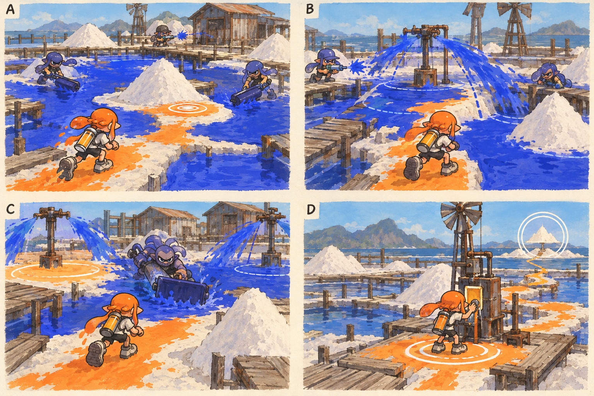

# 스테이지 5-2 — 마르는 길

- [x] 장면·목표·동선·등장 적·보상을 상세화한다.
- [x] 러프 장면판을 생성하고 장면 설명과 대조한다.
- [x] 연결 링크와 기획 수치를 검토한다.

[전체 기획과 목차](../../싱글플레이-PvE-캠페인-기획-2.md) · [플레이 규칙](../systems/게임플레이-상세-24.md) · [그림 범례](../일러스트-시각설계-29.md)

이 문서는 추가할 캠페인의 기획이다. 아래 그림은 기획용 러프이며 실제 구현 화면이 아니다. 기존 지도 이미지와 구분해 읽는다. 좌표·엄폐 위치·적 수·체력·시간은 실제 맵과 플레이 검증 후 조정할 초기값이다.

## 1. 이 임무에서 경험하는 것

넓은 적 잉크 지대에서 이동·회복 공간을 유지하며 도색 정예와 살수 장치를 공략한다.

| 항목 | 내용 |
|---|---|
| 지역과 시간대 | 솔트팬 분지, 낮 / 지도 ID: saltpan이다. |
| 유형 | 일반 진행과 중간보스 임무이다. |
| 예상 시간 | 11~14분을 초기 목표로 한다. |
| 주 목표 | 안전 연결점 2개를 확보하고 염전 청소조를 제압한다. |
| 권장 행동 | 정예 체력만 줄이려 하지 말고 안전 공간을 만드는 장치를 먼저 끈다. 장치는 모든 무기가 닿는 낮은 높이에 둔다. |
| 완료 후 변화 | 안전지대 유지와 설치물 우선 파괴를 보스전 전 단계에서 익힌다. |

## 2. 네 장면으로 보는 플레이

> 그림 검수: 작은 회복 지점·퇴로를 덮는 살수 원점·정예와 고정 장치 2개·연결된 귀환 길을 확인했다. C는 장치를 끄기 전 접근 순간이며 한 장치 차단 후 안전 공간 확보가 이어진다. 회복 원은 소비품을 뜻하지 않는다.

장면판은 왼쪽 위 A → 오른쪽 위 B → 왼쪽 아래 C → 오른쪽 아래 D 순서로 읽는다. 화살표는 플레이어의 선택 동선이며, 반투명 위험선·원은 공격 전 예고이다. 작은 문자와 수치보다 아래의 설명을 기준으로 해석한다.

| 그림 | 읽어야 할 행동 |
|---|---|
| A — 작은 섬 하나 | 짧은 주황 길과 작은 회복 원을 만들며 조금씩 전진한다. |
| B — 계속 칠해지는 길 | 장치를 먼저 부수거나 소금더미 옆의 다른 안전 경로를 만든다. |
| C — 염전 청소조 | 한 장치를 먼저 끄고 생긴 안전 공간으로 정예의 돌진을 유도한다. |
| D — 섬들이 길이 되다 | E를 가동해 펌프 제어에 필요한 기록을 보낸다. |

## 3. 기존 배경과 공간 구성

위 이미지는 기존 게임의 배경 참고이다. 신규 목표·적·장치의 배치를 확정한 사진이 아니다. 큰 지형과 건물·선박·소품을 재사용하고 아래 관계에 맞는 실제 공간을 선택한다.

| 표식 | 위치의 역할 |
|---|---|
| S | 창고 뒤 넓은 안전판 |
| A | 첫 번째 낮은 소금더미 |
| CP | 풍력 펌프 기단 |
| B | 살수 장치가 있는 정예 구역 |
| X | 밭 가장자리 창고길의 선택 상자 |
| E | 정예 뒤 안전 연결 단말 |

**주 경로:** S → 소금더미 A → CP → 살수 장치 → 정예 B → E이다.

**다른 선택:** CP에서 창고를 돌아 X와 살수 장치 측면으로 접근한다.

통로 폐쇄는 시각 표식과 임무 구역 경계로 표현한다. 점프나 무기 이동기로 우연히 뒤 구역에 도착해도 순서를 건너뛰어 완료되지 않게 하며, 플레이어가 막혔다면 되돌아갈 수 있는 경로를 남긴다.

## 4. 목표와 진행 조건

정해진 작은 연결점 2개를 60% 도색해 저장하고 정예의 살수 장치를 무력화한 뒤 정예를 제압한다. 바닥 전체를 칠할 필요는 없다.

- 화면에는 현재 수행할 목표 하나를 우선 표시하고 완료한 목표는 작은 체크로 남긴다.
- 필수 장치와 적은 지도·화면 양쪽에서 식별할 수 있게 한다. 선택 보상은 별표로 구분한다.
- 장치 접근 가동은 별도 조작키 없이 범위 안에서 2초 머무르는 방식이다. 위험을 피하려고 나가면 즉시 중단한다.
- 특정 주 무기만 닿는 필수 표적을 만들지 않는다. 직접 공격이 어려우면 접근 가능한 낮은 표적이나 경로를 제공한다.

## 5. 장면별 상세 플레이

### A. 작은 섬 하나

넓은 파란 잉크 사이 소금더미 주변의 작은 마른 바닥이 보인다.

| 구분 | 장면 안에서 일어나는 일 |
|---|---|
| 플레이어 행동 | 짧은 주황 길과 작은 회복 원을 만들며 조금씩 전진한다. |
| 적과 기믹 | 도색병 2명과 사격병 1명이 넓게 나뉘어 있다. |
| 화면·소리의 전달 | 목표 면적을 좁게 표시해 과도한 도색 노동을 막는다. |
| 다음 장면으로 가는 조건 | A가 확보되면 다음 연결점으로 간다. |

### B. 계속 칠해지는 길

앞쪽 살수 장치가 퇴로를 다시 적 잉크로 덮는다.

| 구분 | 장면 안에서 일어나는 일 |
|---|---|
| 플레이어 행동 | 장치를 먼저 부수거나 소금더미 옆의 다른 안전 경로를 만든다. |
| 적과 기믹 | 장치 1개·감시병 1명·사격병 1명이다. |
| 화면·소리의 전달 | 적 잉크 재확산의 원점을 선으로 보여 준다. |
| 다음 장면으로 가는 조건 | 연결점 2 완료 후 CP를 켠다. |

### C. 염전 청소조

정예와 좌우 살수 장치 두 개가 구역을 나누어 압박한다.

| 구분 | 장면 안에서 일어나는 일 |
|---|---|
| 플레이어 행동 | 한 장치를 먼저 끄고 생긴 안전 공간으로 정예의 돌진을 유도한다. |
| 적과 기믹 | 도색 정예 1명과 고정 장치 2개이다. 일반 지원 적은 추가하지 않는다. |
| 화면·소리의 전달 | 꺼진 장치의 구역은 체크 무늬 없는 안전색으로 바뀐다. |
| 다음 장면으로 가는 조건 | 정예 제압 뒤 E가 열린다. |

### D. 섬들이 길이 되다

뒤를 돌아보면 작은 주황 안전 지점들이 연결되어 있다.

| 구분 | 장면 안에서 일어나는 일 |
|---|---|
| 플레이어 행동 | E를 가동해 펌프 제어에 필요한 기록을 보낸다. |
| 적과 기믹 | 추가 적과 재도색 장치는 정지한다. |
| 화면·소리의 전달 | 다음 보스의 안전 구역 아이콘을 미리 보여 준다. |
| 다음 장면으로 가는 조건 | E 가동으로 완료한다. |

## 6. 핵심 적의 공략

**염전 청소조 / 도색 정예**이다. 초기 체력 520을 기준으로 조정한다.

1. 살수 장치가 정해진 구역만 번갈아 칠하고 정예가 직선으로 압박한다.
2. 장치 한 개를 끄면 그 방향의 재도색이 멈추고 정예가 방향 전환 후 2초 쉰다.
3. 두 장치 모두 꺼도 정예 일반 공격은 남으며 불필요한 무적 상태는 없다.

정예 체력만 줄이려 하지 말고 안전 공간을 만드는 장치를 먼저 끈다. 장치는 모든 무기가 닿는 낮은 높이에 둔다.

예고는 최소 0.9초를 기본으로 하고 장면에 따로 정한 값이 더 길면 그 값을 사용한다. 재정비 중에는 예고 없이 즉시 반격하지 않는다. 정해진 지원 출현을 소진한 뒤에는 추가 소환이 반복되지 않는다.

## 7. 대사와 이야기의 변화

**입장 통신:** 틸: 앞으로 가는 속도보다 다시 숨을 돌릴 자리가 중요해. 길을 한 번에 다 칠하려 하지 마.

**완료 통신:** 아카이브: 보호 구역이 재분류된다. 모라: 네가 만든 공간을 시설이 안전지대로 읽기 시작했어.

전투 중 긴 대사는 하지 않는다. 공격 예고가 시작되면 통신 자막을 미루며, 완료 대화는 건너뛰고 기록 창에서 다시 읽을 수 있다.

**선택 기록 — 돌아갈 자리:** 정비반의 메모에는 빠른 돌파보다 돌아올 작은 섬을 먼저 만들라는 말이 남아 있다.

선택 기록은 이 일반 임무의 선택 상자 하나와 함께 배치한다. 필수 회수 자료와 다른 수집물이며 엔딩 진입 조건으로 요구하지 않는다.

## 8. 보상과 다음 임무

| 항목 | 지급 규칙 |
|---|---|
| 첫 완료 경험치 | 기본 반복분과 첫 완료 추가분을 합해 600이다. |
| 반복 완료 경험치 | 120이다. |
| 첫 완료 부품 | 기본 40 + 첫 완료 추가 20 = 60개이다. |
| 반복 완료 부품 | 40개이다. |
| 완료 모듈 | 무작위 모듈 1개이다. |
| 공명핵 | 기본 완료에서는 지급하지 않는다. |
| 추가 보상 | 선택 상자 완료 시 무작위 모듈 1개·부품 10개·선택 기록 1개를 추가한다. |
| 파밍 계열 | 도색·스페셜 운용 계열이다. |

안전지대 유지와 설치물 우선 파괴를 보스전 전 단계에서 익힌다.

전투 중 보상은 현재 임무의 미확정 목록에 저장하고 완료 화면에서 확정한다. 실패·재시작으로 같은 상자의 모듈을 재추첨하지 않는다. 경험치·부품은 적 처치 횟수만으로 별도 증가하지 않는다.

## 9. 체크포인트와 재도전

연결점 1·2 완료 후, 정예 직전의 펌프 기단에서 저장한다.

잠수 회복 구역이 완전히 사라지지 않도록 CP 주변 바닥을 보호한다. 실패 시 정예 전투만 복원하고 연결점은 유지한다.

체크포인트 대기에서는 장비와 특성을 바꿀 수 있다. 체력·잉크는 채우고 스페셜은 저장된 구간 시작값으로 복원한다. 현재 구간의 적·장치·임무용 잉크는 함께 복원하며, 공격 중인 적 앞에 바로 플레이어를 놓지 않는다.

## 10. 일러스트와 실제 제작의 경계

- 배경의 중심 실루엣은 기존 솔트팬 분지의 건물·소품을 따른다.
- 플레이어는 주황 잉크, 잔향 적은 코발트색 잉크로 시안을 통일한다. 실제 게임에서는 팀 팔레트와 색각 설정을 적용한다.
- 목표는 흰 이중 원, 선택 상자는 별, 공격 위험은 사선·원 테두리로 구분한다. 색 하나만으로 의미를 전달하지 않는다.
- 그림의 빛나는 표식·상호작용·임무 순서·개별 AI는 추가 기획이다. 현재 게임에서 이미 동작하는 기능이라고 해석하지 않는다.
- 이미지가 설명과 다르게 생성한 작은 장식·문자·문 개폐는 필수 기능으로 추가하지 않는다. 장면의 행동·공간 관계를 우선한다.

[그림 생성 지시서](../그림-생성-프롬프트-30.md) · [아이템](../systems/아이템-상세-26.md) · [성장](../systems/성장-상세-27.md) · [파밍](../systems/파밍과-보상-상세-28.md)
