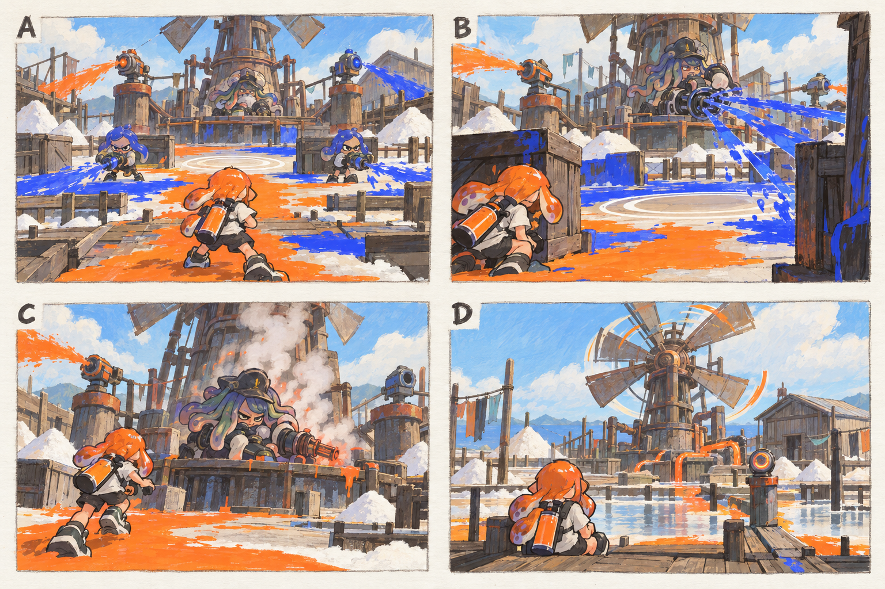

# 스테이지 5-3 — 바람이 멈춘 펌프

- [x] 장면·목표·동선·등장 적·보상을 상세화한다.
- [x] 러프 장면판을 생성하고 장면 설명과 대조한다.
- [x] 연결 링크와 기획 수치를 검토한다.

[전체 기획과 목차](../../싱글플레이-PvE-캠페인-기획-2.md) · [플레이 규칙](../systems/게임플레이-상세-24.md) · [그림 범례](../일러스트-시각설계-29.md)

이 문서는 추가할 캠페인의 기획이다. 아래 그림은 기획용 러프이며 실제 구현 화면이 아니다. 기존 지도 이미지와 구분해 읽는다. 좌표·엄폐 위치·적 수·체력·시간은 실제 맵과 플레이 검증 후 조정할 초기값이다.

## 1. 이 임무에서 경험하는 것

장치가 만드는 잉크 압박을 끊어 스피너 대장을 과열시키고 공격하는 구역 관리 보스전이다.

| 항목 | 내용 |
|---|---|
| 지역과 시간대 | 솔트팬 분지, 낮 / 지도 ID: saltpan이다. |
| 유형 | 스테이지 보스 임무이다. |
| 예상 시간 | 7~10분을 초기 목표로 한다. |
| 주 목표 | 살수 장치와 안전 구역을 활용해 풍차장 솔트를 제압한다. |
| 권장 행동 | 정비 빈틈에 대장을 쏠지 바닥을 칠할지 선택한다. 주 무기 종류에 따라 도색 속도는 달라도 목표 면적이 작아 모두 해결할 수 있다. |
| 완료 후 변화 | 록게이트 운하와 풍차축을 확정 해금한다. |

## 2. 네 장면으로 보는 플레이

> 그림 검수: 살수 장치 양쪽 배치·엄폐로 연사 피하기·과열 시 장비를 내린 대장·복구된 펌프를 확인했다. 주황 장치 표현은 안전 구역의 러프 색 구분이며 장치 소유권 전환 기능이 아니다. 안정화·연사·과열의 시간은 본문을 따른다.

장면판은 왼쪽 위 A → 오른쪽 위 B → 왼쪽 아래 C → 오른쪽 아래 D 순서로 읽는다. 화살표는 플레이어의 선택 동선이며, 반투명 위험선·원은 공격 전 예고이다. 작은 문자와 수치보다 아래의 설명을 기준으로 해석한다.

| 그림 | 읽어야 할 행동 |
|---|---|
| A — 펌프의 두 팔 | 왼쪽과 오른쪽 중 접근하기 쉬운 장치를 고른다. |
| B — 사격 사이에 길을 칠하다 | 엄폐를 이용해 연사를 끊고 공격 휴지기에 바닥을 칠한다. |
| C — 과열된 대장 | 4초 동안 접근 공격하거나 스페셜을 사용한다. |
| D — 돌아가는 풍차 | 복구 명령을 회수하고 모라의 결심을 듣는다. |

## 3. 기존 배경과 공간 구성

위 이미지는 기존 게임의 배경 참고이다. 신규 목표·적·장치의 배치를 확정한 사진이 아니다. 큰 지형과 건물·선박·소품을 재사용하고 아래 관계에 맞는 실제 공간을 선택한다.

| 표식 | 위치의 역할 |
|---|---|
| S | 풍력 펌프 앞 정비 구역 |
| A | 왼쪽 살수 장치 |
| CP | 보스장 바깥 창고 벽 |
| B | 스피너 대장의 낮은 펌프 기단 |
| X | 오른쪽 살수 장치와 안전 원 |
| E | 순환 설계 단말 |

**주 경로:** S·CP → A 또는 X 장치 → 안전 원 확보 → 솔트 B → E이다.

**다른 선택:** 왼쪽 또는 오른쪽 장치를 먼저 골라 공략한다. 선택 상자는 없다.

통로 폐쇄는 시각 표식과 임무 구역 경계로 표현한다. 점프나 무기 이동기로 우연히 뒤 구역에 도착해도 순서를 건너뛰어 완료되지 않게 하며, 플레이어가 막혔다면 되돌아갈 수 있는 경로를 남긴다.

## 4. 목표와 진행 조건

살수 장치 하나를 끄고 그 구역 60% 이상을 칠해 누적 6초 안전 상태를 만들면 솔트가 4초 과열 정비에 들어간다.

- 화면에는 현재 수행할 목표 하나를 우선 표시하고 완료한 목표는 작은 체크로 남긴다.
- 필수 장치와 적은 지도·화면 양쪽에서 식별할 수 있게 한다. 선택 보상은 별표로 구분한다.
- 장치 접근 가동은 별도 조작키 없이 범위 안에서 2초 머무르는 방식이다. 위험을 피하려고 나가면 즉시 중단한다.
- 특정 주 무기만 닿는 필수 표적을 만들지 않는다. 직접 공격이 어려우면 접근 가능한 낮은 표적이나 경로를 제공한다.

## 5. 장면별 상세 플레이

### A. 펌프의 두 팔

풍력 펌프 아래 대장과 좌우 살수 장치가 대칭처럼 보이되 도색은 다른 방향으로 흐른다.

| 구분 | 장면 안에서 일어나는 일 |
|---|---|
| 플레이어 행동 | 왼쪽과 오른쪽 중 접근하기 쉬운 장치를 고른다. |
| 적과 기믹 | 진입 사격병 2명 뒤 보스전을 시작한다. |
| 화면·소리의 전달 | 현재 안전 원과 장치 상태를 표시한다. |
| 다음 장면으로 가는 조건 | 첫 장치를 파괴하면 안전 구역 확보를 안내한다. |

### B. 사격 사이에 길을 칠하다

스피너 연사선과 주황 안전 원의 빈 바닥이 대비된다.

| 구분 | 장면 안에서 일어나는 일 |
|---|---|
| 플레이어 행동 | 엄폐를 이용해 연사를 끊고 공격 휴지기에 바닥을 칠한다. |
| 적과 기믹 | 연사 2초 뒤 최소 1.5초 정비를 준다. 사격은 플레이어를 즉시 추적하지 않는다. |
| 화면·소리의 전달 | 안전 상태 누적 0~6초를 표시한다. |
| 다음 장면으로 가는 조건 | 6초 달성 시 보스가 과열된다. |

### C. 과열된 대장

스피너에서 연기가 나고 대장이 잠깐 장비를 내려놓는다.

| 구분 | 장면 안에서 일어나는 일 |
|---|---|
| 플레이어 행동 | 4초 동안 접근 공격하거나 스페셜을 사용한다. |
| 적과 기믹 | 체력 절반에서 장치 활성 위치를 반대로 바꾸되 기존 장치를 무한 재생하지 않는다. |
| 화면·소리의 전달 | 노출 창과 다음 활성 장치를 동시에 예고한다. |
| 다음 장면으로 가는 조건 | 보스 제압 시 모든 살수 장치를 끈다. |

### D. 돌아가는 풍차

기존 펌프의 작은 움직임과 켜지는 순환 단말을 보여 준다.

| 구분 | 장면 안에서 일어나는 일 |
|---|---|
| 플레이어 행동 | 복구 명령을 회수하고 모라의 결심을 듣는다. |
| 적과 기믹 | 추가 전투는 없다. |
| 화면·소리의 전달 | 풍차축의 효과를 이전 도색 행동과 연결해 보여 준다. |
| 다음 장면으로 가는 조건 | E 회수로 완료한다. |

## 6. 핵심 적의 공략

**풍차장 솔트 / 인간형 스테이지 보스**이다. 초기 체력 2400, 본전투 90~150초를 목표로 조정한다.

1. 한쪽 장치를 끄고 6초 안전 상태를 만들면 4초 과열 창을 연다.
2. 체력 절반에서 반대 장치와 새 안전 원을 활성화한다.
3. 두 장치를 모두 처리한 뒤에는 정비 빈틈이 주기적으로 발생해 끝없는 가동 반복을 막는다.

정비 빈틈에 대장을 쏠지 바닥을 칠할지 선택한다. 주 무기 종류에 따라 도색 속도는 달라도 목표 면적이 작아 모두 해결할 수 있다.

예고는 최소 0.9초를 기본으로 하고 장면에 따로 정한 값이 더 길면 그 값을 사용한다. 재정비 중에는 예고 없이 즉시 반격하지 않는다. 정해진 지원 출현을 소진한 뒤에는 추가 소환이 반복되지 않는다.

## 7. 대사와 이야기의 변화

**입장 통신:** 솔트: 혼합 흐름을 차단한다. 모라: 역으로 생각해. 네가 만든 공간이 저 장비의 계산을 멈추게 할 거야.

**완료 통신:** 모라: 대체 복구 명령을 만들었어. 이제 운하의 통신선만 이어 주면 돼.

전투 중 긴 대사는 하지 않는다. 공격 예고가 시작되면 통신 자막을 미루며, 완료 대화는 건너뛰고 기록 창에서 다시 읽을 수 있다.

## 8. 보상과 다음 임무

| 항목 | 지급 규칙 |
|---|---|
| 첫 완료 경험치 | 기본 반복분과 첫 완료 추가분을 합해 600이다. |
| 반복 완료 경험치 | 180이다. |
| 첫 완료 부품 | 기본 60 + 첫 완료 추가 20 = 80개이다. |
| 반복 완료 부품 | 60개이다. |
| 완료 모듈 | 무작위 모듈 1개이다. |
| 공명핵 | 완료마다 1개이다. |
| 추가 보상 | 첫 완료에 풍차축 1개를 확정 지급한다. 선택 상자는 없다. |
| 파밍 계열 | 도색·스페셜 운용 계열이다. |

록게이트 운하와 풍차축을 확정 해금한다.

전투 중 보상은 현재 임무의 미확정 목록에 저장하고 완료 화면에서 확정한다. 실패·재시작으로 같은 상자의 모듈을 재추첨하지 않는다. 경험치·부품은 적 처치 횟수만으로 별도 증가하지 않는다.

## 9. 체크포인트와 재도전

펌프장 입장 앞에서 저장한다.

도색이 60% 아래로 내려가면 안전 시간은 잠시 멈추고 감소하지 않는다. 사망 시 장치·누적 시간·보스 체력을 함께 초기화한다.

체크포인트 대기에서는 장비와 특성을 바꿀 수 있다. 체력·잉크는 채우고 스페셜은 저장된 구간 시작값으로 복원한다. 현재 구간의 적·장치·임무용 잉크는 함께 복원하며, 공격 중인 적 앞에 바로 플레이어를 놓지 않는다.

## 10. 일러스트와 실제 제작의 경계

- 배경의 중심 실루엣은 기존 솔트팬 분지의 건물·소품을 따른다.
- 플레이어는 주황 잉크, 잔향 적은 코발트색 잉크로 시안을 통일한다. 실제 게임에서는 팀 팔레트와 색각 설정을 적용한다.
- 목표는 흰 이중 원, 선택 상자는 별, 공격 위험은 사선·원 테두리로 구분한다. 색 하나만으로 의미를 전달하지 않는다.
- 그림의 빛나는 표식·상호작용·임무 순서·개별 AI는 추가 기획이다. 현재 게임에서 이미 동작하는 기능이라고 해석하지 않는다.
- 이미지가 설명과 다르게 생성한 작은 장식·문자·문 개폐는 필수 기능으로 추가하지 않는다. 장면의 행동·공간 관계를 우선한다.

[그림 생성 지시서](../그림-생성-프롬프트-30.md) · [아이템](../systems/아이템-상세-26.md) · [성장](../systems/성장-상세-27.md) · [파밍](../systems/파밍과-보상-상세-28.md)
