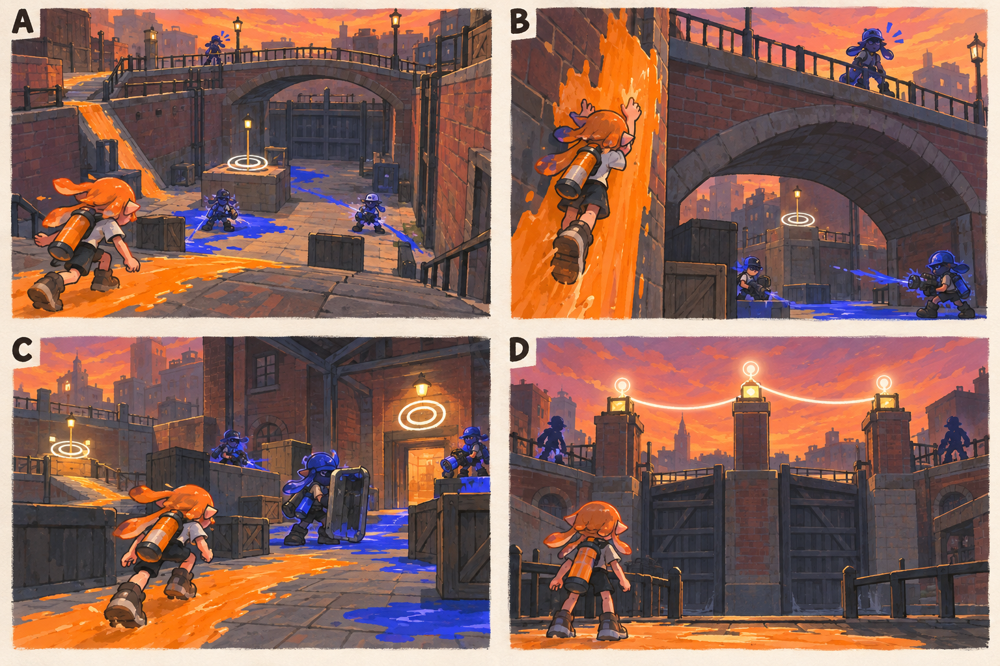

# 스테이지 6-1 — 닫힌 물길

- [x] 장면·목표·동선·등장 적·보상을 상세화한다.
- [x] 러프 장면판을 생성하고 장면 설명과 대조한다.
- [x] 연결 링크와 기획 수치를 검토한다.

[전체 기획과 목차](../../싱글플레이-PvE-캠페인-기획-2.md) · [플레이 규칙](../systems/게임플레이-상세-24.md) · [그림 범례](../일러스트-시각설계-29.md)

이 문서는 추가할 캠페인의 기획이다. 아래 그림은 기획용 러프이며 실제 구현 화면이 아니다. 기존 지도 이미지와 구분해 읽는다. 좌표·엄폐 위치·적 수·체력·시간은 실제 맵과 플레이 검증 후 조정할 초기값이다.

## 1. 이 임무에서 경험하는 것

높은 운하 벽과 다리로 나뉜 세 제어점을 순서대로 켜 도시의 마지막 통신선을 연결한다.

| 항목 | 내용 |
|---|---|
| 지역과 시간대 | 록게이트 운하, 해질녘 / 지도 ID: lockgate이다. |
| 유형 | 일반 목표 진행 임무이다. |
| 예상 시간 | 10~13분을 초기 목표로 한다. |
| 주 목표 | 운하 제어점 3개를 순서대로 복구한다. |
| 권장 행동 | 운하 벽의 칠할 수 있는 낮은 구간을 이용해 X와 다리 측면으로 접근한다. |
| 완료 후 변화 | 최종 통신 경로의 일부를 열고 관제실 접근을 해금한다. |

## 2. 네 장면으로 보는 플레이

> 그림 검수: 마른 운하 바닥·벽오르기·석교 엄폐·이어지는 제어점과 닫힌 수문을 확인했다. D의 두 실루엣은 다음 임무 예고이며 현재 교전하지 않는다. C의 최대 활성 수 4명은 본문을 따른다.

장면판은 왼쪽 위 A → 오른쪽 위 B → 왼쪽 아래 C → 오른쪽 아래 D 순서로 읽는다. 화살표는 플레이어의 선택 동선이며, 반투명 위험선·원은 공격 전 예고이다. 작은 문자와 수치보다 아래의 설명을 기준으로 해석한다.

| 그림 | 읽어야 할 행동 |
|---|---|
| A — 깊어 보이는 운하 | 깊이와 안전 경로를 확인하고 첫 제어점을 향해 내려간다. |
| B — 다리 아래에서 위로 | 벽을 칠해 올라가거나 경사로를 이용해 같은 높이를 확보한다. |
| C — 지키는 대신 이어 가기 | 다시 돌아가지 않고 방패병을 옆으로 돌아 마지막 지점에 진입한다. |
| D — 세 불빛의 연결 | 복구 명령을 전송하고 다음 통로의 두 실루엣을 본다. |

## 3. 기존 배경과 공간 구성

위 이미지는 기존 게임의 배경 참고이다. 신규 목표·적·장치의 배치를 확정한 사진이 아니다. 큰 지형과 건물·선박·소품을 재사용하고 아래 관계에 맞는 실제 공간을 선택한다.

| 표식 | 위치의 역할 |
|---|---|
| S | 남쪽 붉은 창고 앞 |
| A | 낮은 운하 바닥 첫 제어점 |
| CP | 돌다리 아래 중간 제어점 |
| B | 반대편 창고의 마지막 제어점 |
| X | 옆 창고 경사로의 선택 상자 |
| E | 세 번째 제어점 뒤 통신 단말 |

**주 경로:** S → A → 고정 경사로·다리 CP → B → E이다.

**다른 선택:** 운하 벽의 칠할 수 있는 낮은 구간을 이용해 X와 다리 측면으로 접근한다.

통로 폐쇄는 시각 표식과 임무 구역 경계로 표현한다. 점프나 무기 이동기로 우연히 뒤 구역에 도착해도 순서를 건너뛰어 완료되지 않게 하며, 플레이어가 막혔다면 되돌아갈 수 있는 경로를 남긴다.

## 4. 목표와 진행 조건

세 제어점을 각각 60% 도색하고 2초 가동한다. 실제 수문과 수위는 움직이지 않으며 완료한 지점은 유지한다.

- 화면에는 현재 수행할 목표 하나를 우선 표시하고 완료한 목표는 작은 체크로 남긴다.
- 필수 장치와 적은 지도·화면 양쪽에서 식별할 수 있게 한다. 선택 보상은 별표로 구분한다.
- 장치 접근 가동은 별도 조작키 없이 범위 안에서 2초 머무르는 방식이다. 위험을 피하려고 나가면 즉시 중단한다.
- 특정 주 무기만 닿는 필수 표적을 만들지 않는다. 직접 공격이 어려우면 접근 가능한 낮은 표적이나 경로를 제공한다.

## 5. 장면별 상세 플레이

### A. 깊어 보이는 운하

높은 벽돌 벽과 고정된 돌다리, 내려갈 수 있는 경사로가 한눈에 보인다.

| 구분 | 장면 안에서 일어나는 일 |
|---|---|
| 플레이어 행동 | 깊이와 안전 경로를 확인하고 첫 제어점을 향해 내려간다. |
| 적과 기믹 | 감시병 1명·사격병 2명이다. |
| 화면·소리의 전달 | 물이 아닌 이동 가능한 바닥과 낙하 경계를 구분한다. |
| 다음 장면으로 가는 조건 | A를 켜면 다리 아래 CP를 안내한다. |

### B. 다리 아래에서 위로

다리 위 감시병과 아래의 안전 엄폐가 수직으로 대비된다.

| 구분 | 장면 안에서 일어나는 일 |
|---|---|
| 플레이어 행동 | 벽을 칠해 올라가거나 경사로를 이용해 같은 높이를 확보한다. |
| 적과 기믹 | 도색병 1명·감시병 1명·사격병 1명이다. |
| 화면·소리의 전달 | 이전 제어점의 체크 표시를 계속 유지한다. |
| 다음 장면으로 가는 조건 | 두 번째 제어점을 켜면 마지막 창고가 열린다. |

### C. 지키는 대신 이어 가기

뒤쪽은 복구된 빛으로 남고 앞 창고에서 방패병이 등장한다.

| 구분 | 장면 안에서 일어나는 일 |
|---|---|
| 플레이어 행동 | 다시 돌아가지 않고 방패병을 옆으로 돌아 마지막 지점에 진입한다. |
| 적과 기믹 | 방패병 1명·포격병 1명·사격병 2명, 동시 최대 4명이다. |
| 화면·소리의 전달 | 완료 제어점 재방어가 필요 없다는 문구를 한 번 표시한다. |
| 다음 장면으로 가는 조건 | 세 번째 제어점 가동 후 E로 간다. |

### D. 세 불빛의 연결

다리와 창고 사이 통신등이 순서대로 켜진다.

| 구분 | 장면 안에서 일어나는 일 |
|---|---|
| 플레이어 행동 | 복구 명령을 전송하고 다음 통로의 두 실루엣을 본다. |
| 적과 기믹 | 두 문지기는 배경 예고만 한다. |
| 화면·소리의 전달 | 전송 3/3과 다음 임무를 표시한다. |
| 다음 장면으로 가는 조건 | E 전송으로 완료한다. |

## 6. 적 배치와 난도

- A 구간: 감시병 1명·사격병 2명이다.
- B 구간: 도색병 1명·감시병 1명·사격병 1명이다.
- C 구간: 방패병 1명·포격병 1명·사격병 2명, 동시 최대 4명이다.
- D 구간: 두 문지기는 배경 예고만 한다.

적의 단순 체력보다 사선·높이·도색 역할로 난도를 만든다. 사격병은 짧은 연사 뒤 0.8초 이상의 정비 시간을 제공한다. 감시병은 방향과 발사 시간을 먼저 알리고, 보스가 아닌 일반 적은 쓰러지면 이 구간에서 다시 출현하지 않는다.

## 7. 대사와 이야기의 변화

**입장 통신:** 틸: 물길은 멈췄어도 벽과 다리는 남아 있다. 한 번에 전부 지키려 하지 말고 한 곳씩 이어 가자.

**완료 통신:** 아카이브: 대체 명령 수신 가능. 모라: 이제 저 문지기들이 막는 관제실로 들어가자.

전투 중 긴 대사는 하지 않는다. 공격 예고가 시작되면 통신 자막을 미루며, 완료 대화는 건너뛰고 기록 창에서 다시 읽을 수 있다.

**선택 기록 — 수문 관리자의 우회선:** 큰 문이 멈추어도 사람이 고칠 수 있도록 작은 점검선이 남겨져 있었다.

선택 기록은 이 일반 임무의 선택 상자 하나와 함께 배치한다. 필수 회수 자료와 다른 수집물이며 엔딩 진입 조건으로 요구하지 않는다.

## 8. 보상과 다음 임무

| 항목 | 지급 규칙 |
|---|---|
| 첫 완료 경험치 | 기본 반복분과 첫 완료 추가분을 합해 600이다. |
| 반복 완료 경험치 | 120이다. |
| 첫 완료 부품 | 기본 40 + 첫 완료 추가 20 = 60개이다. |
| 반복 완료 부품 | 40개이다. |
| 완료 모듈 | 무작위 모듈 1개이다. |
| 공명핵 | 기본 완료에서는 지급하지 않는다. |
| 추가 보상 | 선택 상자 완료 시 무작위 모듈 1개·부품 10개·선택 기록 1개를 추가한다. |
| 파밍 계열 | 이동·보조 무기 연계 계열이다. |

최종 통신 경로의 일부를 열고 관제실 접근을 해금한다.

전투 중 보상은 현재 임무의 미확정 목록에 저장하고 완료 화면에서 확정한다. 실패·재시작으로 같은 상자의 모듈을 재추첨하지 않는다. 경험치·부품은 적 처치 횟수만으로 별도 증가하지 않는다.

## 9. 체크포인트와 재도전

각 제어점 완료 후 저장한다.

운하 벽에서 낙하해도 최근 제어점에서 복귀한다. 체크포인트와 가동된 제어점이 항상 같은 진행 상태를 가지게 한다.

체크포인트 대기에서는 장비와 특성을 바꿀 수 있다. 체력·잉크는 채우고 스페셜은 저장된 구간 시작값으로 복원한다. 현재 구간의 적·장치·임무용 잉크는 함께 복원하며, 공격 중인 적 앞에 바로 플레이어를 놓지 않는다.

## 10. 일러스트와 실제 제작의 경계

- 배경의 중심 실루엣은 기존 록게이트 운하의 건물·소품을 따른다.
- 플레이어는 주황 잉크, 잔향 적은 코발트색 잉크로 시안을 통일한다. 실제 게임에서는 팀 팔레트와 색각 설정을 적용한다.
- 목표는 흰 이중 원, 선택 상자는 별, 공격 위험은 사선·원 테두리로 구분한다. 색 하나만으로 의미를 전달하지 않는다.
- 그림의 빛나는 표식·상호작용·임무 순서·개별 AI는 추가 기획이다. 현재 게임에서 이미 동작하는 기능이라고 해석하지 않는다.
- 이미지가 설명과 다르게 생성한 작은 장식·문자·문 개폐는 필수 기능으로 추가하지 않는다. 장면의 행동·공간 관계를 우선한다.

[그림 생성 지시서](../그림-생성-프롬프트-30.md) · [아이템](../systems/아이템-상세-26.md) · [성장](../systems/성장-상세-27.md) · [파밍](../systems/파밍과-보상-상세-28.md)
