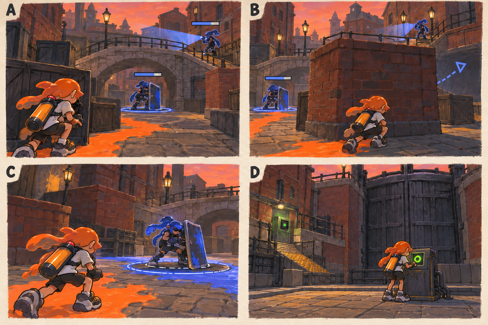

# 스테이지 6-2 — 두 문지기

- [x] 장면·목표·동선·등장 적·보상을 상세화한다.
- [x] 러프 장면판을 생성하고 장면 설명과 대조한다.
- [x] 연결 링크와 기획 수치를 검토한다.

[전체 기획과 목차](../../싱글플레이-PvE-캠페인-기획-2.md) · [플레이 규칙](../systems/게임플레이-상세-24.md) · [그림 범례](../일러스트-시각설계-29.md)

이 문서는 추가할 캠페인의 기획이다. 아래 그림은 기획용 러프이며 실제 구현 화면이 아니다. 기존 지도 이미지와 구분해 읽는다. 좌표·엄폐 위치·적 수·체력·시간은 실제 맵과 플레이 검증 후 조정할 초기값이다.

## 1. 이 임무에서 경험하는 것

방패 정예와 감시 정예를 돌다리·벽돌 엄폐로 분리해 싸우는 조합 전투이다.

| 항목 | 내용 |
|---|---|
| 지역과 시간대 | 록게이트 운하, 해질녘 / 지도 ID: lockgate이다. |
| 유형 | 일반 진행과 중간보스 임무이다. |
| 예상 시간 | 11~14분을 초기 목표로 한다. |
| 주 목표 | 관제 통로의 잠금을 해제하고 쌍문지기를 제압한다. |
| 권장 행동 | 두 체력을 동시에 깎기보다 시야 분리로 한 명부터 끝낸다. 어떤 순서로 제압해도 같은 보상을 준다. |
| 완료 후 변화 | 중간보스 조합 전투를 완료하고 수문 조율기 본전에 진입한다. |

## 2. 네 장면으로 보는 플레이

> 그림 검수: 두 정예의 다른 높이·벽돌 엄폐에 의한 시야 분리·한 명만 남은 교전·잠금 단말 가동을 확인했다. D의 공격 표현을 제거했으며 큰 수문은 움직이지 않는다. 체력 막대는 설명용 러프이다.

장면판은 왼쪽 위 A → 오른쪽 위 B → 왼쪽 아래 C → 오른쪽 아래 D 순서로 읽는다. 화살표는 플레이어의 선택 동선이며, 반투명 위험선·원은 공격 전 예고이다. 작은 문자와 수치보다 아래의 설명을 기준으로 해석한다.

| 그림 | 읽어야 할 행동 |
|---|---|
| A — 두 개의 시선 | 엄폐 안에서 두 공격 방향을 먼저 확인한다. |
| B — 시야를 끊는 벽 | 방패 정예만 엄폐 옆으로 유도하거나 경사로로 감시자에게 접근한다. |
| C — 남은 한 명의 규칙 | 기존에 배운 방패 발사 빈틈 또는 두 발 뒤 정비 창을 이용한다. |
| D — 열리는 통로 | 작은 잠금 단말을 켜고 관제 신호를 읽는다. |

## 3. 기존 배경과 공간 구성

위 이미지는 기존 게임의 배경 참고이다. 신규 목표·적·장치의 배치를 확정한 사진이 아니다. 큰 지형과 건물·선박·소품을 재사용하고 아래 관계에 맞는 실제 공간을 선택한다.

| 표식 | 위치의 역할 |
|---|---|
| S | 관제 창고 외벽 |
| A | 감시 사선을 끊는 큰 벽돌 엄폐 |
| CP | 돌다리 남쪽의 안전 대기 구역 |
| B | 방패 정예가 지키는 첫 통로 |
| X | 감시 정예 쪽 우회 경사로와 선택 상자 |
| E | 관제실 입구 잠금 단말 |

**주 경로:** S → 경계 전투 → CP → A로 둘의 시야 분리 → B → E이다.

**다른 선택:** A → X 경사로 → 감시 정예를 먼저 처리 → 방패 정예

통로 폐쇄는 시각 표식과 임무 구역 경계로 표현한다. 점프나 무기 이동기로 우연히 뒤 구역에 도착해도 순서를 건너뛰어 완료되지 않게 하며, 플레이어가 막혔다면 되돌아갈 수 있는 경로를 남긴다.

## 4. 목표와 진행 조건

두 정예의 경계 범위는 겹치지만 무제한 추적하지 않는다. 어느 정예부터 처리해도 잠금이 풀린다.

- 화면에는 현재 수행할 목표 하나를 우선 표시하고 완료한 목표는 작은 체크로 남긴다.
- 필수 장치와 적은 지도·화면 양쪽에서 식별할 수 있게 한다. 선택 보상은 별표로 구분한다.
- 장치 접근 가동은 별도 조작키 없이 범위 안에서 2초 머무르는 방식이다. 위험을 피하려고 나가면 즉시 중단한다.
- 특정 주 무기만 닿는 필수 표적을 만들지 않는다. 직접 공격이 어려우면 접근 가능한 낮은 표적이나 경로를 제공한다.

## 5. 장면별 상세 플레이

### A. 두 개의 시선

방패 정예는 낮은 다리 입구에, 감시 정예는 반대 경사로 위에 서 있다.

| 구분 | 장면 안에서 일어나는 일 |
|---|---|
| 플레이어 행동 | 엄폐 안에서 두 공격 방향을 먼저 확인한다. |
| 적과 기믹 | 진입 경계 적 3명을 처리한 뒤 정예가 활성화된다. |
| 화면·소리의 전달 | 각 정예의 이름과 체력을 따로 표시한다. |
| 다음 장면으로 가는 조건 | CP를 확인하면 본전투를 시작한다. |

### B. 시야를 끊는 벽

큰 벽돌 엄폐가 화면 가운데에서 감시자의 선을 가린다.

| 구분 | 장면 안에서 일어나는 일 |
|---|---|
| 플레이어 행동 | 방패 정예만 엄폐 옆으로 유도하거나 경사로로 감시자에게 접근한다. |
| 적과 기믹 | 정예 둘 외의 지원 적은 출현하지 않는다. |
| 화면·소리의 전달 | 동시에 가려진 적의 예고는 방향 아이콘으로 안내한다. |
| 다음 장면으로 가는 조건 | 한 정예를 제압하면 남은 정예가 재배치한다. |

### C. 남은 한 명의 규칙

남은 정예가 엄폐 옆으로 이동해 새로운 공격선을 만든다.

| 구분 | 장면 안에서 일어나는 일 |
|---|---|
| 플레이어 행동 | 기존에 배운 방패 발사 빈틈 또는 두 발 뒤 정비 창을 이용한다. |
| 적과 기믹 | 남은 정예에게 큰 체력 회복·즉시 광폭화는 주지 않는다. |
| 화면·소리의 전달 | 처리한 정예 이름은 회색 체크로 바뀐다. |
| 다음 장면으로 가는 조건 | 둘 모두 제압하면 잠금이 해제된다. |

### D. 열리는 통로

큰 수문은 그대로이고 옆 점검 통로의 표시만 녹색으로 바뀐다.

| 구분 | 장면 안에서 일어나는 일 |
|---|---|
| 플레이어 행동 | 작은 잠금 단말을 켜고 관제 신호를 읽는다. |
| 적과 기믹 | 실제 문 이동 연출은 필수로 만들지 않는다. |
| 화면·소리의 전달 | 최종 제어핵 표식을 다음 임무로 보여 준다. |
| 다음 장면으로 가는 조건 | E 가동으로 완료한다. |

## 6. 핵심 적의 공략

**쌍문지기 / 방패·감시 정예 조합**이다. 방패 360, 감시 300을 시작값으로 조정한다. 둘의 합계를 단독 정예 두 배로 올리지 않는다.

1. 둘이 함께 있지만 벽돌 엄폐로 시야를 완전히 분리할 수 있다.
2. 방패는 1초 예고 발사 후 3초 노출, 감시는 두 발 후 2.5초 정비를 유지한다.
3. 한 명이 남으면 위치를 한 번 바꾸며 갑자기 새 패턴을 추가하지 않는다.

두 체력을 동시에 깎기보다 시야 분리로 한 명부터 끝낸다. 어떤 순서로 제압해도 같은 보상을 준다.

예고는 최소 0.9초를 기본으로 하고 장면에 따로 정한 값이 더 길면 그 값을 사용한다. 재정비 중에는 예고 없이 즉시 반격하지 않는다. 정해진 지원 출현을 소진한 뒤에는 추가 소환이 반복되지 않는다.

## 7. 대사와 이야기의 변화

**입장 통신:** 틸: 한 명이 앞을 막고 다른 한 명이 옆을 본다. 둘의 시선이 만나는 곳에서 싸우지 마.

**완료 통신:** 모라: 혼자라서 동시에 상대할 필요는 없어. 네가 나누어 만든 공간이 해답이었어.

전투 중 긴 대사는 하지 않는다. 공격 예고가 시작되면 통신 자막을 미루며, 완료 대화는 건너뛰고 기록 창에서 다시 읽을 수 있다.

**선택 기록 — 둘로 나눈 열쇠:** 관제실은 두 작업자가 서로 확인해야 열리도록 설계되었다. 조율망은 그 안전 절차를 봉쇄에 사용했다.

선택 기록은 이 일반 임무의 선택 상자 하나와 함께 배치한다. 필수 회수 자료와 다른 수집물이며 엔딩 진입 조건으로 요구하지 않는다.

## 8. 보상과 다음 임무

| 항목 | 지급 규칙 |
|---|---|
| 첫 완료 경험치 | 기본 반복분과 첫 완료 추가분을 합해 600이다. |
| 반복 완료 경험치 | 120이다. |
| 첫 완료 부품 | 기본 40 + 첫 완료 추가 20 = 60개이다. |
| 반복 완료 부품 | 40개이다. |
| 완료 모듈 | 무작위 모듈 1개이다. |
| 공명핵 | 기본 완료에서는 지급하지 않는다. |
| 추가 보상 | 선택 상자 완료 시 무작위 모듈 1개·부품 10개·선택 기록 1개를 추가한다. |
| 파밍 계열 | 이동·보조 무기 연계 계열이다. |

중간보스 조합 전투를 완료하고 수문 조율기 본전에 진입한다.

전투 중 보상은 현재 임무의 미확정 목록에 저장하고 완료 화면에서 확정한다. 실패·재시작으로 같은 상자의 모듈을 재추첨하지 않는다. 경험치·부품은 적 처치 횟수만으로 별도 증가하지 않는다.

## 9. 체크포인트와 재도전

두 정예 전투 직전에 저장한다.

정예가 지형에 끼면 처음 체력으로 재시작하지 말고 공격을 쉬는 안전 위치로 재배치한다. 플레이어 사망 시 두 정예 전투만 복원한다.

체크포인트 대기에서는 장비와 특성을 바꿀 수 있다. 체력·잉크는 채우고 스페셜은 저장된 구간 시작값으로 복원한다. 현재 구간의 적·장치·임무용 잉크는 함께 복원하며, 공격 중인 적 앞에 바로 플레이어를 놓지 않는다.

## 10. 일러스트와 실제 제작의 경계

- 배경의 중심 실루엣은 기존 록게이트 운하의 건물·소품을 따른다.
- 플레이어는 주황 잉크, 잔향 적은 코발트색 잉크로 시안을 통일한다. 실제 게임에서는 팀 팔레트와 색각 설정을 적용한다.
- 목표는 흰 이중 원, 선택 상자는 별, 공격 위험은 사선·원 테두리로 구분한다. 색 하나만으로 의미를 전달하지 않는다.
- 그림의 빛나는 표식·상호작용·임무 순서·개별 AI는 추가 기획이다. 현재 게임에서 이미 동작하는 기능이라고 해석하지 않는다.
- 이미지가 설명과 다르게 생성한 작은 장식·문자·문 개폐는 필수 기능으로 추가하지 않는다. 장면의 행동·공간 관계를 우선한다.

[그림 생성 지시서](../그림-생성-프롬프트-30.md) · [아이템](../systems/아이템-상세-26.md) · [성장](../systems/성장-상세-27.md) · [파밍](../systems/파밍과-보상-상세-28.md)
