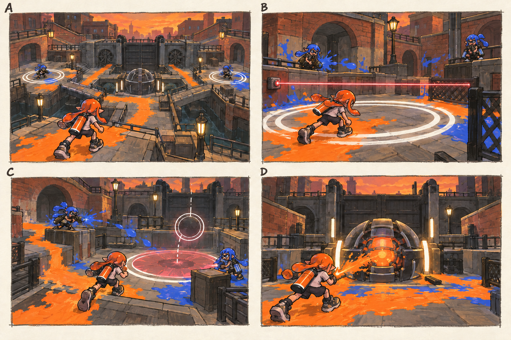

# 스테이지 6-3 — 역류의 관제실

- [x] 장면·목표·동선·등장 적·보상을 상세화한다.
- [x] 러프 장면판을 생성하고 장면 설명과 대조한다.
- [x] 연결 링크와 기획 수치를 검토한다.

[전체 기획과 목차](../../싱글플레이-PvE-캠페인-기획-2.md) · [플레이 규칙](../systems/게임플레이-상세-24.md) · [그림 범례](../일러스트-시각설계-29.md)

이 문서는 추가할 캠페인의 기획이다. 아래 그림은 기획용 러프이며 실제 구현 화면이 아니다. 기존 지도 이미지와 구분해 읽는다. 좌표·엄폐 위치·적 수·체력·시간은 실제 맵과 플레이 검증 후 조정할 초기값이다.

## 1. 이 임무에서 경험하는 것

두 제어구역을 차례로 지킨 뒤 중심핵을 여는 장치 보스전으로 지금까지의 공간 관리 능력을 시험한다.

| 항목 | 내용 |
|---|---|
| 지역과 시간대 | 록게이트 운하, 해질녘 / 지도 ID: lockgate이다. |
| 유형 | 스테이지 보스 임무이다. |
| 예상 시간 | 8~10분을 초기 목표로 한다. |
| 주 목표 | 외곽 제어점 2개를 안정화하고 수문 조율기를 파괴한다. |
| 권장 행동 | 빈 원을 지키려고 제자리에서 피해를 받지 않는다. 잠깐 피하면 진행만 멈추며 뒤로 줄지 않는다. |
| 완료 후 변화 | 테라스 고지대와 수문 도체를 확정 해금한다. |

## 2. 네 장면으로 보는 플레이

> 그림 검수: 제어점 A·B와 낮은 핵, 고정 장치의 광선, 원형 예고의 안전 통로, 핵 공격을 확인했다. B의 잉크 흔적은 앞선 사격 흔적이며 장치 광선과 사격병 공격은 본문대로 교대한다. C에는 원형 예고 하나만 표현했다.

장면판은 왼쪽 위 A → 오른쪽 위 B → 왼쪽 아래 C → 오른쪽 아래 D 순서로 읽는다. 화살표는 플레이어의 선택 동선이며, 반투명 위험선·원은 공격 전 예고이다. 작은 문자와 수치보다 아래의 설명을 기준으로 해석한다.

| 그림 | 읽어야 할 행동 |
|---|---|
| A — 물길의 회로 | 현재 활성 지점 A와 이동 엄폐를 확인한다. |
| B — 한 곳을 먼저 지키기 | 광선 예고를 보고 원 안팎을 오가며 30초를 누적한다. |
| C — 원과 선 사이의 길 | A에서 확보한 퇴로를 활용해 B로 접근하고 안전 시간을 채운다. |
| D — 마지막 핵 | 기존 두 안전 공간을 오가며 핵을 공격한다. |

## 3. 기존 배경과 공간 구성

위 이미지는 기존 게임의 배경 참고이다. 신규 목표·적·장치의 배치를 확정한 사진이 아니다. 큰 지형과 건물·선박·소품을 재사용하고 아래 관계에 맞는 실제 공간을 선택한다.

| 표식 | 위치의 역할 |
|---|---|
| S | 관제 창고 앞 정비 구역 |
| A | 서쪽 외곽 제어점 |
| CP | 보스장 진입 전 낮은 창고 |
| B | 동쪽 제어점과 중앙 낮은 핵 |
| X | 고정 다리 아래의 안전 엄폐 |
| E | 핵 뒤 중앙 통신함 |

**주 경로:** S·CP → A 안정화 → B 안정화 → 중앙 핵 → E이다.

**다른 선택:** 각 제어점 사이에 다리 위 짧은 길과 다리 아래 긴 안전 길을 둔다.

통로 폐쇄는 시각 표식과 임무 구역 경계로 표현한다. 점프나 무기 이동기로 우연히 뒤 구역에 도착해도 순서를 건너뛰어 완료되지 않게 하며, 플레이어가 막혔다면 되돌아갈 수 있는 경로를 남긴다.

## 4. 목표와 진행 조건

A에서 누적 30초, 이어서 B에서 누적 30초를 안정화한다. 둘을 동시에 지킬 필요는 없다. 두 곳 완료 후 핵이 계속 노출된다.

- 화면에는 현재 수행할 목표 하나를 우선 표시하고 완료한 목표는 작은 체크로 남긴다.
- 필수 장치와 적은 지도·화면 양쪽에서 식별할 수 있게 한다. 선택 보상은 별표로 구분한다.
- 장치 접근 가동은 별도 조작키 없이 범위 안에서 2초 머무르는 방식이다. 위험을 피하려고 나가면 즉시 중단한다.
- 특정 주 무기만 닿는 필수 표적을 만들지 않는다. 직접 공격이 어려우면 접근 가능한 낮은 표적이나 경로를 제공한다.

## 5. 장면별 상세 플레이

### A. 물길의 회로

벽돌 운하 양쪽 제어점과 중앙 장치가 고정된 회로처럼 보인다.

| 구분 | 장면 안에서 일어나는 일 |
|---|---|
| 플레이어 행동 | 현재 활성 지점 A와 이동 엄폐를 확인한다. |
| 적과 기믹 | 진입 전투는 짧게 사격병 2명으로 제한한다. |
| 화면·소리의 전달 | 현재 A, 다음 B 순서를 명확하게 보여 준다. |
| 다음 장면으로 가는 조건 | A 진입으로 첫 안정화를 시작한다. |

### B. 한 곳을 먼저 지키기

A에 좁은 광선이 가로지르고 반대편은 비활성 상태이다.

| 구분 | 장면 안에서 일어나는 일 |
|---|---|
| 플레이어 행동 | 광선 예고를 보고 원 안팎을 오가며 30초를 누적한다. |
| 적과 기믹 | 사격병 2명과 장치 광선이 번갈아 공격한다. |
| 화면·소리의 전달 | 원에서 나가면 시간이 멈추고 줄지 않는다는 것을 보여 준다. |
| 다음 장면으로 가는 조건 | A 완료 후 B로 이동한다. |

### C. 원과 선 사이의 길

B 근처에서 원형 낙하 예고와 광선이 시간차로 겹친다.

| 구분 | 장면 안에서 일어나는 일 |
|---|---|
| 플레이어 행동 | A에서 확보한 퇴로를 활용해 B로 접근하고 안전 시간을 채운다. |
| 적과 기믹 | 지원 도색병 1명·사격병 1명이다. 강한 공격은 하나씩 예고한다. |
| 화면·소리의 전달 | A의 완료 표식과 B 진행률을 함께 보여 준다. |
| 다음 장면으로 가는 조건 | B 완료 뒤 핵의 보호 표시가 사라진다. |

### D. 마지막 핵

중앙 핵이 낮게 열리고 이제 이동과 사격을 함께 할 수 있다.

| 구분 | 장면 안에서 일어나는 일 |
|---|---|
| 플레이어 행동 | 기존 두 안전 공간을 오가며 핵을 공격한다. |
| 적과 기믹 | 새 제어점은 생성하지 않고 남은 광선의 빈도도 낮춘다. |
| 화면·소리의 전달 | 핵 파괴 시 초기화 파형이 끊기고 중앙 통신선이 켜진다. |
| 다음 장면으로 가는 조건 | E 전송과 서명 보상으로 완료한다. |

## 6. 핵심 적의 공략

**수문 조율기 / 고정 장치 보스**이다. 노출 핵 초기 체력 2800, 안정화 포함 본전투 150~210초를 목표로 조정한다.

1. A만 활성화해 30초 안정화를 수행한다.
2. B에서 같은 규칙에 원형 공격을 추가한다.
3. 두 점 완료 후 핵을 계속 노출하고 재가동을 요구하지 않는다.

빈 원을 지키려고 제자리에서 피해를 받지 않는다. 잠깐 피하면 진행만 멈추며 뒤로 줄지 않는다.

예고는 최소 0.9초를 기본으로 하고 장면에 따로 정한 값이 더 길면 그 값을 사용한다. 재정비 중에는 예고 없이 즉시 반격하지 않는다. 정해진 지원 출현을 소진한 뒤에는 추가 소환이 반복되지 않는다.

## 7. 대사와 이야기의 변화

**입장 통신:** 아카이브: 모든 흐름의 초기화까지 대기 중. 모라: 이제 우리 쪽 순환도를 보낼 차례야.

**완료 통신:** 틸: 중앙 고지대로 신호가 닿았어. 복구 명령을 끝까지 보낼 사람이 한 명 필요하다.

전투 중 긴 대사는 하지 않는다. 공격 예고가 시작되면 통신 자막을 미루며, 완료 대화는 건너뛰고 기록 창에서 다시 읽을 수 있다.

## 8. 보상과 다음 임무

| 항목 | 지급 규칙 |
|---|---|
| 첫 완료 경험치 | 기본 반복분과 첫 완료 추가분을 합해 600이다. |
| 반복 완료 경험치 | 180이다. |
| 첫 완료 부품 | 기본 60 + 첫 완료 추가 20 = 80개이다. |
| 반복 완료 부품 | 60개이다. |
| 완료 모듈 | 무작위 모듈 1개이다. |
| 공명핵 | 완료마다 1개이다. |
| 추가 보상 | 첫 완료에 수문 도체 1개를 확정 지급한다. 선택 상자는 없다. |
| 파밍 계열 | 이동·보조 무기 연계 계열이다. |

테라스 고지대와 수문 도체를 확정 해금한다.

전투 중 보상은 현재 임무의 미확정 목록에 저장하고 완료 화면에서 확정한다. 실패·재시작으로 같은 상자의 모듈을 재추첨하지 않는다. 경험치·부품은 적 처치 횟수만으로 별도 증가하지 않는다.

## 9. 체크포인트와 재도전

본전투 직전에 저장한다. 보스 단계 내부에는 별도 자동 저장을 두지 않는다.

수문이 닫히거나 수위가 올라가 물리적으로 끼이는 실패 조건은 만들지 않는다. 사망 시 A·B와 핵을 함께 초기화한다.

체크포인트 대기에서는 장비와 특성을 바꿀 수 있다. 체력·잉크는 채우고 스페셜은 저장된 구간 시작값으로 복원한다. 현재 구간의 적·장치·임무용 잉크는 함께 복원하며, 공격 중인 적 앞에 바로 플레이어를 놓지 않는다.

## 10. 일러스트와 실제 제작의 경계

- 배경의 중심 실루엣은 기존 록게이트 운하의 건물·소품을 따른다.
- 플레이어는 주황 잉크, 잔향 적은 코발트색 잉크로 시안을 통일한다. 실제 게임에서는 팀 팔레트와 색각 설정을 적용한다.
- 목표는 흰 이중 원, 선택 상자는 별, 공격 위험은 사선·원 테두리로 구분한다. 색 하나만으로 의미를 전달하지 않는다.
- 그림의 빛나는 표식·상호작용·임무 순서·개별 AI는 추가 기획이다. 현재 게임에서 이미 동작하는 기능이라고 해석하지 않는다.
- 이미지가 설명과 다르게 생성한 작은 장식·문자·문 개폐는 필수 기능으로 추가하지 않는다. 장면의 행동·공간 관계를 우선한다.

[그림 생성 지시서](../그림-생성-프롬프트-30.md) · [아이템](../systems/아이템-상세-26.md) · [성장](../systems/성장-상세-27.md) · [파밍](../systems/파밍과-보상-상세-28.md)
