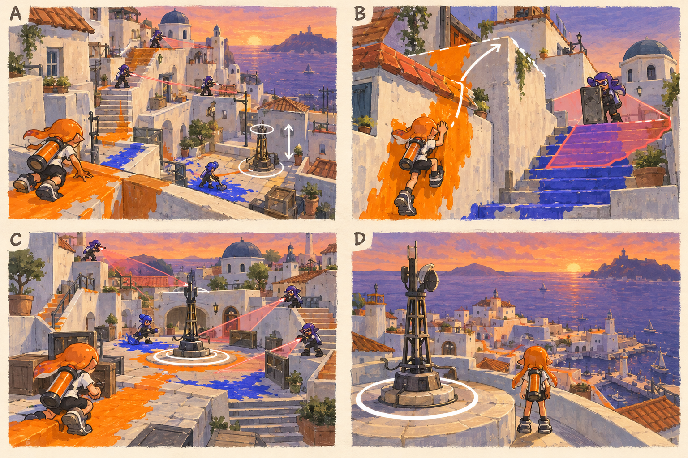

# 스테이지 7-1 — 가장 높은 우회로

- [x] 장면·목표·동선·등장 적·보상을 상세화한다.
- [x] 러프 장면판을 생성하고 장면 설명과 대조한다.
- [x] 연결 링크와 기획 수치를 검토한다.

[전체 기획과 목차](../../싱글플레이-PvE-캠페인-기획-2.md) · [플레이 규칙](../systems/게임플레이-상세-24.md) · [그림 범례](../일러스트-시각설계-29.md)

이 문서는 추가할 캠페인의 기획이다. 아래 그림은 기획용 러프이며 실제 구현 화면이 아니다. 기존 지도 이미지와 구분해 읽는다. 좌표·엄폐 위치·적 수·체력·시간은 실제 맵과 플레이 검증 후 조정할 초기값이다.

## 1. 이 임무에서 경험하는 것

언덕마을의 층진 계단과 벽을 연결해 감시 사선을 우회하며 중앙 중계기로 올라가는 임무이다.

| 항목 | 내용 |
|---|---|
| 지역과 시간대 | 테라스 고지대, 해질녘 / 지도 ID: terraces이다. |
| 유형 | 일반 목표 진행 임무이다. |
| 예상 시간 | 11~14분을 초기 목표로 한다. |
| 주 목표 | 높이가 다른 중계기 3개를 연결하고 상부 광장에 도달한다. |
| 권장 행동 | A → 낮은 집 외벽의 연속 잠수 길 → X → CP 측면 |
| 완료 후 변화 | 마지막 지역의 통신 연출과 최종 지휘관 접근을 해금한다. |

## 2. 네 장면으로 보는 플레이

> 그림 검수: 흰 벽·주황 지붕·층진 계단·벽오르기와 착지 공간·최종 중계기·항구 조망을 확인했다. 붉은 사선은 병종별 공격 영역의 개념 표시이며 사격병을 추가 감시병으로 바꾸지 않는다. 적 구성과 예고 시간은 본문을 따른다.

장면판은 왼쪽 위 A → 오른쪽 위 B → 왼쪽 아래 C → 오른쪽 아래 D 순서로 읽는다. 화살표는 플레이어의 선택 동선이며, 반투명 위험선·원은 공격 전 예고이다. 작은 문자와 수치보다 아래의 설명을 기준으로 해석한다.

| 그림 | 읽어야 할 행동 |
|---|---|
| A — 계단을 보는 시선 | 첫 엄폐까지 도색하고 낮은 중계기를 확보한다. |
| B — 벽에 만든 계단 | 기본 잠수·벽오르기로 우회하거나 정면 엄폐를 순서대로 오른다. |
| C — 세 방향의 작은 전투 | 높은 감시병과 도색병 중 우선순위를 고르고 마지막 중계기를 복구한다. |
| D — 뒤돌아본 항구 | 중앙 통신대에 도착해 남은 신호를 듣는다. |

## 3. 기존 배경과 공간 구성

위 이미지는 기존 게임의 배경 참고이다. 신규 목표·적·장치의 배치를 확정한 사진이 아니다. 큰 지형과 건물·선박·소품을 재사용하고 아래 관계에 맞는 실제 공간을 선택한다.

| 표식 | 위치의 역할 |
|---|---|
| S | 언덕 아래 작은 골목 |
| A | 첫 계단의 중간 테라스 |
| CP | 돔 건물 옆 그늘진 광장 |
| B | 위쪽 중계기와 긴 계단 |
| X | 옆집 외벽의 선택 상자 |
| E | 가장 높은 고정 통신대 |

**주 경로:** S → 계단 A → 옆벽 또는 긴 계단 → CP → B → E이다.

**다른 선택:** A → 낮은 집 외벽의 연속 잠수 길 → X → CP 측면

통로 폐쇄는 시각 표식과 임무 구역 경계로 표현한다. 점프나 무기 이동기로 우연히 뒤 구역에 도착해도 순서를 건너뛰어 완료되지 않게 하며, 플레이어가 막혔다면 되돌아갈 수 있는 경로를 남긴다.

## 4. 목표와 진행 조건

중계기 3개를 순차 가동하며 각 완료 지점은 유지한다. 특정 점프 기술이나 특정 무기 이동기를 필수로 요구하지 않는다.

- 화면에는 현재 수행할 목표 하나를 우선 표시하고 완료한 목표는 작은 체크로 남긴다.
- 필수 장치와 적은 지도·화면 양쪽에서 식별할 수 있게 한다. 선택 보상은 별표로 구분한다.
- 장치 접근 가동은 별도 조작키 없이 범위 안에서 2초 머무르는 방식이다. 위험을 피하려고 나가면 즉시 중단한다.
- 특정 주 무기만 닿는 필수 표적을 만들지 않는다. 직접 공격이 어려우면 접근 가능한 낮은 표적이나 경로를 제공한다.

## 5. 장면별 상세 플레이

### A. 계단을 보는 시선

흰 벽과 주황 지붕 사이 계단이 위로 이어지고 감시선이 길을 가른다.

| 구분 | 장면 안에서 일어나는 일 |
|---|---|
| 플레이어 행동 | 첫 엄폐까지 도색하고 낮은 중계기를 확보한다. |
| 적과 기믹 | 감시병 1명·사격병 2명·도색병 1명이다. |
| 화면·소리의 전달 | 높이가 다른 목표는 위·아래 화살표로 구분한다. |
| 다음 장면으로 가는 조건 | 첫 중계기 완료 후 위쪽 경로가 보인다. |

### B. 벽에 만든 계단

막힌 정면 계단과 칠할 수 있는 옆집 벽이 대비된다.

| 구분 | 장면 안에서 일어나는 일 |
|---|---|
| 플레이어 행동 | 기본 잠수·벽오르기로 우회하거나 정면 엄폐를 순서대로 오른다. |
| 적과 기믹 | 방패병 1명은 정면만 막고 측면 경로를 완전히 보지 못한다. |
| 화면·소리의 전달 | 도달 가능한 벽 끝과 안전 착지 공간을 보여 준다. |
| 다음 장면으로 가는 조건 | CP 광장에 도착하면 아래 구간을 저장한다. |

### C. 세 방향의 작은 전투

위 광장의 계단 세 방향에서 제한된 적이 접근한다.

| 구분 | 장면 안에서 일어나는 일 |
|---|---|
| 플레이어 행동 | 높은 감시병과 도색병 중 우선순위를 고르고 마지막 중계기를 복구한다. |
| 적과 기믹 | 감시병 1명·도색병 1명·사격병 2명, 동시 최대 4명이다. |
| 화면·소리의 전달 | 이전 지역에서 복구한 통신 아이콘이 차례로 들어온다. |
| 다음 장면으로 가는 조건 | 마지막 중계기 완료 후 E로 올라간다. |

### D. 뒤돌아본 항구

높은 테라스에서 바다와 복구된 아래 지역을 멀리 바라본다.

| 구분 | 장면 안에서 일어나는 일 |
|---|---|
| 플레이어 행동 | 중앙 통신대에 도착해 남은 신호를 듣는다. |
| 적과 기믹 | 새 적을 출현시키지 않는다. |
| 화면·소리의 전달 | 시야를 방해하지 않는 짧은 통신 자막만 넣는다. |
| 다음 장면으로 가는 조건 | E 도착으로 완료한다. |

## 6. 적 배치와 난도

- A 구간: 감시병 1명·사격병 2명·도색병 1명이다.
- B 구간: 방패병 1명은 정면만 막고 측면 경로를 완전히 보지 못한다.
- C 구간: 감시병 1명·도색병 1명·사격병 2명, 동시 최대 4명이다.
- D 구간: 새 적을 출현시키지 않는다.

적의 단순 체력보다 사선·높이·도색 역할로 난도를 만든다. 사격병은 짧은 연사 뒤 0.8초 이상의 정비 시간을 제공한다. 감시병은 방향과 발사 시간을 먼저 알리고, 보스가 아닌 일반 적은 쓰러지면 이 구간에서 다시 출현하지 않는다.

## 7. 대사와 이야기의 변화

**입장 통신:** 틸: 아래 길은 전부 보고 있지만 위 벽은 비어 있어. 네가 만든 길로 올라가.

**완료 통신:** 모라: 시장과 부두, 염전에서 응답이 돌아와. 다들 마지막 신호를 기다리고 있어.

전투 중 긴 대사는 하지 않는다. 공격 예고가 시작되면 통신 자막을 미루며, 완료 대화는 건너뛰고 기록 창에서 다시 읽을 수 있다.

**선택 기록 — 벽에 남긴 안내:** 폭풍 때 주민들은 계단이 막히자 벽에 다음 대피 장소의 색을 칠해 서로를 안내했다.

선택 기록은 이 일반 임무의 선택 상자 하나와 함께 배치한다. 필수 회수 자료와 다른 수집물이며 엔딩 진입 조건으로 요구하지 않는다.

## 8. 보상과 다음 임무

| 항목 | 지급 규칙 |
|---|---|
| 첫 완료 경험치 | 기본 반복분과 첫 완료 추가분을 합해 600이다. |
| 반복 완료 경험치 | 120이다. |
| 첫 완료 부품 | 기본 40 + 첫 완료 추가 20 = 60개이다. |
| 반복 완료 부품 | 40개이다. |
| 완료 모듈 | 무작위 모듈 1개이다. |
| 공명핵 | 기본 완료에서는 지급하지 않는다. |
| 추가 보상 | 선택 상자 완료 시 무작위 모듈 1개·부품 10개·선택 기록 1개를 추가한다. |
| 파밍 계열 | 약점 공략·위험 감수 계열이다. |

마지막 지역의 통신 연출과 최종 지휘관 접근을 해금한다.

전투 중 보상은 현재 임무의 미확정 목록에 저장하고 완료 화면에서 확정한다. 실패·재시작으로 같은 상자의 모듈을 재추첨하지 않는다. 경험치·부품은 적 처치 횟수만으로 별도 증가하지 않는다.

## 9. 체크포인트와 재도전

첫 중계기와 돔 옆 광장에서 저장한다.

벽오르기 실패 시 마지막 테라스 CP에서 복귀한다. 도달할 수 없는 높은 벽을 유일한 진입로로 지정하지 않는다.

체크포인트 대기에서는 장비와 특성을 바꿀 수 있다. 체력·잉크는 채우고 스페셜은 저장된 구간 시작값으로 복원한다. 현재 구간의 적·장치·임무용 잉크는 함께 복원하며, 공격 중인 적 앞에 바로 플레이어를 놓지 않는다.

## 10. 일러스트와 실제 제작의 경계

- 배경의 중심 실루엣은 기존 테라스 고지대의 건물·소품을 따른다.
- 플레이어는 주황 잉크, 잔향 적은 코발트색 잉크로 시안을 통일한다. 실제 게임에서는 팀 팔레트와 색각 설정을 적용한다.
- 목표는 흰 이중 원, 선택 상자는 별, 공격 위험은 사선·원 테두리로 구분한다. 색 하나만으로 의미를 전달하지 않는다.
- 그림의 빛나는 표식·상호작용·임무 순서·개별 AI는 추가 기획이다. 현재 게임에서 이미 동작하는 기능이라고 해석하지 않는다.
- 이미지가 설명과 다르게 생성한 작은 장식·문자·문 개폐는 필수 기능으로 추가하지 않는다. 장면의 행동·공간 관계를 우선한다.

[그림 생성 지시서](../그림-생성-프롬프트-30.md) · [아이템](../systems/아이템-상세-26.md) · [성장](../systems/성장-상세-27.md) · [파밍](../systems/파밍과-보상-상세-28.md)
