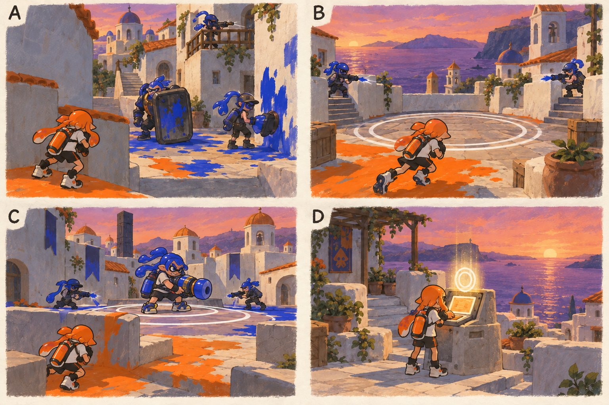

# 스테이지 7-2 — 남은 신호

- [x] 장면·목표·동선·등장 적·보상을 상세화한다.
- [x] 러프 장면판을 생성하고 장면 설명과 대조한다.
- [x] 연결 링크와 기획 수치를 검토한다.

[전체 기획과 목차](../../싱글플레이-PvE-캠페인-기획-2.md) · [플레이 규칙](../systems/게임플레이-상세-24.md) · [그림 범례](../일러스트-시각설계-29.md)

이 문서는 추가할 캠페인의 기획이다. 아래 그림은 기획용 러프이며 실제 구현 화면이 아니다. 기존 지도 이미지와 구분해 읽는다. 좌표·엄폐 위치·적 수·체력·시간은 실제 맵과 플레이 검증 후 조정할 초기값이다.

## 1. 이 임무에서 경험하는 것

세 가지 역할의 적 조합과 마지막 지휘관을 순서대로 상대하며 마지막 복구 기록을 찾는다.

| 항목 | 내용 |
|---|---|
| 지역과 시간대 | 테라스 고지대, 해질녘 / 지도 ID: terraces이다. |
| 유형 | 일반 진행과 중간보스 임무이다. |
| 예상 시간 | 12~15분을 초기 목표로 한다. |
| 주 목표 | 고정 제어점의 방어를 완료하고 잔향 지휘관을 제압해 원본 기록을 회수한다. |
| 권장 행동 | 지원이 끝없이 나오는 것으로 오해하지 않게 남은 호출 수를 보여 준다. 적을 오래 살려 보상을 늘리는 구조는 없다. |
| 완료 후 변화 | 최종 임무의 제어 고리와 복구 명령 사용법을 설명한다. |

## 2. 네 장면으로 보는 플레이

> 그림 검수: 지휘관을 기존 캐릭터 체형으로 수정하고 역할 조합·첫 방어 웨이브·지원 적 2명·마지막 기록 회수를 확인했다. A의 가려진 사격병을 포함한 실제 배치 수와 지원 출현 횟수는 본문을 따른다.

장면판은 왼쪽 위 A → 오른쪽 위 B → 왼쪽 아래 C → 오른쪽 아래 D 순서로 읽는다. 화살표는 플레이어의 선택 동선이며, 반투명 위험선·원은 공격 전 예고이다. 작은 문자와 수치보다 아래의 설명을 기준으로 해석한다.

| 그림 | 읽어야 할 행동 |
|---|---|
| A — 배운 역할을 다시 읽다 | 엄폐로 시야를 분리하고 도색병 또는 감시병을 먼저 처리한다. |
| B — 멈출 줄 아는 방어 | 위험 예고 때 원 밖으로 피하고 30초를 누적한다. |
| C — 잔향의 마지막 지휘 | 지원 적을 먼저 정리하거나 포격 정비 중 지휘관을 압박한다. |
| D — 끝나는 조건 | 원본 기록을 회수하고 최종 명령을 완성한다. |

## 3. 기존 배경과 공간 구성

위 이미지는 기존 게임의 배경 참고이다. 신규 목표·적·장치의 배치를 확정한 사진이 아니다. 큰 지형과 건물·선박·소품을 재사용하고 아래 관계에 맞는 실제 공간을 선택한다.

| 표식 | 위치의 역할 |
|---|---|
| S | 돔 건물 아래 안전 구역 |
| A | 좁은 골목의 첫 전투장 |
| CP | 상부 계단의 작은 테라스 |
| B | 누적 방어 원과 지휘관 구역 |
| X | 외곽 계단의 선택 상자 |
| E | 지휘관 뒤 원본 기록함 |

**주 경로:** S → 골목 전투 A → CP → 30초 방어 → 지휘관 B → E이다.

**다른 선택:** A → 외곽 계단 X → CP 위쪽으로 접근한다.

통로 폐쇄는 시각 표식과 임무 구역 경계로 표현한다. 점프나 무기 이동기로 우연히 뒤 구역에 도착해도 순서를 건너뛰어 완료되지 않게 하며, 플레이어가 막혔다면 되돌아갈 수 있는 경로를 남긴다.

## 4. 목표와 진행 조건

정해진 혼합 웨이브와 누적 30초 방어를 끝내면 지휘관이 등장한다. 지휘관 지원 적은 유한 횟수로 제한한다.

- 화면에는 현재 수행할 목표 하나를 우선 표시하고 완료한 목표는 작은 체크로 남긴다.
- 필수 장치와 적은 지도·화면 양쪽에서 식별할 수 있게 한다. 선택 보상은 별표로 구분한다.
- 장치 접근 가동은 별도 조작키 없이 범위 안에서 2초 머무르는 방식이다. 위험을 피하려고 나가면 즉시 중단한다.
- 특정 주 무기만 닿는 필수 표적을 만들지 않는다. 직접 공격이 어려우면 접근 가능한 낮은 표적이나 경로를 제공한다.

## 5. 장면별 상세 플레이

### A. 배운 역할을 다시 읽다

짧은 골목 끝 방패병과 위쪽 감시병, 측면 도색병을 함께 보여 준다.

| 구분 | 장면 안에서 일어나는 일 |
|---|---|
| 플레이어 행동 | 엄폐로 시야를 분리하고 도색병 또는 감시병을 먼저 처리한다. |
| 적과 기믹 | 방패병 1명·감시병 1명·도색병 1명·사격병 1명, 동시 최대 4명이다. |
| 화면·소리의 전달 | 병종 아이콘과 우회 벽을 함께 표시한다. |
| 다음 장면으로 가는 조건 | 지정 적 정리 뒤 CP를 켠다. |

### B. 멈출 줄 아는 방어

작은 테라스 원과 두 계단 출현점이 보인다.

| 구분 | 장면 안에서 일어나는 일 |
|---|---|
| 플레이어 행동 | 위험 예고 때 원 밖으로 피하고 30초를 누적한다. |
| 적과 기믹 | 사격병 2명 다음 도색병 1명·포격병 1명, 두 웨이브이다. |
| 화면·소리의 전달 | 진행 중지와 완료를 구분하고 시간이 뒤로 줄지 않게 한다. |
| 다음 장면으로 가는 조건 | 방어 완료 후 지휘관 전 CP를 저장한다. |

### C. 잔향의 마지막 지휘

지휘관의 포격 원과 지원 출현 표식이 번갈아 켜진다.

| 구분 | 장면 안에서 일어나는 일 |
|---|---|
| 플레이어 행동 | 지원 적을 먼저 정리하거나 포격 정비 중 지휘관을 압박한다. |
| 적과 기믹 | 정예 1명과 지원 최대 2명이다. 지원은 사격병 1묶음, 도색병 1묶음 두 번뿐이다. |
| 화면·소리의 전달 | 공격 예고와 지원 신호가 같은 순간에 겹치지 않는다. |
| 다음 장면으로 가는 조건 | 지휘관 제압 후 기록함을 연다. |

### D. 끝나는 조건

작은 단말에 귀환 확인 목록과 마지막 빈칸이 보인다.

| 구분 | 장면 안에서 일어나는 일 |
|---|---|
| 플레이어 행동 | 원본 기록을 회수하고 최종 명령을 완성한다. |
| 적과 기믹 | 전투를 끝내고 대사를 읽을 공간을 준다. |
| 화면·소리의 전달 | 마지막 임무 해금과 현재 장비 정비 안내를 표시한다. |
| 다음 장면으로 가는 조건 | E 회수로 완료한다. |

## 6. 핵심 적의 공략

**잔향 지휘관 / 포격 정예와 제한 지원**이다. 초기 체력 600을 기준으로 조정한다.

1. 통 낙하 두 번 뒤 3초 장비 정비를 한다.
2. 체력 70%에서 사격병 2명, 35%에서 도색병 1명을 각각 한 번만 부른다.
3. 지원 출현 중에는 다음 강한 포격을 늦추고 동시 위협을 제한한다.

지원이 끝없이 나오는 것으로 오해하지 않게 남은 호출 수를 보여 준다. 적을 오래 살려 보상을 늘리는 구조는 없다.

예고는 최소 0.9초를 기본으로 하고 장면에 따로 정한 값이 더 길면 그 값을 사용한다. 재정비 중에는 예고 없이 즉시 반격하지 않는다. 정해진 지원 출현을 소진한 뒤에는 추가 소환이 반복되지 않는다.

## 7. 대사와 이야기의 변화

**입장 통신:** 아카이브: 초기화 중지 조건이 누락되었다. 틸: 마지막 원본 기록을 찾아야 끝까지 명령을 바꿀 수 있어.

**완료 통신:** 모라: 내가 만든 명령이라도 혼자 고칠 수는 없었어. 틸: 이제 마지막 장치만 남았다.

전투 중 긴 대사는 하지 않는다. 공격 예고가 시작되면 통신 자막을 미루며, 완료 대화는 건너뛰고 기록 창에서 다시 읽을 수 있다.

**선택 기록 — 누락된 중지 조건:** 비상 회수 명령의 끝에는 주민의 귀환 확인이 있어야 했다. 지워진 기록 때문에 끝나는 조건도 사라졌다.

선택 기록은 이 일반 임무의 선택 상자 하나와 함께 배치한다. 필수 회수 자료와 다른 수집물이며 엔딩 진입 조건으로 요구하지 않는다.

## 8. 보상과 다음 임무

| 항목 | 지급 규칙 |
|---|---|
| 첫 완료 경험치 | 기본 반복분과 첫 완료 추가분을 합해 600이다. |
| 반복 완료 경험치 | 120이다. |
| 첫 완료 부품 | 기본 40 + 첫 완료 추가 20 = 60개이다. |
| 반복 완료 부품 | 40개이다. |
| 완료 모듈 | 무작위 모듈 1개이다. |
| 공명핵 | 기본 완료에서는 지급하지 않는다. |
| 추가 보상 | 선택 상자 완료 시 무작위 모듈 1개·부품 10개·선택 기록 1개를 추가한다. |
| 파밍 계열 | 약점 공략·위험 감수 계열이다. |

최종 임무의 제어 고리와 복구 명령 사용법을 설명한다.

전투 중 보상은 현재 임무의 미확정 목록에 저장하고 완료 화면에서 확정한다. 실패·재시작으로 같은 상자의 모듈을 재추첨하지 않는다. 경험치·부품은 적 처치 횟수만으로 별도 증가하지 않는다.

## 9. 체크포인트와 재도전

혼합 웨이브 완료 뒤와 지휘관 등장 직전에 저장한다.

지휘관 전에 죽으면 방어 웨이브를 반복하지 않는다. 마지막 기록은 임무 완료 전까지 미확정 상태로 저장한다.

체크포인트 대기에서는 장비와 특성을 바꿀 수 있다. 체력·잉크는 채우고 스페셜은 저장된 구간 시작값으로 복원한다. 현재 구간의 적·장치·임무용 잉크는 함께 복원하며, 공격 중인 적 앞에 바로 플레이어를 놓지 않는다.

## 10. 일러스트와 실제 제작의 경계

- 배경의 중심 실루엣은 기존 테라스 고지대의 건물·소품을 따른다.
- 플레이어는 주황 잉크, 잔향 적은 코발트색 잉크로 시안을 통일한다. 실제 게임에서는 팀 팔레트와 색각 설정을 적용한다.
- 목표는 흰 이중 원, 선택 상자는 별, 공격 위험은 사선·원 테두리로 구분한다. 색 하나만으로 의미를 전달하지 않는다.
- 그림의 빛나는 표식·상호작용·임무 순서·개별 AI는 추가 기획이다. 현재 게임에서 이미 동작하는 기능이라고 해석하지 않는다.
- 이미지가 설명과 다르게 생성한 작은 장식·문자·문 개폐는 필수 기능으로 추가하지 않는다. 장면의 행동·공간 관계를 우선한다.

[그림 생성 지시서](../그림-생성-프롬프트-30.md) · [아이템](../systems/아이템-상세-26.md) · [성장](../systems/성장-상세-27.md) · [파밍](../systems/파밍과-보상-상세-28.md)
