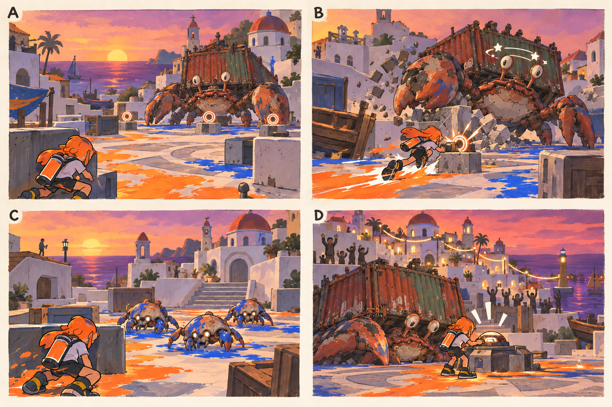

# 스테이지 7-3 — 되찾는 물결

- [x] 장면·목표·동선·등장 적·보상을 상세화한다.
- [x] 러프 장면판을 생성하고 장면 설명과 대조한다.
- [x] 연결 링크와 기획 수치를 검토한다.

[전체 기획과 목차](../../싱글플레이-PvE-캠페인-기획-2.md) · [플레이 규칙](../systems/게임플레이-상세-24.md) · [그림 범례](../일러스트-시각설계-29.md)

이 문서는 추가할 캠페인의 기획이다. 아래 그림은 기획용 러프이며 실제 구현 화면이 아니다. 기존 지도 이미지와 구분해 읽는다. 좌표·엄폐 위치·적 수·체력·시간은 실제 맵과 플레이 검증 후 조정할 초기값이다.

## 1. 이 임무에서 경험하는 것

마지막 제어 고리를 끊고 자유로워진 거대 소라게와 함께 항구의 서로 다른 흐름을 되돌리는 결전이다.

| 항목 | 내용 |
|---|---|
| 지역과 시간대 | 테라스 고지대, 해질녘 / 지도 ID: terraces이다. |
| 유형 | 스테이지 보스 임무이다. |
| 예상 시간 | 9~12분을 초기 목표로 한다. |
| 주 목표 | 파도껍질의 세 제어 고리를 제거하고 최종 통제핵을 무력화한다. |
| 권장 행동 | 고리를 자잘한 표적 찾기로 만들지 않는다. 밝은 이중 원과 번호로 표시하며 어떤 무기도 지면에서 닿게 한다. 고리를 처리할 때 보스는 짧은 정비 상태를 유지한다. |
| 완료 후 변화 | 물결의 기억, 엔딩, 완료 임무의 도전 재진입과 무기별 공략 기록을 해금한다. |

## 2. 네 장면으로 보는 플레이

> 그림 검수: 3-3과 같은 컨테이너 껍질·비대칭 집게로 수정했다. 낮은 받침대 고리·벽 충돌 뒤 기절·소형 게 3마리·안전한 마지막 단말을 확인했다. C는 광선 종료 뒤 한 순간이며 회전은 그 뒤에 별도로 실행한다. 광장 배치와 충돌 공간은 구현 시 검증한다.

장면판은 왼쪽 위 A → 오른쪽 위 B → 왼쪽 아래 C → 오른쪽 아래 D 순서로 읽는다. 화살표는 플레이어의 선택 동선이며, 반투명 위험선·원은 공격 전 예고이다. 작은 문자와 수치보다 아래의 설명을 기준으로 해석한다.

| 그림 | 읽어야 할 행동 |
|---|---|
| A — 마지막 광장의 껍질 | 입장 전 양쪽 엄폐와 충돌 가능한 벽을 확인한다. |
| B — 익숙한 빈틈, 첫 고리 | 돌진을 옆으로 피하고 기절 중 약점 또는 고리를 공격한다. |
| C — 서로 다른 공격 사이 | 엄폐로 광선을 피하고 소형 게를 정리한 뒤 회전 바깥으로 이동한다. |
| D — 되찾는 물결 | 전투가 멈춘 짧은 시간에 마지막 장치를 끊고 복구 명령을 보낸다. |

## 3. 기존 배경과 공간 구성

위 이미지는 기존 게임의 배경 참고이다. 신규 목표·적·장치의 배치를 확정한 사진이 아니다. 큰 지형과 건물·선박·소품을 재사용하고 아래 관계에 맞는 실제 공간을 선택한다.

| 표식 | 위치의 역할 |
|---|---|
| S | 상부 광장의 최종 정비 표식 |
| A | 좌측 고리 장치와 단단한 돌벽 |
| CP | 결전 입장 직전의 안전 테라스 |
| B | BossNav 검증을 거친 넓은 광장 후보 |
| X | 우측 엄폐와 낮은 고리 받침대 |
| E | 보스 후방 중앙 통제핵 |

**주 경로:** S·CP → 보스 1페이즈·고리1 → 2페이즈·고리2 → 3페이즈·고리3 → E이다.

**다른 선택:** 좌우 엄폐를 번갈아 이용하며 노출된 고리로 접근한다. 선택 상자는 없다.

통로 폐쇄는 시각 표식과 임무 구역 경계로 표현한다. 점프나 무기 이동기로 우연히 뒤 구역에 도착해도 순서를 건너뛰어 완료되지 않게 하며, 플레이어가 막혔다면 되돌아갈 수 있는 경로를 남긴다.

## 4. 목표와 진행 조건

보스 체력 66%·33%에서 고리 하나씩 노출하고 제거하면 다음 패턴으로 진행한다. 마지막 체력 소진 후 세 번째 고리와 통제핵을 안전하게 끊는다.

- 화면에는 현재 수행할 목표 하나를 우선 표시하고 완료한 목표는 작은 체크로 남긴다.
- 필수 장치와 적은 지도·화면 양쪽에서 식별할 수 있게 한다. 선택 보상은 별표로 구분한다.
- 장치 접근 가동은 별도 조작키 없이 범위 안에서 2초 머무르는 방식이다. 위험을 피하려고 나가면 즉시 중단한다.
- 특정 주 무기만 닿는 필수 표적을 만들지 않는다. 직접 공격이 어려우면 접근 가능한 낮은 표적이나 경로를 제공한다.

## 5. 장면별 상세 플레이

### A. 마지막 광장의 껍질

해질녘 흰 벽의 광장에 같은 소라게가 단순 제어 고리와 함께 나타난다.

| 구분 | 장면 안에서 일어나는 일 |
|---|---|
| 플레이어 행동 | 입장 전 양쪽 엄폐와 충돌 가능한 벽을 확인한다. |
| 적과 기믹 | 새 괴물 모델이 아니라 기존 HULLBREAKER와 제어 장치이다. |
| 화면·소리의 전달 | 세 고리 아이콘과 보스 페이즈를 표시한다. |
| 다음 장면으로 가는 조건 | 등장 연출 후 기존 강타·돌진을 시작한다. |

### B. 익숙한 빈틈, 첫 고리

벽 충돌 뒤 낮은 배와 옆 받침대의 첫 고리가 밝아진다.

| 구분 | 장면 안에서 일어나는 일 |
|---|---|
| 플레이어 행동 | 돌진을 옆으로 피하고 기절 중 약점 또는 고리를 공격한다. |
| 적과 기믹 | 66% 체력에서 고리1을 제거해야 다음 페이즈로 넘어간다. |
| 화면·소리의 전달 | 고리는 전투장 바닥에서 닿는 높이에 두고 파괴 후 체크한다. |
| 다음 장면으로 가는 조건 | 고리1 파괴 시 광선 패턴이 열린다. |

### C. 서로 다른 공격 사이

광선이 지나간 뒤 소형 게가 나오고, 회전은 그 뒤에 따로 예고된다.

| 구분 | 장면 안에서 일어나는 일 |
|---|---|
| 플레이어 행동 | 엄폐로 광선을 피하고 소형 게를 정리한 뒤 회전 바깥으로 이동한다. |
| 적과 기믹 | 광선·소형 게·회전을 동시에 사용하지 않는다. 소형 게는 최대 3마리이다. |
| 화면·소리의 전달 | 현재 패턴 아이콘과 다음 회피 공간을 보여 준다. |
| 다음 장면으로 가는 조건 | 33%에서 고리2를 제거하고 마지막 페이즈로 간다. |

### D. 되찾는 물결

보스가 주저앉고 마지막 고리와 낮은 통제핵이 남는다. 항구의 통신등이 이어진다.

| 구분 | 장면 안에서 일어나는 일 |
|---|---|
| 플레이어 행동 | 전투가 멈춘 짧은 시간에 마지막 장치를 끊고 복구 명령을 보낸다. |
| 적과 기믹 | 마지막 입력 중 공격·낙하·잔여 투사체를 모두 정지한다. |
| 화면·소리의 전달 | 주민 귀환 신호와 엔딩 카드, 최종 서명 보상을 보여 준다. |
| 다음 장면으로 가는 조건 | 통제핵 무력화 후 엔딩과 결과 화면으로 간다. |

## 6. 핵심 적의 공략

**파도껍질 / 최종 거대 소라게 보스**이다. 솔로 초기 체력 22000, 본전투 240~360초를 목표로 조정한다.

1. 100~66%: 강타·통 낙하·돌진으로 3장의 학습을 확인하고 첫 고리를 연다.
2. 66~33%: 광선과 소형 게를 교대로 추가하고 두 번째 고리를 연다.
3. 33% 이하: 회전을 추가하되 공격 순서를 분리하고 충분한 정비 창을 남긴다. 마지막 고리는 전투 종료 연출에서 안전하게 제거한다.

고리를 자잘한 표적 찾기로 만들지 않는다. 밝은 이중 원과 번호로 표시하며 어떤 무기도 지면에서 닿게 한다. 고리를 처리할 때 보스는 짧은 정비 상태를 유지한다.

예고는 최소 0.9초를 기본으로 하고 장면에 따로 정한 값이 더 길면 그 값을 사용한다. 재정비 중에는 예고 없이 즉시 반격하지 않는다. 정해진 지원 출현을 소진한 뒤에는 추가 소환이 반복되지 않는다.

## 7. 대사와 이야기의 변화

**입장 통신:** 모라: 이번에는 전부 지우라는 명령을 보내지 않을 거야. 틸: 우리가 돌아왔다는 신호를 보내 줘.

**완료 통신:** 아카이브: 귀환 확인. 비상 회수 종료. 모라: 색이 달라도 같이 흘러갈 수 있어. 돌아오면 작업장이 열려 있을 거야.

전투 중 긴 대사는 하지 않는다. 공격 예고가 시작되면 통신 자막을 미루며, 완료 대화는 건너뛰고 기록 창에서 다시 읽을 수 있다.

## 8. 보상과 다음 임무

| 항목 | 지급 규칙 |
|---|---|
| 첫 완료 경험치 | 기본 반복분과 첫 완료 추가분을 합해 600이다. |
| 반복 완료 경험치 | 180이다. |
| 첫 완료 부품 | 기본 60 + 첫 완료 추가 20 = 80개이다. |
| 반복 완료 부품 | 60개이다. |
| 완료 모듈 | 무작위 모듈 1개이다. |
| 공명핵 | 완료마다 1개이다. |
| 추가 보상 | 첫 완료에 물결의 기억 1개를 확정 지급한다. 선택 상자는 없다. |
| 파밍 계열 | 약점 공략·위험 감수 계열이다. |

물결의 기억, 엔딩, 완료 임무의 도전 재진입과 무기별 공략 기록을 해금한다.

전투 중 보상은 현재 임무의 미확정 목록에 저장하고 완료 화면에서 확정한다. 실패·재시작으로 같은 상자의 모듈을 재추첨하지 않는다. 경험치·부품은 적 처치 횟수만으로 별도 증가하지 않는다.

## 9. 체크포인트와 재도전

최종 결전 직전에 저장한다. 실패 시 결전만 재시작한다.

최종 광장에 거대 보스의 충분한 이동 공간이 없는 경우 새 맵을 만들기 전에 검증된 켈프라인 전투장으로 본전투 배경을 재배치하는 대안을 검토한다. 이는 그림의 실제 배치가 확정되었다는 의미가 아니다.

체크포인트 대기에서는 장비와 특성을 바꿀 수 있다. 체력·잉크는 채우고 스페셜은 저장된 구간 시작값으로 복원한다. 현재 구간의 적·장치·임무용 잉크는 함께 복원하며, 공격 중인 적 앞에 바로 플레이어를 놓지 않는다.

## 10. 일러스트와 실제 제작의 경계

- 배경의 중심 실루엣은 기존 테라스 고지대의 건물·소품을 따른다.
- 플레이어는 주황 잉크, 잔향 적은 코발트색 잉크로 시안을 통일한다. 실제 게임에서는 팀 팔레트와 색각 설정을 적용한다.
- 목표는 흰 이중 원, 선택 상자는 별, 공격 위험은 사선·원 테두리로 구분한다. 색 하나만으로 의미를 전달하지 않는다.
- 그림의 빛나는 표식·상호작용·임무 순서·개별 AI는 추가 기획이다. 현재 게임에서 이미 동작하는 기능이라고 해석하지 않는다.
- 이미지가 설명과 다르게 생성한 작은 장식·문자·문 개폐는 필수 기능으로 추가하지 않는다. 장면의 행동·공간 관계를 우선한다.

[그림 생성 지시서](../그림-생성-프롬프트-30.md) · [아이템](../systems/아이템-상세-26.md) · [성장](../systems/성장-상세-27.md) · [파밍](../systems/파밍과-보상-상세-28.md)
