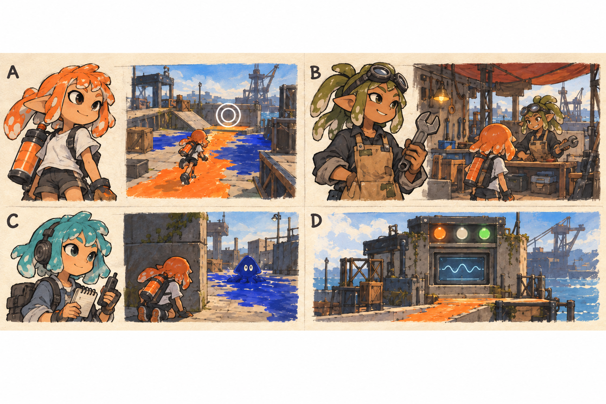
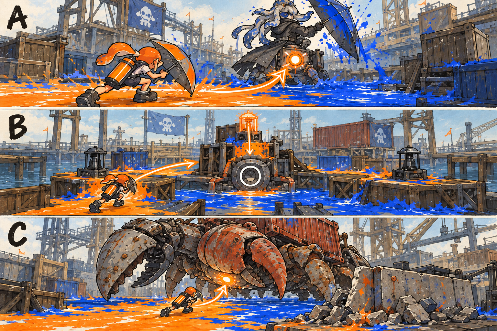

# NPC·잔향 대장·보스와 서사 상세

- [x] 주요 인물·외형·대사·등장 시점과 보스의 서사 역할을 상세화한다.
- [x] 인물·보스 러프 그림을 생성하고 설명과 대조한다.
- [x] 인물 관계와 각 스테이지의 이야기 연결을 검토한다.

[전체 기획과 목차](../../싱글플레이-PvE-캠페인-기획-2.md) · [게임플레이](게임플레이-상세-24.md) · [시각 설계](../일러스트-시각설계-29.md)

## 1. 등장인물 네 컷

> 그림 검수: 4컷으로 정리하고 회수반 신입·모라의 올리브 머리와 고글·틸의 청록 머리와 헤드셋·상태등 3개와 파형의 아카이브 단말을 확인했다. C의 작은 전장 삽화는 통신으로 알려 주는 상황이며 틸의 전장 동행을 뜻하지 않는다.

그림 A는 사용자가 외형과 이름을 고르는 회수반 신입, B는 정비사 모라, C는 통신원 틸, D는 아카이브 단말이다. 초상과 분위기는 기존 캐릭터 리그·라커·소품을 활용할 시안이다. 새로운 인체 리그나 별도의 동행 AI를 필수로 요구하지 않는다.

## 2. 인물 관계와 이야기의 질문

폭풍 때 모라가 도시 구조를 서두르려고 비상 회수 명령의 범위를 넓혔다. 조율망은 서로 다른 색뿐 아니라 주민의 기록도 오염으로 분류했다. 귀환 기록이 지워지자 비상 명령의 종료 조건도 사라졌다. 아카이브는 악의를 가진 인물처럼 행동하기보다 불완전한 규칙을 계속 반복한다.

플레이어와 틸은 지역의 기록을 되살려 잘못된 분류를 발견한다. 모라는 자신의 선택을 인정하고, 플레이어가 공간을 나누어 다시 연결하는 행동을 보고 원래의 혼합 순환 설계를 복원한다. 마지막에는 “모두 지운다”가 아니라 “주민의 귀환을 확인하고 서로 다른 흐름을 이어 준다”는 종료 명령을 보낸다.

이야기의 질문은 **문제를 빨리 없애려 할 때 무엇까지 지우게 되는가, 서로 다른 흐름을 어떻게 다시 연결하는가**이다. 플레이어가 실제로 하는 도색·우회·복구가 답이 된다.

## 3. 회수반 신입 — 플레이어

| 항목 | 기획 |
|---|---|
| 정체성 | 항구를 잘 알지 못하는 신입으로 시작한다. 고정된 이름·성별·얼굴을 강제하지 않는다. |
| 외형 | 기존 라커의 머리·얼굴·장비·의상을 사용한다. 시안에서는 주황 탱크와 밝은 티셔츠로 표시한다. |
| 이야기 역할 | NPC가 설명한 문제를 직접 다른 방식으로 해결한다. 선택 경로와 무기가 캐릭터의 플레이 성향을 만든다. |
| 대사 방식 | 긴 독백 대신 짧은 행동 반응과 통신 수신을 사용한다. 선택지를 통해 설정을 크게 분기시키지 않는다. |
| 성장 표현 | 몸 크기나 종족이 바뀌지 않는다. 장비 슬롯과 익숙해진 이동·공략이 변화를 보여 준다. |

튜토리얼에서 무력한 존재로 길게 붙잡지 않는다. 1-1에서 두 복구점을 직접 켜고, 1-3에서 첫 대장의 방패를 우회해 자신이 문제를 풀 수 있다는 경험을 제공한다.

## 4. 모라 — 실수를 인정하는 정비사

### 4.1. 모습과 행동

기존 캐릭터의 묶은 촉수 머리, 올리브·황토색 작업복, 머리에 올린 고글, 짧은 앞치마와 공구를 조합한다. 큰 새 실루엣보다 자세와 소품으로 구분한다. 작업장에서는 손에 든 부품을 내려놓고 플레이어를 바라보며, 중요한 고백 때는 공구를 멈추는 정지 연출을 사용한다.

실무적이고 설명을 짧게 하는 인물이다. 초반에는 고장 원인을 장비 탓으로 설명하지만 3장의 정비반 표식부터 문장이 짧아지고 침묵이 늘어난다. 4-2에서 책임을 인정한 뒤에는 플레이어를 통제하기보다 선택할 방법을 제시한다.

### 4.2. 등장과 대사 예시

| 시점 | 감정과 역할 | 짧은 대사 예시 |
|---|---|---|
| 1-1 완료 | 플레이어의 행동을 인정한다. | “새 부품보다 네가 만든 길이 먼저였구나.”이다. |
| 3-3 완료 | 장비의 원산지를 알아보고 흔들린다. | “저 표식… 우리 정비반 것이야.”이다. |
| 4-2 완료 | 비상 명령을 넓힌 사실을 말한다. | “빨리 구하고 싶었어. 돌아갈 기록까지 지울 줄은 몰랐어.”이다. |
| 5-1 완료 | 서로 다른 흐름을 섞는 원리를 되찾는다. | “한 색으로 만드는 게 정화는 아니었어.”이다. |
| 7-3 직전 | 해결을 플레이어와 나눈다. | “이번에는 전부 지우라는 명령을 보내지 않을 거야.”이다. |
| 엔딩 | 돌아올 장소를 제공한다. | “돌아오면 작업장은 열려 있을 거야.”이다. |

아이템·강화 안내도 모라가 맡지만 고백 대화 직후 제작 판매 문구를 연달아 내지 않는다. 이야기 장면을 마친 뒤 정비 UI를 열도록 한 박자를 둔다.

## 5. 틸 — 기록을 사람에게 돌려주는 통신원

짧은 청록 촉수 머리, 헤드셋, 작은 녹음기와 접힌 메모를 사용한다. 시안에서는 플레이어보다 차분한 색을 쓰고, 눈과 몸의 방향이 화면 밖 신호를 찾는 모습으로 역할을 전달한다. 실제 전장 동행은 하지 않으며 통신창·기록 화면에서 등장한다.

틸은 임무의 다음 행동과 지역 주민의 흔적을 연결한다. 정답을 모두 말하기보다 읽을 신호를 알려 준다. 예를 들어 “벽으로 가라”보다 “정면은 보고 있지만 위 벽은 비어 있다”라고 말한다.

| 상황 | 제공할 정보 | 피할 표현 |
|---|---|---|
| 새 장치 | 무엇이 켜지고 언제 안전한지 알려 준다. | 여러 개의 수치와 키를 한 번에 말하지 않는다. |
| 첫 실패 | 공격의 방향이나 빈틈을 한 줄 알려 준다. | 플레이어 실수를 비난하지 않는다. |
| 기록 회수 | 사라진 기록 뒤의 사람과 장소를 이야기한다. | 수집 개수만 읽지 않는다. |
| 마지막 임무 | 이전 지역에서 복구한 신호가 돌아오는 것을 전한다. | 새 등장인물을 갑자기 늘리지 않는다. |

4-2에서 작업반의 귀환 통신을 확인하고, 7-1에서 시장·부두·염전의 짧은 응답을 연결한다. 주민 모델을 대량으로 새로 만들지 않아도 도시가 비어 있는 장난감 무대처럼 느껴지지 않게 한다.

## 6. 아카이브 — 사람 모양이 아닌 기록 인터페이스

기존 단말·표지판 소품에 작은 파형과 상태등 세 개를 더한다. 얼굴 표정 대신 파형의 끊김과 반복, 상태등의 안정 여부로 변화를 표현한다. 별도의 로봇 몸체·이동·전투 AI를 만들지 않는다.

- 초반에는 “편차 회수”, “미등록 항로 폐쇄” 같은 같은 표현을 반복한다.
- 2~4장에는 사람 이름과 장비 번호가 섞인 오류 기록을 보여 준다.
- 5장에는 원래 순환 설계를 발견하지만 스스로 명령을 바꾸지는 못한다.
- 7-2에서 누락된 종료 조건이 주민 귀환 확인이었다는 사실을 보여 준다.
- 엔딩에서는 짧게 “귀환 확인. 비상 회수 종료.”라고 출력한다.

반복 메시지는 첫 번째만 전문을 보여 주고 이후에는 짧은 상태 아이콘으로 줄인다. 공포 게임의 위협적 인공지능 음성보다 고장 난 공공 설비의 안타까운 반복으로 표현한다.

## 7. 보스 세 기본형의 서사와 실루엣

> 그림 검수: 3컷으로 정리해 잔향 대장·고정 제어 장치·컨테이너 소라게의 기본형을 확인했다. B는 송신기 한 개만 켜지고 낮은 중심핵으로 이어진다. A의 원형 표식은 후방 약점이며 별도 회전 공격 추가가 아니다. 세부 공격은 각 스테이지 본문을 따른다.

| 컷·기본형 | 뜻하는 것 | 화면에서 읽는 공략 |
|---|---|---|
| A 잔향 대장 | 작업자의 동작이 잘못된 명령으로 굳어졌다. | 정면 방어·긴 사선·도색 압박 중 하나를 강조하고 그 반대편을 연다. |
| B 제어 장치 | 원래 사람을 위한 안전 절차가 봉쇄 절차가 되었다. | 작은 제어점을 순서대로 복구하고 낮은 중심핵을 공격한다. |
| C 거대 소라게 | 생물까지 작업 장비로 잘못 분류되었다. | 예고를 피하고 벽 충돌·낮은 배 약점을 공략해 통제 장비를 제거한다. |

### 7.1. 지역 보스의 성격과 대사

| 보스 | 역할·말투 | 첫 인상과 전투 후 변화 |
|---|---|---|
| 통행대장 바리 | 통행 확인 동작을 반복한다. “통행 기록을 초기화한다.”이다. | 큰 우산으로 정면을 막는다. 제압 뒤 이동 금지 표시가 귀환 표시로 바뀐다. |
| 배전탑 오르골 | 방송 파형과 종소리 같은 합성음이다. | 반복되던 가게 이름을 지우는 기계이다. 핵이 꺼지면 가게 이름이 다시 뜬다. |
| 하역왕 HULLBREAKER | 대사는 없고 집게·발소리·껍질 금속음으로 표현한다. | 화물처럼 취급된 생물이다. 제압은 껍질 통제 장치의 해제로 해석한다. |
| 계류장 스큐 | 등록 항로만 인정한다. “미등록 항로를 폐쇄한다.”이다. | 긴 사선으로 항로를 막고, 제압 뒤 부두 안내등이 켜진다. |
| 풍차장 솔트 | 하나의 순도만 요구한다. “혼합 흐름을 차단한다.”이다. | 살수 장치로 다른 색을 덮으며, 제압 뒤 순환 설계가 복구된다. |
| 수문 조율기 | 무표정한 상태 파형이다. | 안전용 이중 확인을 봉쇄에 쓴다. 제어점을 순서대로 돌려 쓰면 해결된다. |
| 파도껍질 | 다시 통제된 HULLBREAKER이다. | 기존 생물의 새 괴물화가 아니라 외부 고리가 위협이다. 마지막에는 귀환 신호와 함께 해방된다. |

### 7.2. 중간보스의 역할

청소반장·유리눈 감시자·적재장 포수·계류 수문장·염전 청소조·쌍문지기·잔향 지휘관은 별도 대서사를 가진 새 인물 7명을 늘리는 목적이 아니다. 각 지역의 공략을 먼저 가르치는 작업 동작의 잔향이다. 외형은 공통 다이아몬드 잔향 표식과 무기·자세로 구분하고, 공격과 빈틈은 각 스테이지 문서에 따른다.

## 8. 장면 연출의 길이와 카메라

- 입장 대화는 15~25초, 완료 대화는 20~35초를 목표로 한다. 자막 속도를 조절하고 즉시 건너뛸 수 있다.
- 주요 고백·엔딩 이외에는 통신 초상과 게임 화면을 함께 사용한다. 전장 전체를 덮는 대화창을 피한다.
- 보스 등장은 넓은 구도 → 공격에 쓰는 부분의 근접 → 플레이어 뒤 시점 복귀의 세 구도로 짧게 보여 준다.
- 모라의 고백은 공격 없는 정비 갑판에서 전달한다. 플레이어가 아직 적에게 맞는데 감정 대사를 강제로 읽게 하지 않는다.
- 엔딩은 7개 지역의 복구된 표시·기록·통신과 작업장 귀환으로 구성한다. 주민 군중·새 도시 전체 모델을 필수로 만들지 않는다.

## 9. 선택 기록 14개의 주제

각 지역의 두 일반 임무에 하나씩 배치한다. 기록 하나는 약 80~150자의 본문과 한 장의 기존 소품·표식 이미지를 사용한다. 화면에서 오래 읽어야만 이해되는 대량 설정집은 만들지 않는다.

| 지역 | 첫 기록 | 두 번째 기록 |
|---|---|---|
| 타이드워터 | 광장의 첫 방송이다. | 돌아온 사람들의 명단이다. |
| 크로스로드 | 빈 가게의 영수증이다. | 유리 지붕의 점검표이다. |
| 켈프라인 | 목적지 없는 운송장이다. | 정화 대상 목록의 생물이다. |
| 할야드 | 끊어지지 않은 계류선이다. | 귀환한 작업반이다. |
| 솔트팬 | 섞이는 물의 설계도이다. | 돌아갈 자리이다. |
| 록게이트 | 수문 관리자의 우회선이다. | 둘로 나눈 열쇠이다. |
| 테라스 | 벽에 남긴 안내이다. | 누락된 중지 조건이다. |

필수 통신 자료는 이야기 진행에 필요한 별도 목표이다. 선택 기록을 놓쳐도 모라의 책임과 비상 명령의 종료 조건, 결말을 이해할 수 있어야 한다.
