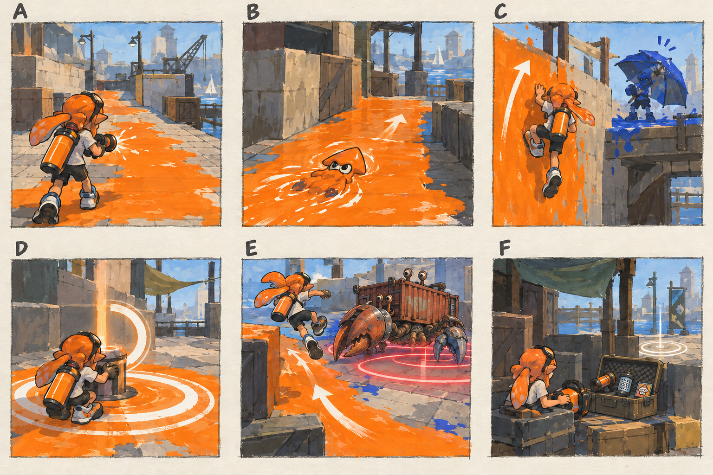
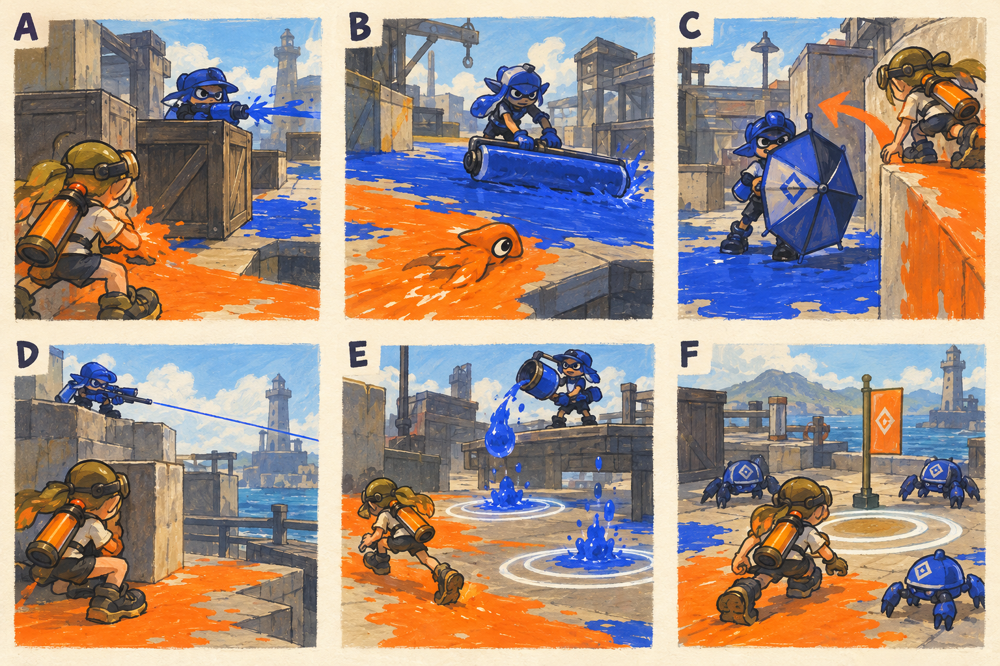

# 캠페인 게임플레이 상세

- [x] 조작·전투·목표·적·재도전의 실제 플레이 규칙을 상세화한다.
- [x] 게임플레이·적 역할 그림을 생성하고 설명과 대조한다.
- [x] 연결 문서와 규칙의 일관성을 확인한다.

[전체 기획과 스테이지 목차](../../싱글플레이-PvE-캠페인-기획-2.md) · [NPC와 보스](NPC와-서사-상세-25.md) · [시각 범례](../일러스트-시각설계-29.md)

이 문서는 플레이어가 화면을 보며 어떤 판단을 하고 어떤 행동을 하는지를 설명하는 기획이다. 새 캠페인의 규칙이며 구현 완료를 뜻하지 않는다. 수치는 첫 플레이용 시작값이다.

## 1. 여섯 컷으로 보는 1분의 전투

> 그림 검수: 도색·오징어형 잠수·도색 벽 우회·복구 범위·컨테이너 소라게의 원형 예고 회피·안전한 장비 교체의 6컷을 확인했다. F의 동행 인물을 제거해 싱글 플레이 전제에 맞췄다. 가동 시간과 회복 수치는 본문을 따른다.

| 컷 | 보는 것 | 판단과 행동 | 다음 행동에 주는 이득 |
|---|---|---|---|
| A | 마른 바닥과 정면 적 사이의 빈 공간이다. | 이동할 길과 돌아올 공간을 먼저 칠한다. | 공격하면서도 후퇴할 자리가 생긴다. |
| B | 자신의 잉크 길과 줄어든 탱크가 보인다. | 잠수해 빠르게 이동하고 잉크·체력을 재정비한다. | 사격을 계속 누르는 대신 공격 주기를 만든다. |
| C | 정면을 막는 방패와 비어 있는 옆 벽이다. | 옆 벽을 칠해 오르거나 방패 발사 후 돌아간다. | 높은 공격력 없이 유리한 방향을 만든다. |
| D | 복구 단말과 작은 가동 원이다. | 주변을 안전하게 만든 뒤 2초 가동을 시도한다. | 전투가 목표 달성으로 이어진다. |
| E | 큰 집게와 퍼져 나올 위험 원이다. | 예고를 보고 점프하거나 미리 칠한 길로 빠진다. | 도색이 생존과 보스 공략을 돕는다. |
| F | 엄폐 뒤 체크포인트와 장비 표시이다. | 장비를 바꾸거나 같은 구간을 재도전한다. | 실패한 원인에 맞춰 다른 접근을 선택한다. |

중요한 질문은 “지금 쏠 수 있는가”뿐 아니라 “다음에 어디로 움직이고, 어디에서 숨을 돌릴 것인가”이다. 적을 다 없앤 뒤 아무 의미 없이 넓은 바닥을 칠하게 만들지 않는다.

## 2. 조작과 기본 자원

이동·조준·발사·잠수·점프·보조 무기·스페셜·지도는 기존 조작을 유지한다. 캠페인만을 위한 새로운 전투 버튼은 추가하지 않는다. 단말·상자는 지정 범위에 2초 머물러 가동하며, 위험을 피하려고 움직이면 즉시 중단한다.

| 자원 | 기본 행동 | 고갈·위험 시 선택 |
|---|---|---|
| 체력 | 엄폐와 아군 잉크에서 기존 자동 회복을 이용한다. | 적에게 시야를 주지 않는 짧은 퇴로를 확보한다. 소비형 회복약은 없다. |
| 잉크 | 사격·보조 무기에 사용하고 잠수로 빠르게 보충한다. | 탄약이 다 떨어지기 전에 돌아갈 공간을 칠한다. 바닥 전체를 칠할 필요는 없다. |
| 스페셜 | 비어 있거나 적 잉크인 면적을 자신의 잉크로 바꾸어 충전한다. | 정예·보스의 확실한 빈틈 또는 위험한 지원 웨이브에 사용한다. |
| 공간 | 자신의 잉크가 이동·재정비를 돕고 적 잉크가 이동을 방해한다. | 도색병과 살수 장치를 먼저 제거하거나 다른 길을 만든다. |

현재 기본 플레이어 체력과 잉크 용량은 각각 100이다. 기존 회복 지연과 잠수 속도는 출발점으로 사용하며, 성장 효과를 적용할 때 [성장 규칙](성장-상세-27.md)의 상한을 따른다. 캠페인의 적·플레이어 수치를 공용 상수 전체에 덮어쓰지 않는다.

## 3. 전투 공간을 읽는 세 가지 질문

1. **시야가 어디서 끊기는가:** 기둥·선실·컨테이너·높이 차이로 정면 화력을 피한다. 장식 차양과 유리 모두가 총알을 막는다고 가정하지 않는다. 실제 충돌 재질을 확인해 엄폐로 지정한다.
2. **짧은 길과 안전한 길은 어떻게 다른가:** 짧은 길은 방패나 사선, 긴 길은 작은 교전과 선택 상자를 배치한다. 늘 같은 쪽이 정답이 되지 않게 한다.
3. **퇴로를 누가 다시 칠하는가:** 도색병·살수 장치를 식별한다. 적 체력보다 공간을 바꾸는 원인을 먼저 공략할 수 있다.

선택 경로는 기본 달리기·점프·잠수·벽오르기로 접근 가능해야 한다. 특정 무기의 돌진·공중 이동만을 필수 열쇠로 사용하지 않는다. 무기에 따라 쉬운 공략이 달라지는 것은 허용한다.

## 4. 네 가지 임무 규칙의 정확한 동작

### 4.1. 복구 단말

- 장치 둘레의 작게 표시된 유효 바닥을 60% 이상 칠하면 가동 가능 상태가 된다.
- 플레이어가 원 안에서 2초 머물면 가동된다. 원 밖으로 나가거나 직접 공격을 받으면 2초 가동 게이지만 다시 시작한다.
- 이미 칠한 면적은 현재 시도에서 유지한다. 장치 완료 후에는 적이 주변을 칠해도 완료를 빼앗지 않는다.
- 다른 층의 바닥이나 장식 면을 칠해 진행되지 않게 한다. 도색률의 계산 대상은 같은 높이의 표시된 목표 면적이다.

### 4.2. 안정화 방어

- 일반형은 누적 45초를 시작값으로 삼으며 스테이지가 30초·6초 등 별도 값을 정하면 그 값을 사용한다.
- 유효 도색률을 만족하고 적이 가동 원 안에 없을 때 진행한다. 플레이어가 피하거나 적이 들어오면 일시 정지한다.
- 누적 시간은 감소하지 않는다. 보스를 제외하면 완료 지점을 다시 빼앗기지 않는다.
- 웨이브 수·출현 수·활성 상한을 스테이지 문서에 명시한다. 무한 적 출현과 무제한 시간 끌기를 사용하지 않는다.

### 4.3. 기록·장비 회수

- 진행용 자료는 주변의 지정 경계 적을 정리한 뒤 접근해 받는다. 지정 적이 누구인지 HUD에 표시한다.
- 회수한 자료 때문에 이동이 느려지거나 무기를 잃지 않는다. 새 운반 애니메이션은 필요하지 않다.
- 선택 기록은 일반 임무의 선택 상자에 하나씩 묶어 총 14개를 배치한다. 필수 자료와 수집 표시를 분리한다.

### 4.4. 대장·핵 제압

- 행동 예고 → 공격 → 재정비를 반복한다. 새로운 패턴은 앞선 임무나 초반 페이즈에서 먼저 보여 준다.
- 인간형 보스의 본전투는 약 90~150초, 고정 장치는 목표 작업을 포함해 120~210초, 거대 보스는 180~360초를 목표로 한다. 실제 체력 수치는 전투 관찰로 조정한다.
- 방패·장치 공략은 가장 빠른 방법이 되지만, 이유 없이 긴 완전 무적을 반복시키지 않는다.
- 약점은 작고 빠른 점 찾기가 아니다. 몸통 대비 읽기 쉬운 형태·높이·색과 이중 원으로 보여 준다.

## 5. 적을 보고 대응을 떠올리게 한다

> 그림 검수: 사격·도색·우산 방패·감시·포격·소형 게 3마리의 여섯 역할과 엄폐·우회·회피를 확인했다. E의 두 원은 시간차 낙하 개념이며 동시 강제 피격을 뜻하지 않는다. 병종 표식과 수치는 본문을 따른다.

| 컷·역할 | 처음 읽는 신호 | 공격과 빈틈의 시작값 | 좋은 대응 |
|---|---|---|---|
| A 사격병 | 짧은 슈터 실루엣과 사각 역할 표식이다. | 2~4발 짧은 연사 후 0.8초 이상 쉰다. HP 100을 출발점으로 둔다. | 기둥으로 시야를 끊고 쉬는 동안 이동·공격한다. |
| B 도색병 | 낮게 든 롤러와 넓은 잉크 길이다. | 지정 통로를 칠하고 회전할 때 빈틈을 준다. HP 120을 출발점으로 둔다. | 퇴로를 계속 잃고 있다면 먼저 처리한다. |
| C 방패병 | 큰 우산과 정면 방어 자세이다. | 느린 전진 뒤 1초 예고, 방패 발사 후 약 3초 열린다. HP 130을 출발점으로 둔다. | 측면·고지·발사 후의 후방을 공략한다. |
| D 감시병 | 긴 총열·활과 얇은 바닥 위험선이다. | 최소 0.9초 조준하며 두 발 뒤 약 2.5초 정비한다. HP 90을 출발점으로 둔다. | 엄폐를 하나씩 옮기고 같은 높이로 접근한다. |
| E 포격병 | 위로 향한 버킷·발사 장치와 지면 원이다. | 이전 플레이어 위치에 원을 찍고 두 번 공격 뒤 쉰다. HP 110을 출발점으로 둔다. | 원을 한쪽에 모으고 남은 안전 공간으로 이동한다. |
| F 소형 잔향 게 | 낮은 몸체, 짧은 이동과 폭발 예고이다. | 개별 체력은 기존 값을 출발점으로 둔다. 소환 상한은 일반 최대 4, 거대 보스전 최대 3이다. | 가까워지기 전에 처리하거나 잠수 길로 거리를 벌린다. |

특정 스테이지가 더 낮은 상한을 정하면 그 값을 따른다. 인간형 활성 적은 1장 최대 3명, 2~4장 최대 4명, 5~7장 최대 5명이다. 정예도 이 수에 포함한다. 거대 보스전은 별도 제한으로 인간형 최대 2명·소형 게 최대 3마리를 사용하고 강한 공격과 동시 출현을 피한다.

적은 전투 구역 밖으로 무제한 추적하지 않는다. 시야를 잃으면 마지막 확인 위치까지 찾고 정해진 경계로 돌아간다. 보이지 않는 뒤쪽에서 즉시 사격하지 않으며 출현 표식을 최소 1초 먼저 보여 준다. 지원 횟수는 HUD에서 남은 묶음으로 전달한다.

## 6. 장비보다 먼저 성립해야 하는 플레이

초기 슈터·롤러·차저로 목표 복구·엄폐·벽오르기·세 보스 기본형을 모두 공략할 수 있어야 한다. 장비 모듈은 다음 선택을 돕는다.

- 이동형은 안전한 우회와 근접 접근을 조금 빠르게 한다.
- 제압형은 약점과 장치의 빈틈을 더 효율적으로 사용한다.
- 순환형은 작은 도색 구역과 스페셜·잉크 운용의 여유를 만든다.

장비가 없어서 기본 이동이 막히거나 목표를 가동할 수 없는 구조는 만들지 않는다. 보스의 필수 약점은 근접 공격 높이까지 내려오거나 낮은 장치로 연결한다.

## 7. 실패·대기·다시 시작의 화면

사망 직후에는 공격 이름과 대응 한 줄을 보여 준다. 예를 들어 “계류 수문장 — 방패를 보낸 직후 선실 쪽으로 돌아간다”라고 안내한다. 타이머로 서둘러 누르게 하지 않고, 재시도·장비 정비·작업장 복귀를 제공한다.

재시작하면 현재 구간의 적·장치·도색을 함께 초기화한다. 이전 구간의 복구 완료와 회수 자료는 유지한다. 체력·잉크는 채우고 스페셜은 체크포인트 시작값으로 복원한다. 일반 임무는 최근 약 3~5분 구간, 보스는 본전투 앞에서 재도전한다.

체크포인트 정비에서 선택한 무기와 특성은 같은 구간 재시작에 반영한다. 기존 공격 효과를 모두 제거한 뒤 새 구간을 시작한다. 단절된 AI·사라진 필수 적·물리적으로 닿지 않는 표적이 있으면 조용히 막히게 두지 않고 안전 위치 복귀와 목표 복구 규칙을 적용한다.

## 8. 화면의 우선순위

1. 곧 닿는 위험 예고와 회피 가능한 공간을 가장 먼저 읽게 한다.
2. 현재 목표 하나와 가동 가능 여부를 두 번째로 보여 준다.
3. 플레이어 체력·잉크·스페셜을 고정 위치에 둔다.
4. 선택 보상과 통신 자막은 전투를 가리지 않는 위치에 둔다.

대화는 공격 예고와 겹치면 미루고, 색각 설정에서는 팔레트와 형태를 함께 적용한다. 카메라 흔들림·과한 번쩍임·UI 효과를 줄여도 위험선과 약점을 읽을 수 있어야 한다.
