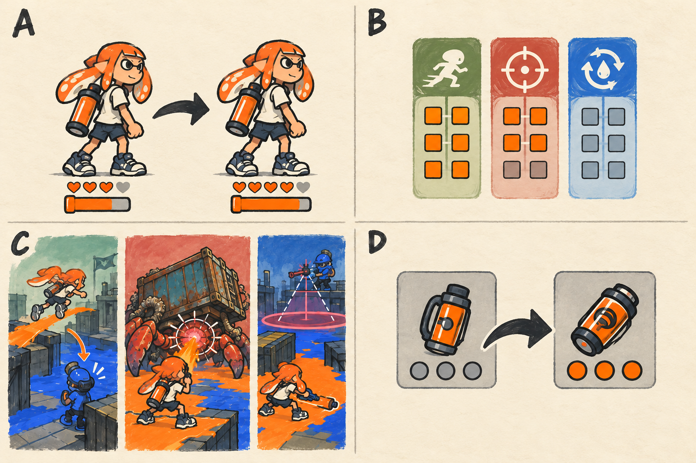

# 캐릭터 레벨·특성·빌드 성장 상세

- [x] 레벨별 수치와 특성·빌드·성장 경험을 상세화한다.
- [x] 성장과 장비 이전 러프를 생성하고 설명과 대조한다.
- [x] 경험치·포인트·상한 계산을 검토한다.

[전체 기획](../../싱글플레이-PvE-캠페인-기획-2.md) · [게임플레이](게임플레이-상세-24.md) · [아이템](아이템-상세-26.md) · [파밍](파밍과-보상-상세-28.md)

## 1. 성장 뒤에도 같은 캐릭터로 다른 판단을 한다

> 그림 검수: 동일 체형의 전후 비교, 특성점 6+4로 총 10개, 세 공략 방식, 같은 슬롯 강화 이전 후 기존 0·새 장비 3단계를 확인했다. 체력·잉크 그림 막대는 상대적 여유의 개념이며 실제 증가율은 레벨 표를 따른다.

그림 A는 외형 크기를 바꾸지 않고 늘어난 체력·잉크 여유를, B는 세 계열의 선택을, C는 서로 다른 공략 행동을, D는 새 장비로 강화 단계를 옮기는 경험을 보여 준다. 레벨이 오르면 새로운 기본 이동 능력을 사야 하는 구조는 사용하지 않는다.

성장 목표는 처음에 위태롭게 건너던 길을 조금 여유 있게 넘고, 좋아하는 무기의 한 번의 공격 창을 더 잘 사용하는 것이다. 적을 자동으로 지우는 수치 상승과 레벨 차이로 막는 입장 조건은 사용하지 않는다.

## 2. 레벨 1~20의 수치

현재 레벨 L에서 다음 레벨에 필요한 경험치는 `150 + 50 × L`이다. 기본 체력은 100, 기본 잉크는 100을 출발점으로 한다. 레벨마다 기본 대비 체력 1%, 잉크 0.5%를 더한다.

| 레벨 | 이 레벨 도달 누적 경험치 | 다음 레벨 필요 경험치 | 기본 체력 | 기본 잉크 | 누적 특성점 |
|---|---|---|---|---|---|
| 1 | 0 | 200 | 100 | 100 | 0 |
| 2 | 200 | 250 | 101 | 100.5 | 1 |
| 3 | 450 | 300 | 102 | 101 | 1 |
| 4 | 750 | 350 | 103 | 101.5 | 2 |
| 5 | 1,100 | 400 | 104 | 102 | 2 |
| 6 | 1,500 | 450 | 105 | 102.5 | 3 |
| 7 | 1,950 | 500 | 106 | 103 | 3 |
| 8 | 2,450 | 550 | 107 | 103.5 | 4 |
| 9 | 3,000 | 600 | 108 | 104 | 4 |
| 10 | 3,600 | 650 | 109 | 104.5 | 5 |
| 11 | 4,250 | 700 | 110 | 105 | 5 |
| 12 | 4,950 | 750 | 111 | 105.5 | 6 |
| 13 | 5,700 | 800 | 112 | 106 | 6 |
| 14 | 6,500 | 850 | 113 | 106.5 | 7 |
| 15 | 7,350 | 900 | 114 | 107 | 7 |
| 16 | 8,250 | 950 | 115 | 107.5 | 8 |
| 17 | 9,200 | 1,000 | 116 | 108 | 8 |
| 18 | 10,200 | 1,050 | 117 | 108.5 | 9 |
| 19 | 11,250 | 1,100 | 118 | 109 | 9 |
| 20 | 12,350 | 상한이다. | 119 | 109.5 | 10 |

필수 21개 임무의 첫 완료는 각각 합계 600으로 12,600 경험치를 제공한다. 마지막 상한을 넘는 250은 추가 능력치나 재료로 바꾸지 않는다. 결과 카드에는 지급 경험치와 실제 레벨 적용분을 구분해 상한에서 사라진 것처럼 보이지 않게 한다.

## 3. 파밍 없이 진행했을 때의 성장 흐름

| 완료 지점 | 누적 첫 완료 경험치 | 예상 레벨 | 새로 체감하는 것 |
|---|---|---|---|
| 1-1 | 600 | 3이다. | 기본 세 슬롯과 첫 특성점 하나를 사용한다. |
| 1장 | 1,800 | 6이다. | 기동·제압·순환 중 어느 계열이 맞는지 시도한다. |
| 2장 | 3,600 | 10이다. | +1 강화와 장치 공략 장비를 사용한다. |
| 3장 | 5,400 | 12이다. | 보스의 기절 창에 맞춘 조합을 만든다. |
| 4장 | 7,200 | 14이다. | 12종 주 무기와 +2 강화로 공략을 바꾼다. |
| 5장 | 9,000 | 16이다. | 도색·스페셜 순환의 효율을 비교한다. |
| 6장 | 10,800 | 18이다. | +3 강화와 마지막 빌드 선택을 마친다. |
| 7장 | 12,600 | 20이다. | 반복 임무·도전에서 완성한 빌드를 시험한다. |

이 표는 적 강제 레벨이나 입장 제한이 아니다. 중간에 반복 임무를 하면 조금 앞서 성장할 수 있고, 이야기 난이도로 진행해도 같은 첫 완료 성장을 받는다.

## 4. 특성 구조

기동·제압·순환의 세 계열에 각각 효과 3개, 효과마다 2단계를 둔다. 짝수 레벨마다 1점으로 최대 10점이다. 두 번째 효과는 같은 계열에 2점, 세 번째는 4점을 쓴 뒤 열린다. 최고 6점을 한 계열에 넣을 수 있어 6+4 형태나 여러 계열 혼합을 선택한다.

| 계열·효과 | 1단계 | 2단계 합계 | 행동의 차이 |
|---|---|---|---|
| 기동 1 / 잠수 추진 | 잠수 속도 +2%이다. | +4%이다. | 엄폐와 측면 경로를 더 빠르게 바꾼다. |
| 기동 2 / 빠른 재정비 | 보충 시작 지연 -0.05초이다. | -0.10초이다. | 짧게 숨는 공격 주기를 사용한다. |
| 기동 3 / 이탈 보호 | 아군 잉크에서 나온 뒤 2초간 피해 -4%이다. | -8%이다. | 접근 직후 짧은 위험을 조금 줄인다. 큰 예고는 피해야 한다. |
| 제압 1 / 약점 관찰 | 약점 피해 +3%이다. | +6%이다. | 몸통보다 노출된 표적을 노린다. |
| 제압 2 / 장치 해체 | 적 장치 피해 +4%이다. | +8%이다. | 도색·공격의 원인인 장치를 먼저 처리한다. |
| 제압 3 / 빈틈 집중 | 기절한 보스 피해 +4%이다. | +8%이다. | 기절을 유도한 뒤 스페셜을 집중한다. |
| 순환 1 / 넓은 연결 | 기본 도색 폭 +2%이다. | +4%이다. | 작은 목표 원과 이동로를 효율적으로 칠한다. |
| 순환 2 / 잉크 여과 | 잠수 보충 속도 +3%이다. | +6%이다. | 엄폐에서 머무는 시간을 줄인다. |
| 순환 3 / 흐름 축적 | 유효 도색 스페셜 충전 +3%이다. | +6%이다. | 적이 다시 칠한 공간을 정리하며 다음 특수기를 준비한다. |

작업장과 체크포인트 대기에서 무료 재배분한다. 적용은 현재 전투가 종료·초기화된 뒤에 하며 보스 공격 중 수치를 계속 바꾸지 않는다. 새 액티브 스킬과 전용 키는 만들지 않는다.

## 5. 세 가지 빌드의 플레이 예

### 5.1. 기동 6·제압 4 — 옆길을 만드는 접근형

우산·롤러·검 등 좋아하는 무기를 들고 빠르게 위치를 바꾼다. 방패병 정면에 오래 머무르지 않고 옆 벽을 타고 내려와 공격한다. 어댑터는 약점 또는 장치, 탱크는 계류 밸브, 표식은 잠행 또는 수문 도체를 고른다. 구체적인 무기 선택은 자유이다.

### 5.2. 제압 6·순환 4 — 짧은 창에 집중하는 공략형

슈터·차저·활로 약점과 기절 창을 읽는다. 파쇄 결정 또는 회수반 렌즈 중 이번 임무의 표적에 맞는 하나를 고른다. 같은 어댑터 슬롯의 두 서명을 동시에 장착할 수 없다. 평소에는 안전 공간을 유지하고 기절 창에 스페셜과 사격을 모은다.

### 5.3. 순환 6·기동 4 — 작은 안전 구역을 잇는 관리형

도색 폭과 재정비를 활용해 안정화 원과 퇴로를 유지한다. 풍차축은 적 잉크를 바꿀 때만 추가 충전을 주므로 이미 안전한 바닥만 반복해서 칠하지 않는다. 스페셜을 다음 지원 웨이브에 사용해 목표를 마무리한다.

세 빌드는 장비 조건으로 고정된 직업이 아니다. 무료로 바꾸어 다른 보스·목표에 맞춰 시도하는 선택지이다.

## 6. 수치를 합치는 기준과 상한

레벨 체력·잉크 용량은 기본 100을 기준으로 더한다. 장비의 용량 보정도 같은 기본값 기준으로 더해 중첩 곱셈을 피한다. 이동·비용·피해의 같은 종류 옵션은 합산한다. 서로 조건이 다른 피해 보너스도 현재 성립하는 값들을 더한 뒤 최종 성장 상한을 적용한다.

| 항목 | 상한과 적용 |
|---|---|
| 성장에 따른 추가 피해 | 무기의 기본 피해·기본 약점 판정 뒤 추가되는 계수를 최대 1.35로 제한한다. |
| 피해 감소 | 적용되는 모든 캠페인 감소와 불이익을 합산해 최대 20% 감소로 제한한다. |
| 이동 속도 | 현재 달리기·잠수 상태의 기본 속도 대비 최대 +10%이다. |
| 잉크 소모 감소 | 주 무기·보조 무기 각각 최대 15%이다. |
| 보충·자동 회복 | 표시된 같은 종류 수치를 더한다. 새 발동 효과를 재귀 호출하지 않는다. |

예를 들어 기동 1의 +4%와 수문 도체 +3의 발동 보너스 +7.8%가 겹치면 표기 합계는 +11.8%지만 실제 적용은 +10%이다. SG07 +3의 피해 증가 불이익은 +6.5%로 함께 표시한다. 좋은 값만 숨김 없이 보여 주고 최종 적용값을 카드에 적는다.

## 7. 기존 모드와 저장의 관계

캠페인 레벨·특성·장비는 전용 저장에 둔다. 이름·외형은 기존 프로필에서 가져올 수 있지만, 캠페인에서 끝난 뒤 기존 대전의 체력·잉크·무기 수치에 보정이 남으면 안 된다. 기존 대전 경험치를 캠페인으로 합산하지 않는다.

한 번에 여러 레벨이 올라도 미지급 특성점이 없도록 마지막 레벨만 보고 1점을 주지 않는다. 새로 통과한 모든 짝수 레벨의 포인트를 합산해 지급하고 같은 결과를 다시 열어도 중복 지급하지 않는다. 저장은 경험치·특성점·보상 처리 ID를 함께 기록한다.
