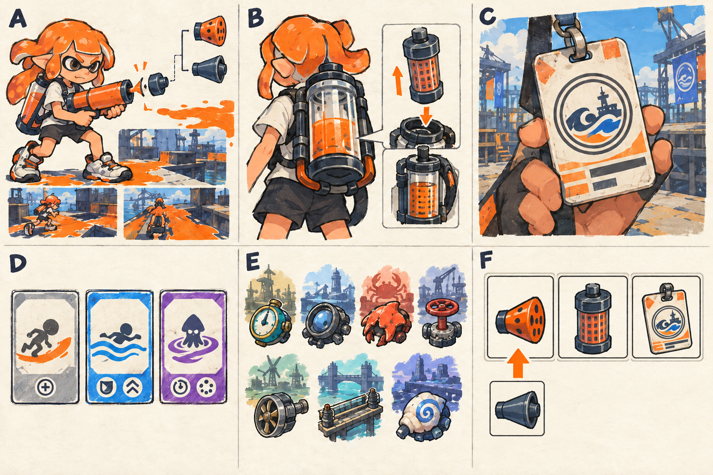

# 아이템·장비 슬롯·제작 상세

- [x] 19개 아이템 설계와 등급·옵션·강화·인벤토리 사용 장면을 상세화한다.
- [x] 장비와 비교 화면 러프를 생성하고 설명과 대조한다.
- [x] 성장 상한·보상표·연결 링크를 확인한다.

[전체 기획](../../싱글플레이-PvE-캠페인-기획-2.md) · [성장](성장-상세-27.md) · [파밍](파밍과-보상-상세-28.md)

## 1. 무엇을 주워 무엇이 달라지는가

> 그림 검수: 어댑터·탱크 필터·표식과 등급 카드 3종·지역 서명 7종·장착 슬롯 3개 및 교체 화살표를 확인했다. 불필요한 특성·보장·분해 도식을 제거했다. 작은 문양은 시안이며 실제 옵션·불이익·상한은 표를 따른다.

| 컷 | 그림의 의미 | 실제 플레이에서 바뀌는 것 |
|---|---|---|
| A | 기존 무기에 붙이는 작은 어댑터이다. | 약점·장치 공격과 잉크 효율을 보완한다. 새 총이나 새 조작을 만드는 아이템이 아니다. |
| B | 기존 잉크 탱크에 들어가는 필터·밸브이다. | 용량·잠수 보충·보조 무기 비용을 보완한다. |
| C | 회수반의 작은 표식이다. | 이동·목표 작업·기존 자동 회복을 보완한다. |
| D | 일반·정밀·특제의 카드 틀이다. | 옵션 조합과 서명 효과를 구분한다. 등급만으로 기본 총알 피해가 크게 뛰지 않는다. |
| E | 지역을 상징하는 서명 모듈이다. | 어느 지역에서 얻고 어떤 전투에 쓰는지 모양과 효과로 기억하게 한다. |
| F | 세 슬롯의 비교 화면이다. | 지금 장비와 새 장비의 실제 적용 수치·상한·불이익을 비교한다. |

아이템은 전투 중 바닥에 수십 개씩 쌓아 두지 않는다. 필드에서는 모듈 회수 아이콘과 미확정 수량을 보여 주고, 임무 완료 후 비교한다. 외형 의상은 기존 라커를 사용하며 능력치 때문에 마음에 들지 않는 의상을 입게 하지 않는다.

## 2. 세 슬롯과 기본 카드

| 슬롯 | 카드 정보 | 선택 기준 |
|---|---|---|
| 어댑터 | 약점·장치·기절 피해 또는 주 무기 잉크 효율을 표시한다. | 해당 지역에 장치가 많은지, 보스의 노출을 잘 활용하는지에 따라 고른다. |
| 탱크 | 용량·보충·보조 무기 비용·스페셜 순환을 표시한다. | 전투 지속과 재정비 중 어느 쪽이 부족한지에 따라 고른다. |
| 표식 | 이동·회복·가동 중 생존을 표시한다. | 우회 접근, 방어 목표, 안정적 재도전 중 무엇을 원하는지 고른다. |

아이템 카드는 이름, 슬롯, 등급, +0~+3 강화, 효과, 획득 지역, 장착·잠금 상태를 가진다. 같은 이름의 카드도 옵션 조합이 다를 수 있으므로 고유 ID를 둔다. 장비 점수 하나만으로 자동 추천하지 않고, 달라지는 행동과 적용값을 보여 준다.

## 3. 기본 설계 12종

아래 값은 +0의 기본 옵션이다. 일반은 기본 옵션 하나를, 정밀은 기본 옵션과 지역 풀에서 고른 보조 옵션 하나를 가진다. 보조 옵션은 기본 옵션과 같은 항목을 중복 추첨하지 않는다.

| ID | 슬롯·이름 | 기본 옵션 | 쓰기 좋은 장면 |
|---|---|---|---|
| AD01 | 어댑터 / 절약 노즐 | 주 무기 잉크 소모 -3%이다. | 슈터 연사·롤러 도색 뒤 탱크가 비는 시간을 늦춘다. |
| AD02 | 어댑터 / 정밀 조준판 | 약점 피해 +4%이다. | 바리의 후방·거대 보스의 낮은 배를 노린다. |
| AD03 | 어댑터 / 차단 접점 | 적 장치·설치물 피해 +6%이다. | 시장 송신기 전투와 솔트의 살수 장치를 빠르게 정리한다. |
| AD04 | 어댑터 / 빈틈 증폭기 | 기절한 보스에게 주는 피해 +4%이다. | 벽 충돌 뒤의 HULLBREAKER에 화력을 집중한다. |
| TK01 | 탱크 / 예비 저장조 | 최대 잉크 용량 +5%이다. | 복구 지점까지 길을 한 번 더 이어 칠한다. |
| TK02 | 탱크 / 급속 여과기 | 잠수 중 잉크 보충 속도 +5%이다. | 짧은 엄폐를 오가며 공격 주기를 줄인다. |
| TK03 | 탱크 / 분기 밸브 | 보조 무기 잉크 소모 -5%이다. | 폭탄으로 방패·장치를 처리한 뒤 주 무기 여유를 남긴다. |
| TK04 | 탱크 / 순환 촉매 | 유효 도색 스페셜 충전량 +4%이다. | 적 도색병이 있는 구역에서 다음 스페셜을 준비한다. |
| BD01 | 표식 / 잠행 표식 | 잠수 이동 속도 +3%이다. | 양쪽 우회로를 바꾸어 타며 공격 방향을 바꾼다. |
| BD02 | 표식 / 경량 표식 | 인간형 달리기 속도 +3%이다. | 아직 칠하지 않은 짧은 연결 구간을 건넌다. |
| BD03 | 표식 / 회복 표식 | 기존 자동 체력 재생 속도 +5%이다. | 피격 뒤 엄폐에 들어가 다음 공격을 준비한다. |
| BD04 | 표식 / 현장 표식 | 목표 진행 중 받는 피해 -5%이다. | 중계기 가동 원을 지키되 위험 공격은 여전히 피한다. |

1-1의 첫 완료 세트는 AD01·TK01·BD01의 일반 +0으로 정한다. 각 슬롯이 무엇을 바꾸는지 단순하게 보여 주며, 첫 장부터 정밀·특제가 없다고 막히게 하지 않는다.

## 4. 지역 서명 7종

특제는 서명 효과와 지역 풀의 보조 옵션 하나를 가진다. 첫 보스 완료 때의 확정 서명도 특제로 제공한다. 확정 카드의 보조 옵션은 아래 추천값으로 고정해 첫 획득 운에 따른 차이를 줄인다. 이후 파밍에서는 같은 서명에 다른 보조 옵션을 얻을 수 있다.

| ID | 이름·슬롯 | +0 서명 효과 | 첫 확정 카드의 보조 옵션 | 만드는 선택 |
|---|---|---|---|---|
| SG01 | 복구자의 표식 / 표식 | 목표 진행 중 피해 -8%이다. | 최대 잉크 +3%이다. | 짧은 위험을 감수해 가동을 마칠지 판단한다. 큰 예고 공격을 버티라는 뜻은 아니다. |
| SG02 | 회수반 렌즈 / 어댑터 | 적 장치·설치물 피해 +8%이다. | 약점 피해 +2%이다. | 적 본체보다 전투 공간을 바꾸는 장치를 먼저 처리한다. |
| SG03 | 파쇄 결정 / 어댑터 | 기절한 보스에게 주는 피해 +8%이다. | 주 무기 잉크 소모 -2%이다. | 벽 충돌을 유도한 뒤 스페셜과 사격을 한 창에 집중한다. |
| SG04 | 계류 밸브 / 탱크 | 잠수 중 잉크 보충 속도 +8%이다. | 잠수 이동 속도 +2%이다. | 회피 뒤 짧게 잠수하고 다시 싸우는 리듬을 만든다. |
| SG05 | 풍차축 / 탱크 | 적 잉크를 바꾼 면적의 스페셜 충전량 +8%이다. | 최대 잉크 +3%이다. | 이미 내 색인 바닥 대신 위협이 되는 적 잉크를 정리한다. |
| SG06 | 수문 도체 / 표식 | 보조 무기 사용 후 4초간 잠수 속도 +6%, 재발동 간격 10초이다. | 보조 무기 잉크 소모 -2%이다. | 보조 무기를 쓴 다음 공격·후퇴 위치를 바꾼다. |
| SG07 | 물결의 기억 / 어댑터 | 약점 피해 +8%, 받는 피해 +5%이다. | 잉크 보충 속도 +3%이다. | 적의 공격을 잘 피하는 숙련자가 약점 공략을 더 밀어붙인다. |

SG06의 10초 간격은 현재 효과가 끝난 뒤가 아니라 발동 시점부터 센다. 그 사이 보조 무기를 다시 써도 효과 시간과 간격을 초기화하지 않는다. SG07은 불이익을 카드 위쪽에 함께 표시하고 숨기지 않는다.

## 5. 정밀·특제의 보조 옵션 풀

| 지역 | 보조 옵션 후보와 +0 고정값 |
|---|---|
| 타이드워터 | 최대 잉크 +3%, 자동 회복 +3%, 목표 진행 중 피해 -3%이다. |
| 크로스로드 | 장치 피해 +4%, 약점 피해 +2%, 주 무기 잉크 소모 -2%이다. |
| 켈프라인 | 기절 보스 피해 +4%, 약점 피해 +2%, 주 무기 잉크 소모 -2%이다. |
| 할야드 | 잠수 보충 +3%, 잠수 이동 +2%, 보조 무기 잉크 소모 -2%이다. |
| 솔트팬 | 유효 도색 충전 +3%, 최대 잉크 +3%, 주 무기 잉크 소모 -2%이다. |
| 록게이트 | 보조 무기 잉크 소모 -2%, 잠수 이동 +2%, 목표 진행 중 피해 -3%이다. |
| 테라스 | 약점 피해 +2%, 잠수 보충 +3%, 인간형 이동 +2%이다. |

효과 수치 자체를 2.91%·3.02%처럼 무작위로 재추첨하지 않는다. 같은 항목이 기본 옵션과 겹치면 다른 후보를 고른다. 확정 서명 카드에 쓰는 추천값도 이 풀과 호환된다. 특정 지역 풀에 원하는 항목이 없다면 다른 지역을 고르거나 기본 설계를 제작한다.

## 6. 강화와 이전의 실제 예

+0·+1·+2·+3은 옵션 수치 크기에 각각 1.0·1.1·1.2·1.3배를 곱한다. 예를 들어 +0의 8%는 +3에서 10.4%가 된다. SG07의 불이익 5%도 +3에서 6.5%가 된다. SG06의 지속 4초와 간격 10초는 강화로 변하지 않는다.

| 강화 | 해금 | 이번 단계 비용 | +0부터 누적 비용 |
|---|---|---|---|
| +1 | 2장 보스 완료이다. | 부품 50개이다. | 50개이다. |
| +2 | 4장 보스 완료이다. | 부품 90개이다. | 140개이다. |
| +3 | 6장 보스 완료이다. | 부품 140개이다. | 280개이다. |

예를 들어 AD02 +2를 쓰다가 SG03 +0을 얻었다면, 어댑터 슬롯 안에서 강화 단계를 이전해 SG03 +2로 만든다. AD02는 +0이 되고 두 장비가 동시에 +2로 남지 않는다. 대상의 단계가 더 높다면 낮은 단계로 덮어쓰지 않고 이전 불가 이유를 표시한다. 무료 이전은 재료로 강화 단계를 환급하거나 복제하는 기능이 아니다.

강화·이전 뒤에는 [성장 문서](성장-상세-27.md)의 합산 상한을 적용한다. 카드의 원래 수치와 실제 적용 수치를 함께 보여 주어 상한에 걸렸음을 알 수 있게 한다.

## 7. 제작·분해·보관

- 기본 설계 제작은 부품 40개이며 슬롯과 설계를 직접 고른다. 해당 지역의 첫 임무 완료로 설계를 해금한다. 시작 지역 4개 설계와 초기 세트는 처음부터 제공한다.
- 한 번 획득한 서명은 부품 80개·공명핵 1개로 추천 보조 옵션이 붙은 확정형을 재제작한다. 완벽한 옵션 추첨을 위해 재료를 무한 소모시키지 않는다.
- 분해 보상은 일반 5·정밀 10·특제 20 부품이다. 잠금·장착 카드는 일괄 분해 목록에서 제외한다.
- 강화 단계를 먼저 이전하지 않고 분해하려 하면 +단계가 사라진다는 안내를 제공한다. 강화 재료를 추가 환급하지 않는다.
- 기본 보관함은 60칸이다. 빈칸이 부족하면 임무 완료 보상은 대기함으로 이동하고 자동 파괴하지 않는다.

부품과 공명핵은 재료 아이콘으로 표시하고, 무기 해금·설계 해금·이야기 기록은 인벤토리 칸을 차지하지 않는다. 모듈의 모델을 전투 캐릭터에 하나씩 새로 붙이는 작업은 필수 범위가 아니다.

## 8. 결과 화면에서의 사용 예

1. 임무 완료 카드에서 획득 모듈과 지역 서명을 확인한다.
2. 새 모듈을 고르면 현재 같은 슬롯 카드와 나란히 비교한다.
3. 더해진 효과·사라지는 효과·불이익·상한 초과를 확인한다.
4. 장착하거나 잠그고, 나머지는 보관·직접 분해한다.
5. 강화 이전이 필요하면 같은 창에서 출처와 대상을 확인한다.

장비를 얻은 즉시 좋은지 판단할 수 있도록 “장치가 많은 임무에 적합하다”, “잠수 재정비를 빠르게 한다” 같은 짧은 용도를 붙인다. 현재 빌드를 모르는 상황에서 등급만 보고 자동 장착하지 않는다.
