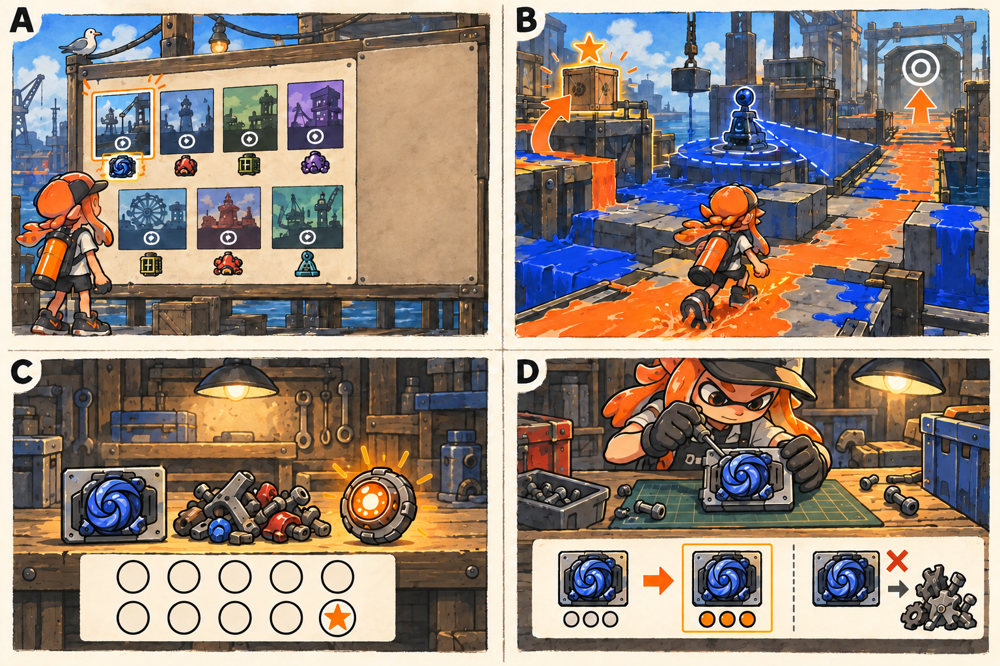

# 파밍·보상·재도전 경제 상세

- [x] 획득처·확률·확정보상·재료 수지와 반복 플레이를 상세화한다.
- [x] 파밍 흐름 러프를 생성하고 설명과 대조한다.
- [x] 수지·확률·보장 횟수·저장 규칙을 검토한다.

[전체 기획](../../싱글플레이-PvE-캠페인-기획-2.md) · [아이템 목록](아이템-상세-26.md) · [성장](성장-상세-27.md)

## 1. 파밍은 다음 공략을 준비하는 짧은 재방문이다

> 그림 검수: 지역 후보 7개·열린 출구와 선택 상자·완료 작업대의 모듈/부품/공명핵·동일 슬롯 이전과 수동 분해를 확인했다. C의 보장 표시는 위 5칸·아래 빈 4칸과 별 1칸으로 총 10칸이다. 공명핵은 보스 완료 예시이며 일반 임무 공통 보상이 아니다. A의 썸네일 배치는 지리·지역별 보상표가 아닌 선택 화면 개념이다.

그림 A는 원하는 지역 보상을 고르는 장면, B는 필수 출구와 선택 상자의 갈림길, C는 임무 완료 때 확정하는 장비·재료·특제 보장, D는 원하는 모듈 제작과 강화 이전이다. 전투 중 아이템 더미를 정리하는 장면이나 뽑기를 반복하는 화면은 목표가 아니다.

예를 들어 수문 조율기에서 장치 처리가 느리다면 크로스로드 임무를 골라 장치 계열 옵션을 찾거나, 이미 획득한 회수반 렌즈를 제작한다. 새 장비를 얻어도 같은 슬롯의 강화 단계를 옮겨 바로 공략을 바꿀 수 있다.

## 2. 첫 완주와 반복의 보상표

| 보상 | 일반 임무 첫 완료 | 일반 임무 반복 | 보스 첫 완료 | 보스 반복 |
|---|---|---|---|---|
| 경험치 | 120 + 추가 480 = 600이다. | 120이다. | 180 + 추가 420 = 600이다. | 180이다. |
| 부품 | 40 + 추가 20 = 60이다. | 40이다. | 60 + 추가 20 = 80이다. | 60이다. |
| 무작위 모듈 | 1개이다. | 1개이다. | 1개이다. | 1개이다. |
| 확정 지역 서명 | 없다. | 없다. | 해당 지역 1개이다. | 없다. |
| 공명핵 | 없다. | 없다. | 1개이다. | 1개이다. |
| 선택 상자 | 일반 임무마다 최대 1개를 추가 회수할 수 있다. | 매 완료 회차에 최대 1개이다. | 없다. | 없다. |

예외는 1-1 첫 완료이다. 이때 무작위 완료 모듈 1개 대신 AD01·TK01·BD01 일반 +0 세트를 지급한다. 선택 상자를 열었다면 그 상자의 무작위 모듈 1개는 별도로 받는다. 첫 완주 보상과 임무 해금은 같은 저장 처리에서 확정한다.

선택 상자는 무작위 모듈 1개·부품 10개·첫 발견 시의 선택 기록을 준다. 선택 기록은 이미 얻었다면 다시 수집 개수를 늘리지 않는다. 이야기·일반 난이도는 같은 보상이며 빠른 시간·무피격을 높은 등급의 필수 조건으로 만들지 않는다.

## 3. 무엇을 노리고 어디로 가는가

| 지역 | 반복할 이유 | 특제 추첨과 첫 보스 확정 서명 |
|---|---|---|
| 타이드워터 | 목표 작업 중의 생존과 기초 운용을 보완한다. | 복구자의 표식이다. |
| 크로스로드 | 장치·약점 옵션을 찾는다. | 회수반 렌즈이다. |
| 켈프라인 | 기절 창의 공격 효율을 높인다. | 파쇄 결정이다. |
| 할야드 | 잉크 보충과 잠수 재정비를 보완한다. | 계류 밸브이다. |
| 솔트팬 | 적 잉크 정리와 스페셜 순환을 강화한다. | 풍차축이다. |
| 록게이트 | 보조 무기 후 이동과 목표 작업을 보완한다. | 수문 도체이다. |
| 테라스 | 약점 공략을 더 밀어붙이는 위험 보상을 고른다. | 물결의 기억이다. |

일반·정밀의 기본 설계는 해금한 기본 모듈 12종에서 고르되 보조 옵션은 현재 지역의 풀을 사용한다. 특제는 현재 지역 서명을 준다. 따라서 선택한 지역의 서명을 파밍하는 것과 기본 설계를 특정 슬롯으로 제작하는 역할이 구분된다.

임무 선택 화면에는 지역 옵션 풀, 서명, 공명핵 여부, 선택 상자 여부, 예상 시간을 표시한다. 새로운 임무를 처음 할 때에는 다음 이야기 안내를 우선하고, 완료 임무를 다시 선택할 때에는 보상 정보를 먼저 보여 준다.

## 4. 등급 추첨과 열 번째 보장

기본 확률은 일반 70%·정밀 25%·특제 5%로 합계 100%이다. 일반은 기본 옵션 1개, 정밀은 기본+보조 2개, 특제는 서명+보조 2개이다. 선택 상자의 무작위 모듈도 동일한 등급 추첨과 보장 횟수를 사용한다.

- 무작위 모듈에서 9회 연속 특제가 없었다면 다음 추첨을 특제로 확정한다.
- 9회 이전에 특제가 나오면 연속 미획득 횟수를 0으로 만든다.
- 1-1의 기본 세트와 보스 첫 완료의 확정 서명은 보장 횟수를 늘리거나 초기화하지 않는다.
- 같은 임무에서는 선택 상자를 획득한 순서대로 먼저 계산하고, 완료 모듈을 마지막으로 계산한다. 모든 결과는 임무 완료에서 한 번에 확정한다.
- 확정 보상 때문에 현재 보장 상태가 사라지지 않게 표시한다. “지역 서명 확정 1개”와 “다음 무작위 추첨의 특제 보장”은 다른 정보이다.

예를 들어 연속 미획득 8회에서 상자를 열어 일반을 받았다면 미확정 상태는 9회가 된다. 그 임무를 완료하면 마지막 모듈이 특제로 보장되고 확정 횟수는 0으로 저장된다. 그 전에 사망하면 상자의 추첨 결과와 현재 실행 기록은 유지하지만 보장 횟수를 다시 증가시키지 않는다.

## 5. 첫 완주의 수지

| 계산 | 결과와 의미 |
|---|---|
| 필수 경험치 | 21 × 600 = 12,600으로 레벨 20 필요량 12,350을 충족한다. |
| 기본 부품 | 일반 14 × 60 + 보스 7 × 80 = 1,400개이다. |
| 선택 상자 부품 | 14 × 10 = 140개를 선택 수입으로 더한다. |
| 공명핵 | 보스 7개에서 총 7개를 받는다. |
| 세 슬롯 +3 비용 | 3 × (50 + 90 + 140) = 840개이다. |
| 기본 설계 3개 제작 예 | 3 × 40 = 120개이다. |
| 서명 2개 재제작 예 | 2 × 80 = 160 부품·공명핵 2개이다. |
| 위 소비 예의 잔여 | 1,400 - 840 - 120 - 160 = 280 부품·공명핵 5개이다. |

위 계산에는 선택 상자·분해·재도전을 넣지 않았다. 첫 진행 보상만으로 좋아하는 세 슬롯을 강화하고 일부 제작을 할 수 있는지 확인하는 시작 수지이다. 실제 플레이에서 모든 슬롯을 즉시 +3으로 만들도록 강제하지 않는다.

첫 완주 중 모듈은 선택 상자를 제외하면 무작위 20개·1-1 세트 3개·첫 보스 서명 7개로 총 30개이다. 일반 임무의 선택 상자 14개를 모두 열면 총 44개이다. 세 슬롯을 제외한 보관까지 고려해도 60칸이 첫 완주를 과도하게 방해하지 않는 시작값이다.

## 6. 임무 실패·포기·이어하기

완료 전에 나온 보상은 미확정 목록에 둔다. 체크포인트 재시작은 같은 상자·추첨 시드·획득 결과를 복원한다. 구간을 반복해 동일한 상자를 여러 번 집거나 보장 횟수를 늘리지 않는다. 적 처치와 바닥 반복 도색은 별도 경험치·부품 추첨을 만들지 않는다.

작업장으로 포기하면 현재 임무의 미확정 보상은 버리고 기존 확정 장비·재료는 보존한다. 재시도만으로 새 추첨을 계속 만들지 않도록 해당 미완료 임무의 추첨 기록을 재사용하는 방향으로 설계한다. 오프라인 개인 저장의 임의 수정을 막는 보안·거래 서버를 새로 만드는 것은 이 기획의 범위가 아니다.

완료 보상 저장에는 임무 완료 회차의 처리 ID, 인벤토리, 재료, 첫 보상 여부, 보장 횟수와 해금을 함께 기록한다. 저장 실패는 실패로 알리고 다시 저장하기를 제공한다. 저장이 끝나기 전에 보상을 버리고 다음 임무로 보내지 않는다.

## 7. 보관함이 꽉 찼을 때

결과 화면에서 선택·잠금·분해를 할 수 있고, 빈칸이 부족하면 모듈은 대기함에 남긴다. 서명 확정 보상이나 특제 보장 결과를 자동 분해하지 않는다. 플레이어가 다음 임무를 시작하기 전에 대기함을 알려 주되 강제적인 대량 정리를 반복시키지 않는다.

분해는 일반 5·정밀 10·특제 20 부품이며, 장착·잠금 아이템은 일괄 선택에서 제외한다. 강화 이전을 무료로 제공하므로 새 모듈을 얻었다는 이유로 같은 강화 비용을 전부 다시 내지 않는다.

## 8. 엔딩 뒤에도 목적을 잃지 않게 한다

완료 임무를 다시 골라 다른 무기·빌드·공략 순서를 시험한다. 도전 임무는 기존 병종 조합과 목표 순서를 최대 두 가지까지 바꾸고 재료 추가·외형 표식·개인 기록을 제공한다. 상위 아이템 레벨을 계속 올리는 무한 성장과 매일 해야만 하는 임무는 추가하지 않는다.

원하는 모듈을 얻은 뒤에는 더 파밍해야만 다음 콘텐츠를 열 수 있게 만들지 않는다. 파밍의 끝은 플레이어가 자기 조합에 만족하고 다른 공략을 시도하는 시점이다.
