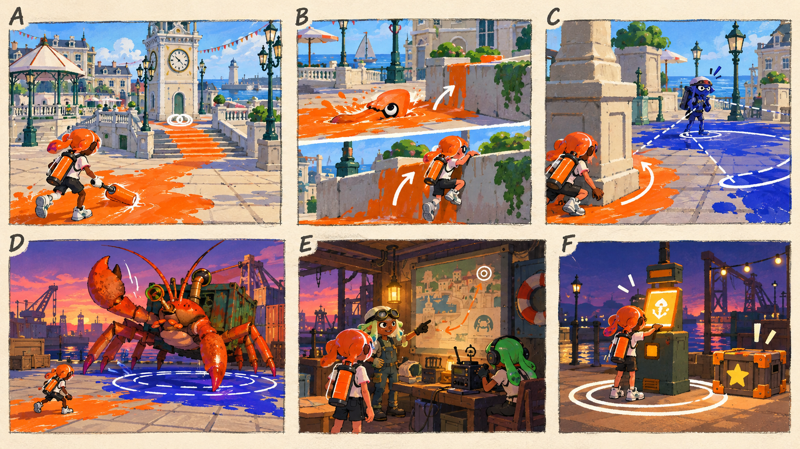

# 러프 일러스트의 시각 설계와 읽는 법

- [x] 기존 게임 화면을 참고해 공간·캐릭터·위험·목표의 표현 규칙을 정한다.
- [x] 내장 이미지 도구로 시각 설계 장면판을 생성하고 프로젝트에 저장한다.
- [x] 나머지 스테이지·주제별 장면판과 표현의 일관성을 확인한다.

[전체 기획과 문서 목차](../싱글플레이-PvE-캠페인-기획-2.md) · [그림 생성 프롬프트](그림-생성-프롬프트-30.md)

## 1. 여섯 컷으로 보는 시각 방향

이 장면판은 현재 내장 이미지 도구로 생성한 기획용 그림이다. 사용자는 모델명 확인 없이 현재 도구로 진행하도록 승인했다. 도구에 모델 선택 항목이 없어 image 2.5 사용 여부는 확인할 수 없다.

| 컷 | 전달하려는 것 | 기획 문서를 읽을 때 볼 지점 |
|---|---|---|
| A | 기존 광장과 작은 플레이어의 크기 관계이다. | 밝은 건물·시계탑·난간 사이에서 자신의 잉크 길이 시선을 이끈다. |
| B | 잠수와 벽오르기는 같은 도색 행동에서 이어진다. | 잉크가 길과 높이 접근을 동시에 제공한다. |
| C | 엄폐와 측면 진입이다. | 적의 시야를 기둥으로 끊고 반대편 주황 경로로 돌아간다. |
| D | 거대 소라게와 회피 공간이다. | 플레이어·집게·바닥 위험 원의 크기를 함께 본다. |
| E | 돌아올 작업장과 통신 인물이다. | 전투와 정비·이야기 사이의 차분한 호흡을 보여 준다. |
| F | 복구 목표·선택 상자·체크포인트이다. | 같은 색의 빛만 쓰지 않고 이중 원·별·장치 형태로 역할을 구분한다. |

그림 B는 잠수와 벽오르기를 한 컷 안의 두 순간으로 나누어 표현한다. 해당 표현이 실제 한 프레임의 캐릭터 상태라는 뜻은 아니다. 그림의 장식·문자·상세 소품은 생성 과정에서 달라질 수 있으며, 게임 규칙은 각 문서의 설명을 따른다.

## 2. 그림의 목적과 해상도보다 중요한 것

이 그림은 플레이어가 어디에 서 있고 무엇을 보고 어떤 행동을 하는지 상상하기 위한 러프이다. 연필 밑선과 평면 색을 사용해 공간 관계를 우선한다. 고품질 홍보 이미지, 실제 실행 화면, 제작 완료된 캐릭터 시트로 오해하지 않게 한다.

- 스테이지 그림은 A·B·C·D의 네 장면을 한 장에 구성한다. 왼쪽 위에서 오른쪽 아래 순으로 읽는다.
- 적의 공격은 맞은 순간보다 예고와 피할 곳을 보여 준다.
- 플레이어를 배경 속 작은 인물로 두되 무기·이동·엄폐 관계는 알아볼 수 있게 한다.
- 장면마다 멋진 새로운 건물이나 괴물을 추가하지 않고 기존 배경의 큰 실루엣을 따른다.
- 정확한 좌표·미터 단위 배치·실제 충돌 가능 면은 코드와 레벨 검증으로 정한다. 그림은 개념 공간이다.

## 3. 공통 범례

| 표현 | 뜻 | 실제 게임에서 함께 제공할 정보 |
|---|---|---|
| 주황 실선·넓은 칠 | 플레이어의 잉크와 제안 이동 경로이다. | 팀 팔레트·색각 설정과 이동 가능한 면을 적용한다. |
| 코발트 칠·적 실루엣 | 잔향 적과 적이 만든 공간 압박이다. | 역할 아이콘·무기 실루엣·체력 표시를 함께 쓴다. |
| 흰 이중 원 | 복구·안정화 목표 또는 체크포인트이다. | 문서의 목표 이름과 완료 상태로 서로 구분한다. |
| 별 | 선택 상자·선택 기록이 있는 우회 보상이다. | 필수 진행 화살표와 다른 모양으로 표시한다. |
| 얇은 선·테두리 원 | 공격 전에 보이는 위험 예고이다. | 방향·도착 시간·안전한 빈 공간을 보여 준다. |
| 밝은 작은 이중 고리 | 공격 가능한 약점 또는 제어 고리이다. | 기본 몸통 피해와 노출 조건을 문서에서 설명한다. |
| 굽은 화살표 | 반드시 따라야 할 자동 길이 아니라 가능한 선택 동선이다. | 다른 경로도 성공할 수 있는지 확인한다. |

색만으로 의미를 전달하지 않는다. 그림이 주황·코발트 시안을 쓰더라도 실제 게임은 기존 팀 팔레트와 색각 설정을 사용한다. 위험 표현은 지형 도색과 구분되는 테두리·깜박임·방향 형태를 유지한다.

## 4. 지역별 배경에서 유지할 특징

| 지역 | 원본에서 가져올 큰 형태 | 러프에서 보여 줄 플레이 |
|---|---|---|
| 타이드워터 | 크림색 시계탑·정자·흰 난간·벽돌 바닥이다. | 옆 벽과 계단, 정면 방패의 측면 길이다. |
| 크로스로드 | 유리 시장홀·정차 전차·좁은 가게 골목·차양이다. | 사선의 끊김과 고지 접근, 송신기의 활성 순서이다. |
| 켈프라인 | 노란 갠트리 크레인·컨테이너·화물선이다. | 컨테이너 엄폐와 보스 돌진 충돌 벽이다. |
| 할야드 | 목재 부두·선실·카페리·계류 말뚝·바다이다. | 물가 반대편으로 피하는 안전한 우회이다. |
| 솔트팬 | 낮은 염전·흰 소금더미·풍력 펌프·판자 길이다. | 작은 안전 공간과 살수 장치의 압박이다. |
| 록게이트 | 높은 붉은 벽돌 벽·돌다리·고정 수문이다. | 같은 적을 시야와 높이로 분리하는 경로이다. |
| 테라스 | 흰 언덕마을·주황 지붕·층진 계단·돔 건물이다. | 위로 이어지는 경로와 마지막 복구 신호이다. |

최종 거대 보스의 실제 광장 배치는 검증 대상이다. 충분한 공간이 없다면 기존 넓은 항만 전투장을 재사용하는 대안이 있으며, 기획 그림을 맞추려고 새 대형 지형을 무조건 만들지 않는다.

## 5. 캐릭터와 소품의 제작 기준

플레이어와 모라·틸·잔향 대장은 기존 캐릭터 비율·라커 외형·리그를 따른다. 색·머리·안경·작업 소품·자세로 차이를 준다. 아카이브는 단말과 파형이며 인간형 로봇으로 새로 만들지 않는다.

HULLBREAKER는 컨테이너 껍질과 비대칭 집게를 유지한다. 최종형은 새 괴물이 아니라 제어 고리와 기존 공격 순서의 변형이다. 장치 보스는 기존 펌프·상자·낮은 중심핵·송신기 조합으로 표현한다.

게임에 추가할 공통 상호작용 표현은 복구 단말·중심핵·회수 상자·체크포인트 표식 네 종류이다. 아이템은 카드와 슬롯 아이콘으로 설명하며 19개 아이템 각각의 새 무기 모델을 만들지 않는다.

## 6. 그림과 글이 다르면 무엇을 기준으로 보는가

각 문서의 목표·성공 조건·적 수·패턴 순서·보상이 우선이다. 그림이 추가한 장식문·위험색·열리는 문·정체가 불분명한 장치는 자동으로 새로운 기능이 되지 않는다. 중요한 행동이나 위치 관계가 틀리면 해당 장면판을 다시 생성해 검토한다.

이미지는 내장 도구에서 먼저 생성한 뒤 저장소의 `docs_working/PvP-GDD/images/campaign`에 복사한다. 저장소 밖의 기본 생성 경로만 참조하지 않는다. [프롬프트 문서](그림-생성-프롬프트-30.md)에 장면별 지시서와 원본 참고 이미지를 남긴다.

전체 장면판 29장의 공통 화풍과 색·목표·위험 표현을 대조했다. 기존 시각 설계 파일은 그대로 보존했다. 같은 칸에서 이어지는 여러 순간을 모두 그리지 않았으며, 각 그림 아래의 검수 메모가 그 순간과 생략 범위를 설명한다. 캐릭터 머리·소품·작은 문양은 러프 변형이며 최종 인물 정체성과 기능은 해당 상세 문서를 따른다.
