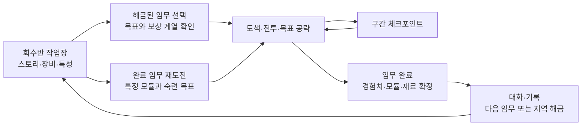

# INKWAVE 싱글 플레이 PvE 캠페인 기획 — 되찾는 물결

- [x] 구현 순서와 완료 조건 절을 삭제한다.
- [x] 스테이지 21개를 각각의 상세 문서로 분리한다.
- [x] 게임플레이·NPC·아이템·성장·파밍을 별도 상세 문서로 작성한다.
- [x] 시각 설계와 러프 장면판을 생성해 문서에 삽입한다.
- [x] 전체 링크·보상 수치·그림과 설명의 일치 여부를 검토한다.

## 1. 기획의 전제

이 문서는 기존 INKWAVE의 플레이와 리소스를 활용해 별도의 싱글 플레이 캠페인을 만드는 기획안이다. 가제는 **「되찾는 물결」**이다. 온라인 모드와 독립적으로 한 명이 끝까지 플레이하며, 잉크로 길과 전투 공간을 확보하고 적의 공격을 읽어 돌파하는 스테이지 진행형 PvE를 목표로 한다.

클라이언트의 웹 우선 개발·향후 안드로이드·아이폰 지원과 공통 조작은 [31번 전환 계획](../클라이언트-멀티플랫폼-전환계획-31.md)과 [32번 구현 설계](../클라이언트-멀티플랫폼-구현설계-32.md)를 따른다. 모바일 전환은 스테이지 1 완성 후 검토하며 안드로이드 빌드는 사용자의 별도 요청 이후에만 진행한다.

기존 기능의 확인 기준은 커밋 `7c970e65beea8f54ca94d2ac326674e0c2e7279b`이다. 아래에서 **기존**은 코드에서 확인한 기능, **추가**는 캠페인을 위해 새로 제작하거나 수정해야 할 기능을 뜻한다. 플레이 시간, 보상, 확률, 전투 수치는 모두 검증 전의 **초기 기획값**이다. 실제 캠페인 구현이나 플레이 테스트를 완료했다는 의미는 아니다.

| 항목 | 제안 범위 |
|---|---|
| 플레이 형태 | 플레이어 한 명이 진행하는 오프라인 PvE 캠페인이다. 기본 구성에 전투 동료 봇을 넣지 않는다. |
| 전체 분량 | 기존 오프라인 스테이지 7개를 지역으로 사용하고, 지역당 3개 임무로 총 21개 스테이지를 구성한다. |
| 첫 완주 목표 | 일반 난이도에서 스토리·장비 정비를 포함해 약 4~6시간을 목표로 한다. |
| 한 번의 플레이 | 일반 스테이지는 약 8~14분, 보스 스테이지는 진입 전투를 포함해 약 6~10분을 목표로 한다. |
| 전개 | 각 지역의 첫 임무에서 문제를 발견하고, 두 번째 임무의 중간보스를 넘어, 세 번째 임무의 스테이지 보스를 제압한다. |
| 성장 | 캠페인 전용 레벨 1~20, 특성 선택, 장비 모듈 3칸과 강화로 구성한다. |
| 파밍 | 원하는 지역에서 원하는 모듈을 노릴 수 있고, 첫 완주에 필요한 전력은 확정 보상으로 확보한다. |
| 추가 제작 원칙 | 기존 맵·캐릭터·무기·거대 보스·효과를 우선 사용한다. 새 기능은 임무 진행, 보상, 저장과 필요한 적 행동에 집중한다. |

## 2. 기존 게임에서 가져올 수 있는 것

| 기존 자산·기능 | 코드에서 확인한 상태 | 캠페인 활용 | 필요한 추가 작업 |
|---|---|---|---|
| 잉크 전투와 이동 | 잉크 발사, 칠하기, 잠수 이동, 벽 오르기, 잉크 보충, 피해와 회복을 구현한다. | 잉크 길 만들기, 고지 접근, 공격 회피, 재정비를 핵심 행동으로 삼는다. | 캠페인 전용 보정치를 캐릭터별로 적용한다. |
| 주 무기 12종 | `WEAPON_ORDER`에 슈터·쌍권총·우산·블래스터·스피너·차저·활·롤러·브러시·검·미츠·버킷이 등록되어 있다. | 무기별 공략과 장비 조합을 제공한다. | 모든 필수 목표를 어떤 무기로도 해결할 수 있도록 판정과 보스 약점 접근을 점검한다. |
| 보조 무기 15종·스페셜 19종 | 종류와 기본 동작을 구현한다. | 전투 역할과 빌드의 차이를 만든다. | 혼자 쓰는 상황의 효과와 적 대응을 조정한다. |
| 오프라인용 맵 7개 | `tidewater`, `crossmarket`, `kelpline`, `halyard`, `saltpan`, `lockgate`, `terraces`를 사용할 수 있다. | 7개 지역의 배경과 전투 구역으로 사용한다. | 진입·적 출현·목표·체크포인트 위치를 데이터로 지정한다. |
| 낮·해질녘과 환경 소품 | 기존 스테이지별 시간대, 부두·상자·표지판·펌프 등 절차적 소품을 제공한다. | 같은 맵에서도 시간대, 사용 구역과 목표 배치로 분위기를 바꾼다. | 임무 표식과 상호작용 표시를 추가한다. 장식 소품이 곧바로 작동 장치가 되는 것은 아니다. |
| 캐릭터와 외형 | 모델·리그·애니메이션·장비 외형을 코드로 생성한다. | 적 병종, 정예, 대장, 통신 인물의 초상에 활용한다. | 적 식별 표식과 필요한 행동 상태를 추가한다. |
| 봇과 길 찾기 | 이동, 도색, 교전, 회피, 장치 대응과 보스전 행동을 제공한다. | 일반 적의 이동과 전투 기반으로 활용한다. | 순찰·경계·제한된 추적·지정 위치 방어·웨이브 출현을 추가한다. 기존 봇을 넣는 것만으로 임무 AI가 완성되지는 않는다. |
| HULLBREAKER | 거대한 소라게 보스 한 종과 강타·통 낙하·광선·돌진·소형 게·회전 공격을 구현한다. | 중반 거대 보스와 최종 보스의 기반으로 활용한다. | 솔로 체력·패턴·무기별 효율과 전투장 위치를 재조정한다. |
| 현재 보스 모드 | 기본 8인 분대, 제한 시간, 체력에 따른 페이즈와 결과 화면을 제공한다. | 보스 UI, 예고, 약점과 효과를 재사용한다. | 플레이어 1명 기준의 진행·재도전 규칙을 새로 연결한다. |
| 현재 프로필 성장 | 로컬 프로필에 경험치·레벨·승패 등을 저장한다. | 경험치 표시와 결과 연출을 참고한다. | 캠페인 레벨, 특성, 인벤토리와 저장 데이터를 별도로 만든다. 현재 레벨이 캠페인 능력치를 제공하는 기능은 아니다. |
| 메뉴·HUD·소리 | 로비, 장비 선택, 결과, 보스 HUD와 합성 오디오가 있다. | 캠페인 허브, 장비 정비, 목표 표시와 보상 화면의 바탕으로 삼는다. | 임무 선택, 대화 자막, 모듈 비교와 체크포인트 UI를 추가한다. |

`cargo`는 현재 `onlineOnly`, `noBots`, `noBoss`로 지정되어 있다. 첫 캠페인 범위에는 넣지 않는다. 해당 플래그를 지워 재사용하는 방식은 봇 이동과 보스 전투장의 검증을 건너뛰게 되므로 별도 확장 후보로 남긴다.

근거는 [공통 설정과 콘텐츠 목록](../../src/config.js), [캐릭터 상태](../../src/game/actor.js), [봇](../../src/game/bots.js), [보스 모드](../../src/boss/bossMode.js), [보스](../../src/boss/boss.js), [공격과 예고](../../src/boss/bossHazards.js), [게임 진행과 현재 보상](../../src/main.js)이다.

## 3. 플레이어가 느껴야 할 핵심 재미

### 3.1. 전투의 중심은 잉크로 만드는 선택지이다

적을 쓰러뜨리는 동안에도 다음 행동을 계속 선택하게 한다.

- 정면에서 사격을 이어갈지, 옆 벽을 칠해 올라가 약점을 노릴지 선택한다.
- 목표를 빨리 가동할지, 먼저 주변을 칠해 회복·재장전·후퇴 경로를 확보할지 선택한다.
- 스페셜을 정예에게 사용할지, 다음 방어 웨이브와 보스의 노출 구간까지 아낄지 선택한다.
- 곧바로 출구로 갈지, 짧은 우회 전투를 치르고 원하는 장비 계열의 상자를 열지 선택한다.

필수 동선에서는 **도색 → 빠른 이동 → 짧은 교전 → 안전지대 확보 → 목표 완료**가 반복된다. 도색은 이동과 생존을 돕고, 목표를 작동시키고, 보스의 공격을 피할 공간을 만든다. 넓은 바닥을 오랫동안 칠하는 일을 임무 완료 조건으로 삼지 않는다.

### 3.2. 한 스테이지의 구성

일반 임무는 다음 네 박자로 구성한다. 사용 구역과 적 조합을 바꾸어 같은 지도에서 다른 경로와 전투를 경험하게 한다.

| 구간 | 목표 시간 | 플레이 내용 |
|---|---|---|
| 진입 | 약 1~2분 | 안전한 도색·이동 구간과 소규모 전투로 이번 임무의 규칙을 보여 준다. |
| 선택 | 약 2~4분 | 주 목표와 선택 상자 중 경로를 고른다. 고지·엄폐·벽타기의 이득을 제공한다. |
| 위기 | 약 3~5분 | 적 조합, 방어 웨이브 또는 중간보스로 배운 행동을 시험한다. |
| 해소 | 약 1~3분 | 최종 장치를 작동시키거나 출구에 도달한 뒤 스토리와 보상을 받는다. |

보스 임무는 짧은 진입 전투와 체크포인트 후 인간형 약 90~150초, 고정 장치 약 120~210초, 거대 보스 약 180~360초의 본전투를 배치한다. 강제 제한 시간은 특정 방어·탈출 구간에만 사용한다. 일반 임무 전체와 보스전에는 기존 대전 모드의 3분·4분 제한을 적용하지 않는다.

### 3.3. 캠페인 전체 흐름

## 4. 내러티브 — 항구가 색을 잃은 이유

### 4.1. 배경과 주인공

항구 도시의 잉크 순환망은 서로 다른 색의 흐름을 받아들여 교통·시장·정화 설비를 움직인다. 폭풍 뒤에 비상 정화 장치인 **조율망**이 도시 전체를 오염 구역으로 오인한다. 조율망은 모든 색을 하나로 회수하는 명령을 반복하며 길을 막고, 작업 장비와 생물까지 통제하기 시작한다.

플레이어는 잉크 회수반의 신입이다. 사용자가 정한 이름과 기존 라커 외형을 그대로 사용한다. 처음에는 통신 중계기를 고치는 간단한 임무를 받지만, 지역을 복구하면서 조율망의 오류가 사람의 선택과 연결되어 있음을 알아낸다. 마지막에는 도시를 초기화하는 대신 서로 다른 흐름이 공존하는 순환망을 복구한다.

일반 적은 조율망이 저장된 작업 동작을 복제해 만든 **잔향 대원**이다. 기존 캐릭터 모델에 공통 표식과 작업용 외형을 입혀 표현한다. 쓰러진 적은 잉크로 풀어지며, 장비 회수와 파밍은 이 잔향을 해체해 얻는 부품이라는 설정으로 연결한다.

### 4.2. 주요 인물과 표현 비용

| 인물 | 역할과 이야기 | 표현 방식 |
|---|---|---|
| 플레이어 | 회수반 신입으로 시작해 서로 다른 방식의 전투와 장비를 익힌다. | 기존 플레이어 모델·외형·이름을 사용한다. |
| 모라 | 작업장을 지키는 정비사이다. 장비를 고치며 플레이어에게 돌아올 곳을 제공한다. | 기존 캐릭터의 외형 변형과 고정 구도 초상을 사용한다. |
| 틸 | 끊긴 구역의 기록을 모으는 통신원이다. 임무 목표와 지역의 사연을 전달한다. | 통신창 초상과 자막을 사용한다. 실제 동행 AI는 만들지 않는다. |
| 아카이브 | 조율망의 기록 인터페이스이다. 초반에는 명령을 반복하고 후반에는 누락된 사고 기록을 보여 준다. | 표지판·단말 그래픽과 간단한 파형·자막으로 표현한다. |

전용 음성 녹음, 입 모양 애니메이션과 긴 영상은 첫 범위에서 제외한다. 기존 배경·캐릭터 구도와 합성 효과음, 짧은 카메라 연출로 대화와 보스 등장을 표현한다.

### 4.3. 지역별 이야기의 변화

| 장 | 지역과 시간대 | 사건과 감정의 변화 | 다음 지역으로 이어지는 이유 |
|---|---|---|---|
| 1 | 타이드워터 광장 / 낮 | 멈춘 시계와 중계기를 복구한다. 단순 고장이라고 생각하지만 대장이 민간 기록까지 회수하려 한다. | 시장의 수신 기록에서 같은 명령이 반복된 흔적을 찾는다. |
| 2 | 크로스로드 시장 / 해질녘 | 대피한 상인들의 거래 기록을 회수한다. 조율망이 사람을 보호하는 대신 흔적을 지우고 있음을 알게 된다. | 오류 명령의 배포 경로가 화물 터미널로 이어진다. |
| 3 | 켈프라인 터미널 / 낮 | 화물과 생물을 정화 대상으로 분류한 현장을 발견한다. 통제 장치를 짊어진 거대 소라게와 싸우고 조율망 신호를 끊는다. | 껍질의 장비에서 마리나 정비반의 작업 기록을 찾는다. |
| 4 | 할야드 마리나 / 해질녘 | 모라가 폭풍 때 구조를 서두르려 비상 회수 명령을 확대한 사실을 고백한다. 책임을 회피하던 인물이 복구에 참여한다. | 강제 초기화 외의 해결책을 찾기 위해 원래 순환 시설로 간다. |
| 5 | 솔트팬 분지 / 낮 | 서로 다른 잉크가 섞여야 정화 설비가 정상 작동한다는 사실을 재발견한다. 플레이어의 도색이 복구의 원리로 연결된다. | 대체 복구 명령을 보내려면 운하의 차단 구역을 열어야 한다. |
| 6 | 록게이트 운하 / 해질녘 | 조율망이 최종 초기화를 준비한다. 플레이어는 수문별로 남은 통신선을 되살려 복구 경로를 확보한다. | 테라스 고지대의 중앙 중계기로 마지막 명령을 보내야 한다. |
| 7 | 테라스 고지대 / 새벽을 앞둔 해질녘 | 최종 통제 장치를 제거하고 도시를 서로 다른 색이 흐르는 상태로 되돌린다. 앞선 지역에서 배운 행동을 모두 사용한다. | 엔딩에서 복구된 지역의 통신과 기록을 확인하고 재도전 모드를 연다. |

7장의 시간대는 기존 `dusk`를 사용하며 새벽은 자막과 이야기로 표현한다. 새 하늘·조명 세트를 필수로 만들지 않는다. 복구된 도시도 우선 임무 선택 화면의 이미지·설명과 작업장 대사로 보여 준다.

필수 대화는 임무 시작 15~25초, 완료 후 20~35초를 목표로 한다. 이동 중 통신은 한 번에 짧은 자막 두 줄로 제한하고 보스 예고와 겹치면 미룬다. 대화는 건너뛰기·기록 다시 읽기를 지원한다. 선택 기록물은 지역마다 2개, 총 14개로 제한하며 본편의 결말을 이해하는 데 필수로 요구하지 않는다.

선택 기록물은 각 지역의 일반 임무 2개에 있는 선택 상자와 하나씩 묶어 배치한다. 임무 목표로 반드시 회수하는 통신 자료는 진행용 목표이며, 선택 수집물 14개와 구분한다. 주민과 작업반의 행방은 대피 기록·통신 복구로 설명해 별도의 동행 구조 AI를 요구하지 않는다.

## 5. 지역 7개와 스테이지 21개의 구성

아래의 스테이지는 같은 지역 맵을 사용하는 서로 다른 임무이다. 각 지역의 1·2·3번 임무를 순서대로 완료하면 다음 지역이 열린다. 하나의 맵을 거대한 선형 던전으로 재제작하지 않고, 출발점·활성 구역·목표·적 출현을 바꾸어 진행감을 만든다.

| 번호 | 임무명 | 주 목표와 전투의 차이 | 중간보스·보스 또는 이야기 보상 |
|---|---|---|---|
| 1-1 | 멈춘 시계 아래 | 가까운 중계기 2개에 잉크를 공급하고 광장 통신을 복구한다. 이동과 잠수 회복을 가르친다. | 기본 모듈 3칸을 채울 수 있는 확정 보상을 제공한다. |
| 1-2 | 지워지는 발자국 | 기록 2개를 회수하고 고지의 방어 구역을 통과한다. 옆길 도색과 엄폐를 사용한다. | 중간보스 「청소반장」과 첫 기록물을 만난다. |
| 1-3 | 광장의 통행금지 | 중앙 장치를 지키는 대장의 방패를 우회하고 약점 노출 때 공격한다. | 스테이지 보스 「통행대장 바리」를 제압하고 시장 경로를 연다. |
| 2-1 | 비어 있는 가판대 | 골목의 기록 보관함 3개 중 주 목표 2개를 회수한다. 나머지 하나는 선택 보상이다. | 브러시·우산·쌍권총 계열을 해금한다. |
| 2-2 | 유리 지붕의 감시자 | 좁은 사선을 피해 전진하고 측면 높은 길을 확보한다. | 중간보스 「유리눈 감시자」가 긴 사거리의 대응법을 시험한다. |
| 2-3 | 시장의 마지막 방송 | 작동 중인 송신기부터 차례로 무력화하고 노출된 중심부를 공격한다. | 스테이지 보스 「배전탑 오르골」과 명령 배포 기록을 확보한다. |
| 3-1 | 목적지 없는 화물 | 컨테이너 사이 중계기 3개를 순차 복구한다. 모든 구역을 동시에 지킬 필요는 없다. | 블래스터·활·버킷 계열을 해금한다. |
| 3-2 | 적재 구역 봉쇄 | 표시된 안전 통로를 만들고 낙하 위험 구역의 기록을 회수한다. | 중간보스 「적재장 포수」를 상대한다. |
| 3-3 | 껍질 속의 명령 | 넓은 전투장에서 강타를 넘고 벽에 부딪힌 돌진의 빈틈을 노린다. | 스테이지 보스 「하역왕 HULLBREAKER」의 통제 장비를 부순다. |
| 4-1 | 끊어진 계류선 | 부두의 고정 중계점을 따라 이동하고 짧은 방어전을 두 번 수행한다. 이동 차량은 사용하지 않는다. | 스피너·검·미츠 계열을 해금해 주 무기 12종을 모두 선택할 수 있게 한다. |
| 4-2 | 돌아오지 않은 작업반 | 난간과 선박 엄폐를 이용해 장비를 회수한다. 물에 빠지지 않는 경로 선택이 중요하다. | 중간보스 「계류 수문장」과 모라의 과거를 확인한다. |
| 4-3 | 등대 없는 항로 | 번갈아 열리는 사선을 피하고 가까운 정비 지점을 확보해 대장의 위치를 무너뜨린다. | 스테이지 보스 「계류장 스큐」를 제압한다. |
| 5-1 | 소금 밭의 두 흐름 | 두 펌프를 순서대로 가동한다. 도색 진행은 각 지점별로 저장한다. | 혼합 순환의 원리를 배운다. |
| 5-2 | 마르는 길 | 넓은 적 잉크 지대를 건너면서 회복 공간을 확보하고 도색병을 먼저 처리한다. | 중간보스 「염전 청소조」가 안전지대 관리 능력을 시험한다. |
| 5-3 | 바람이 멈춘 펌프 | 적의 살수 장치를 부수고 안전 구역을 만들어 대장의 연속 사격을 끊는다. | 스테이지 보스 「풍차장 솔트」와 대체 복구 명령을 확보한다. |
| 6-1 | 닫힌 물길 | 운하의 세 고정 제어점을 차례로 복구한다. 실제 수위와 지형은 움직이지 않는다. | 수문 통신의 일부가 살아난다. |
| 6-2 | 두 문지기 | 방패 정예와 원거리 정예를 분리해 각자의 빈틈을 공략한다. | 중간보스 「쌍문지기」가 병종 조합 대응을 시험한다. |
| 6-3 | 역류의 관제실 | 하나의 구역을 확보한 뒤 다음 구역으로 이동하고, 마지막 제어핵을 파괴한다. | 스테이지 보스 「수문 조율기」를 정지시켜 중앙 통신선을 연다. |
| 7-1 | 가장 높은 우회로 | 계단과 벽을 이용해 기존 사선을 우회하고 세 중계점을 연결한다. | 앞선 지역의 인물들이 통신으로 복구를 돕는다. |
| 7-2 | 남은 신호 | 혼합 병종 웨이브와 짧은 제어점 방어를 연속 돌파한다. | 중간보스 「잔향 지휘관」이 마지막 복구 기록을 지킨다. |
| 7-3 | 되찾는 물결 | 거대 보스의 통제 고리를 페이즈별로 끊고 마지막 공격을 버틴 뒤 약점을 공략한다. | 최종 스테이지 보스 「파도껍질」, 엔딩과 도전 재진입을 해금한다. |

초기 주 무기는 슈터·롤러·차저 3종이다. 주 무기 해금은 2·3·4장 진입 임무의 확정 보상으로 각각 3종씩 제공한다. 보조 무기와 스페셜도 이야기 진행에 따라 묶음으로 해금하되, 임무를 해결하는 데 필요한 기본 폭탄과 회피·방어 수단은 초반부터 제공한다. 해금 보상을 무작위 획득에 맡기지 않는다.

### 5.1. 재사용할 임무 규칙 네 가지

| 규칙 | 기본 동작과 완료 조건 | 반복감을 줄이는 조합 |
|---|---|---|
| 중계기 복구 | 장치 주변의 작은 영역을 60% 이상 칠하고 가동 범위에 2초 머무르면 복구된다. 완료한 장치는 다시 빼앗기지 않는다. | 고지 접근, 적 도색병, 활성화 순서를 조합한다. |
| 구역 방어 | 작은 구역을 확보해 총 45초의 안정화 시간을 채운다. 적이 진입하면 진행을 멈추지만 이미 채운 시간은 줄이지 않는다. | 2개 웨이브, 측면 진입, 사선 차단을 조합한다. |
| 기록 회수 | 적을 정리한 뒤 고정 보관함에 접근해 2초 머무르고 지정 출구로 이동한다. | 가까운 위험 경로와 먼 안전 경로, 선택 보관함을 배치한다. |
| 대장·핵 제압 | 주변 장치를 처리하거나 공격 빈틈을 만들어 약점을 공격한다. | 방패 우회, 사선 확보, 잉크 구역, 거대 보스 패턴을 조합한다. |

네 규칙은 모두 **추가 임무 시스템**이다. 기존 구역 점령 판정·잉크 격자·이벤트·보스 판정을 가져와 구성한다. 보관함과 장치의 접근·가동은 자동 진행 표시로 처리해 기존 발사·보조 무기·스페셜 키를 바꾸지 않는다. 위험 지역의 조작은 즉시 중단할 수 있다.

### 5.2. 첫 임무 1-1의 구체적인 플레이 예시

1. **처음 1분:** 작은 안전 구역에서 슈터로 바닥을 칠하고 잉크에 잠수한다. 잉크가 이동로이자 재정비 공간이라는 설명을 행동으로 익힌다.
2. **1~3분:** 중계기 A를 향한다. 정면에는 사격병 한 명이 있고, 옆 벽을 칠하면 낮은 고지로 올라갈 수 있다. 정면과 우회 모두 성공 가능하게 만든다.
3. **중간 체크포인트:** 중계기 A를 복구한다. 체력·잉크를 회복하고 진행을 저장한다. 이후의 실패로 A 복구를 다시 요구하지 않는다.
4. **3~6분:** B로 가는 두 경로가 열린다. 짧은 길에는 방패병 한 명, 긴 길에는 사격병 두 명과 선택 상자 하나가 있다. 위험한 경로가 항상 보상이 더 좋은 구조로 고정하지 않는다.
5. **6~8분:** B를 복구하는 동안 두 번의 작은 적 출현을 막는다. 마지막 적을 쓰러뜨리면 출구가 열리고 통신이 돌아온다.
6. **결과:** 기본 장비 세트를 받고 작업장으로 돌아간다. 첫 모듈 장착을 안내하며, 바닥을 칠한 면적보다 목표 완료와 안전 경로 활용을 먼저 보여 준다.

첫 임무의 목표는 장비 없이도 기본 무기로 잉크 이동·회복·엄폐의 이득을 느끼게 하는 것이다.

## 6. 일반 적과 중간보스

### 6.1. 일반 적은 기존 무기에서 역할을 만든다

| 병종 | 재사용 자산 | 플레이어에게 요구하는 대응 | 캠페인 전용 행동 |
|---|---|---|---|
| 사격병 | 슈터·쌍권총, 기존 캐릭터·봇 | 엄폐와 짧은 사격, 측면 접근을 사용한다. | 짧게 연사한 뒤 최소 0.8초 재정비한다. 플레이어를 무제한 추적하지 않는다. |
| 도색병 | 롤러·브러시 | 이동로를 먼저 칠하거나 적을 우선 처리한다. | 지정 구역과 통로를 칠하고, 플레이어를 계속 쫓기보다 목표로 돌아간다. |
| 방패병 | 우산과 기존 방패 표현 | 측면·고지·방패 발사 후의 빈틈을 공략한다. | 정면 방어와 느린 전진을 반복한다. 방패를 닫는 시간이 반드시 있다. |
| 감시병 | 차저·활, 조준 효과 | 사선을 읽고 엄폐 사이를 이동한다. | 발사 전 방향과 위험선을 최소 0.9초 보여 주고, 발사 후 위치를 조정한다. |
| 포격병 | 버킷·블래스터·스피너, 기존 투사체 | 지면 예고를 보고 이동하고 고지를 빼앗는다. | 장시간 추적 사격을 제한하고 공격·재정비 상태를 명확히 나눈다. |
| 소형 잔향 게 | 기존 Crablet 모델·이동·폭발 효과 | 짧게 우선 처리하거나 잉크 길로 거리를 벌린다. | 정해진 출현 수만 사용하고, 단독 무한 소환으로 시간과 보상을 벌지 못하게 한다. |

몸체는 공통 잔향 표식을 사용하고 머리 위 아이콘과 무기 실루엣으로 병종을 구분한다. 팀 색만으로 아군·적군·약점을 구분하지 않는다. 신규 동물 모델이나 병종별 새 뼈대는 첫 범위에서 만들지 않는다.

### 6.2. 중간보스는 공략 규칙 하나를 강조한다

중간보스는 일반 캐릭터 기반 정예로 구성한다. 목표 전투 시간은 약 45~90초이다. 기본 체력만 과도하게 늘리지 않고 **일반 적과 다른 예고 행동 하나, 확실한 빈틈 하나**를 부여한다. 플레이어가 다음 스테이지 보스의 공략을 미리 익히는 역할도 맡는다.

| 중간보스 | 기본형 | 고유 상황과 공략 | 다음 보스와의 연결 |
|---|---|---|---|
| 청소반장 / 1-2 | 도색 정예 | 정면을 밀고 들어온 뒤 회전·재정비한다. 벽과 옆길로 이동해 뒤를 노린다. | 바리의 방패 우회에 대비한다. |
| 유리눈 감시자 / 2-2 | 감시 정예 | 사선을 유지하지만 연속 두 발 뒤 긴 재정비를 한다. 엄폐를 옮기며 고지를 차지한다. | 송신기의 활성 순서와 위험선을 읽게 한다. |
| 적재장 포수 / 3-2 | 포격 정예 | 낙하 예고 지점을 두 번 만든 뒤 장치를 보충한다. 안전 공간을 남기는 도색을 요구한다. | 거대 보스의 통 낙하와 회피에 대비한다. |
| 계류 수문장 / 4-2 | 방패 정예 | 부두의 좁은 길을 막는다. 방패를 쏘아 보낸 뒤 열린 길로 돌아 들어간다. | 사선을 끊고 가까운 거리를 확보하게 한다. |
| 염전 청소조 / 5-2 | 도색 정예 | 보조 살수 장치가 퇴로를 칠한다. 장치를 먼저 부수거나 안전 공간을 새로 만든다. | 솔트의 구역 압박에 대비한다. |
| 쌍문지기 / 6-2 | 방패 + 감시 정예 | 서로를 엄호하지만 고정 거리 이상 추적하지 않는다. 엄폐로 둘의 시야를 분리한다. 각각의 체력은 단독 중간보스보다 낮춘다. | 여러 제어점을 순차 처리하는 판단을 시험한다. |
| 잔향 지휘관 / 7-2 | 포격 정예 | 감시병과 도색병의 소규모 지원을 단계별로 부른다. 지원 간격에 공격할 시간이 있다. | 최종 보스의 페이즈 전환과 우선순위 판단을 시험한다. |

기본형은 도색·방패·감시·포격 4종이며, 쌍문지기는 그 조합이다. 단순 확대 모델 대신 문양·표식·장비 배치와 체력 UI를 사용한다. 크기 변경은 충돌·길 찾기 검증을 추가로 요구하므로 기본 캐릭터 크기를 유지한다.

### 6.3. 혼자 싸워도 공정해야 하는 규칙

- 적 출현 위치는 바닥 표시와 소리로 최소 1초 전에 알린다. 플레이어 바로 뒤나 체크포인트 안에서 즉시 공격하지 않는다.
- 인간형 적의 동시 활성 수는 초반 3명, 중반 4명, 후반 최대 5명을 시작값으로 둔다. 중간보스도 이 수에 포함한다.
- 거대 보스전에서는 인간형 지원 적 최대 2명, 소형 게 최대 3마리를 별도 상한으로 두고 강한 공격과 지원 출현을 동시에 겹치지 않는다.
- 체력만 올리는 정예는 기본 적 대비 1.3~2배를 시작값으로 삼는다. 중간보스는 3~5배 범위에서 행동과 빈틈으로 전투 길이를 맞춘다. 적 체력 자동 회복은 기본적으로 끈다.
- 기존 봇의 반응 속도와 정확도를 그대로 최고 난도로 사용하지 않는다. 사선 밖 공격은 소리·방향 표시로 먼저 알리고, 빠져나갈 수 없는 연속 경직을 막는다.
- 길 찾기가 끊기거나 적이 전투 구역을 벗어나면 안전 위치로 복귀한다. 필수 적이 복귀에 실패할 때는 임무를 진행할 수 있도록 재배치 규칙을 둔다.
- 필수 전투에 무한 적 재출현을 사용하지 않는다. 방어전도 웨이브 수와 적 수를 명시한다.

## 7. 스테이지 보스 7종을 세 가지 기본형으로 만든다

### 7.1. 기본형과 제작 범위

| 기본형 | 사용 지역 | 재사용 내용 | 추가 구현의 중심 |
|---|---|---|---|
| A. 잔향 대장 | 1·4·5장 | 기존 캐릭터, 우산·차저·스피너, 봇, 피해·애니메이션을 사용한다. | 보스용 행동 순서, 체력·노출 상태, 전투장 장치 연결을 추가한다. |
| B. 고정 제어 장치 | 2·6장 | 기존 상자·펌프·송신 소품, 광선·원형 예고와 폭발 효과를 사용한다. | 피격 가능한 중심핵, 활성 순서, 고정 방출점과 목표 UI를 추가한다. |
| C. 거대 소라게 | 3·7장 | HULLBREAKER의 모델·뼈대·공격 6종·소형 게·약점·UI를 사용한다. | 솔로 수치, 사용할 패턴 목록, 기존 공격과 제어 목표의 연결을 추가한다. |

새 대형 캐릭터 모델의 필수 제작 수는 0종이다. 고정 제어 장치의 중심핵과 표식은 단순 절차적 도형과 기존 소품으로 만든다. 다만 기존 보스 공격은 `Boss`와 강하게 연결되어 있으므로 고정 장치에서 재사용하려면 발사 원점·시간·팀을 받는 연결 작업이 필요하다. 효과를 복사하는 것만으로 작동한다고 가정하지 않는다.

### 7.2. 보스별 공략과 차이

| 장·보스 | 전투 규칙 | 페이즈 변화 | 재사용과 추가의 경계 |
|---|---|---|---|
| 1. 통행대장 바리 / A | 우산 방패로 정면을 막는다. 방패 발사 직후 후방 표시점이 노출된다. 옆길 도색으로 거리를 줄인다. | 체력 절반부터 방패가 지나간 길에 적 잉크가 남고 도색병 한 명을 부른다. | 우산 동작은 재사용한다. 후방 약점 표시와 페이즈·지원 호출은 추가한다. |
| 2. 배전탑 오르골 / B | 활성 송신기를 끄면 중심핵이 열린다. 위험선이 겹치지 않는 경로를 찾아 순서대로 접근한다. | 2단계에서 방출점 두 곳을 번갈아 사용한다. 동시 점령은 요구하지 않는다. | 기존 소품·광선·폭발 표현을 사용한다. 송신기 상태와 핵 피격·가동 순서는 추가한다. |
| 3. 하역왕 HULLBREAKER / C | 강타·통 낙하·돌진을 중심으로 구성한다. 돌진을 벽으로 유도하고 낮게 노출된 배를 공격한다. | 2단계부터 소형 게를 소수 추가한다. 3단계는 공격 간격을 줄이되 같은 대응법을 유지한다. | 기존 거대 보스의 공격 목록과 수치를 제한한다. 전투장 검증과 모든 무기의 약점 접근 보정은 필요하다. |
| 4. 계류장 스큐 / A | 고정된 두 사격 위치를 번갈아 사용한다. 플레이어가 가까운 중계점을 칠하면 해당 사선의 엄폐 구간을 확보할 수 있다. | 후반에는 두 번째 사선이 활성화되지만 각 공격 사이에 이동 여유를 준다. | 차저와 캐릭터 동작을 사용한다. 사격 위치 지정·위험선·중계점 연결을 추가한다. 엄폐물 자체의 이동은 필수로 하지 않는다. |
| 5. 풍차장 솔트 / A | 스피너 사격과 살수 장치가 바닥을 압박한다. 장치를 파괴하고 안전 구역을 만들면 대장이 과열 정비에 들어간다. | 후반에는 살수 위치가 바뀌고 짧은 통로 방어가 추가된다. | 스피너·스프링클러·잉크를 사용한다. 과열·안전 구역 판정과 장치 재배치 규칙을 추가한다. |
| 6. 수문 조율기 / B | 외곽 제어점 두 곳을 순차 안정화한 뒤 중심핵을 노출한다. 광선과 원형 위험 구역을 함께 읽는다. | 후반에는 이전에 확보한 안전 공간을 활용하도록 방출 순서를 바꾼다. | 2장 장치 기본형과 기존 공격 표현을 재조합한다. 물리적인 수문 개폐·수위 변화는 추가하지 않는다. |
| 7. 파도껍질 / C | 3장에서 만난 거대 소라게가 중앙 통제 장비에 다시 묶여 있다. 페이즈마다 제어 고리를 끊고 약점을 노출한다. | 강타·돌진·낙하에 광선·소형 게·회전을 순차 추가한다. 한 번에 전부 겹치지 않는다. | 기존 모델·공격 6종을 사용한다. 제어 고리는 단순 표식·피격체로 추가하며 거대 보스의 새 뼈대는 만들지 않는다. |

각 보스는 **첫 시도에 이해할 규칙 하나 → 변형 한 번 → 학습한 행동으로 마무리**를 기본으로 한다. 강제 무적 단계는 필요한 장치 전환에만 짧게 사용하고, 기다리는 것 외에 할 일이 없는 구간을 만들지 않는다. 일반 공격으로도 진전할 수 있게 하되 약점·장치 공략이 가장 빠른 해결책이 되도록 한다.

### 7.3. 솔로 보스 조정 원칙

현재 보스 모드의 `squad: 8`, 분대 인원별 체력, 제한 시간과 자동 부활을 그대로 캠페인에 가져오지 않는다. 플레이어 한 명 기준으로 보스의 피해·체력·휴지기·지원 적을 다시 맞춘다. 기존 약점 배율 `2.5`와 무기 종류별 보정도 캠페인에서 별도로 검토한다.

- 공격 예고는 일반 난이도에서 최소 0.9초를 목표로 한다. 현재 거대 보스 구현의 최소 예고값 `0.7초`보다 여유를 주는 초기안이다.
- 공격이 끝난 뒤 이동·회복 또는 접근 공격을 할 수 있는 빈틈을 준다. 근접 무기는 항상 닿을 수 있는 낮은 약점이나 몸통 공격 경로가 있어야 한다.
- 후퇴만으로 모든 공격을 무력화하는 안전지대와, 공격을 피할 수 없는 막힌 구역을 모두 점검한다.
- HULLBREAKER의 전투장은 [BossNav](../../src/boss/bossNav.js)의 몸체·절벽 여유 공간을 만족하는 위치를 실제로 찾아 지정한다. 맵이 있다는 이유만으로 어느 구역에서나 보스가 움직일 수 있다고 보지 않는다.
- 보스별 목표 전투 시간은 기본 장비와 권장 진행 상태의 첫 도전 기준이다. 숙련·성장한 캐릭터가 다시 올 때는 더 빨리 끝낼 수 있다.
- 마지막 제어 고리를 끊은 뒤의 해방은 기존 쓰러짐·껍질 파괴 효과와 짧은 자막으로 표현한다. 전용 해방 애니메이션은 필수 제작에 넣지 않는다.

## 8. 캐릭터 성장

### 8.1. 캠페인 전용 성장과 수치 상한

온라인 프로필의 능력치와 별도로 캠페인 레벨·특성·모듈을 저장한다. 공유할 항목은 이름과 외형이며, 캠페인에서 획득한 전투 보정은 캠페인 실행 시에만 적용한다.

| 성장축 | 초기 규칙 | 역할 |
|---|---|---|
| 레벨 | 1~20이다. 레벨 상승마다 기본 대비 최대 체력 +1%, 잉크 용량 +0.5%를 제공한다. 20레벨에서 각각 +19%, +9.5%이다. | 생존과 연속 행동의 여유를 준다. 공격력은 레벨로 직접 증가시키지 않는다. |
| 특성 | 짝수 레벨마다 1점, 총 10점이다. 작업장에서 무료로 다시 배분한다. | 기동·제압·순환 중 플레이 성향을 고른다. |
| 장비 | 어댑터·탱크·표식의 3칸이다. | 특정 목표 공략과 자원 운용에 차이를 준다. |
| 조정 강화 | 모듈마다 +0~+3이며 2·4·6장 완료 시 강화 상한을 한 단계씩 연다. | 좋아하는 장비를 유지할 수 있게 한다. |
| 무기 해금 | 기본 3종에서 시작해 4장까지 기존 12종을 확정 해금한다. | 수직 성장과 별도로 새 플레이 방식을 제공한다. |

첫 완주에 필요한 경험치는 필수 임무의 첫 완료로 확보한다. 레벨 차이를 이유로 임무 입장을 막지 않으며, 적은 임무별 고정 난도로 배치한다. 플레이어 레벨에 따라 모든 적이 같이 강해지는 자동 보정은 사용하지 않는다.

### 8.2. 경험치 수급

다음 레벨에 필요한 경험치는 현재 레벨을 `L`이라고 할 때 `150 + 50 × L`로 시작한다. 1레벨에서 20레벨까지 총 `12,350` 경험치가 필요하다.

- 일반 임무의 반복 완료 보상은 120, 첫 완료 추가 보상은 480으로 합계 600이다.
- 보스 임무의 반복 완료 보상은 180, 첫 완료 추가 보상은 420으로 합계 600이다.
- 필수 21개 임무를 모두 처음 완료하면 `21 × 600 = 12,600` 경험치를 얻어 20레벨에 도달한다.
- 처치·도색·실패·체크포인트 재시작으로 경험치를 별도 지급하지 않는다. 선택 목표는 경험치 대신 재료·장비·기록을 제공한다.
- 20레벨 이후에는 추가 경험치로 능력치를 올리지 않는다. 기존 대전 결과의 경험치 계산식은 캠페인 결과에서 호출하지 않는다.

### 8.3. 특성은 아홉 가지 효과로 시작한다

각 계열은 효과 3개를 가지며 효과마다 2단계까지 투자한다. 한 계열에 최대 6점, 전체 최대 10점이다. 두 번째 효과는 같은 계열 2점 투자 후, 세 번째 효과는 4점 투자 후 열린다. 새 스킬 버튼을 추가하지 않고 기존 행동을 보완한다.

| 계열 | 1번 효과 / 단계당 | 2번 효과 / 단계당 | 3번 효과 / 단계당 |
|---|---|---|---|
| 기동 | 잠수 이동 속도 +2%이다. | 잉크 보충 시작 지연 -0.05초이다. | 아군 잉크에서 나온 뒤 2초간 받는 피해 -4%이다. |
| 제압 | 약점 피해 +3%이다. | 적 장치·설치물 피해 +4%이다. | 보스가 기절한 동안 주는 피해 +4%이다. |
| 순환 | 기본 도색 폭 +2%이다. | 잠수 중 잉크 보충 속도 +3%이다. | 유효 도색으로 얻는 스페셜 충전량 +3%이다. |

예시 빌드는 기동 6·제압 4의 접근형, 제압 6·순환 4의 약점 공략형, 순환 6·기동 4의 구역 관리형이다. 이는 서로 다른 무기를 강제하지 않으며 어떤 주 무기로도 기본 임무를 완료할 수 있다.

장비·특성의 동일 능력치는 더해 계산한다. 캠페인 성장으로 추가되는 최종 피해 배율은 기존 무기의 기본 피해·기본 약점 배율을 기준으로 최대 `1.35배`, 받는 피해 감소는 최대 `20%`, 이동 속도 증가는 최대 `10%`, 잉크 소모 감소는 최대 `15%`로 제한한다. 체력의 레벨 상승은 피해 감소와 별도이다. 확률형 추가 피해와 중첩 재귀 효과는 첫 범위에서 넣지 않는다.

## 9. 아이템 파밍과 장비 경제

### 9.1. 기존 무기에 붙이는 모듈 세 칸

| 슬롯 | 바꾸는 것 | 바꾸지 않는 것 |
|---|---|---|
| 무기 어댑터 | 약점·장치 공격, 탄약 효율과 무기 운용을 보완한다. | 무기 종류·외형·기본 조작은 기존 주 무기를 사용한다. |
| 잉크 탱크 모듈 | 용량·보충·잉크 소모와 재정비를 보완한다. | 새 장전 조작이나 소비 탄약을 만들지 않는다. |
| 회수반 표식 | 목표 작업·이동·위험 대응의 조건부 보너스를 제공한다. | 외형 의상에 전투 능력치를 강제로 연결하지 않는다. |

일반 모듈은 슬롯별 4개, 총 12개 기본 설계로 시작한다. 여기에 지역 보스의 서명 모듈 7개를 더해 **기본 아이템 설계 19개**를 첫 범위로 잡는다. 등급·부가 옵션·강화 수치가 달라도 별도 모델을 제작하지 않는다. 기존 아이콘에 슬롯과 등급 테두리를 조합한다.

일반·정밀 등급의 기본 설계는 다음과 같다. 수치는 +0 기준이며, 정밀 등급의 두 번째 옵션은 해당 지역의 옵션 풀에서 기본 옵션과 겹치지 않게 고른다.

| 슬롯 | 기본 설계 | 기본 옵션 |
|---|---|---|
| 어댑터 | 절약 노즐 | 주 무기 잉크 소모 -3%이다. |
| 어댑터 | 정밀 조준판 | 약점 피해 +4%이다. |
| 어댑터 | 차단 접점 | 적 장치·설치물 피해 +6%이다. |
| 어댑터 | 빈틈 증폭기 | 보스가 기절한 동안 주는 피해 +4%이다. |
| 탱크 | 예비 저장조 | 최대 잉크 용량 +5%이다. |
| 탱크 | 급속 여과기 | 잠수 중 잉크 보충 속도 +5%이다. |
| 탱크 | 분기 밸브 | 보조 무기 잉크 소모 -5%이다. |
| 탱크 | 순환 촉매 | 유효 도색의 스페셜 충전량 +4%이다. |
| 표식 | 잠행 표식 | 잠수 이동 속도 +3%이다. |
| 표식 | 경량 표식 | 인간형 달리기 속도 +3%이다. |
| 표식 | 회복 표식 | 기존 자동 체력 재생 속도 +5%이다. |
| 표식 | 현장 표식 | 장치 가동 범위에서 목표 진행 중 받는 피해 -5%이다. |

유효 도색은 비어 있거나 적 잉크인 표면을 아군 잉크로 바꾼 면적이다. 이미 아군 잉크인 표면을 덧칠하는 행동으로 추가 충전 보너스를 만들지 않는다.

### 9.2. 획득, 등급과 원하는 보상 찾기

| 획득처 | 보상 규칙 |
|---|---|
| 1-1 첫 완료 | 무작위 모듈 1개 대신 일반 등급 기본 모듈 3개를 제공해 모든 슬롯을 채운다. |
| 일반 임무·보스 임무 완료 | 매번 무작위 모듈 1개와 재료를 지급한다. 1-1 첫 완료만 위 규칙을 우선한다. |
| 일반 임무의 선택 상자 | 임무당 최대 1개이다. 무작위 모듈 1개와 부품 10개를 추가한다. 총 14개 일반 임무에 배치한다. |
| 보스 첫 완료 | 해당 보스의 서명 모듈 1개를 추가로 확정 지급한다. |
| 중간보스·일반 적 | 완료 보상에 반영할 재료를 획득한다. 적 하나마다 별도의 장비 추첨을 하지 않는다. |

무작위 모듈의 초기 등급 확률은 **일반 70%, 정밀 25%, 특제 5%**이다. 일반은 기본 옵션 1개, 정밀은 기본 옵션 2개, 특제는 지역 서명 효과와 기본 옵션 1개를 가진다. 고등급의 장점은 조합이며, 무기 기본 공격력 자체를 등급에 따라 크게 올리지 않는다.

무작위 모듈을 9번 연속 받아도 특제가 나오지 않았다면 10번째를 특제로 확정한다. 기본 등급 확률에 이 보장 규칙이 우선하며, 보스 첫 완료의 확정 서명 보상과 1-1 기본 세트는 이 횟수에 포함하지 않는다. 선택 상자에서 받는 무작위 모듈은 횟수에 포함한다. 특제가 나오면 횟수를 초기화하고, 상자에서 먼저 발동했다면 같은 임무의 완료 보상에는 새 횟수를 적용한다.

임무 선택 화면에 **주요 옵션 계열, 나올 수 있는 서명 모듈, 확정 재료**를 보여 준다. 일반·정밀의 옵션 풀은 지역별로 좁히고, 특제는 해당 지역의 서명 모듈을 준다. 서명 모듈은 보스 첫 완료로도 확보되므로 특정 희귀 드롭을 기다려야 본편을 진행하는 상황을 만들지 않는다.

### 9.3. 지역별 파밍 목적과 서명 모듈

| 지역 | 주로 노리는 옵션 | 첫 보스 확정 서명 모듈 / 슬롯 | 서명 효과의 초기안 |
|---|---|---|---|
| 타이드워터 | 목표 작업·기초 생존 | 복구자의 표식 / 표식 | 장치 가동 범위에서 목표 진행 중 받는 피해 -8%이다. |
| 크로스로드 | 장치 공격·약점 | 회수반 렌즈 / 어댑터 | 적 장치·설치물 피해 +8%이다. |
| 켈프라인 | 보스 기절 공략 | 파쇄 결정 / 어댑터 | 보스가 기절한 동안 주는 피해 +8%이다. |
| 할야드 | 잠수·재정비 | 계류 밸브 / 탱크 | 잠수 중 잉크 보충 속도 +8%이다. |
| 솔트팬 | 도색·스페셜 운용 | 풍차축 / 탱크 | 적 잉크를 아군 잉크로 바꾼 유효 면적의 스페셜 충전량 +8%이다. |
| 록게이트 | 이동·보조 무기 연계 | 수문 도체 / 표식 | 보조 무기 사용 후 4초간 잠수 이동 속도 +6%이다. 재발동 간격은 10초이다. |
| 테라스 | 약점 공략·위험 감수 | 물결의 기억 / 어댑터 | 약점 피해 +8%와 받는 피해 +5%를 함께 적용한다. |

부가 옵션은 소수의 고정값에서 선택하며 최대값을 미세하게 재추첨하는 구조는 만들지 않는다. 같은 서명 모듈을 여러 개 얻어도 한 슬롯에 하나만 장착하고 효과를 중복 발동하지 않는다. 모든 효과는 8.3절의 공통 상한을 따른다.

### 9.4. 재료와 강화·제작

전투 경제의 재료는 **부품**과 **공명핵** 두 종류로 제한한다. 이야기 해금 기록은 재료와 별도로 저장한다.

| 항목 | 초기 수치 |
|---|---|
| 일반 임무 완료 | 부품 40개를 지급한다. 적과 중간보스에서 표시한 부품도 이 총량에 포함하며 처치 반복으로 총액을 늘리지 않는다. |
| 보스 임무 완료 | 부품 60개와 공명핵 1개를 지급한다. |
| 모든 임무 첫 완료 추가 | 부품 20개를 지급한다. |
| 일반 모듈 분해 | 일반 5개, 정밀 10개, 특제 20개의 부품을 얻는다. 장착·잠금 상태의 아이템은 자동 분해하지 않는다. |
| 강화 비용 | +1은 부품 50개, +2는 90개, +3은 140개이다. 성공률은 100%이며 파괴·실패가 없다. |
| 선택 제작 | 일반 기본 모듈은 부품 40개로 지정 슬롯·설계를 제작한다. 해당 지역 완료 후 해금된다. |
| 서명 제작 | 한 번 획득한 서명 설계는 부품 80개와 공명핵 1개로 다시 제작한다. |

필수 임무 첫 완주만으로 확보하는 기본 부품은 `일반 14 × 60 + 보스 7 × 80 = 1,400개`이다. 선택 상자 14개를 모두 완료하면 부품 140개와 추가 모듈을 얻는다. 세 슬롯을 각각 +3까지 올리는 강화 비용은 `3 × (50 + 90 + 140) = 840개`이므로 첫 완주 동안 강화와 일부 제작을 병행할 여지가 있다. 이 수지는 임무 기본 보상만으로 계산하며 분해·재도전을 추가 수입으로 본다.

강화는 각 옵션의 수치 크기에 +0·+1·+2·+3에서 각각 1.0·1.1·1.2·1.3배를 적용한다. 불이익 옵션도 같은 비율로 증가하며, 효과의 지속 시간과 발동 간격은 유지한다. 적용 후에는 공통 능력치 상한을 계산한다. 장비 교체 부담을 줄이기 위해 같은 슬롯 안에서 강화 단계를 다른 모듈로 무료 이전할 수 있게 한다. 기존 모듈은 +0으로 돌아가며, 대상에 이미 있는 더 높은 단계를 덮어쓰거나 강화 단계를 재료로 중복 환급하지 않는다.

### 9.5. 인벤토리와 보상 피로를 줄이는 규칙

- 기본 보관함은 모듈 60칸으로 시작한다. 임무 진입 전 공간을 안내하고, 공간이 부족하면 완료 보상을 대기함에 보관한다. 부족한 공간 때문에 보상을 버리지 않는다.
- 비교 화면은 달라지는 효과와 상한을 초과해 적용되지 않는 수치를 보여 준다. 장착·잠금·분해는 결과 화면이나 작업장에서 처리한다.
- 필드의 적 드롭과 상자는 큰 아이콘으로 회수 상태만 표시하고, 확정·비교는 결과 화면에서 한 번에 처리한다. 전투 중 장비 창을 반복해서 열게 하지 않는다.
- 임무 성적은 완료·선택 목표·피격과 재도전 기록을 보여 준다. 빠른 클리어와 최고 등급을 장비 드롭의 필수 조건으로 삼지 않는다.
- 소비형 회복 아이템, 수리비, 유료 열쇠, 일일 제한과 접속 보상은 첫 범위에서 넣지 않는다. 체력 재생과 잉크 공간 관리가 생존의 중심이다.

## 10. 실패·재도전·저장

### 10.1. 실패해도 다음 시도에서 배운 것을 쓰게 한다

- 체력이 0이 되거나 물에 빠지면 가까운 확정 체크포인트에서 현재 구간을 다시 시작한다. 목숨 수와 재도전 비용은 두지 않는다.
- 일반 임무는 큰 목표 완료 뒤에 체크포인트를 두어 약 3~5분 이상을 다시 반복하지 않도록 한다. 보스 전투 직전에는 항상 체크포인트를 둔다.
- 현재 구간의 적·보스 체력, 배치, 임무용 도색과 장치 상태는 해당 구간 시작 상태로 복원한다. 이전 구간에서 확정한 장치 복구와 기록 회수는 유지한다.
- 플레이어 체력과 잉크는 복귀 시 채우고, 스페셜은 체크포인트 저장 시의 값으로 복원한다. 기존 대전의 자동 부활·스페셜 손실 규칙을 그대로 호출하지 않는다.
- 체크포인트 대기 화면에서 무기·모듈·특성을 바꾸고 구간을 다시 시도할 수 있다. 장비 선택 때문에 임무 전체를 포기하게 만들지 않는다.
- 사망 직후에는 받은 공격의 이름과 대응법 한 줄을 보여 준다. 같은 구간 3회 실패 시 피해 완화 설정을 안내하며 자동으로 난도를 바꾸지는 않는다.

### 10.2. 보상과 저장의 기준

필드에서 받은 장비·재료는 임무 중 **미확정 보상**으로 쌓고 임무 완료 때 인벤토리에 확정한다. 선택 상자와 추첨 결과는 현재 실행 기록에 저장해 체크포인트 재시작 때 같은 상자를 다시 뽑지 못하게 한다. 임무를 포기하면 미확정 보상은 버리며 기존 확정 장비·재료는 잃지 않는다.

저장 데이터는 기존 `inkwave.profile`과 별도의 `inkwave.campaign.v1` 같은 이름으로 관리하는 추가 기능으로 설계한다. 기록할 항목은 다음과 같다.

| 기록 | 목적 |
|---|---|
| 저장 형식 버전과 저장 식별자 | 업데이트 시 데이터 이전과 백업 복구에 사용한다. |
| 완료 임무·지역·첫 보상 지급 여부 | 해금과 일회성 보상이 중복되지 않게 한다. |
| 캠페인 경험치·레벨·특성 배분 | 성장 상태를 복원한다. |
| 아이템 고유 ID·옵션·강화·잠금·장착 | 인벤토리와 모듈 효과를 복원한다. |
| 재료·특제 보장 횟수 | 제작 자원과 확률 보장을 복원한다. |
| 현재 임무·체크포인트·추첨 시드·상자 회수·미확정 보상 | 이어하기와 중복 파밍 방지에 사용한다. |
| 최근 보상 처리 ID | 완료 직후 새로고침으로 같은 보상을 두 번 적용하지 않게 한다. |

보상 처리 ID는 임무 완료 회차를 포함해 재도전 보상과 첫 완료 보상을 구분한다. 인벤토리 변경·재료·보장 횟수·첫 보상 여부·처리 ID를 같은 저장 묶음에 기록하고, 로딩 때 이미 처리한 보상을 다시 적용하지 않도록 한다. 특제 보장 횟수도 임무의 추첨 결과를 순서대로 확정한 뒤 저장한다.

우선 로컬 저장과 직전 정상 저장의 백업 복구를 구현한다. 저장 실패 시 성공한 것처럼 표시하지 않고 오류와 다시 저장하기를 안내한다. 브라우저 데이터 삭제·기기 변경에 대응하는 저장 파일 내보내기·가져오기를 함께 제공하되, 가져오기는 데이터 형식과 버전을 검사한다. 임의 스크립트나 실행 파일은 사용하지 않는다. 클라우드 계정과 동기화 서버는 첫 범위에 포함하지 않는다.

## 11. 난이도와 완주 뒤의 플레이

### 11.1. 첫 완주를 위한 선택

| 설정 | 초기 방향 | 보상 |
|---|---|---|
| 이야기 | 적의 피해를 일반 대비 25% 낮추고 공격 예고를 늘린다. 도색·목표·보스의 공략 규칙은 유지한다. | 본편 보상·해금·드롭을 동일하게 제공한다. |
| 일반 | 이 문서의 기본 적 수·빈틈·전투 시간을 적용한다. | 본편 기준 보상을 제공한다. |
| 도전 | 엔딩 후 개방한다. 기존 적 조합과 패턴 선택을 바꾸고 자원 운용의 압박을 높인다. | 재료 추가와 외형 표식·기록 등 선택 보상을 제공한다. 상위 성능 장비를 강제하지 않는다. |

이야기와 일반은 작업장 또는 체크포인트에서 변경할 수 있다. 난이도를 바꾸면 현재 구간을 시작 상태로 되돌린다. 보스 체력과 장비 단계가 중간에 섞여 남지 않게 한다.

### 11.2. 엔딩 뒤에는 빌드를 시험한다

완료 임무는 바로 다시 선택할 수 있다. 엔딩 뒤의 도전 임무는 기존 21개에서 고른 전투에 최대 두 가지 변형을 적용한다. 예를 들어 적 도색병 추가와 중계기 순서 변경, 방패병 지원과 다른 방출점 조합을 사용한다. 새 보스 패턴·새 지형을 전제로 삼지 않는다.

엔딩 뒤의 목표는 지역 서명 모듈 조합 완성, 12종 무기의 공략 기록, 선택 기록물 14개 수집과 개인 최고 성적이다. 끝없는 장비 레벨 상승이나 반복 일일 숙제를 만들지 않는다. 낮은 지역도 완주 후 짧게 재방문해 원하는 모듈을 얻을 수 있게 한다.

## 12. 화면과 전달 방식

| 화면 | 반드시 전달할 정보 | 기존 화면 활용 |
|---|---|---|
| 캠페인 작업장·임무 선택 | 다음 이야기, 7개 지역의 해금 상태, 임무 목표·권장 난도·보상 계열을 보여 준다. | 기존 메뉴·스테이지 카드·쇼케이스를 사용한다. 독립된 거대 허브 맵은 만들지 않는다. |
| 장비 정비 | 세 모듈 슬롯, 능력 변화, 상한, 강화·제작·분해를 보여 준다. | 기존 로드아웃과 라커를 확장한다. |
| 특성 배분 | 기동·제압·순환의 투자와 적용 효과를 보여 준다. | 기존 UI 스타일에 맞춘 작은 패널을 추가한다. |
| 임무 HUD | 지금 할 목표 하나, 진행량, 체크포인트와 선택 상자 방향을 표시한다. | 기존 HUD·미니맵·지도 표시를 확장한다. |
| 통신·기록 | 인물 초상, 짧은 자막과 기록 다시 읽기를 제공한다. | 기존 캐릭터 렌더링과 DOM UI를 사용한다. |
| 보스 HUD | 이름·체력·공격 예고·지금 노릴 약점을 보여 준다. | 기존 보스 HUD와 효과를 확장한다. |
| 결과 | 완료 보상과 미확정 보상의 확정, 첫 완료·다음 임무·장비 비교를 보여 준다. | 기존 결과 연출과 경험치 표시를 활용한다. |

온라인 메뉴와 별도로 **캠페인 시작 / 이어하기 / 완료 임무** 진입점을 둔다. 캠페인 진입은 방 만들기나 외부 중계 접속을 호출하지 않는다. 도움말에서 현재 오프라인 봇 대전과 이야기 캠페인을 구분한다.

캠페인에 온라인 중계 서버는 필요하지 않다. 브라우저로 공개 웹 버전을 열 때 게임 파일을 내려받는 과정은 별도로 존재한다. 인터넷 없이 실행하는 기준 환경은 게임 파일을 보유한 Electron 앱 또는 로컬 정적 파일 서버이며, 웹 페이지의 자동 오프라인 설치·캐시 기능은 추가 범위로 둔다.

## 13. 최소 추가 제작 범위

### 13.1. 콘텐츠 제작량

| 항목 | 첫 전체 캠페인의 제작 범위 | 줄이는 방법 |
|---|---|---|
| 기본 지형·배경 | 기존 7개를 사용한다. 신규 기본 맵은 0개이다. | 지역당 3개 임무의 구역·동선·시간대를 데이터로 바꾼다. |
| 임무 배치 | 임무 21개, 각 임무의 목표·웨이브·체크포인트를 추가한다. | 공통 규칙 4개와 제한된 출현점을 조합한다. |
| 일반 적 | 인간형 역할 5종과 기존 소형 게를 사용한다. | 모델·뼈대는 공통이며 무기·표식·행동을 바꾼다. |
| 중간보스 | 기본 행동형 4종과 조합으로 전투 7개를 만든다. | 새 리그와 확대 모델을 만들지 않는다. |
| 스테이지 보스 | 대장 3전, 고정 장치 2전, 거대 소라게 2전으로 총 7전이다. | 기본형 3개를 구성하고 지역마다 목표와 패턴 순서를 바꾼다. |
| 상호작용 표현 | 복구 단말·중심핵·회수 상자·체크포인트 표식의 공통 표현 4종을 만든다. | 기존 소품 변형과 단순 도형을 사용한다. |
| 아이템 | 기본 설계 12개와 서명 7개이다. | 신규 장비 모델 없이 아이콘·옵션·색 테두리를 조합한다. |
| 특성 | 효과 9개, 각 2단계이다. | 기존 능력치와 사건을 읽는 공통 보정 기능으로 구현한다. |
| 스토리 | 시작·완료 대화 각 21개와 선택 기록 14개를 작성한다. | 초상·자막·짧은 카메라와 기존 소리로 표현한다. |
| 신규 음성·영상 | 필수 제작 0개이다. | 기존 합성 음악·효과음과 자막을 사용한다. |

리소스 제작량은 줄일 수 있지만 임무·AI·저장·장비 연결 작업은 새로 필요하다. 기존 소품에 피격체와 임무 상태를 붙이는 작업, 기존 보스 공격을 고정 장치에서 사용하는 작업을 단순한 설정 변경으로 산정하지 않는다.

### 13.2. 게임 시스템의 연결 방향

기존 렌더러·입력·캐릭터·물리·잉크·무기·효과를 유지하고 그 위에 캠페인의 진행 책임을 둔다. 아래 구성 요소와 파일명은 **추가 구현 후보**이며 현재 존재하는 파일을 뜻하지 않는다.

| 추가 구성 요소 | 담당할 일 | 기존 연결 지점 |
|---|---|---|
| `CampaignMode` | 싱글 실행, 일시 정지, 종료, 체크포인트와 보상을 조율한다. | `main.js`, `Match`, 메뉴이다. |
| `MissionDirector` | 활성 구역, 목표, 웨이브, 보스와 완료 조건을 관리한다. | `Level`, `PaintSystem`, 이벤트 버스이다. |
| 임무·전투 데이터 | 지도 ID, 목표 위치, 적 역할·수, 보스 기본형·페이즈, 보상표를 정의한다. | 기존 맵·무기·보스 ID를 참조한다. |
| `CampaignStats` | 캐릭터별 기본값과 캠페인 모듈·특성을 합쳐 보정한다. | `Actor`, 무기·보조 무기·스페셜의 수치 접근이다. |
| `CampaignInventory` | 아이템 ID, 슬롯, 강화, 제작과 보상 추첨을 관리한다. | 장비·결과 UI이다. |
| `CampaignSave` | 진행·체크포인트·미확정 보상·백업·중복 지급 방지를 관리한다. | 로컬 저장과 내보내기·가져오기이다. |

기존 `PLAYER`·`WEAPONS` 공통 상수를 전역으로 변경해 성장 수치를 적용하지 않는다. 캠페인의 플레이어·적에게 적용할 값을 개별적으로 산출해야 온라인과 기존 오프라인 대전의 규칙을 보존할 수 있다.

또한 기존 `BotBrain`은 `G.boss`가 있으면 보스전 행동으로 분기한다. 캠페인에서 적 잔향 대원과 거대 보스가 함께 등장하려면 **팀·역할별로 공격 목표를 구분**해야 한다. 지원 적이 자기 편 보스를 공격하거나 모두 기존 아군 보스전 행동을 따르지 않도록 명시적으로 연결한다.

첫 구현에서는 캠페인의 단일 목표·다단계 진행에 맞는 수명 주기를 둔다. 기존 `turf`의 시간 종료·영역 판정, `zones`의 대전 승패, `boss`의 분대 구성과 자동 부활을 그대로 캠페인 완료 조건으로 호출하지 않는다. 공용 전투 처리와 캠페인의 승패·보상 처리를 구분한다.

## 14. 재미와 품질을 확인하는 기준

다음 기준은 구현 후 플레이와 측정으로 확인할 목표이다. 정적 코드 검토나 구문 검사로 재미·완주·성능을 확인했다고 판정하지 않는다.

| 확인할 질문 | 초기 판정 기준 |
|---|---|
| 잉크가 사격 이외의 재미를 만드는가 | 첫 임무에서 플레이어가 도색한 길을 이동·후퇴·회복에 자발적으로 사용한다. 적을 전부 먼저 죽이는 방식만 유리하면 배치를 조정한다. |
| 목표를 읽을 수 있는가 | 새 임무에 들어간 플레이어가 HUD와 환경 표식을 보고 다음 목표를 찾아간다. 모르는 이유로 30초 이상 멈추면 표식과 문구를 수정한다. |
| 보스 패배의 이유를 이해하는가 | 첫 사망 뒤 플레이어가 위험 예고 또는 다음 대응 하나를 설명할 수 있다. 설명할 수 없으면 공격 표현부터 바꾼다. |
| 같은 지도 3회가 다른가 | 각 임무의 주 목표·유효 경로·적 조합·결말 중 두 가지 이상이 다르다. 출현 수만 다른 임무는 재구성한다. |
| 특정 무기가 필수가 되는가 | 우선 슈터·롤러·차저로 본편 대표 목표와 모든 보스 기본형을 완료한 뒤 12종으로 확장 검증한다. 가까운 무기로 닿지 않는 필수 표적은 수정한다. |
| 성장 때문에 강제 파밍이 생기는가 | 선택 상자·재도전을 생략해도 기본 임무 보상으로 엔딩에 도달한다. 막히면 보상·적 배치를 조정하고 반복 횟수를 요구하지 않는다. |
| 장비 선택이 행동을 바꾸는가 | 기동·제압·순환 빌드가 서로 다른 접근·재정비·자원 운용으로 이어진다. 숫자만 바뀌고 행동이 같으면 옵션을 교체한다. |
| 재도전이 과도하게 길어지는가 | 일반 임무 재시도는 최근 3~5분 구간, 보스 재시도는 본전투 앞에서 시작한다. |
| 저장·보상이 안전한가 | 사망·새로고침·종료·보관함 부족·저장 실패 후 진행을 복구하고 보상·보장 횟수가 중복되거나 사라지지 않는다. |
| 기존 게임과 공존하는가 | 캠페인 후 기존 대전·온라인에 들어갔을 때 적, 모듈 보정, 저장된 성장 효과와 목표 UI가 남지 않는다. |
| 실제 환경에서 감당할 수 있는가 | 목표 PC와 브라우저에서 최대 전투 배치를 측정한다. 기존 게임이 동작한다는 사실만으로 캠페인의 프레임·메모리 성능을 통과로 보지 않는다. |

첫 플레이 관찰은 설명 없이 1장을 진행하는 사용자 최소 3명과, 서로 다른 무기를 선택한 사용자로 시작한다. 소규모 관찰은 문제 발견용이며 전체 이용자의 재미나 완주율을 대표하는 통계로 해석하지 않는다.

## 15. 기획에서 우선 지킬 결정

1. 플레이어 한 명이 잉크 이동과 전투를 주도하며 봇 동료의 성과에 기대지 않는다.
2. 스테이지의 진전은 목표와 이야기로 보여 주고, 보스는 학습한 행동을 시험한다.
3. 기본 지형 7개와 기존 무기·캐릭터·거대 보스를 우선 사용한다.
4. 21개 임무·중간보스 7전·스테이지 보스 7전을 전체 범위로 제안하되, 첫 장과 솔로 보스를 먼저 실제로 확인한다.
5. 성장과 파밍은 다른 공략을 시도할 이유를 제공하고 필수 반복 횟수를 만들지 않는다.
6. 캠페인 데이터·보정·승패는 기존 온라인 및 오프라인 대전과 독립적으로 관리한다.

실제 코드의 구성과 온라인 서버 구조는 [서버·클라이언트 기술과 구조](../서버-클라이언트-기술과-구조-1.md)를 함께 참고한다. 이 문서의 새 임무·적 행동·아이템·저장 규칙은 해당 구조 위에 추가할 기획이며 현재 제공되는 기능 목록이 아니다.

## 16. 상세 문서와 그림 읽는 순서

상세 수치와 장면 진행은 아래 문서를 기준으로 읽는다. 이 목록은 구현 작업 순서가 아니라 기획 문서의 탐색 목차이다.

- [시각 설계와 그림 범례](campaign/일러스트-시각설계-29.md)를 먼저 본다.
- [게임플레이 상세](campaign/systems/게임플레이-상세-24.md)를 참고한다.
- [NPC와 서사 상세](campaign/systems/NPC와-서사-상세-25.md)를 참고한다.
- [아이템 상세](campaign/systems/아이템-상세-26.md)를 참고한다.
- [성장 상세](campaign/systems/성장-상세-27.md)를 참고한다.
- [파밍과 보상 상세](campaign/systems/파밍과-보상-상세-28.md)를 참고한다.

| 지역 | 첫 임무 | 중간보스 임무 | 스테이지 보스 임무 |
|---|---|---|---|
| 타이드워터 광장 | [1-1 멈춘 시계 아래](campaign/stages/스테이지-1-1-멈춘-시계-아래-3.md) | [1-2 지워지는 발자국](campaign/stages/스테이지-1-2-지워지는-발자국-4.md) | [1-3 광장의 통행금지](campaign/stages/스테이지-1-3-광장의-통행금지-5.md) |
| 크로스로드 시장 | [2-1 비어 있는 가판대](campaign/stages/스테이지-2-1-비어-있는-가판대-6.md) | [2-2 유리 지붕의 감시자](campaign/stages/스테이지-2-2-유리-지붕의-감시자-7.md) | [2-3 시장의 마지막 방송](campaign/stages/스테이지-2-3-시장의-마지막-방송-8.md) |
| 켈프라인 터미널 | [3-1 목적지 없는 화물](campaign/stages/스테이지-3-1-목적지-없는-화물-9.md) | [3-2 적재 구역 봉쇄](campaign/stages/스테이지-3-2-적재-구역-봉쇄-10.md) | [3-3 껍질 속의 명령](campaign/stages/스테이지-3-3-껍질-속의-명령-11.md) |
| 할야드 마리나 | [4-1 끊어진 계류선](campaign/stages/스테이지-4-1-끊어진-계류선-12.md) | [4-2 돌아오지 않은 작업반](campaign/stages/스테이지-4-2-돌아오지-않은-작업반-13.md) | [4-3 등대 없는 항로](campaign/stages/스테이지-4-3-등대-없는-항로-14.md) |
| 솔트팬 분지 | [5-1 소금 밭의 두 흐름](campaign/stages/스테이지-5-1-소금-밭의-두-흐름-15.md) | [5-2 마르는 길](campaign/stages/스테이지-5-2-마르는-길-16.md) | [5-3 바람이 멈춘 펌프](campaign/stages/스테이지-5-3-바람이-멈춘-펌프-17.md) |
| 록게이트 운하 | [6-1 닫힌 물길](campaign/stages/스테이지-6-1-닫힌-물길-18.md) | [6-2 두 문지기](campaign/stages/스테이지-6-2-두-문지기-19.md) | [6-3 역류의 관제실](campaign/stages/스테이지-6-3-역류의-관제실-20.md) |
| 테라스 고지대 | [7-1 가장 높은 우회로](campaign/stages/스테이지-7-1-가장-높은-우회로-21.md) | [7-2 남은 신호](campaign/stages/스테이지-7-2-남은-신호-22.md) | [7-3 되찾는 물결](campaign/stages/스테이지-7-3-되찾는-물결-23.md) |

[그림 생성 프롬프트와 출처](campaign/그림-생성-프롬프트-30.md)에서 그림별 지시서와 참고 자산을 확인할 수 있다.

그림 작업은 내장 이미지 도구로 새 장면판 28장을 생성하고 기존 시각 설계 1장을 보존해 총 29장·123컷을 삽입했다. 이미지별 설명과 검수 보완점은 각 그림 아래에 기록했다. [생성 목록과 검수 결과](images/campaign/generation-manifest.json)에 파일 해시·크기·소비 문서와 확인 범위를 남겼다. 문서·그림의 정적 검수를 마친 상태이며 실제 캠페인 구현·전투 배치·밸런스·저장 동작의 플레이 검증은 별도이다.
