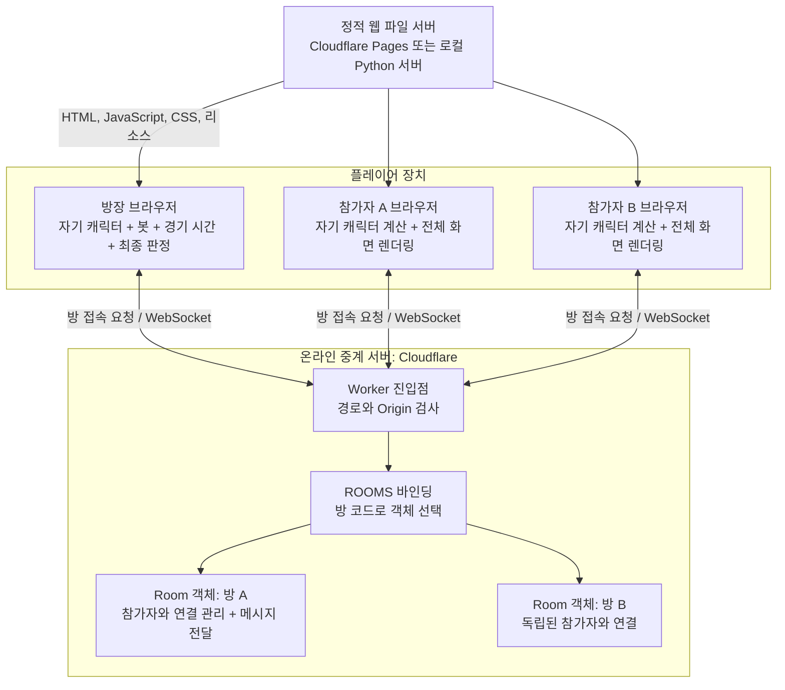
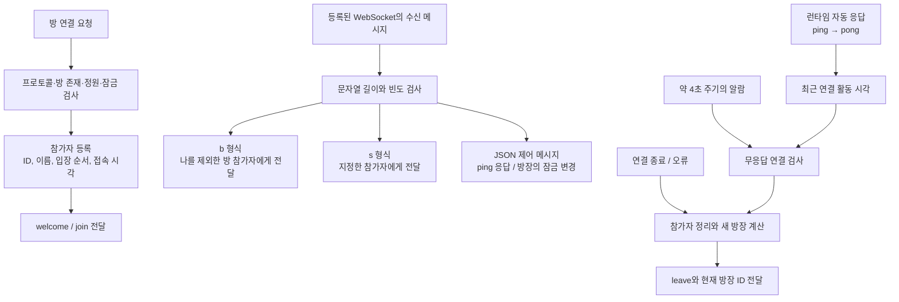
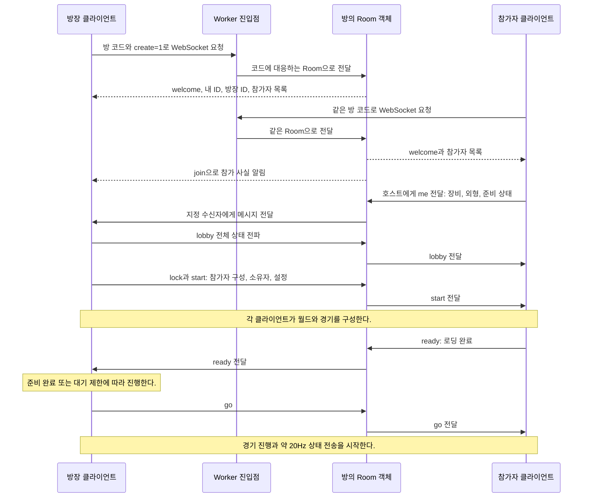

# INKWAVE 서버·클라이언트 기술과 구조

- [x] 실제 코드에서 사용 기술과 실행 진입점을 확인한다.
- [x] 클라이언트 구현 방식과 서버의 책임을 정리한다.
- [x] 서버 구조도와 온라인 통신 흐름도를 작성한다.
- [x] 실행 방법, 현재 제약, 근거 링크와 문서 형식을 검증한다.

## 1. 문서의 기준과 읽는 순서

이 문서는 INKWAVE의 클라이언트, 정적 파일 서버, 온라인 중계 서버가 어떻게 구성되어 있는지 설명한다. 서버 개발을 처음 접하는 사람도 각 구성 요소의 역할과 데이터 흐름을 따라갈 수 있도록 정리한다.

웹 우선 개발·안드로이드·아이폰·가상 키·게임패드에 관한 새 방침은 [31번 전환 계획](클라이언트-멀티플랫폼-전환계획-31.md)과 [32번 구현 설계](클라이언트-멀티플랫폼-구현설계-32.md)를 따른다. 아래 내용은 기준 커밋의 기존 구현 설명이며 새 방침이 이미 구현됐다는 뜻은 아니다.

- 기준 커밋은 `7c970e65beea8f54ca94d2ac326674e0c2e7279b`이다.
- 확인 범위는 저장소의 코드와 설정에 대한 정적 검토이다. 문서 작성 과정에서 설치, 앱 실행, 실제 온라인 경기, 배포를 수행하지 않았다.
- 기술과 버전은 현재 저장소에 선언되거나 잠금 파일에 기록된 값이다. 공개 서비스의 실제 배포 상태를 확인한 결과는 아니다.
- 2절에서 사용 기술을 확인하고, 3~5절에서 클라이언트와 서버를 살펴본 뒤 통신 흐름과 실행 방법을 읽으면 된다.

## 2. 사용 기술

### 2.1. 클라이언트와 개발 도구

| 구분 | 기술 | 이 프로젝트에서의 역할 | 코드 근거 |
|---|---|---|---|
| 언어·모듈 | JavaScript ES 모듈, HTML, CSS | 브라우저가 모듈을 직접 불러오고 게임과 화면을 실행한다. | [index.html](../index.html), [package.json](../package.json) |
| 3D 렌더링 | three.js r186 | WebGL 기반 장면, 캐릭터, 재질, 조명, 후처리를 구성한다. 의존성 선언은 `^0.186.0`이며 잠금 버전은 `0.186.1`이다. | [renderer.js](../src/core/renderer.js), [package-lock.json](../package-lock.json) |
| 라이브러리 배포 | 저장소에 포함한 `vendor/three/`, 임포트 맵 | `three`와 `three/addons/`를 저장소의 실제 파일 경로에 연결한다. | [index.html](../index.html) |
| 사용자 인터페이스 | DOM, CSS, SVG | 메뉴, 체력·잉크 표시, 로비, 지도 UI를 WebGL 캔버스 위에 표시한다. | [menus.js](../src/ui/menus.js), [hud.js](../src/ui/hud.js), [ui.css](../styles/ui.css) |
| 오디오 | Web Audio API | 효과음과 음악을 코드로 합성하고 공간 음향·볼륨을 제어한다. 별도 음원을 넣는 기능도 제공한다. | [audio.js](../src/audio/audio.js), [music.js](../src/audio/music.js) |
| 입력 | 키보드·마우스, Gamepad API, 터치 이벤트 | 이동, 조준, 발사와 장치별 조작을 처리한다. | [input.js](../src/core/input.js), [touch.js](../src/core/touch.js) |
| 로컬 저장 | `localStorage` | 프로필, 장비·외형, 설정, 새 소식 확인 상태를 브라우저에 저장한다. | [main.js](../src/main.js), [news.js](../src/ui/news.js) |
| 데스크톱 실행 | Electron `^44.4.5` | 같은 웹 게임을 네이티브 창에서 실행하고 전체 화면 기능을 연결한다. | [main.cjs](../electron/main.cjs), [preload.cjs](../electron/preload.cjs) |
| 패키지·개발 명령 | Node.js, npm | Electron, Python 실행 연결 도구, 검사·캡처 도구를 실행한다. Electron 등의 잠금 메타데이터에는 Node.js `>=22.12.0` 요구 조건이 기록되어 있다. | [package.json](../package.json), [package-lock.json](../package-lock.json), [py.mjs](../tools/py.mjs) |
| macOS 패키징 | `@electron/packager` `^20.3.0` | arm64·x64용 macOS 앱을 `dist/`에 만든다. | [package.json](../package.json) |
| 브라우저 자동화 | `puppeteer-core` `^25.12.0` | 시스템에 설치된 Chrome을 구동해 캡처와 온라인 동작 측정에 사용한다. | [chrome.mjs](../tools/chrome.mjs), [net-test.mjs](../tools/net-test.mjs) |

### 2.2. 서버와 배포 도구

| 구분 | 기술 | 이 프로젝트에서의 역할 | 코드 근거 |
|---|---|---|---|
| 웹 게임 제공 | 정적 HTTP 파일 서버 | HTML, JavaScript, CSS, 글꼴, 라이트맵 등 게임 파일을 전달한다. | [serve.py](../tools/serve.py) |
| 로컬 파일 서버 | Python 3 표준 라이브러리 `http.server` | 기본 포트 `8490`에서 저장소 파일을 제공한다. | [serve.py](../tools/serve.py) |
| 온라인 서버 실행 환경 | Cloudflare Workers | HTTP 요청을 검사하고 방 코드에 대응하는 객체로 연결한다. | [서버 진입점](../server/src/index.js) |
| 방 단위 상태 관리 | Cloudflare Durable Objects | 방마다 하나의 `Room` 객체가 참가자와 WebSocket 연결을 관리한다. | [서버 진입점](../server/src/index.js), [wrangler.jsonc](../server/wrangler.jsonc) |
| 실시간 전송 | WebSocket, 문자열 봉투와 JSON 데이터 | 로비 변경과 경기 상태·이벤트를 연결된 플레이어에게 전달한다. | [transport.js](../src/net/transport.js), [서버 진입점](../server/src/index.js) |
| 개발·배포 명령 | Wrangler `^4.141.0` | 로컬 중계 서버 실행과 Worker 배포에 사용한다. 현재 잠금 파일에는 이 의존성이 빠져 있다. | [package.json](../package.json), [package-lock.json](../package-lock.json) |
| 정적 웹 배포 | Cloudflare Pages | `dist/`에 모은 웹 게임 파일을 게시하는 스크립트를 제공한다. | [release-pages.sh](../tools/release-pages.sh) |

서버 설정의 Worker 이름은 `inkwave-net`, Durable Object 바인딩 이름은 `ROOMS`, 클래스 이름은 `Room`이다. 호환성 날짜는 `2026-09-01`이다. `new_sqlite_classes`로 `Room`을 등록하지만 현재 서버 코드에는 게임 데이터용 SQL 테이블이나 쿼리가 없다. 저장소 API는 연결 생존 확인용 알람에 사용한다.

## 3. 전체 구성과 역할 분담

게임 파일을 내려주는 **정적 파일 서버**, 온라인 메시지를 전달하는 **중계 서버**, 실제 게임을 계산하고 그리는 **클라이언트**로 나뉜다. 여기서 방장은 참가자 중 한 명의 브라우저가 맡는 역할이다.

| 구성 요소 | 담당하는 일 | 상태를 두는 곳 |
|---|---|---|
| 정적 파일 서버 | 게임 코드와 리소스를 HTTP로 전달한다. | 서버의 배포 파일이다. |
| Worker 진입점 | 경로, 방 코드 형식, WebSocket 업그레이드, 요청 출처를 검사한다. | 요청 처리에 필요한 값이다. |
| 방의 `Room` 객체 | 참가자 목록, 입장 순서, 방장 선출, 입장 제한, 메시지 전달, 연결 정리를 담당한다. | WebSocket 부가 정보, 객체 메모리, 생존 확인용 알람이다. |
| 각 플레이어의 클라이언트 | 자기 캐릭터의 이동·무기·잉크를 계산하고 모든 캐릭터를 그린다. | 브라우저의 게임 객체와 GPU 리소스이다. |
| 방장 클라이언트 | 일반 플레이어 역할에 더해 로비 설정, 봇, 경기 시간, 최종 판정과 모드별 규칙을 담당한다. | 방장 브라우저의 경기 상태이다. |

온라인 경기는 플레이어마다 자신의 캐릭터를 소유하는 방식이다. 각 소유자가 계산한 결과를 중계 서버를 거쳐 나머지 참가자에게 전달한다. 원격 캐릭터는 받은 상태를 시간에 맞춰 보간해 표현한다. 네트워크 관점에서 모든 메시지는 중계 서버를 통과한다.

## 4. 클라이언트는 어떻게 만들어졌는가

### 4.1. 시작과 메인 루프

1. 브라우저가 [index.html](../index.html)을 읽고 임포트 맵으로 three.js의 경로를 등록한다.
2. [src/main.js](../src/main.js)의 `Game.boot()`가 로컬 설정과 프로필을 읽는다. 터치 장치 여부와 화질 설정도 반영한다.
3. 메뉴·HUD를 준비하고 렌더러, 입력 장치, 월드, 물리·이동 경로 시스템, 무기·보조 무기·스페셜 시스템을 구성한다.
4. 지형 데이터로 월드를 만들고 라이트맵을 불러온다. 선택된 모드와 참가자에 맞춰 `Match`와 캐릭터를 구성한다.
5. `requestAnimationFrame`을 통해 프레임을 진행한다. 매 프레임 입력, 시뮬레이션, 온라인 상태, 카메라·효과·HUD 갱신과 렌더링을 조율한다. 메뉴·로비·경기 상태에 따라 실행하는 부분이 달라진다.

모듈 사이에는 [ctx.js](../src/core/ctx.js)의 공용 컨텍스트 `G`와 `on`·`emit` 이벤트 버스를 사용한다. 예를 들어 캐릭터가 이벤트를 발생시키면 효과·오디오·UI가 이를 구독해 반응한다.

### 4.2. 주요 폴더와 구현 방식

| 경로 | 담당하는 구현 |
|---|---|
| [`src/main.js`](../src/main.js) | 시작, 월드 구성, 메뉴와 경기 전환, 메인 루프를 조율한다. |
| [`src/config.js`](../src/config.js) | 무기, 스테이지, 이동, 경기, 화질 등의 공통 데이터를 정의한다. |
| [`src/core/`](../src/core) | 렌더러, 입력, 터치 조작, 공용 컨텍스트와 이벤트 버스를 구현한다. |
| [`src/game/`](../src/game) | 캐릭터 상태, 플레이어 조작, 봇, 충돌·레이캐스트, 무기, 카메라, 경기 진행을 구현한다. |
| [`src/game/kits/`](../src/game/kits) | 무기·보조 무기의 개별 동작과 네트워크 재생 기능을 등록한다. |
| [`src/world/`](../src/world) | 지형 데이터, 레벨 생성, 잉크 칠하기, 재질, 소품과 배경을 구현한다. |
| [`src/fx/`](../src/fx) | 입자, 잉크 물결, 화면 효과와 이벤트 연결을 구현한다. |
| [`src/ui/`](../src/ui) | 메뉴, 로비, HUD, 지도와 아이콘을 구현한다. |
| [`src/audio/`](../src/audio) | 효과음 합성, 음악 재생과 음량·공간 음향 처리를 구현한다. |
| [`src/boss/`](../src/boss) | 보스의 모델, 행동, 애니메이션과 보스전 규칙을 구현한다. |
| [`src/net/`](../src/net) | 연결, 로비 세션, 경기 중 상태·이벤트 동기화를 구현한다. |

지형은 상자·경사로 등의 데이터로 구성하고 기본 경기장은 반쪽 지형을 180도 회전해 대칭으로 만든다. 캐릭터의 지오메트리·재질·뼈대·애니메이션과 여러 소품·텍스처도 코드로 생성한다. 잉크는 GPU의 텍스처 아틀라스에 그리며, CPU 측 격자로 게임 판정과 영역 점수를 관리한다. 라이트맵은 별도 도구로 미리 계산해 [`assets/lightmaps/`](../assets/lightmaps)에 둔다.

렌더러는 기본 장면에 주변광 차폐(GTAO), 블룸, 색보정과 출력 패스를 조합한다. 화질·GPU에 따라 후처리와 안티앨리어싱 구성이 달라진다. UI는 WebGL 화면 위에 배치한 HTML 요소와 CSS로 구성한다.

근거는 [renderer.js](../src/core/renderer.js), [maps.js](../src/world/maps.js), [level.js](../src/world/level.js), [paint.js](../src/world/paint.js), [character.js](../src/game/character.js)와 [bake-ao.cjs](../build/bake-ao.cjs)이다.

### 4.3. 브라우저와 Electron의 관계

Electron도 같은 `index.html`과 `src/`의 웹 게임을 실행한다. [electron/main.cjs](../electron/main.cjs)가 `BrowserWindow`를 만들고 `app://inkwave/index.html`을 연다. 자체 `app://` 프로토콜 처리기가 요청한 파일을 로컬 앱 폴더에서 읽어 전달한다.

- 창은 `contextIsolation: true`, `sandbox: true`로 생성한다.
- [preload.cjs](../electron/preload.cjs)는 플랫폼 확인과 전체 화면 조회·설정·변경 알림만 페이지에 노출한다.
- 창 크기와 전체 화면 상태는 Electron 사용자 데이터 폴더의 `window-state.json`에 저장한다.
- HTML 응답에 적용되는 콘텐츠 보안 정책의 `connect-src`는 `'self' data: blob:`이다. 현재 정책은 외부 WebSocket 중계 서버 접속을 허용하지 않으므로, 데스크톱 앱의 온라인 기능은 브라우저와 같은 조건으로 동작한다고 볼 수 없다.

## 5. 서버는 어떻게 만들어졌는가

### 5.1. 정적 파일 제공

[tools/serve.py](../tools/serve.py)는 Python의 `SimpleHTTPRequestHandler`와 `ThreadingHTTPServer`를 사용한다. 저장소 루트의 파일을 기본 포트 `8490`으로 제공하고, 응답에 `Cache-Control: no-cache`를 추가해 변경된 모듈을 재검증하게 한다. 파일 제공 요청에는 게임 시뮬레이션이 포함되지 않는다.

`npm run build`의 [build-dist.py](../tools/build-dist.py)는 게임 파일과 필요한 three.js 확장 모듈을 `dist/`에 모은다. 이 명령은 파일을 복사해 배포 폴더를 만드는 작업이다. 단일 JavaScript 파일로 묶는 별도 [bundle.mjs](../tools/bundle.mjs)도 있지만 기본 빌드 명령에는 연결되어 있지 않고, 이 도구가 가져오는 `esbuild`도 현재 의존성 목록에 선언되어 있지 않다.

### 5.2. Worker 진입점

[server/src/index.js](../server/src/index.js)의 기본 내보내기 객체가 HTTP 요청을 받는다.

| 요청 | 처리 |
|---|---|
| `GET /health` | `ok`를 반환한다. 서비스 생존 확인용 경로이다. |
| `GET /room/<CODE>?name=<이름>&v=1&create=1` | 새 방의 WebSocket 연결을 요청한다. `create=1`은 방 만들기일 때 사용한다. |
| `GET /room/<CODE>?name=<이름>&v=1` | 기존 방에 WebSocket으로 참가한다. |

요청 경로와 방 코드를 검사하고, WebSocket 업그레이드와 허용된 `Origin`인지 확인한다. 코드가 유효하면 `env.ROOMS.idFromName(code)`로 방의 식별자를 얻고, 해당 `Room` 객체에 요청을 전달한다. 클라이언트는 다섯 자리 방 코드를 생성하며, 서버가 허용하는 코드 형식은 대문자 영문·숫자 4~8자리이다.

### 5.3. 방마다 하나의 Room 객체

`Room`은 다음 기능을 제공한다.

1. `WebSocketPair`를 만들고 서버 쪽 연결을 Durable Object에 등록한다.
2. 프로토콜 버전, 방 생성·참가 조건, 최대 여덟 명, 경기 중 입장 잠금을 검사한다.
3. 이름에서 허용하지 않는 문자를 제거하고 최대 16자로 제한한다. 참가자 ID와 입장 순서를 발급한다.
4. WebSocket 부가 정보에 참가자 ID·이름·입장 순서·시각을 보관하고, 입장 순서가 가장 빠른 연결을 방장으로 정한다.
5. 참가자에게 `welcome`·`join`·`leave` 같은 제어 메시지를 보내고 게임 메시지를 전달한다.
6. 방장의 잠금 요청, 과도한 메시지, 연결 종료와 장시간 무응답을 처리한다.

플레이어의 위치, 충돌, 잉크, 피해량과 경기 결과는 클라이언트가 계산한다. 서버는 게임 본문을 해석해 정당성을 검증하는 기능 없이 문자열을 전달한다.

### 5.4. 현재 코드의 주요 수치

| 항목 | 현재 값과 의미 |
|---|---|
| 방 최대 인원 | `8`명이다. |
| 클라이언트 연결 대기 | 환영 메시지를 최대 `8초` 기다린다. |
| 생존 확인 | 클라이언트가 `2초`마다 `ping`을 보낸다. 런타임의 자동 응답 기능이 `pong`으로 답한다. |
| 연결 검사 주기 | 방의 알람이 약 `4초`마다 연결 상태를 검사한다. |
| 무응답 기준 | 잠긴 방은 `20초`, 잠기지 않은 방은 `150초`이다. 실제 정리 시점은 알람 주기에 영향을 받는다. |
| 메시지 길이 | 문자열의 `.length`가 `65536`을 넘으면 전달하지 않는다. 바이트 수를 직접 측정하는 코드는 아니다. |
| 전송 빈도 | 약 1초 구간의 메시지 수 `90`을 기준으로 초과 이력을 누적한다. 한 구간에서 `270`개를 초과하거나 초과 이력이 `4`에 도달하면 연결을 종료한다. |

입장 순서 등은 WebSocket 부가 정보에서 복원하며, 최근 수신 시각·빈도와 잠금 상태 등은 객체 메모리에 둔다. 이 구현을 영구적인 경기 기록 저장소로 해석해서는 안 된다. 승패·랭킹을 저장하는 서버 계정이나 데이터베이스 기능도 현재 코드에는 없다.

## 6. 서버 구조도

### 6.1. 전체 서비스 구성



그림의 Worker 진입점은 최초 연결을 검사하고 방을 선택하는 경로이다. 업그레이드가 끝난 뒤에는 각 `Room` 객체가 WebSocket을 보유해 메시지를 주고받는다. 서로 다른 방의 메시지는 각자의 객체에서 처리한다.

### 6.2. Room 내부 처리 구조



단순 문자열 `ping`은 런타임 자동 응답 경로를 사용한다. 구형 JSON 형태의 `ping`도 서버 메시지 처리기에서 지원한다. 방장 변경을 받은 클라이언트는 로비와 경기의 소유권을 이어받는 처리를 수행한다.

## 7. 방 참가부터 경기 시작까지

온라인 코드는 다음 세 층으로 나뉜다.

| 층 | 파일 | 책임 |
|---|---|---|
| 연결 | [transport.js](../src/net/transport.js) | 주소 선택, WebSocket 연결, 봉투 처리, 생존 확인과 지연 측정을 담당한다. |
| 세션 | [session.js](../src/net/session.js) | 방 생성·참가·퇴장, 팀과 장비, 준비 상태, 방장, 경기 시작을 담당한다. |
| 경기 복제 | [netmatch.js](../src/net/netmatch.js) | 캐릭터 상태·이벤트 전송, 원격 캐릭터 보간, 피해 전달과 소유권 인계를 담당한다. |



세션 상태는 `offline → connecting → lobby → starting → match`로 이동하며 오류가 생기면 `error`가 된다. 결과 화면이 끝난 뒤에는 같은 방의 로비로 돌아간다. 호스트의 준비 확인 대기는 코드상 최대 `12초` 타이머를 사용하며, 모든 참가자가 완료하면 먼저 시작한다.

## 8. 경기 상태는 어떻게 동기화하는가

### 8.1. 메시지 형식

중계 서버는 전달 대상과 발신자를 표시하는 얇은 문자열 봉투를 사용한다. 아래의 JSON은 게임 본문을 나타내는 예시이다.

```text
클라이언트 → 서버, 방 전체 전파: b|{"k":"t","ts":12.34,"a":[...]}
클라이언트 → 서버, 특정인에게 전송: s|상대ID|{"k":"ready","id":"경기ID"}
서버 → 수신 클라이언트: m|발신자ID|{"k":"t","ts":12.34,"a":[...]}
```

| 메시지 | 의미 |
|---|---|
| `welcome`, `join`, `leave`, `err` | 서버가 보내는 연결·참가자 관리 메시지이다. |
| `lock` | 방장이 경기 중 새 참가를 제한하거나 결과 후 잠금을 해제한다. |
| `me`, `lobby` | 개인의 로비 변경 요청과 방장이 확정한 전체 로비 상태이다. |
| `start`, `ready`, `go` | 경기 구성 전달, 로딩 완료, 경기 진행 신호이다. |
| `t` | 소유한 캐릭터들의 압축 상태와 시각을 전달한다. 필요하면 이벤트와 방장의 경기 시간도 포함한다. |
| `hit`, `dh`, `bhit` | 캐릭터, 설치물, 보스에 대한 피해 적용 요청이다. |
| `st`, `res`, `end` | 방장이 전달하는 경기 상태, 결과와 종료 신호이다. |

### 8.2. 이동·잉크·피해와 결과

1. **자기 캐릭터는 즉시 계산한다.** 플레이어 입력은 자신의 브라우저에서 처리한다. 방장은 봇도 계산한다.
2. **약 20Hz로 상태를 전송한다.** `TICK = 1 / 20`을 사용한다. 렌더링은 각 장치의 프레임 주기로 실행하므로 전송 주기와 화면 주기는 다르다.
3. **원격 캐릭터는 받은 샘플을 보간한다.** 발신자별 재생 시계를 두고 위치와 속도를 이용한 3차 Hermite 보간을 수행한다. 초기 지연은 약 `100ms`이며, 현재 코드의 목표 버퍼 범위는 `70~300ms`이다. 최근 패킷의 간격과 지연 분포에 따라 조절한다.
4. **잠깐 끊기면 제한적으로 예측한다.** 최신 샘플 이후는 최대 `180ms`까지 외삽한 뒤 위치를 유지한다. 부활 등의 실제 순간이동은 별도 카운터로 구분한다.
5. **잉크와 효과를 이벤트로 재생한다.** 잉크 자국의 위치·크기·팀·난수 시드와 발사·애니메이션 이벤트를 전달한다. 원격 발사체는 시각적 복제이며, 잉크와 피해는 소유자의 이벤트를 통해 반영한다.
6. **명중과 피해는 역할을 나눠 적용한다.** 발사자의 화면에서 명중을 판단하고 피해자의 소유자가 피해를 적용한다. 보스전에서는 보스를 계산하는 방장에게 피해 요청을 전달한다.
7. **방장의 결과를 공유한다.** 방장이 경기 시간·구역 점령 규칙·최종 결과를 관리하고 참가자에게 전달한다. 이는 게임 동작의 책임 분담이며 서버가 결과를 검증한다는 뜻은 아니다.

### 8.3. 참가자 이탈과 방장 인계

연결이 종료되거나 무응답 기준을 넘으면 `Room`이 이탈 메시지와 새 방장 ID를 전달한다. 일반 스테이지에서는 방장이 이탈한 플레이어의 캐릭터를 봇으로 이어받는다. `noBots` 스테이지에서는 해당 캐릭터를 제거한다.

방장이 나가면 남아 있는 참가자 중 입장 순서가 가장 빠른 사람이 새 방장이 된다. 클라이언트는 봇, 경기 시간, 판정 역할과 보스 시뮬레이션을 인계하도록 구현되어 있다. 실제 네트워크 단절 상황에서의 인계 성공 여부는 별도 실행 검증이 필요하다.

## 9. 실행과 배포는 어떻게 연결되는가

아래 명령은 저장소 루트에서 실행하는 사용 예시이다. 문서 작성 과정에서는 실행하지 않았다. Node.js·npm과 실제 Python 3 인터프리터가 필요하며, 브라우저 자동화 도구는 별도 Chrome 설치가 필요하다.

### 9.1. 웹 게임과 로컬 중계 서버

의존성 설치가 필요한 도구를 사용하려면 먼저 설치한다. 현재 잠금 파일의 Wrangler 누락은 재현 가능한 설치를 위해 정리해야 한다.

```powershell
npm install
```

첫 번째 터미널에서 게임 파일 서버를 실행한다.

```powershell
npm run serve
```

두 번째 터미널에서 온라인 중계 서버를 실행한다.

```powershell
npm run relay
```

브라우저에서 `http://localhost:8490`에 접속한다. 로컬 페이지의 중계 주소는 기본적으로 `ws://localhost:8787`이다. 오프라인 플레이에는 중계 서버가 필요하지 않다.

`npm run serve`와 `npm run relay`는 LAN 접속을 받는 설정이다. LAN의 다른 장치에서는 `localhost` 대신 서버 컴퓨터의 IP를 사용한다. 게임 파일 서버는 저장소 루트를 제공하므로 민감한 파일을 함께 두지 않도록 주의해야 한다. 개인 PC에서 게임 파일을 로컬에만 제공하려면 Python 3가 설치된 환경에서 다음과 같이 표준 서버를 사용할 수 있다.

```powershell
python -m http.server 8490 --bind 127.0.0.1
```

이 명령은 저장소에 포함된 서버의 캐시 헤더 기능 없이 파일을 제공한다. Python 실행 파일 이름이 다른 환경에서는 해당 인터프리터 이름으로 바꿔 사용한다.

### 9.2. 중계 서버 주소 선택

| 조건 | 클라이언트가 선택하는 주소 |
|---|---|
| URL에 `?relay=...`가 있다. | 지정한 중계 주소를 우선 사용한다. |
| 페이지가 localhost, 코드에 정의된 사설 IPv4 주소, `.local` 호스트에서 열린다. | `ws://<페이지의 호스트>:8787`을 사용한다. |
| 그 외의 호스트에서 열린다. | 코드에 지정된 `wss://inkwave-net.inkwave.workers.dev`를 사용한다. |

공개 웹 주소는 코드와 README에 `https://inkwave-aah.pages.dev`로 기록되어 있다. 자신의 포크를 다른 도메인에 배포하려면 정적 웹 배포와 중계 서버 배포를 각각 구성하고, 클라이언트의 중계 주소와 서버의 `ORIGIN_OK` 허용 출처를 함께 맞춰야 한다. 중계 주소만 바꾸면 요청 출처 검사에서 거절될 수 있다.

### 9.3. Electron과 배포 산출물

| 명령 | 수행하는 작업 |
|---|---|
| `npm start` | 먼저 음악 목록을 생성하고 Electron 데스크톱 앱을 연다. |
| `npm run music` | `songs/manifest.json`을 생성한다. 별도 음원이 있으면 설치된 `ffmpeg`로 음량을 분석하며, `ffmpeg`가 없어도 기본 재생을 지원한다. |
| `npm run build` | 기존 `dist/` 내용을 정리하고 웹 배포 파일을 모은다. 일부 Vercel 연결 파일은 보존한다. |
| `npm run package` | 구문 검사와 음악 목록 생성 후 macOS arm64·x64 앱을 패키징한다. |
| `npm run release` | 웹 배포 폴더를 구성하고 Cloudflare Pages에 업로드하는 셸 스크립트이다. |
| `npm run deploy-relay` | `server/` 설정으로 Cloudflare Worker를 배포한다. |

`release` 스크립트는 `/private/tmp`, `rsync`, 셸 도구를 사용하며, 패키징 대상도 macOS로 지정되어 있다. Windows에서는 해당 명령의 환경과 대상 설정을 조정해야 한다. 배포 명령은 Cloudflare 인증과 프로젝트 설정이 준비된 뒤 별도 배포 작업으로 실행한다.

## 10. 현재 구조의 제약과 확인이 필요한 부분

- **클라이언트 신뢰 범위가 크다.** 중계 서버가 게임 상태와 피해의 정당성을 검사하지 않으므로 경쟁 서비스로 확장하려면 서버 검증과 부정행위 대응을 별도 설계해야 한다. 방 코드와 출처 검사는 사용자 인증을 대신하지 않는다.
- **영구 서비스 데이터는 구현되어 있지 않다.** 서버 계정, 영구 랭킹, 경기 이력과 저장된 게임의 복구 기능은 현재 코드에서 확인되지 않는다. 프로필과 경험치 등은 클라이언트 로컬 저장을 사용한다.
- **Electron의 온라인 연결은 정책 확인이 필요하다.** 현재 콘텐츠 보안 정책은 외부 WebSocket을 허용하지 않는다. 파일 경로 제한의 문자열 접두사 검사와 외부 URL 처리도 앞선 보안 검토에서 보완 대상으로 확인했으며, 이 문서 작성으로 수정되지는 않는다.
- **기존 문서보다 현재 코드를 우선한다.** [NET.md](../docs/NET.md)의 무응답 `10초`, 보간 지연 하한 `85ms` 설명과 달리 현재 코드는 잠긴 방 무응답 `20초`, 목표 보간 버퍼 하한 `70ms`를 사용한다. [CONTRIBUTING.md](../CONTRIBUTING.md)의 `npm start` 설명도 현재 명령과 다르며, 현재 `npm start`는 Electron, `npm run serve`는 웹 파일 서버이다.
- **의존성과 배포 도구 정리가 필요하다.** Wrangler의 잠금 파일 누락, 별도 번들 도구의 `esbuild` 미선언, macOS 중심 배포 스크립트는 실행 환경을 구성할 때 확인할 항목이다.
- **실행 품질과 운영 성능은 별도 검증 대상이다.** 이 문서는 코드 구조를 설명한다. 실제 두 장치 온라인 경기, 단절·방장 인계, 동시 접속 성능과 공개 서비스의 배포 상태는 이 문서 작성 과정에서 검증하지 않았다.

## 11. 코드를 읽는 추천 순서

1. [package.json](../package.json)에서 실행 명령과 의존성을 확인한다.
2. [index.html](../index.html)과 [main.js](../src/main.js)에서 게임 시작 흐름을 확인한다.
3. [ctx.js](../src/core/ctx.js), [renderer.js](../src/core/renderer.js), [match.js](../src/game/match.js)에서 공용 상태, 화면 구성, 경기 진행을 확인한다.
4. [transport.js](../src/net/transport.js)와 [session.js](../src/net/session.js)에서 연결과 로비를 확인한다.
5. [netmatch.js](../src/net/netmatch.js)에서 상태 전송, 보간, 피해와 이탈 처리를 확인한다.
6. [서버 진입점과 Room](../server/src/index.js), [wrangler.jsonc](../server/wrangler.jsonc)에서 방 관리와 실행 환경을 확인한다.
7. [serve.py](../tools/serve.py), [build-dist.py](../tools/build-dist.py), [release-pages.sh](../tools/release-pages.sh)에서 파일 제공과 웹 배포 과정을 확인한다.

추가 설명은 [이벤트 규약](../docs/EVENTS.md), [모듈 규약](../docs/CONTRACTS.md), [캐릭터 리그](../docs/RIG.md), [온라인 규약](../docs/NET.md), [보스전](../docs/BOSS.md)에 정리되어 있다. 수치와 실행 명령이 다를 때에는 연결된 실제 구현을 기준으로 판단한다.
