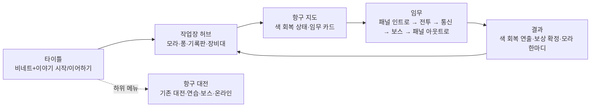
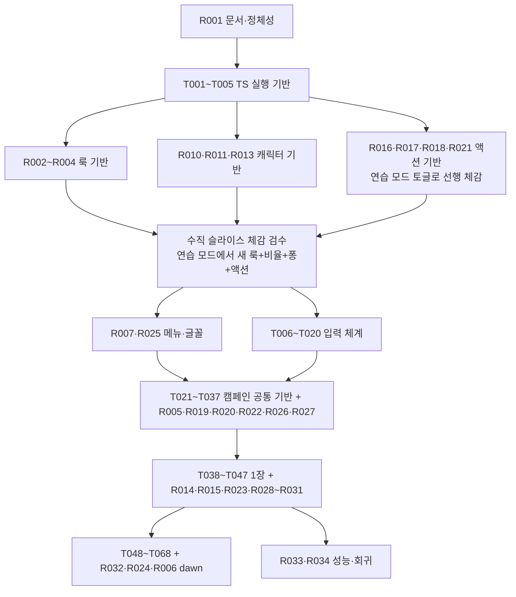

# INKWAVE 스토리 중심 액션 리디자인 구현 계획 — 「되찾는 물결」 외형·캐릭터·액션 차별화

- [x] R001 리디자인 결정을 기획·지침 문서에 반영하고 게임 정체성(제목·부제·메뉴 순서)을 바꾼다.
- [x] R002 룩 프로필(`LookProfile`) 계약과 설정·모드별 적용 경계를 만든다.
- [x] R003 잉크 선화 포스트 패스(`StylePass`: 외곽선·종이 질감·하프톤)를 구현한다.
- [x] R004 툰 램프 조명 주입과 "잉크만 젖어 보이는" 재질 대비를 구현한다.
- [ ] R005 색 회복(Color Return) 시스템을 구현한다.
- [x] R006 잃어버린 색 테마(`inkwash`)와 새벽 테마(`dawn`)를 추가한다.
- [x] R007 한글 글꼴·UI 디자인 토큰·메뉴 스킨을 그림책 스타일로 교체한다.
- [x] R008 의성어·히트 텍스트 월드 라벨 시스템을 구현한다.
- [ ] R009 액션 카메라 프로필과 보스 등장 3컷 구도를 구현한다.
- [x] R010 귀여운 비율 프리셋(머리 비율·표정 강조)을 구현한다.
- [x] R011 등장인물별 표정 프로필과 사건 반응 체계를 구현한다.
- [x] R012 월드 말풍선과 절차적 "찍찍 목소리"를 구현한다.
- [x] R013 잉크 방울 마스코트 「퐁」을 구현한다.
- [x] R014 등장인물 외형 정의(플레이어 프리셋·모라·틸·잔향 대원·대장 7인)를 구현한다.
- [ ] R015 잔향 대원의 출현·소멸 연출(종이 조각 풀어짐)을 구현한다.
- [x] R016 캠페인 핸들링 튜닝 오버레이를 구현한다.
- [x] R017 퍼펙트 잠수(저스트 회피)와 반격 창을 구현한다.
- [x] R018 잉크 서지(이중 입력 대시)를 구현한다.
- [x] R019 물결(Wave) 게이지와 단계 효과를 구현한다.
- [x] R020 적 경직·넉백·스태거와 약점 노출 규격을 구현한다.
- [x] R021 전투 피드백 패키지(시간 배율·히트스톱·카메라 펀치·진동·피니시)를 구현한다.
- [x] R022 적 공격 텔레그래프 표준(형태·시간·색각 대응)을 구현한다.
- [ ] R023 레벨 액션 장치(잉크 분수·잉크통·잉크 스위치)를 구현한다.
- [x] R024 물결 단계에 반응하는 적응형 음악 레이어를 구현한다.
- [x] R025 타이틀·메인 메뉴를 이야기 우선 구조로 재편한다.
- [ ] R026 대화 시스템(대본 형식·자막·초상 뷰·건너뛰기·기록)을 구현한다.
- [x] R027 만화 패널 컷신 시스템을 구현한다.
- [ ] R028 작업장 허브를 인물이 있는 공간으로 바꾼다.
- [x] R029 임무 선택을 "색을 되찾는 항구 지도"로 바꾼다.
- [ ] R030 결과·보상 화면을 이야기 중심 연출로 바꾼다.
- [ ] R031 1장(1-1·1-2·1-3) 대본·연출 콘티·기록 2개를 작성하고 데이터로 넣는다.
- [ ] R032 2~7장 대본·엔딩 콘티를 작성하고 데이터로 넣는다.
- [ ] R033 리디자인 통합 성능 예산과 웹 실측 검증을 완료한다.
- [x] R034 기존 대전·연습·보스·온라인 모드의 회귀를 검증한다.

## 1. 이 문서의 범위와 전제

이 문서의 일련번호는 35이다. 저장소의 기존 최대 번호 34와 Git 이력의 최대 번호 34를 확인해 다음 번호를 발급했다. 작성일은 2026-11-04이다.

이 문서는 사용자의 요청 "원 저장소와 너무 비슷하다. 스토리 모드 중심, 액션성 높은 게임, 외형 차별화, 개성 있고 귀여운 캐릭터"에 대한 **구현 계획**이다. 다음 세션에서 이 문서만 보고 구현할 수 있도록 결정·수치·파일·계약·완료 조건·검증을 적는다. 아래의 모든 R 태스크는 **미착수**이며 이 문서 작성으로 체크하지 않는다.

### 1.1. 현재 저장소의 실제 상태

- 현재 코드는 원본 `jaydendavisnc/inkwave`(4대4 영역 쟁탈 슈팅)의 JavaScript 137개 파일에 Tauri 데스크톱 호스트(`desktop/*.ts`, `src-tauri/`)와 한글 문서를 더한 상태이다. 게임 플레이·외형·메뉴는 원본과 같다.
- 캠페인 코드는 없다. [33번 상세 구현 계획](클라이언트-캠페인-상세구현계획-33.md)의 T001~T074와 M001~M005는 전부 미착수이다. `src/campaign/`, TypeScript 컴파일 경로(`npm run typecheck`, `npm run dev`)도 아직 없다.
- 직접 작성하는 새 코드는 [AGENTS.md](../AGENTS.md)에 따라 TypeScript이다. 따라서 이 문서의 R 태스크 대부분은 **T002(컴파일·타입 검사)·T003(개발 경로)이 먼저 있어야 실행할 수 있다.** 기존 `.js` 모듈을 수정할 때는 해당 모듈을 TypeScript로 이전하면서 수정한다.
- 기존 캐릭터·무기·7개 배경·보스·효과·오디오는 모두 절차 생성이며 재사용한다. 리디자인은 이 자산 위에 **렌더링 스타일·비율·표정·액션 규칙·메뉴 구조**를 바꾸는 방식으로 차별화한다. 새 엔진이나 전면 재작성을 시작하지 않는다.

### 1.2. 결정한 차별화 방향 요약

| 축 | 원본 INKWAVE | 리디자인 「되찾는 물결」 |
|---|---|---|
| 게임의 중심 | 4대4 영역 쟁탈 대전이다. 메인 메뉴 첫 항목이 대전이다. | 1인 스토리 캠페인이다. 타이틀에서 바로 이야기를 시작·이어하기하고 대전은 "항구 대전" 하위 메뉴로 내린다. |
| 화면 룩 | 밝은 햇살의 스타일화 PBR, 광택 잉크, 사실적 하늘·바다이다. | **잉크 그림책 룩**이다. 툰 램프 조명, 잉크색 외곽선, 종이 결, 그림자 하프톤을 쓰고 젖은 광택은 잉크에만 남긴다. |
| 세계의 색 | 항상 채도 높은 항구이다. | **색을 잃은 항구**이다. 조율망이 색을 회수한 구역은 먹빛 회색이고, 플레이어가 중계기를 복구할 때마다 그 주변부터 색이 돌아온다. 이야기와 화면이 같은 말을 한다. |
| 캐릭터 | 1.45 m, 약 4등신의 스쿼드키드이다. 표정은 섬세하지만 전투 중 잘 보이지 않는다. | 머리를 키운 **약 3.2등신**의 귀여운 비율이다. 인물마다 표정 프로필·반응 대사·말풍선·찍찍 목소리를 가진다. 플레이어 등에 잉크 방울 마스코트 「퐁」이 타고 다니며 통신창 역할을 한다. |
| 적 | 같은 스쿼드키드 봇이다. | **종이 인형 같은 무채색 잔향 대원**이다. 다이아몬드 표식이 빛나고 쓰러지면 잉크와 종이 조각으로 풀어진다. |
| 액션 | 사격·도색·잠수·벽타기이다. 회피 구르기는 쌍권총 전용이다. | 모든 무기에서 **퍼펙트 잠수(저스트 회피)·잉크 서지(대시)·물결 게이지·경직/스태거·히트스톱·의성어**를 제공한다. 새 버튼은 추가하지 않고 기존 입력의 타이밍·이중 입력으로 만든다. |
| 연출 | HUD 배너와 결과 화면이다. | **만화 패널 컷신**, 통신 초상, 챕터 표제, 색 회복 연출, 모라·틸·퐁의 대사로 이야기를 전달한다. |
| 글꼴·UI | 영문 Titan One·Rubik이다. | 한글 둥근 표제 글꼴과 본문 글꼴을 추가해 잉크 자국·종이 카드 스타일로 메뉴를 재구성한다. |

이 방향은 기존 [2번 캠페인 기획](PvP-GDD/싱글플레이-PvE-캠페인-기획-2.md)의 임무 21개·적 병종·보스 기본형·성장·파밍·저장 규칙을 **그대로 유지**하면서 그 위에 얹는 변경이다. 2번·24번·25번·29번과 어긋나는 결정은 R001에서 해당 문서를 고친다.

### 1.3. 기존 지침·기획과 어긋나는 점과 처리

| 기존 문장 | 이 문서의 결정 | 처리 |
|---|---|---|
| 29번 "플레이어와 모라·틸·잔향 대장은 기존 캐릭터 비율을 따른다." | 머리 비율을 키운 귀여운 프리셋을 기본으로 한다. 충돌·물리 치수는 유지한다. | **2026-11-04 사용자 확정.** 29번 5절·25번 1절·2번 6.2절에 반영했다. |
| 2번·24번 "캠페인만을 위한 새로운 전투 버튼은 추가하지 않는다." | 유지한다. 퍼펙트 잠수·잉크 서지는 기존 잠수 키의 타이밍·이중 입력이다. | 변경 없음이다. 24번 2절에 새 행동 설명을 추가한다. |
| 2번 "7장의 새벽은 자막으로 표현한다. 새 하늘 세트를 필수로 만들지 않는다." | `dawn` 테마는 선택(P2)이다. `inkwash` 테마는 색 회복 시스템의 전제이므로 필수(P1)이다. | R006에서 우선순위를 구분한다. |
| AGENTS.md "기획에 없는 필수 전투 버튼… 임의로 추가하지 않는다." | 버튼을 추가하지 않는다. 새 행동 규칙은 이 문서가 기획이 된다. | AGENTS.md 머리글과 README 문서 안내에 35번을 연결했다(2026-11-04). |
| 33번의 `GAME_SUBTITLE`·메뉴 구조 언급 없음 | 부제를 "되찾는 물결"로 바꾸고 메뉴를 재편한다. | R001·R025이다. |

우선순위 표기는 **P1 = 1장 완성 전에 필요**, **P2 = 1장 이후**이다. 체크박스는 P1·P2 구분 없이 실제 완료 때만 체크한다. 완료 판정은 [33번 2절](클라이언트-캠페인-상세구현계획-33.md#2-태스크별-실행완료-체크-규칙)을 따른다. 구현과 자동 검사로 완료 조건을 충족하면 체크하고, 사람의 조작감·실물 패드·실기기 확인은 [33번 14절 사용자 최종 일괄 검증](클라이언트-캠페인-상세구현계획-33.md#14-사용자-최종-일괄-검증)으로 옮겨 마지막에 한다(2026-11-06).

## 2. 시각 정체성 — 잉크 그림책

### 2.1. 룩의 규칙

1. **잉크만 젖어 있다.** 바닥·벽·소품·캐릭터 피부·옷은 무광 툰 램프(3단)로 그리고, 잉크 표면(기존 `inkShading.js`의 메니스커스·광택·물결)만 지금처럼 젖은 광택을 유지한다. 플레이어가 칠한 길이 화면에서 가장 "살아 있는" 것이 된다.
2. **선은 잉크색이다.** 외곽선 색은 순검정이 아니라 그 픽셀 바탕색을 어둡게 한 색과 먹색 `#15121c`를 섞는다. 잉크 위의 선은 잉크색이 어두워진 선처럼 보인다.
3. **종이 위에 그렸다.** 화면 전체에 약한 종이 결을 깔고, 그림자 영역에만 하프톤 점을 찍는다. 효과는 설정으로 끌 수 있다.
4. **색은 보상이다.** 복구 전 구역은 먹물 담채(채도 약 18%)이고 복구할수록 색이 돌아온다. 팀 잉크·위험 예고·약점 표시는 언제나 완전한 채도를 유지해 가독성을 지킨다.
5. **UI는 종이 카드와 잉크 자국이다.** 둥근 한글 표제, 잉크 방울 아이콘, 찢긴 종이 테두리, 도장 같은 챕터 표제를 쓴다. 원본의 네온·스케이트 그래픽은 쓰지 않는다.

### 2.2. 렌더 파이프라인 변경

현재 [src/core/renderer.ts](../src/core/renderer.ts)의 패스 순서는 `RenderPass → GTAO(선택) → Bloom → Grade → extraPass(ScreenFX) → Output → SMAA(선택)`이다. 변경 후 순서는 다음과 같다.

```
RenderPass(depthTexture 부착) → GTAO(선택) → StylePass(신규: 외곽선·종이·하프톤·색 회복) → Bloom → Grade → extraPass → Output → SMAA(선택)
```

- `StylePass`는 HDR 선형 공간에서 동작한다. 블룸 앞에 두어 밝은 잉크가 선 위로 번지지 않게 한다.
- 깊이는 컴포저의 렌더 타깃에 `THREE.DepthTexture`를 붙여 얻는다. 멀티샘플 타깃(`samples > 0`)에서 깊이 텍스처를 읽지 못하는 환경이면 절반 해상도의 깊이 전용 선행 패스(`MeshDepthMaterial`, `RGBADepthPacking`)로 대체한다. 캐릭터의 일부 메시는 `scene.overrideMaterial`이 있으면 그리지 않는 `partGate`를 쓰므로(`character.js:137`), 선행 패스 대체 경로에서는 그 부품의 외곽선이 빠질 수 있다. 이 차이를 R003 검증에 기록한다.
- 법선은 별도 패스 없이 깊이로부터 재구성한다(이웃 깊이 4점으로 접평면 추정). 법선 패스를 추가하지 않는 이유는 `partGate`와 비용이다.

### 2.3. 룩 토글과 적용 범위

- 설정 `settings.look`은 `'storybook'`(기본)과 `'classic'`(원본 룩) 두 값이다. 리디자인 룩은 게임 전체의 정체성이므로 캠페인·대전·메뉴 모두에 기본 적용한다. `'classic'`은 비교·성능 대안으로 남긴다.
- 툰 램프는 three.js 셰이더 청크를 부팅 시 패치하는 방식이라(2.4절) 설정 변경은 **다시 시작 후 적용**이다. 설정 화면에 그 사실을 적는다.
- 색 회복(R005)은 캠페인 세션에서만 상태를 가진다. 대전·연습·보스 모드에서는 `worldSat = 1`로 고정해 색이 빠지지 않는다.

## 3. 캐릭터 — 개성 있고 귀여운 인물

### 3.1. 비율

기존 리그는 신장 1.45 m, 머리 지름 약 0.36 m(약 4등신)이다. [docs/RIG.md](../docs/RIG.md)는 뼈의 휴지 위치 변경을 금지하므로 **뼈 위치를 옮기지 않고 머리 뼈(`head`)의 스케일만 키운다.** 머리의 자식인 머리카락·모자·눈·귀·턱·볼은 함께 커지므로 추가 작업이 없다.

| 항목 | 값 | 비고 |
|---|---|---|
| `headScale` | 1.16 | 머리 지름 약 0.42 m, 약 3.2등신이다. 1.25 이상은 사격 자세에서 무기와 겹친다. |
| 눈 | 머리 스케일에 따라 함께 커진다. 눈 뼈의 Y 스케일은 깜박임 드라이버이므로 **직접 건드리지 않는다.** | RIG.md "lidL/lidR" 항목이 근거이다. |
| 충돌·물리 | `PLAYER.height`·`radius`·카메라 붐은 유지한다. | 시각 변경만이다. |
| 발 | 변경 없음(P2 후보: `foot` 뼈 1.1배, IK 접지 검증 필요)이다. | |

### 3.2. 등장인물 시트

| 인물 | 실루엣과 색 | 성격 | 표정 기본값 | 목소리 |
|---|---|---|---|---|
| 플레이어 | 라커 자유 설정이다. 기본 프리셋으로 `'tide'`(짧은 촉수·둥근 뺨·큰 눈), `'pebble'`(단발·주근깨·비니), `'coral-jr'`(트윈테일·덧니 느낌의 미소)를 **PRESETS 끝에 추가**한다. | 말이 적고 행동으로 답한다. 반응 대사는 짧은 감탄사이다. | `X_SOFTSMILE` 가중 0.3, 블러시 0.15이다. | 중음 찍찍(기본 f0 300 Hz)이다. |
| 모라 | 올리브 묶은 머리(`hair: 6 Knot`), 머리 위 고글(새 모자 종류 `'goggles'`), 황토 작업복(새 의상 `'overalls'`), 뺨에 잉크 자국이다. | 실무적이고 짧게 말한다. 3장부터 말수가 준다. | `X_LIPPRESS` 0.25, 눈썹 `bold`이다. | 낮은 찍찍(f0 190 Hz, 느린 템포)이다. |
| 틸 | 짧은 청록 촉수(`hair: 3 Bob`), 헤드셋(새 모자 종류 `'headset'`), 회색 후드 조끼이다. 몸은 늘 화면 밖 신호를 향한다. | 신호를 읽어 주는 사람이다. 정답 대신 관찰을 말한다. | `X_FOCUS` 0.3, 고개 기울임 0.08 rad이다. | 높은 찍찍(f0 420 Hz, 라디오 대역 필터)이다. |
| 퐁 | 주먹만 한 잉크 방울이다. 플레이어 팀색, 흰 눈 두 개, 작은 입이다. 플레이어 탱크 위에 앉는다. | 겁이 많고 잘 놀라지만 플레이어를 자랑스러워한다. 틸의 통신을 "받아" 말풍선으로 전한다. | 8장 표정 아틀라스(기본·기쁨·놀람·겁·졸림·화남·윙크·눈감음)이다. | 아주 높은 찍찍(f0 560 Hz, 짧은 음절)이다. |
| 잔향 대원 | 무채색 피부·의상(채도 0), 머리카락은 회색 반투명, 고글 중앙의 **다이아몬드 표식**이 병종 색으로 빛난다. 툰 램프 2단, 외곽선 두께 1.3배이다. | 저장된 작업 동작을 반복한다. 말은 없고 기계음 짧은 "삑"이다. | 무표정, 깜박임 없음이다. | 없음이다. |
| 대장 7인 | 잔향 대원 기본에 병종 소품과 하나의 색만 가진다. 바리(큰 우산·빨간 완장), 스큐(긴 차저·등대 노랑 어깨띠), 솔트(스피너·소금 흰 망토) 등이다. 2·6장 장치 보스는 인간형이 아니다. | 하나의 문장만 반복한다(25번 7.1절). | `X_DETERM` 고정이다. | 저음 합성 보코더 한 음절이다. |

새 모자 `'goggles'`·`'headset'`과 새 의상 `'overalls'`·`'hoodie-vest'`는 [character-geo.js](../src/game/character-geo.js)의 `HAT_KINDS`와 [character-style.ts](../src/game/character-style.ts)의 `OUTFITS`에 **끝에 추가(APPEND-ONLY)**한다. 기존 인덱스를 바꾸지 않는다. 모자 지오메트리 제작이 1장 전에 끝나지 않으면 모라는 `bucket`(3), 틸은 `beanie`(2)로 대체하고 표식 색으로 구분한다.

### 3.3. 성격을 보여 주는 장치

- **표정 프로필**: 인물마다 유휴 미세 표정 가중치·사건 반응 표를 가진다. 기존 `character.js`의 `_mxPlay(X, w, …)`와 `X_*` 표정 벡터를 그대로 쓴다.
- **반응 대사(말풍선)**: 처치·피격·퍼펙트 잠수·목표 완료·저체력·오래 멈춤 같은 사건에 짧은 한국어 한마디를 머리 위 말풍선으로 띄운다. 같은 사건에 3개 이상의 문장을 두고 직전 문장을 반복하지 않는다.
- **찍찍 목소리**: 글자 수에 비례한 짧은 음절 열을 `vox()`(audio.js) 포먼트 합성으로 낸다. 실제 음성 녹음은 없다.
- **퐁의 동작**: 2단 스프링으로 플레이어 움직임에 늦게 따라오고, 점프에서 위로 늘어나며, 잠수 중에는 탱크 안으로 숨는다. 대화 때는 카메라 쪽으로 몸을 돌린다.

## 4. 액션 — 모든 무기가 빠르고 손맛 있게

새 버튼은 없다. 모든 행동은 기존 입력(이동·조준·발사·잠수·점프·보조·스페셜·지도)의 **타이밍과 이중 입력**으로 만든다. 이 절의 수치는 초기값이며 실측 후 조정한다.

| 행동 | 입력 | 효과 | 비용·제한 |
|---|---|---|---|
| 퍼펙트 잠수 | 적 공격이 닿기 직전 잠수 키(Shift·LT·가상 키)를 **새로 누름** | 그 공격을 무효화한다. 0.10초 히트스톱 후 0.35초 동안 시간 배율 0.45로 느려지고, 잉크 +15, 스페셜 +12, 2초간 이동 가속 버프, 공격자에게 1.5초 **노출**(받는 피해 1.25배)이 걸린다. | 입력 창은 일반 0.14초, 이야기 난이도 0.18초이다. 적 잉크 위에서는 발동하지 않는다. 같은 공격자에게 1.0초 내 재발동 불가이다. |
| 잉크 서지 | 잠수 키를 0.28초 안에 두 번 누름 | 이동 방향(입력 없으면 정면)으로 0.22초 동안 5.5 m를 돌진한다. 첫 0.16초는 무적이다. 지나간 자리에 폭 0.6 m 잉크 길을 남긴다. 돌진 중 점프하면 점프 거리 +25%이다. | 잉크 12, 재사용 0.9초, 자기 잉크 위 또는 잠수 중에만 가능하다. 서지로 칠한 면적은 스페셜 충전에 50%만 반영한다. |
| 물결 게이지 | 자동 | 명중·처치·목표·퍼펙트 잠수로 0~300점을 쌓는다. 100·200·300에서 1~3단계이다. 단계별로 이동·잠수 속도 +4/+8/+12%, 2단계부터 스페셜 충전 +15%, 3단계에서 잉크 소모 −10%와 머리카락 발광이다. | 피해를 받으면 한 단계 내려가 그 단계 시작값으로 돌아간다. 4초 무가산 시 초당 6점 감소이다. 음악 레이어가 단계를 따른다. |
| 경직·스태거 | 자동 | 모든 적은 `poise`를 가진다. 피해의 60%가 `poise` 피해이고 0이 되면 0.7초 스태거(행동 불가, 받는 피해 1.3배)이다. 정예·대장은 스태거 때 약점 2.0초 노출이다. | `poise`: 사격병 40, 감시병 35, 포격병 55, 도색병 60, 방패병 80, 정예 ×2.5, 대장 ×4이다. 스태거 후 3초 면역이다. |
| 히트스톱·연출 | 자동 | 처치 0.08초, 정예 처치 0.16초, 보스 페이즈 전환 0.25초의 시간 정지이다. 카메라 펀치, 패드 진동, 의성어 라벨이 함께 나온다. | 0.4초에 한 번만 발동한다. "모션 줄이기" 설정이면 시간 정지와 카메라 펀치를 끈다. |

캠페인 플레이어 기본 핸들링은 R016의 오버레이로 빠르게 만든다. 적은 24번 문서의 예고·휴지 규칙을 따르므로 빨라진 플레이어 대비 "읽고 피하고 되받아치는" 리듬이 생긴다.

## 5. 스토리 중심 구조



- 타이틀은 "이야기 시작 / 이어하기 / 항구 대전 / 라커 / 설정"이다. 이어하기가 있으면 첫 포커스는 이어하기이다.
- 임무 시작·완료 대화는 2번 기획대로 15~25초·20~35초이며 **만화 패널 3~5컷**과 **통신 초상 자막** 두 형식 중 하나를 대본이 지정한다.
- 전투 중 통신은 퐁의 말풍선 + 화면 좌하단 통신 초상(틸) 두 줄 자막이다. 보스 예고와 겹치면 미룬다.
- 모든 대화는 즉시 건너뛸 수 있고 작업장 기록판에서 다시 읽을 수 있다.

## 6. 공통 계약과 파일 구조

아래 경로는 **제안할 경로**이며 현재 존재하지 않는다. 기존 모듈과 책임이 겹치지 않는지 만들 때 확인한다. 직접 작성하는 파일은 `.ts`이고, 기존 `.js`는 수정 범위부터 `.ts`로 이전한다.

```
src/style/lookProfile.ts        룩 프로필·설정 읽기·모드별 적용값 (R002)
src/style/stylePass.ts          StylePass 셰이더 패스 (R003·R005)
src/style/toonLighting.ts       셰이더 청크 패치와 램프 상수 (R004)
src/style/sfxWords.ts           의성어 월드 라벨 (R008)
src/game/cast/proportion.ts     비율 프리셋 적용 (R010)
src/game/cast/cast.ts           인물 정의·표정 프로필·반응 대사 (R011·R014)
src/game/cast/speech.ts         말풍선 DOM 레이어 (R012)
src/game/cast/voice.ts          찍찍 목소리 합성 (R012)
src/game/cast/mascot.ts         퐁 (R013)
src/game/cast/echoFx.ts         잔향 출현·소멸 (R015)
src/campaign/action/timeScale.ts    시간 배율·히트스톱 (R021)
src/campaign/action/perfectDive.ts  퍼펙트 잠수 (R017)
src/campaign/action/surge.ts        잉크 서지 (R018)
src/campaign/action/waveGauge.ts    물결 게이지 (R019)
src/campaign/action/stagger.ts      경직·스태거 (R020)
src/campaign/action/feedback.ts     카메라 펀치·진동·피니시 (R021)
src/campaign/action/telegraph.ts    공격 예고 데칼 (R022)
src/campaign/action/devices.ts      잉크 분수·잉크통·스위치 (R023)
src/campaign/story/dialogue.ts      대화 실행기 (R026)
src/campaign/story/portraitView.ts  통신 초상 렌더 (R026)
src/campaign/story/panels.ts        만화 패널 컷신 (R027)
src/campaign/story/scripts/ch1.ts   1장 대본 데이터 (R031)
src/campaign/tuning.ts              핸들링 오버레이 (R016)
styles/look.css                     룩 토큰·종이 카드·잉크 자국 (R007)
styles/story.css                    대화·패널·말풍선·지도 (R007·R026·R027·R029)
assets/fonts/<한글 표제>.woff2, <한글 본문>.woff2, LICENSE-*.txt (R007)
```

2026-11-05 구현에서 더한 파일: `src/campaign/action/devices.ts`·`telegraph.ts`·`feedback.ts`, `src/audio/campaignMusic.ts`(R024, music.js는 그대로), `src/campaign/story/dialogueView.ts`(자막·입력)·`storyDirector.ts`(이야기 진행·읽은 기록)·`districts.ts`(항구 지도 데이터)·`titleVignette.ts`(R025)·`scripts/ch2.ts`~`ch7.ts`·`ending.ts`·`build.ts`·`types.ts`·`index.ts`, `src/game/cast/poses.ts`(R027 포즈), `src/campaign/previewEchoes.ts`(이야기 임무 체험의 잔향 대원, 33번 T026 전), 검사 도구 `tools/client/story-check.ts`·`action-run-check.ts`·`regress-check.ts`·`classic-diff.ts`·`perf-check.ts`.

### 6.1. 핵심 인터페이스

```ts
// src/style/lookProfile.ts
export interface LookProfile {
  id: 'storybook' | 'classic';
  outline: { width: number; depthK: number; normalK: number; farFade: number; inkMix: number }; // px(기준 1080p), 깊이·법선 민감도, 소멸 거리 m, 바탕색 혼합 0..1
  paper: { grain: number; halftone: number; halftoneScale: number };                              // 0 = 끔
  toon: { bands: [number, number, number]; edges: [number, number]; soft: number };                // 밝기 3단, 경계 dotNL 2개, 경계 폭
  colorReturn: { lostSat: number; restoreFadeS: number; maxSpheres: 8 };
}
export function resolveLook(settings: Settings, touch: boolean): LookProfile;  // 터치·저화질이면 halftone 0, width 1.0 고정

// src/style/stylePass.ts
export interface ColorReturnState { worldSat: number; spheres: Array<{ x: number; y: number; z: number; r: number; t: number }>; } // t: 0..1 진행
export class StylePass extends ShaderPass {
  setDepth(tex: THREE.DepthTexture | null, camera: THREE.PerspectiveCamera): void;
  setColorReturn(state: ColorReturnState | null): void;   // null = 전부 채색(대전·메뉴)
  setProfile(p: LookProfile): void;
}

// src/campaign/action/timeScale.ts
export class TimeScale {
  hitstop(seconds: number, scale?: number): void;          // 0.4초 내 중복 요청은 더 긴 것만 유지
  slow(seconds: number, scale: number, ease?: number): void;
  step(rawDt: number): { dt: number; rawDt: number; scale: number };
  reset(): void;                                            // 세션 종료·일시 정지·포커스 이탈
}

// src/campaign/action/perfectDive.ts
export interface DamageIntercept { amount: number; perfect: boolean; attacker: Actor | null }
export function interceptDamage(victim: Actor, amount: number, attacker: Actor | null, source: string, now: number): DamageIntercept;

// src/campaign/action/waveGauge.ts
export interface WaveState { points: number; level: 0 | 1 | 2 | 3; sinceGain: number }
export const WAVE = { thresholds: [100, 200, 300], gain: { hit: 4, kill: 25, elite: 60, objective: 40, perfect: 30 }, decayAfter: 4, decayPerS: 6 } as const;

// src/campaign/story/dialogue.ts
export type Mood = 'neutral' | 'smile' | 'worry' | 'determined' | 'surprise' | 'tired' | 'joy' | 'pout' | 'focus';
export interface DialogueLine {
  speaker: 'player' | 'mora' | 'teal' | 'archive' | 'pong' | 'boss' | string;
  text: string;                       // 한국어, 최대 2줄 × 22자
  mood?: Mood; portrait?: 'left' | 'right' | 'none'; voice?: 'squeak' | 'low' | 'radio' | 'vocoder' | 'none';
  durationMs?: number;                // 없으면 글자 수 × 70 ms + 600, 최소 1200
  cue?: { camera?: 'wide' | 'npc' | 'player' | 'target'; sfx?: string; word?: string; wait?: 'tap' };
}
export interface DialogueScript { id: string; kind: 'intro' | 'outro' | 'comm' | 'record' | 'boss' | 'death' | 'hub'; lines: DialogueLine[]; blocksInput: boolean }

// src/campaign/story/panels.ts
export interface PanelShot {
  id: string; durationMs: number; frame: 'full' | 'left' | 'right' | 'top' | 'bottom';
  camera: { from: [number, number, number]; to?: [number, number, number]; look: [number, number, number]; fov: number };
  actors: Array<{ id: string; at: [number, number, number]; yaw: number; pose: 'idle' | 'point' | 'salute' | 'shock' | 'kneel' | 'wave' | 'work' | 'listen'; mood?: Mood }>;
  caption?: string; word?: { text: string; at: [number, number, number] };
  transition: 'cut' | 'wipe' | 'inkSplash';
}
export interface PanelScene { id: string; shots: PanelShot[]; skippable: true; music?: string }
```

### 6.2. 추가하는 이벤트

[docs/EVENTS.md](../docs/EVENTS.md)의 표에 다음을 추가한다. 모두 `emit(name, payload)`이다.

| 이벤트 | 페이로드 | 발생 지점 |
|---|---|---|
| `action:perfectDive` | `{ actor, attacker, source }` | perfectDive.ts |
| `action:surge` | `{ actor, dir, pos }` | surge.ts |
| `action:wave` | `{ actor, level, prev, points }` | waveGauge.ts |
| `enemy:stagger` / `enemy:staggerEnd` | `{ actor, by, exposeWeak }` / `{ actor }` | stagger.ts |
| `fx:hitstop` | `{ seconds, scale, reason }` | timeScale.ts |
| `fx:word` | `{ text, pos, kind }` | sfxWords.ts 호출자 |
| `story:line` / `story:end` | `{ scriptId, index, line }` / `{ scriptId, skipped }` | dialogue.ts |
| `story:panel` | `{ sceneId, shotId }` | panels.ts |
| `color:restore` | `{ x, y, z, r, districtSat }` | 캠페인 목표 실행기(T024)에서 복구 완료 시 |
| `cast:say` | `{ actor, text, kind }` | cast.ts 반응 대사 |

### 6.3. 설정·저장 키

- `inkwave.settings`(기존)에 `look: 'storybook' | 'classic'`, `halftone: boolean`, `outlineWidth: 0.8 | 1 | 1.3`, `speechBubbles: boolean`, `mascot: boolean`, `reduceMotion: boolean`, `koreanVoice: boolean`를 추가한다. 기본은 전부 켬이며 `reduceMotion`만 끔이다. 기존 키의 의미는 바꾸지 않는다.
- 캠페인 저장 `inkwave.campaign.v1`(33번 T029)에 `colorReturn: { [districtId]: 0..1 }`, `dialogueLog: string[]`(읽은 대본 ID), `records: string[]`를 추가한다. 저장 형식 버전은 T029의 규칙을 따른다.

## 7. 태스크 상세

각 절은 목적·수정 대상·구현·완료 조건·검증·의존성으로 적는다. 완료 시 `검증:` 줄을 실제 결과로 채운다.

### R001 — 기획·지침 반영과 게임 정체성

- **목적**: 이 문서의 결정이 다른 문서·코드와 충돌하지 않게 한다.
- **수정 대상**: [2번](PvP-GDD/싱글플레이-PvE-캠페인-기획-2.md) 4.2·12절, [24번](PvP-GDD/campaign/systems/게임플레이-상세-24.md) 2절, [25번](PvP-GDD/campaign/systems/NPC와-서사-상세-25.md) 3~6절(비율 관련 1절은 2026-11-04 반영 완료), [29번](PvP-GDD/campaign/일러스트-시각설계-29.md) 5절(비율 문장은 반영 완료), [33번](클라이언트-캠페인-상세구현계획-33.md) 3절(선행 관계 표에 R 묶음 추가), [README.md](../README.md) 첫 소개 문단(AGENTS.md 머리글과 README 개발 방향 절에는 2026-11-04 반영 완료), `src/config.js`의 `GAME_SUBTITLE`, `index.html`의 `<title>`.
- **구현**: 부제를 `되찾는 물결`로 바꾼다. 영문 로고 아래 한글 부제를 두는 표시는 R007 글꼴 이후에 완성한다. README 첫 문단을 "1인 스토리 액션 캠페인이 중심이며 항구 대전 모드를 함께 제공한다"로 고친다. 각 문서에 "비율·룩·액션 규칙은 35번을 따른다" 한 줄과 바뀐 문장을 반영한다. AGENTS.md는 핵심 규칙만 유지하며 상세 정책은 README·해당 번호 문서에 둔다.
- **완료 조건**: 링크 검수 통과, 충돌 문장 0개, `npm run check` 통과이다.
- **검증**: 2026-11-04 — `GAME_SUBTITLE = '되찾는 물결'`(src/config.ts), `index.html` `<title>`·설명 교체 / 2·24·25·29·33번과 README 첫 문단 반영, 충돌 문구("기존 캐릭터 비율", "Turf Riot", "대전이 중심" 등) grep 0건 / 수정 문서 8개의 상대 링크 162개 검사, 깨진 링크 0(.js→.ts 이전으로 깨진 링크 6개 수정) / `npm run check` 통과(172 files). 영문 로고 아래 한글 도장 부제 표시는 R007에서 완성한다.
- **의존성**: 없음. 다른 R 태스크보다 먼저 한다.

### R002 — 룩 프로필과 적용 경계

- **목적**: 룩 수치를 한곳에 두고 모드·플랫폼·설정에 따라 결정한다.
- **수정 대상**: `src/style/lookProfile.ts`(신규), `src/config.js`의 `DEFAULT_SETTINGS`·`QUALITY`(각 프리셋에 `lines: boolean`, `halftone: boolean` 추가: low는 `lines true, halftone false`, 나머지 true), `src/core/renderer.js`→`renderer.ts` 이전.
- **구현**: `resolveLook()`은 `settings.look === 'classic'`이면 모든 효과 0인 프로필을 돌려준다. 터치 기기는 `halftone 0`, `outline.width 1.0`이다. 메뉴·로비 세트도 같은 프로필을 쓴다.
- **완료 조건**: 프로필 전환이 재시작 없이 StylePass 수치에 반영된다(툰 램프 제외). 저장된 설정이 없어도 기본값으로 동작한다.
- **검증**: 2026-11-04 — `src/style/lookProfile.ts`(`resolveLook`: classic 전부 0, 터치·low·하프톤 끔 → halftone 0·선 1.0 고정, 색각 lostSat 0.35, 깨진 저장값은 기본값), `src/config.ts` `DEFAULT_SETTINGS`에 6.3절 키, `QUALITY`에 `lines`·`halftone`(low만 halftone false), `renderer.js`→`renderer.ts` / 설정 화면 Video 탭에 화풍·선 두께·하프톤, Gameplay 탭에 움직임 줄이기 행(툰·비율은 다시 시작 후 적용이라고 도움말에 적음) / headless Chrome에서 `_setSettings`로 선 1→1.3, 하프톤 0.35→0, classic(StylePass 제거·`data-look` 전환), storybook 복귀가 재시작 없이 반영됨을 확인, 저장 설정 없는 새 프로필로 storybook 기본 동작 확인 / 메뉴·로비 세트·받침대도 `Renderer.stylize`로 같은 프로필을 쓴다. 실기기 터치 확인은 미실행.
- **의존성**: T002·T003이다.

### R003 — StylePass: 외곽선·종이·하프톤

- **목적**: 그림책 룩의 핵심인 선과 종이 질감을 한 패스로 만든다.
- **수정 대상**: `src/style/stylePass.ts`(신규), `src/core/renderer.ts`의 `_buildComposer()`(렌더 타깃에 `depthTexture` 부착, 패스 삽입 위치, 리사이즈 전달), `resize()`.
- **구현**:
  - 렌더 타깃 생성 시 `rt.depthTexture = new THREE.DepthTexture(w*pr, h*pr); rt.depthTexture.type = THREE.UnsignedInt248Type` 또는 `FloatType`을 시도하고 실패하면(프레임버퍼 불완전 경고·검은 화면) 절반 해상도 깊이 선행 패스로 전환한다. 전환 여부를 `renderer.lineMode = 'depthTex' | 'prepass'`로 노출한다.
  - 프래그먼트: 선형 깊이 `z`를 구하고 4방향 이웃과의 상대 차이 `max(|dz|)/z`가 `depthK`(기본 0.012)를 넘으면 실루엣 선, 재구성 법선의 이웃 내적이 `1 - normalK`(기본 0.3) 아래면 주름 선이다. 선 강도는 `smoothstep`으로 `farFade`(60 m)까지 줄인다.
  - 선 색 = `mix(base * 0.22, vec3(0.082, 0.071, 0.11), inkMix)`이며 `inkMix` 기본 0.55이다.
  - 종이 결은 3옥타브 값 노이즈(화면 좌표, 1080p 기준 스케일)로 밝기 ±`grain`(기본 0.035)이다. 하프톤은 휘도 0.35 이하 영역에 45° 격자 점(`halftoneScale` 기본 6 px)으로 어둡기를 `halftone`(기본 0.35) 비율만큼 대체한다.
  - 하늘(깊이 = 1.0)에는 선을 긋지 않고 종이 결만 준다.
- **완료 조건**: 1080p high에서 StylePass 단독 GPU 시간 1.2 ms 이하(브라우저 `EXT_disjoint_timer_query_webgl2` 또는 프레임 시간 차이로 측정), 7개 스테이지·로비 세트·캐릭터에서 선 깨짐이 없고, `classic`에서 원본과 픽셀 동일(디프 0)이다.
- **검증**: 2026-11-04 — `src/style/stylePass.ts`(역깊이 2차 차분 실루엣 + 좌우/상하 법선 차 주름선, 잉크색 선, 3옥타브 종이 결, 45° 하프톤)와 `renderer.ts` 연결. 깊이 출처는 GTAO 있으면 GTAO 깊이(`gtao`, 컴포저 타깃 깊이는 버퍼 교환 뒤 피드백 루프가 되어 쓰지 않음), 없으면 장면 타깃 DepthTexture(`depthTex`), 불완전 프레임버퍼·`?lines=prepass`면 절반 해상도 RGBA 깊이 선행 패스(`prepass`, overrideMaterial이라 partGate 부품 선 누락 가능) / RTX 4060 Laptop·ANGLE D3D11·1080p high 타이머 쿼리: 7개 스테이지 StylePass 중앙값 0.36~0.44 ms, 95% ≤ 0.53 ms(예산 1.2 ms), medium `depthTex` 0.39~0.59 ms, `prepass`(장면 깊이 렌더 포함) 중앙값 0.50~0.94 ms·95% 2.6 ms / 7개 스테이지·로비 세트(쇼케이스 층도 `stylize`)·캐릭터 스크린숏에서 선 깨짐 없음(`tools/client/look-check.ts`) / classic 화소 비교(`tools/client/pixel-diff.ts`, 원본 커밋 cf5ad23 빌드와 같은 고정 장면을 각 Renderer로 렌더): low·medium 차이 0화소, high·ultra는 GTAO 무작위 잡음 때문에 원본끼리도 약 1.4만 화소가 달라 같은 크기의 차이만 남음(그림책 대조군은 42만 화소 차이).
- **의존성**: R002이다.

### R004 — 툰 램프 조명 주입

- **목적**: 바닥·벽·소품·캐릭터를 무광 3단 음영으로 그리고 잉크만 젖게 남긴다.
- **수정 대상**: `src/style/toonLighting.ts`(신규), `src/main.js`→`main.ts`의 부팅 순서(렌더러 생성 전에 패치 호출), `src/world/inkShading.js`(변경 없음 확인), `src/game/character-mats.js`(피부·옷·머리 재질이 패치 영향을 받는지 확인만).
- **구현**: 렌더러가 이미 `THREE.ShaderChunk.shadowmap_pars_fragment`를 부팅 시 패치하므로 같은 방식으로 `lights_physical_pars_fragment`의 `RE_Direct_Physical` 안 `vec3 irradiance = dotNL * directLight.color;`를 `vec3 irradiance = iwToon( dotNL ) * directLight.color;`로 치환하고 `iwToon`을 같은 청크 상단에 정의한다. 램프는 `bands [0.08, 0.55, 1.0]`, `edges [0.18, 0.55]`, `soft 0.04`이다. `lights_lambert_pars_fragment`에도 같은 치환을 적용한다. 청크 레이아웃이 다르면 경고를 찍고 패치를 건너뛴다(기존 패턴과 동일).
  - 잉크 레이어는 `inkShading.js`가 자체 조명을 계산하므로 램프의 영향을 받지 않는다. 받는 경우 `uInkToon = 0` 분기를 둔다.
  - 간접광·환경맵 반사는 그대로 두되 `scene.environment` 강도를 룩 프로필에서 0.7배로 낮춘다(환경 PMREM 반사가 툰 음영을 흐리게 하므로).
  - 설정 토글은 재시작 후 적용이다(프로그램 캐시 키가 청크 텍스트를 포함하지 않으므로).
- **완료 조건**: 7개 스테이지와 캐릭터에서 3단 음영이 보이고, 잉크 표면 광택·메니스커스·물결이 유지되며, 그림자 맵·GTAO와 충돌하는 밴딩이 없다.
- **검증**: 2026-11-04 — `src/style/toonLighting.ts`가 렌더러 생성 전(`Renderer` 생성자) `lights_physical/lambert_pars_fragment`를 패치한다. 램프는 **확산 항에만** 쓴다(정반사까지 쓰면 뒷면 0.08 바닥값이 GGX 가시성 항에서 폭주해 화면이 하얗게 타는 것을 실측으로 확인하고 고침) / 잉크는 `inkShading.js`→`.ts`의 `IW_INK_LAYER` 정의로 `gInk`만큼 원래 dotNL로 돌아가 광택·메니스커스·물결 유지(kelpline·saltpan 확대 스크린숏) / 환경광은 `Renderer.render`에서 그 렌더에만 0.7배(테마 값 불변) / 7개 스테이지·캐릭터에서 3단 음영 확인, 그림자·GTAO 밴딩 없음. 설정 토글은 다시 시작 후 적용이다.
- **의존성**: R002이다.

### R005 — 색 회복 시스템

- **목적**: "색을 잃은 항구"를 화면으로 보여 주고 복구 행동을 보상한다.
- **수정 대상**: `src/style/stylePass.ts`(색 회복 분기), `src/campaign/colorReturn.ts`(신규: 상태·저장·이벤트 연결), 33번 T024 목표 실행기(복구 완료 시 `color:restore` 발행), T029 저장(`colorReturn` 필드).
- **구현**:
  - 화소 채도 계수 `s = max(worldSat, sphereMask, inkKeep)`이다. `inkKeep = smoothstep(0.45, 0.70, chroma)`로 팀 잉크·위험 예고·약점 표시 같은 고채도 색은 항상 유지한다. `worldSat`은 구역 상태(잃음 0.18 → 복구 1.0)이다.
  - 구체 마스크는 깊이에서 월드 좌표를 복원해 `1 - smoothstep(r*0.7, r, dist)`로 계산한다. 구체는 최대 8개이며 복구 순간 `r`이 0에서 목표 반지름(중계기 14 m, 지역 전체 120 m)까지 `restoreFadeS`(2.5초) 동안 커진다. 완료된 구체는 다음 임무 로딩 때 `worldSat`에 합산되고 목록에서 제거된다.
  - 임무 진입 시 구역 상태를 `colorReturn[districtId]`로 읽고, 1장은 1-1 시작 0.18, 1-1 완료 0.45, 1-2 완료 0.7, 1-3 완료 1.0이다. 2~7장은 같은 패턴이다.
  - 체크포인트 재시작 시 현재 구간 시작 상태의 구체 목록으로 복원한다(33번 T028의 스냅샷에 `colorSpheres` 포함).
  - 색각 설정이 켜져 있으면 `lostSat`을 0.35로 올린다.
- **완료 조건**: 1-1에서 중계기 A 복구 시 구체가 퍼지며 색이 돌아오고, 재시작·이어하기 후 같은 상태가 복원되며, 대전 모드에서는 어떤 경우에도 채도가 빠지지 않는다.
- **검증**: 2026-11-04 부분 구현(미완료) — `src/campaign/colorReturn.ts`(구역 채도 0.18→0.45→0.7→1.0, 구체 최대 8개·2.5초 확장, 체크포인트용 `snapshot`/`restoreSnapshot`, 저장 형식 `{ [districtId]: 0..1 }`)와 StylePass 색 회복 분기(구체 마스크는 깊이에서 월드 좌표 복원, 고채도 유지 0.45~0.70) / 확인용 `?colorreturn=0.18`에서 `color:restore` 반지름 14 m 구체가 퍼지며 색이 돌아오고 팀 잉크·HUD는 채도 유지(스크린숏), 대전·연습·보스는 색 회복 객체를 만들지 않아 채도가 빠지지 않음 / 남은 조건: 1-1 중계기 A(T024)·체크포인트 재시작(T028)·이어하기 저장(T029)이 없어 완료 조건을 검증할 수 없다. 강한 색 소품(가로등·나무)은 고채도 유지로 색이 남는다(11절 위험).
- **재판정(2026-11-06, 미완료)**: 33번 T024·T028·T029는 완료됐지만 캠페인 세션이 색 회복을 쓰지 않는다. `ColorReturn`은 `?colorreturn` 확인 경로에서만 만들어진다. 남은 구현: 임무 시작 때 구역 채도 적용, 중계기 복구 → `color:restore` 발행, 체크포인트 스냅샷(`colorSpheres`)과 캠페인 저장 연결, 1-1 자동 검사이다.
- **의존성**: R003, T024, T028, T029이다.

### R006 — `inkwash`·`dawn` 테마

- **목적**: 색을 잃은 하늘·바다와 7장의 새벽을 제공한다.
- **수정 대상**: `src/world/environment.js`의 `THEMES`(끝에 추가), `src/world/maps.js`의 시간대 선택(캠페인 세션이 테마 ID를 넘기는 경로), `src/main.js`의 `_applyNight`.
- **구현**: `inkwash`(P1)는 `day`를 복제하고 하늘 `zenith #6f7f94, skyMid #9aa6b5, horizon #d9dde3`, 바다 `seaDeep #2e3d4c, seaShallow #5f7483, seaCrest #9fb0bb`, 구름 대비 0.6배, 그레이드 `uSat 0.92, uVib 0.0, uContrast 1.04, uVignette 0.3`이다. 하늘은 R005의 월드 채도와 별도로 테마에서도 낮춰 "흐린 날"을 만든다. `dawn`(P2)은 `sunset`을 복제해 `sunAz 118, sunEl 9, horizon #ffc9a3, zenith #2a3c7a`이다. 모든 지역에서 동작해야 하므로 `marina` 블록도 채운다.
- **완료 조건**: 7개 지역 × `inkwash` 스크린샷에서 바닥 재질·소품·잉크 가독성이 유지된다. 기존 `day`·`sunset`·`golden` 수치는 바이트 단위로 변경하지 않는다.
- **검증**: 2026-11-04 — `src/world/themes-story.ts`가 부팅 때 `Environment.THEMES` 끝에 `inkwash`(day 복제 + 하늘·바다·구름 대비 0.6·그레이드, marina 채움)와 `dawn`(sunset 복제, sunAz 118·sunEl 9, marina 채움)을 더한다. `environment.js`는 수정하지 않아 day·sunset·golden 수치는 바이트 단위로 같다 / 선택 경로: 스테이지 구성의 `opts.theme`(캠페인 세션용)와 확인용 `?theme=inkwash|dawn` / 7개 지역 × inkwash 스크린숏에서 바닥·소품·잉크 가독성 유지, dawn은 tidewater·halyard(marina)에서 확인, 콘솔 오류 0.
- **의존성**: R004이다.

### R007 — 한글 글꼴·UI 토큰·메뉴 스킨

- **목적**: 한국어 스토리 게임에 맞는 표제·본문 글꼴과 그림책 UI를 만든다.
- **수정 대상**: `assets/fonts/`(한글 표제 1종·본문 1종 woff2 서브셋과 라이선스 파일), `index.html` preload, `styles/ui.css`(토큰), `styles/look.css`(신규), `src/ui/ui-icons.js`의 `logoMarkup`, `src/ui/menus.js`의 타이틀·메인 화면 마크업, `desktop/launcher.css`(데스크톱 시작 화면도 같은 토큰).
- **구현**:
  - 글꼴은 **SIL Open Font License** 한글 글꼴만 쓴다. 표제 후보 1순위 Jua, 본문 후보 1순위 Gowun Dodum이다. 다운로드 전에 라이선스 전문을 확인하고 `assets/fonts/LICENSE-<이름>.txt`로 함께 둔다. 서브셋은 KS X 1001 완성형 2,350자 + 숫자·기호이며 파일당 약 300~600 KB를 목표로 한다. 서브셋 도구는 Python `fonttools`(기존 Python 도구 재사용 허용)이다.
  - 토큰: `--paper: #f4efe6; --paper-2: #e8e1d3; --ink: #15121c; --ink-2: #2a2338; --wash: #9aa6b5; --accent: 팀 A 잉크`이다. 카드 테두리는 찢긴 종이 SVG 마스크, 버튼 호버는 잉크 자국 번짐 애니메이션(0.26 s, `--spring`)이다.
  - 로고는 영문 `INKWAVE` 위에 작은 도장 모양 한글 부제 "되찾는 물결"을 올린다.
  - 글꼴이 로드되기 전 FOIT를 막기 위해 `font-display: swap`과 시스템 한글 글꼴 폴백(`'Apple SD Gothic Neo', 'Malgun Gothic', sans-serif`)을 둔다.
- **완료 조건**: 타이틀·메인·설정·일시 정지·결과 화면에서 한글이 새 글꼴로 보이고, 영문 숫자 정렬이 깨지지 않으며, 모바일 폭(360 px)에서 줄바꿈이 깨지지 않는다.
- **검증**: 2026-11-04 — Jua·Gowun Dodum(SIL OFL 1.1, 예약 글꼴 이름 없음 확인)을 KS X 1001 2,350자+기호로 fonttools 서브셋(woff2 355 KB·156 KB), `assets/fonts/LICENSE-*.txt` 동봉, `unicode-range`·`font-display: swap`·시스템 한글 폴백 / `styles/ui.css`의 글꼴 지정 324곳을 `--font-title`·`--font-body` 토큰으로 바꾸고 `--paper`·`--ink`·`--wash` 등 토큰 추가, `styles/look.css`(찢긴 종이 패널, 0.26 s 잉크 번짐 버튼, 도장 부제), `index.html` preload, `ui-icons.ts` `logoMarkup`, 일시 정지·연습·결과 표제의 한글 부제(`data-ko`), `desktop/launcher.css` 같은 토큰 / 타이틀·메인·설정·일시 정지·결과에서 한글이 새 글꼴로 보임(스크린숏), 영문·숫자 정렬 유지, 780×360·360×740에서 가로 넘침 없음(`scrollWidth` = 화면 폭), `word-break: keep-all`로 한글 어절 중간 줄바꿈 제거. 세로 360 px의 기존 분할 버튼 잘림(HIGH 등)은 원래 가로 화면 배치의 제약으로 남는다.
- **의존성**: R001이다.

### R008 — 의성어·히트 텍스트 월드 라벨

- **목적**: 타격감을 그림책 방식으로 보여 준다.
- **수정 대상**: `src/style/sfxWords.ts`(신규), `styles/look.css`, 이벤트 구독(`hit`, `splatted`, `action:*`, `enemy:stagger`, `bomb:explode`, `special:*`).
- **구현**: DOM 레이어(`#ui-root` 하위, `pointer-events: none`)에 월드 좌표를 투영한 라벨을 띄운다. 동시 최대 8개, 수명 0.55초, 등장 `scale 0.4→1.15→1`(0.12 s), 퇴장 위로 18 px 이동하며 사라진다. 글자는 표제 글꼴, 흰 채움 + 먹색 외곽선 + 팀색 그림자이다. 단어 표는 처치 `촤악!`, 정예 처치 `쾅!`, 스태거 `퍽!`, 퍼펙트 잠수 `슈웅—`, 서지 `촥!`, 폭탄 `펑!`, 피격(플레이어) `앗!`이다. 같은 단어는 0.3초 내 재사용하지 않고 두 번째는 크기 0.8배이다. 카메라 뒤 좌표는 그리지 않는다.
- **완료 조건**: 1080p에서 라벨 8개 동시 표시 시 레이아웃 비용이 1 ms 이하(Performance 패널), `reduceMotion`에서 등장 애니메이션 없이 페이드만 한다.
- **검증**: 2026-11-04 — `src/style/sfxWords.ts`(노드 8개 풀, transform·opacity만, 매 프레임 투영, 카메라 뒤 생략, 같은 단어 0.3초 내 0.8배), `fx:word` 계약을 docs/EVENTS.md에 추가, 로컬 플레이어의 처치(`hit`)·피격(`damage`)·근처 폭발(`bomb:explode`)을 단어로 바꾼다. 스태거·퍼펙트 잠수·서지는 해당 모듈(R017·R018·R020)이 `fx:word`를 낸다 / 1080p에서 8개 상시 표시 시 추가 비용(레이아웃+스타일 재계산+스크립트, Chrome 성능 지표) 0.19~0.33 ms/프레임(예산 1 ms) — 첫 측정에서 `clientWidth` 읽기의 강제 레이아웃(0.67 ms)을 찾아 `innerWidth`로 고침 / `reduceMotion`은 크기 변화 없이 페이드만(곡선 값 확인), 스크린숏으로 글꼴·외곽선·팀색 그림자 확인.
- **의존성**: R007이다.

### R009 — 액션 카메라 프로필

- **목적**: 빨라진 이동과 연출을 카메라가 받쳐 준다.
- **수정 대상**: `src/game/cameraRig.js`→`cameraRig.ts`(프로필 입력 추가), `src/campaign/action/feedback.ts`.
- **구현**: `CameraProfile { dist: 4.2, shoulder: 0.35, fovKickSurge: 6, fovKickWave: [0, 1, 2, 3], punchKill: 0.18, punchElite: 0.32 }`이다. 서지 중 FOV 킥, 처치 시 `rig.recoil(punch)` + `addShake`이다. 보스 등장 3컷은 `rig.cinematic(from, to, lookFrom, lookTo, dur)`을 세 번 연결하는 `playShots(shots)` 도우미로 만들고 R027이 재사용한다. 캠페인 밖에서는 기존 수치이다.
- **완료 조건**: 서지·처치·보스 등장에서 카메라가 벽을 뚫지 않고(기존 붐 충돌 유지), 멀미 설정(`reduceMotion`)에서 킥·펀치가 0이다.
- **검증**: 2026-11-04 부분 구현(미완료) — `cameraRig.js`→`cameraRig.ts`에 `CameraProfile`·`ACTION_CAMERA`(dist 4.2, 어깨 0.35는 기존 벽 레이캐스트를 거침), `kickSurge`·`setWaveLevel`(FOV 킥), `punch('kill'|'elite')`, `playShots`(cinematic 연쇄, R027 재사용) / `?tune=campaign`에서 프로필 적용, 처치 펀치, `reduceMotion`이면 펀치·서지 킥 0, 3컷 연쇄 완료를 페이지 안에서 확인. 캠페인 밖은 프로필 null로 기존 수치 / 남은 조건: 서지(R018)·피드백 패키지(R021)·보스 등장 연출이 없어 서지·처치·보스 등장의 벽 관통 검증을 할 수 없다.
- **재판정(2026-11-06, 미완료)**: 서지(R018)·피드백(R021)·보스 등장 패널(세션 `_bossEvents`)은 모두 있다. 남은 것은 세 상황에서 카메라가 벽을 뚫지 않는지 확인하는 자동 검사이다. 추가 구현은 검사 결과에 따른다.
- **의존성**: R016, R021이다.

### R010 — 귀여운 비율 프리셋

- **목적**: 뼈 위치를 바꾸지 않고 머리 비율을 키운다.
- **수정 대상**: `src/game/cast/proportion.ts`(신규), `src/game/character.js`→`character.ts`의 리그 생성 직후 머리 뼈 스케일 적용 지점, `src/game/character-lod.js`(LOD 전환 시 스케일 유지), `src/game/showcase.js`의 `CHAR_H`·`PLATE_H`(머리 높이 증가 반영).
- **구현**: `applyProportion(character, { headScale: 1.16 })`은 `head` 뼈의 `scale.setScalar(headScale)`을 설정하고 캐릭터가 매 프레임 포즈를 다시 쓸 때 덮어쓰지 않도록 `character.js`의 머리 뼈 쓰기 경로에서 스케일을 보존한다(현재 코드가 뼈 스케일을 쓰는지 확인: 눈 뼈만 Y 스케일을 쓴다). 네임플레이트 높이 `PLATE_H`를 1.64에서 1.70으로, 쇼케이스 카메라 포커스를 그에 맞춘다. 머리 스케일은 `LookProfile.id === 'classic'`이면 1.0이다.
- **완료 조건**: 12종 무기 사격·충전·롤러·브러시 자세와 4종 모자·8종 머리에서 무기·탱크와의 겹침이 없고(쇼케이스 회전 검수), 잠수·벽타기·점프 애니메이션이 정상이다. `PLAYER.height`와 충돌 캡슐은 변경하지 않는다.
- **검증**: 2026-11-04 — `src/game/cast/proportion.ts`(`head` 뼈 `scale.setScalar(1.16)`, 원본 룩 1.0). 모든 생성 경로가 main의 `CharacterClass`를 쓰므로 `withProportion`으로 감싸 생성 직후 한 번 건다(포즈 적용은 머리 뼈 scale을 쓰지 않고, LOD 단계는 같은 Skeleton을 써서 유지됨). `showcase.js`→`showcase.ts`의 `CHAR_H`·`PLATE_H`를 머리 배율만큼(1.68·1.70) 올린다 / `tools/client/head-check.ts`: 12종 무기 사격·충전 자세(옆), 모자 4종×머리 8종(앞), 오징어·잠수·벽타기·착지·회피 구르기 정상. 활은 원래(1.0)도 뺨에 붙이는 조준 자세라 1.16에서 얼굴이 활 뒤쪽을 조금 더 가리지만 조준선은 보여 1.16으로 확정했다(1.10 비교 촬영) / `PLAYER.height`·충돌 캡슐 변경 없음.
- **의존성**: T002이다.

### R011 — 표정 프로필과 사건 반응

- **목적**: 인물마다 다른 성격을 전투 중에도 보이게 한다.
- **수정 대상**: `src/game/cast/cast.ts`(신규), `src/game/character.js`의 `_mxPlay`·유휴 미세 표정 선택(프로필 가중치 입력 추가), 이벤트 구독.
- **구현**:
  ```ts
  export interface ExpressionProfile {
    idle: Partial<Record<'lipPress' | 'smirk' | 'hmm' | 'softSmile' | 'browFlash', number>>;  // 발생 확률 가중치
    base: { vector: number[]; weight: number; blush?: number };                                   // 항상 섞이는 기본 표정
    react: Partial<Record<'kill' | 'eliteKill' | 'hurt' | 'bigHurt' | 'perfect' | 'surge' | 'objective' | 'lowHp' | 'idleLong' | 'waveUp' | 'waveDown', { vector: number[]; weight: number; hold: number; say?: string[] }>>;
    blinkRate: number;  // 분당
  }
  ```
  플레이어 기본, 모라, 틸, 퐁(별도 아틀라스), 잔향(무표정·깜박임 0) 프로필을 정의한다. `say`는 R012 말풍선으로 간다. 반응은 0.6초 안에 중복되면 가중치가 큰 것만 재생한다.
- **완료 조건**: 같은 사건에서 플레이어·모라·틸이 다른 표정을 짓는 것을 쇼케이스 "표정 검수" 모드(기존 locker 모드에 사건 버튼 추가)에서 확인한다.
- **검증**: 2026-11-05 — `src/game/cast/cast.ts`(표정 벡터·`ExpressionProfile`·플레이어/모라/틸/잔향/대장 프로필·반응 대사 3개 이상, `passReactGate` 0.6초 규칙·`pickLine` 직전 반복 금지), `src/game/cast/castCharacter.ts`(`withCast`: character.js를 고치지 않고 main의 `CharacterClass`를 감싸 유휴 표정 추첨·기본 표정 슬롯·깜박임 빈도·틸 고개 기울임을 건다. 프로필 없는 캐릭터는 기존 동작). 반응 연결은 `castDirector.ts`(캠페인 세션·미리보기에서만) / 라커 `?castcheck` 패널(인물 3명 × 사건 10종 버튼)과 `tools/client/cast-check.ts`로 처치·피격·퍼펙트·저체력에서 세 인물의 표정·대사가 다름을 스크린숏으로 확인(플레이어: 입 벌린 웃음, 모라: 입 다문 눈 좁힘, 틸: 동그란 입·큰 눈) / `tools/client/action-check.ts` 반응 겹침·문장 반복 검사 통과.
- **의존성**: R010이다.

### R012 — 말풍선과 찍찍 목소리

- **목적**: 대사를 월드 안에서 귀엽게 전달한다.
- **수정 대상**: `src/game/cast/speech.ts`, `src/game/cast/voice.ts`(신규), `styles/story.css`, `src/audio/audio.js`에 `def('voice_squeak', …)` 추가(`vox()` 재사용).
- **구현**: 말풍선은 DOM이며 머리 위 0.25 m 지점을 투영한다. 동시 최대 6개, 글자 수 × 60 ms + 700 ms(최대 2.6초), 꼬리 방향은 화면 중심 쪽이다. 목소리는 음절당 70~110 ms의 포먼트 톤(인물별 `f0`, 포먼트 2개, 미세 피치 랜덤 ±4%)이며 쉼표·마침표에서 90 ms 쉰다. `koreanVoice` 설정으로 끈다. 대화 시스템(R026)의 초상 자막도 같은 음성 함수를 쓴다.
- **완료 조건**: 전투 중 말풍선이 조준점을 가리지 않고(화면 중앙 반지름 120 px 회피), 음성이 효과음 믹스를 덮지 않는다(−9 dB 버스).
- **검증**: 2026-11-05 — `src/game/cast/speech.ts`(노드 6개 재사용, 글자×60+700 ms 최대 2.6초, 머리 위 0.25 m 투영, 중앙 반지름 120 px 원과 겹치면 바깥으로 밀기 `avoidCenter`, 꼬리는 화면 중심 쪽, 크기는 표시 때 한 번만 측정), `src/game/cast/voice.ts`(음절 70~110 ms·인물별 f0·포먼트 2개·피치 ±4%·쉼표/마침표 90 ms, `koreanVoice` 끔이면 무음. audio.js가 이전 전 JavaScript라 `def('voice_squeak')` 대신 같은 구조를 voice.ts에 만들었다), `styles/story.css` / `tools/client/campaign-check.ts`: 전투 중 말풍선이 중앙 120 px 밖(경계 사례 120.98 px로 밀림 확인), 목소리 버스 −9.00 dB가 효과음 입력(sfxIn)에 연결되어 효과음 볼륨을 따름, 콘솔 오류 0 / 행동 검사: 표시 시간·상한·중앙 회피 통과. 실제 귀로 듣는 믹스 확인은 미실행.
- **의존성**: R011이다.

### R013 — 마스코트 「퐁」

- **목적**: 플레이어의 감정을 대신 보여 주고 통신창을 캐릭터로 만든다.
- **수정 대상**: `src/game/cast/mascot.ts`(신규), `src/game/character.js`의 `tank` 뼈 접근(`character.bones.tank` 또는 `skeleton.getBoneByName('tank')`), `src/ui/hud.js`(통신 초상 슬롯), 설정 `mascot`.
- **구현**: 지오메트리는 `superEllipsoid`(character-geo.js 내보냄)로 만든 0.16 m 방울 + 꼭지이며 삼각형 600개 이하, 재질은 `getInkMaterial(teamColor)`에 얼굴 아틀라스(256×256 캔버스, 8장) 데칼이다. 위치는 탱크 뼈 기준 `(0, 0.14, −0.06)`이고 2단 스프링(3.5 Hz, ζ 0.35)으로 지연 추종한다. 점프 시 Y 1.3배 늘림, 착지 시 0.8배 찌그러짐, 잠수 시 탱크 안으로 0.2초 만에 들어가 숨는다(`visible = false` 대신 스케일 0). 반응: 처치 → 기쁨, 저체력 → 겁(떨림 12 Hz), 피격 → 놀람, 10초 무입력 → 졸림, 퍼펙트 잠수 → 윙크이다. 로컬 플레이어에게만 붙이고 봇·원격 플레이어에게는 붙이지 않는다. HUD 통신 초상의 왼쪽 슬롯은 퐁 얼굴 아틀라스를 CSS 스프라이트로 보여 준다.
- **완료 조건**: 드로우콜 +1, 삼각형 +600 이하, 1인칭에 가까운 카메라(벽에 밀린 붐)에서 화면을 가리지 않는다.
- **검증**: 2026-11-05 — `src/game/cast/mascot.ts`: 물방울(구 18×12 분할을 위로 좁혀 꼭지, 삼각형 396개)과 얼굴 데칼을 한 셰이더에서 그린다(메시 1개·그림자 끔 → 드로우콜 +1). 얼굴 아틀라스 256×256 4×2칸 8장, 탱크 뼈 (0, 0.14, −0.06) 2단 스프링(3.5 Hz, ζ 0.35), 점프 1.3배·착지 0.8배, 잠수·벽타기 0.2초 스케일 0, 처치 기쁨·피격 놀람·저체력 겁(12 Hz 떨림)·10초 무입력 졸림·퍼펙트 윙크, 카메라 0.9 m 안이면 숨김, 로컬 플레이어만, 설정 `mascot`. 대화 때 카메라를 향하는 `faceCamera`(R026이 켠다). HUD 통신 초상은 같은 아틀라스의 CSS 스프라이트(`.iw-comm`)이며 퐁이 말할 때 켜진다 / `campaign-check`: 메시 1·그림자 없음·삼각형 396, 근접 카메라에서 숨고 정상 거리에서 다시 보임, 통신 초상 스프라이트 표시, 근접 스크린숏(`shots/campaign/pong-close.png`)으로 탱크 위 얼굴 확인. 지오메트리는 `superEllipsoid` 대신 구 변형이다(character-geo.js 정적 의존을 만들지 않으려고).
- **의존성**: R010, R011이다.

### R014 — 등장인물 외형 정의

- **목적**: 플레이어 프리셋·NPC·적의 외형을 데이터로 확정한다.
- **수정 대상**: `src/game/character-style.js`→`.ts`의 `PRESETS`·`OUTFITS`·`HATS`(끝에 추가), `src/game/character-geo.js`의 `HAT_KINDS`(`goggles`, `headset` 추가), `src/game/character-mats.js`(잔향용 무채색·반투명 머리 변형 플래그 `uEcho`), `src/game/cast/cast.ts`.
- **구현**: 3.2절 시트대로 프리셋 3종·의상 2종·모자 2종을 추가한다. 잔향 대원은 `style`과 별개로 `echo: { markColor, tier: 'grunt' | 'elite' | 'captain' }`를 받아 피부·옷 채도 0, 머리카락 알파 0.75, 고글 중앙에 발광 다이아몬드(기존 `makeGlowMaterial`)를 붙인다. 대장 7인은 `echo.tier = 'captain'`에 병종 소품(우산·차저·스피너 등 기존 무기 모델)과 색 하나(완장·어깨띠·망토는 기존 `strap`·`shirt` 슬롯 색으로 대체 가능)이다.
- **완료 조건**: 라커에서 새 프리셋 3종이 보이고 저장·복원되며, 기존 저장 프로필의 외형 인덱스가 바뀌지 않는다. 잔향 대원이 10 m 거리에서 아군·플레이어와 즉시 구분된다(채도·표식).
- **검증**: 2026-11-05 — `character-style.js`→`character-style.ts`(형식 추가, 동작 보존): `OUTFITS` 끝에 작업복·후드 조끼(색 조합, 옷 형태는 기존 재단), `PRESETS` 끝에 `tide`·`pebble`·`coral-jr`. 이름 시드로 파생하는 의상·무작위 외형은 이전 10벌 안에서만 고르게 해(`SEED_OUTFITS`) 저장된 파생 외형이 바뀌지 않는다(구현 중 12벌로 늘어 파생 의상이 바뀌는 회귀를 찾아 고침). 모자 `goggles`·`headset`은 3.2절 대체안(모라 bucket 3, 틸 beanie 2)을 썼다. 잔향 외형은 character-mats.js의 `uEcho` 대신 `castCharacter.ts`가 재질·균일값을 바꾼다(피부 밝은 무채색, 옷·홍채 채도 0, 머리카락 회색·알파 0.75, 이마에 병종 색 발광 다이아몬드). 대장·정예는 `cast.ts`의 `ECHO_LEADERS`(인간형 스테이지 보스 바리·스큐·솔트는 tier captain + 무기 모델 + 색 하나를 끈·셔츠 색 슬롯으로, 지역 중간보스 7명은 tier elite)이며 `cast-check`의 바리 스크린숏(`shots/cast/captain-bari.png`)에서 무채색·빨간 완장·표식·우산을 확인 / 행동 검사: 시드 5000개 파생 의상 색인 불변, 표 끝 추가 확인 / `cast-check`: 라커 13개 룩에 새 프리셋 3종, Coral Jr. 선택 → `inkwave.profile` 저장 → 새로고침 후 같은 외형 복원 / `campaign-check` 스크린숏(`echo-10m.png`)에서 약 10 m 거리의 잔향 대원이 팀색 아군과 채도·표식으로 구분됨.
- **의존성**: R010이다. 모자 2종은 P1이되 제작 지연 시 대체안(3.2절)을 쓴다.

### R015 — 잔향 출현·소멸 연출

- **목적**: 적을 "지워진 기록"으로 느끼게 하고 출현을 1초 전에 알린다(2번 6.3절).
- **수정 대상**: `src/game/cast/echoFx.ts`(신규), `src/fx/fx.js`(파티클 풀 재사용), 33번 T026의 출현 예산 연결.
- **구현**: 출현은 바닥에 먹색 다이아몬드 데칼이 1.0초 동안 그려지며(선이 네 변을 따라 그려지는 애니메이션) 종이 조각 12장이 모여 몸이 된다. 소멸은 피부·옷 재질 `uDissolve` 0→1(0.45초, 가장자리 하프톤 점으로 녹음) + 종이 조각 20장 + 기존 잉크 폭발이다. 조각은 `InstancedMesh` 하나(최대 400장)로 그린다.
- **완료 조건**: 동시 5명 소멸에서 프레임 시간 증가 0.5 ms 이하, 체크포인트 재시작 시 조각이 남지 않는다.
- **검증**: 2026-11-05 부분 구현(미완료) — `src/game/cast/echoFx.ts`: 출현 예고(바닥 다이아몬드 1.0초 둘레 그리기 + 종이 조각 12장 모임), 소멸(피부·옷·머리·눈 재질에 화면 고정 45° 하프톤 `uIwDissolve` 0→1 0.45초 + 종이 조각 20장, 끝나면 실제 숨김), 조각 `InstancedMesh` 1개 최대 400장, `clear()` / `campaign-check`: 적 4명(대전 상대 최대 인원) 동시 소멸에서 연출 갱신 평균 0.04~0.09 ms(최대 0.3~0.6 ms 한 프레임), 프레임 CPU 중앙값은 headless 잡음(±1 ms) 안, 미리보기 재시작(`restart`)에서 조각 0. 남은 조건: 33번 T026(출현 예산이 출현 1초 전에 `announce` 호출)·T028(체크포인트 재시작)이 없고, 5명 동시 소멸·GPU 비용은 재지 못했다.
- **재판정(2026-11-06, 미완료)**: 캠페인 적은 `addEnemy`로 소멸 연출을 받지만, 출현 1초 예고는 세션의 텔레그래프 원으로 그려 `EchoFx.announce`를 쓰지 않는다. 체크포인트 재시작은 `preview.restart()`로 `cast.clear()`를 부른다. 남은 구현: 출현 예고 연결, 재시작 뒤 조각 0의 임무 내 자동 확인, 5명 동시 소멸 자동 측정이다.
- **의존성**: R014, T026이다.

### R016 — 캠페인 핸들링 오버레이

- **목적**: 캠페인에서만 플레이어를 더 빠르고 가볍게 만든다. 전역 `PLAYER`는 바꾸지 않는다.
- **수정 대상**: `src/campaign/tuning.ts`(신규), `src/game/actor.js`→`actor.ts`(수치 조회를 `this.tune` 객체 경유로 바꾸는 최소 변경), 33번 T027의 `CampaignStats`와 합산 순서.
- **구현**: 오버레이는 `PLAYER`를 얕게 복사해 다음을 덮는다. `runSpeed 6.4, swimSpeed 12.6, jumpVel 8.8, swimJumpVel 9.8, emergeDelay 0.05, regenDelay 1.0, regenRate 28, inkRefillSwim 52, runAccel 77, swimAccel 70, hardLandTime 0.12`. 적은 `moveSpeed ×0.9`, 반응 지연 +0.1초이다. 성장(T027·T033)은 이 오버레이 **위에** 곱한다. 세션 종료 시 `actor.tune`을 전역 `PLAYER`로 되돌린다.
- **완료 조건**: 연습 모드(`practice`)에 임시 토글 `?tune=campaign`으로 체감 비교가 가능하고, 토글 없이 대전에서 `actor.tune === PLAYER`이다.
- **검증**: 2026-11-05 — `src/campaign/tuning.ts`(오버레이 값, 적 이동 0.9배·반응 +0.1초, 성장 → 일시 효과 순서, 이동 보너스 합산 22% 상한을 물결부터 깎음, `restoreTuning`), `actor.js`→`actor.ts`(형식 추가·동작 보존. 수치 조회를 `this.tune` 경유로 바꾸고 무기 달리기 속도는 `runScale`로 비율 적용) / `?tune=campaign` 미리보기(`src/campaign/preview.ts`)는 오프라인 경기(연습·대전·보스)에서만 만들고 경기 정리 때 되돌린다 / `campaign-check`: 연습 모드 최고 달리기 속도 토글 있음 6.4 m/s·없음 6.0 m/s(슈터), 토글 없는 대전 8명 모두 `actor.tune === PLAYER`·`G.campaign` null, 메뉴 복귀 후 효과 0 / 행동 검사: 캠페인·적 수치, 복원, 상한 통과 / 대전·구역·보스·튜닝 대전 25초 자동 진행 콘솔 오류 0. 온라인 경기는 미실행(미리보기는 온라인에서 만들지 않는다).
- **의존성**: T022(세션 수명)이다. 세션 전이라도 연습 모드 토글로 먼저 구현·체감할 수 있다.

### R017 — 퍼펙트 잠수와 반격 창

- **목적**: 모든 무기에 저스트 회피를 준다.
- **수정 대상**: `src/campaign/action/perfectDive.ts`(신규), `src/game/actor.js`의 `damage()`(캠페인 훅 한 줄: `const ic = G.campaign?.combat?.intercept(this, amount, attacker, source); if (ic) { if (ic.perfect) return; amount = ic.amount; }`), `update()`의 잠수 의도 에지 기록(`this.squidPressedAt`), `src/game/weapons.js`의 차저 광선·블래스터 폭발이 `damage()`를 거치는지 확인.
- **구현**: 조건은 (1) 잠수 키가 `window` 안에 **새로 눌렸고**, (2) 현재 바닥이 적 잉크가 아니며, (3) 같은 공격자에 대해 1.0초 내 미발동, (4) 플레이어가 살아 있고 스페셜 변신 중이 아님이다. 성공 시 `TimeScale.hitstop(0.10, 0.05)` → `slow(0.35, 0.45)`, 잉크 +15, 스페셜 +12, `waveGauge.gain('perfect')`, 공격자 `exposed = 1.5초`, 2초 버프(`swimSpeed +15%, runSpeed +8%`), 의성어 `슈웅—`, 퐁 윙크, 카메라 FOV −4 킥이다. 환경 피해(물·낙하·적 잉크 도트)는 대상이 아니다. 봇은 사용하지 않는다.
- **완료 조건**: 사격병 연사·방패병 발사·감시병 저격·포격병 낙하 네 공격 모두에서 창 안 입력이 피해 0, 창 밖 입력이 정상 피해이다. 실패 테스트: 창 밖 입력이 피해를 막지 않는지, 적 잉크 위에서 발동하지 않는지, 중복 발동 제한이 지켜지는지의 행동 검사 3개를 둔다.
- **검증**: 2026-11-05 부분 구현(미완료) — `src/campaign/action/perfectDive.ts`(창 0.14/0.18초, 적 잉크·같은 공격자 1초·환경 피해·스페셜 중 제외), `combat.ts`의 `intercept`·`_perfect`(히트스톱 0.10초 배율 0.05 → 0.35초 0.45배, 잉크 +15, 스페셜 +12, 물결 +30, 공격자 노출 1.5초 ×1.25, 2초 이동 버프, `슈웅—`, 퐁 윙크, FOV −4), `actor.ts` `damage()` 훅 한 줄, 시간 배율 `timeScale.ts`(R021 부품을 먼저 만듦, main `_loop`가 시뮬레이션 dt에만 적용) / `campaign-check`(미리보기 봇 상대, 실제 `damage()` 경로): 창 안 피해 0·히트스톱 배율 0.05·노출, 창 밖·적 잉크 위·같은 공격자 1초 안은 정상 피해 / 행동 검사 3개(창 밖, 적 잉크, 중복) 포함 통과. 남은 조건: 사격병·방패병·감시병·포격병(33번 T026)이 없어 네 공격별 검증을 못 했고, R021(피드백 패키지)이 미완료이다. 2026-11-05 추가: R021을 마쳤고, 예고가 있는 공격은 예고 종료 시각 기준 `[-0.14, +0.04]` 창(`refTime`·`after`, `combat.telegraphHit`)으로 판정한다(R022 검증). 남은 조건은 33번 T026의 네 공격이다. 2026-11-05 완료 — `mission-check act`(1-3 광장, 세션의 실제 적 생성·상태기·예고·탄환, 잠수는 가짜 표준 패드 LT 실제 입력): 사격병 연사·방패병 발사·감시병 저격·포격병 낙하 네 공격 모두 창 안 잠수(예고 종료 0.05~0.06초 전) → 피해 0·발동 1, 창 밖(0.58초 전) → 정상 피해(방패 35·감시 60·포격 40)·발동 없음. 사격병만 즉발 탄환이라 도착 직전 잠수 시각을 기록해 판정했다. 실측에서 두 결함을 찾아 고쳤다. (1) 연사는 첫 탄만 무효가 되고 0.1초 뒤 탄부터 같은 공격자 1초 제한 때문에 피해가 들어갔다 → 발동 시 진행 중인 연사의 남은 시간 + 비행 0.35초(최대 1초) 동안 그 공격자의 피해를 무효로 한다(`burstGrace`, 보상 재지급 없음, 대전 봇 상대 미리보기는 변화 없음). (2) 방패·감시·포격병과 정예·대장이 예고 판정 피해에 더해 실제 무기 탄환 피해까지 주는 이중 피해(감시 108·포격 94)를 `harmless` 훅으로 막았다(무기는 동작만).
- **의존성**: R016, R021이다.

### R018 — 잉크 서지

- **목적**: 무기와 무관한 돌진 이동을 준다.
- **수정 대상**: `src/campaign/action/surge.ts`(신규), `src/game/player.js`→`player.ts`(이중 입력 감지 `it.surge`), `src/game/actor.js`의 수평 이동 분기(기존 `weaponRunner.dodgeVel(this.vel)` 패턴 옆에 `this.surge?.vel(this.vel)` 추가), `src/world/paint.js`(스플랫 호출 재사용), 터치 가상 키(T013)에서 잠수 버튼 두 번 탭 지원.
- **구현**: 감지는 `squid` 의도의 상승 에지 2회가 0.28초 안에 있을 때이며 두 번째 에지에서 발동한다. 방향은 이동 입력(없으면 시선 수평)이다. 속도는 0.22초 동안 25 m/s에서 감속 곡선(`1 - t²`)이고 벽에 닿으면 즉시 종료해 벽타기로 이어진다. 무적 0.16초, 잉크 12, 쿨다운 0.9초이다. 0.05초마다 반지름 0.3 m 스플랫을 남기되 `addTurfNoSpecial`로 스페셜 충전은 50%만 준다. 서지 중 점프 입력은 `jumpVel ×1.0`에 수평 속도 유지(결과적으로 +25% 거리)이다. 캐릭터 애니메이션은 기존 `T_DODGE` 트리거를 재사용한다. 대전·온라인에서는 비활성이다(`G.campaign` 없음).
- **완료 조건**: 1-1 동선에서 서지로 건널 수 있는 간격이 설계 의도(최대 5 m)와 일치하고, 서지만으로 필수 목표에 접근해야 하는 곳이 없다(24번 3절 규칙). 행동 검사: 이중 입력 간격 경계(0.27/0.29초), 쿨다운 중 무시, 적 잉크 위 거부이다.
- **검증**: 2026-11-05 부분 구현(미완료) — `src/campaign/action/surge.ts`(이중 입력 0.28초, 조건, 속도 곡선), `combat.ts`(`squidPressed`·`move`: 이동 방향/시선, 잉크 12·쿨다운 0.9초·무적 0.16초, 0.05초마다 반지름 0.3 m 스플랫·스페셜 50%(`addTurf(area, 0.5)`), 벽에 막히면(프레임 실제 이동이 기대의 절반 미만) 종료, 점프하면 수평 속도 유지, `T_DODGE` 재사용, 서지 FOV 킥·`촥!`). 감지는 player.js 대신 actor.ts의 잠수 의도 상승 에지에서 한다(터치·패드·키보드가 같은 의도를 쓴다). 거리는 4절 표의 5.5 m를 계약으로 해 최고 속도 37.5 m/s이다(본문 25 m/s는 같은 곡선에서 3.7 m라 표와 어긋남) / `campaign-check`: 자기 잉크 위 이중 입력으로 5.47~5.59 m 돌진, 쿨다운 중 재입력 무시 / 행동 검사: 0.27/0.29초 경계, 쿨다운·적 잉크·잉크 부족 거부, 이동 거리 5.5 m 통과. 남은 조건: 1-1(33번 T038)이 없어 동선 간격·필수 경로 검수를 못 했다. 터치 두 번 탭 실기기 확인은 미실행. 2026-11-05 추가(미완료 유지) — `mission-check act`: 1-1 시작 구역(CP1 앞) 자기 잉크 위에서 가짜 패드 LT 이중 입력 실제 입력으로 서지 1회, 이동 5.93~5.96 m(headless 낮은 프레임률의 첫 프레임 초과 포함), `walk`는 서지 없이 걷기·점프만으로 1-1의 모든 목표·상자·CP에 닿는다(서지 전용 필수 경로 없음). 2026-11-06 완료 — 거리 기준을 정리했다. 서지 이동 거리는 4절 표의 5.5 m가 계약이고, 완료 조건의 "최대 5 m"는 서지로 건너게 할 간격의 설계 상한이다. 5.5 m(실측 5.5~5.9 m)는 5 m 간격을 0.5 m 이상의 여유로 넘으므로 둘은 어긋나지 않는다. 1-1은 서지 없이 `walk`로 모든 목표·상자·CP에 닿아 서지 전용 필수 경로가 없다. 터치 두 번 탭 실기기 확인은 33번 14절 U007로 옮겼다.
- **의존성**: R016, R021이다.

### R019 — 물결 게이지

- **목적**: 공격적으로 이어 가는 플레이에 속도와 음악으로 보상한다.
- **수정 대상**: `src/campaign/action/waveGauge.ts`(신규), `src/ui/hud.js`→`hud.ts`(스페셜 게이지 둘레의 3단 물결 링), `src/game/character.js`의 머리카락 발광 입력(`special` 채널과 별도 `waveGlow`), R024 음악 레이어.
- **구현**: 6.1절 `WAVE` 상수이다. 단계 효과는 `tuning.ts`의 배율 입력으로 적용하고 상한은 2번 8.3절의 공통 상한(이동 +10%는 성장 상한과 별도 계산이며 합산 +22%를 넘지 않도록 게이지 쪽을 먼저 깎음)을 지킨다. 피격 시 한 단계 하강, 사망 시 0이다. 체크포인트 복원 시 저장값의 50%이다.
- **완료 조건**: HUD에서 단계 변화가 0.2초 안에 보이고, 3단계 유지 조건이 "피해 없이 25초 이상 교전"에서 달성 가능하다(1-2 고지 전투 실측). 행동 검사: 감소 시작 시점, 단계 하강 값, 상한 계산이다.
- **검증**: 2026-11-05 부분 구현(미완료) — `src/campaign/action/waveGauge.ts`(6.1절 `WAVE`, 피격 한 단계 하강, 사망 0, 4초 뒤 초당 6점 감소, 복원 50%, 단계 효과), `combat.ts`(명중·처치·퍼펙트·목표 획득, 이동 보너스 `applyTemp`, 잉크 소모 −10%, 스페셜 충전 +15%), HUD는 hud.js를 고치지 않고 스페셜 게이지 안에 겹치는 `src/ui/waveRing.ts`(3칸 링·진행 호·단계 글자), 머리카락 발광은 `withCast`의 `_updateMaterials`에서 `special`과 별도로 더함 / `campaign-check`: 2단계에서 링 2칸·달리기 6.912 m/s(+8%), 피격 → 1단계·링 1칸이 다음 프레임에 반영, 3단계 발광 / 행동 검사: 감소 시작, 하강 값, 상한 통과. 남은 조건: 1-2 고지 전투(33번 T041)가 없어 "피해 없이 25초 교전으로 3단계" 실측을 못 했고, 음악 레이어(R024, P2)는 없다. 2026-11-05 추가: 음악 레이어(R024)를 `action:wave`에 연결했다. 남은 조건은 33번 T041 실측이다. 2026-11-06 실측(미완료 유지) — `mission-check act`: 1-2 전 구간을 피해 없이 진행하며 슈터 연사 속도(0.1초마다 36 피해)로 실제 `damage()` 경로를 불러 물결 점수를 쟀다(명중·처치·스태거·정예 획득과 목표 획득은 실제 리스너, 목표는 실제로 칠하고 머묾, 구간 사이에 `walk` 실측 이동 시간 7초·6초를 획득 없이 둠). 1단계 118점(교전 0.6초)·2단계 204점(고지 전투 끝, 교전 1.1초)·3단계 300점(청소반장전, 교전 2.0초)이다. 즉 빗나감 없는 상한에서는 1-2 안에서 3단계에 닿지만, 고지 전투만으로는 2단계에서 끝난다(적 총 체력이 작아 맞힐 시간이 짧고, 점수는 시간이 아니라 명중·처치·목표 수로 정해진다). 조준 사격 자동 진행은 사격 자리 선정에 따라 결과가 흔들려(최고 2단계·155점 ~ 0점) 판정에 쓰지 않았다. 2026-11-06 완료 — 완료 조건의 "1-2 고지 전투 실측"을 1-2의 전투 전체(고지 전투와 청소반장전)로 정했다. 빗나감 없는 상한에서 1-2 안에서 3단계(300점)에 닿으므로 조건을 충족한다. 획득 수치는 바꾸지 않았다. 사람이 조준해 진행하는 체감 확인은 33번 14절 U004로 옮겼고, 그 결과 3단계가 지나치게 멀면 획득 수치를 조정하고 이 항목을 다시 연다.
- **의존성**: R016, R024(음악은 P2로 분리 가능)이다.

### R020 — 경직·넉백·스태거

- **목적**: 적이 맞는 느낌과 약점 노출 리듬을 만든다.
- **수정 대상**: `src/campaign/action/stagger.ts`(신규), 33번 T026의 적 행동 상태기(`staggered` 상태 추가), `src/game/bots.js`→`.ts`의 캠페인 적 분기(스태거 중 의도 0), `src/game/character.js`의 `'hit'` 트리거 진폭 입력.
- **구현**: 4절 표의 `poise` 값이다. 피격 시 `poise -= dmg * 0.6`, 넉백은 공격 방향으로 0.25 m/0.12초(방패병은 0.1 m)이다. 스태거 0.7초 동안 `X_WINCE`·몸 흔들림·다이아몬드 표식 깜박임이며 받는 피해 1.3배, 종료 후 3초 면역이다. 정예·대장은 스태거 때 약점 2.0초 노출(`exposed`)이며 보스 기본형 A·C의 약점 판정(T045·T055)이 이 플래그를 읽는다.
- **완료 조건**: 사격병은 슈터 연사 2회(약 1.1초)에 스태거가 나고 방패병은 정면 사격만으로 스태거가 나지 않으며, 스태거 면역이 "무한 경직"을 막는다. 행동 검사: `poise` 회복·면역·배율 계산이다.
- **검증**: 2026-11-05 부분 구현(미완료) — `src/campaign/action/stagger.ts`(4절 버팀 값·등급 배율, 피해 60%, 0.7초 스태거·1.3배, 끝나면 가득 참·3초 면역, 정예·대장 약점 2초 노출, 넉백 0.25/0.1 m·0.12초, 회복은 마지막 버팀 피해 1.0초 뒤 초당 최대치 50% — 회복 규칙은 기획에 값이 없어 이 문서의 초기값), `combat.ts`(스태거 중 적 의도 0, 넉백은 위치로 밀기, `enemy:stagger`·`퍽!`, 피격 비틀거림 2회), 잔향 표식 깜박임·`X_WINCE`(castDirector) / 미리보기에서는 대전 봇의 무기를 병종으로 대응(`roleOfWeapon`) / `campaign-check`: 사격병 버팀에 슈터 36 피해 2발 → 스태거, 스태거 중 이동·사격 의도 0, 피해 1.3배 / 행동 검사: 회복·면역·배율 통과. 남은 조건: 33번 T026의 적 행동 상태기·방패병 정면 방어, 보스 약점 판정(T045·T055)이 없다. 2026-11-05 완료 — 우산을 든 방패병·대장의 정면 피해는 버팀(poise)을 깎지 않는다(`CombatHooks.poiseTaken`, 세션 `_shieldFront`: 우산 든 상태 + 정면 0.35 초과. 피해 0.35배는 그대로). `mission-check act`: 실제 슈터 연사 5초 — 정면 명중 28~29회·스태거 0, 뒤에서 같은 사격 명중 26~32회·스태거 1~2(3초 면역으로 무한 경직 없음). 대장(T045): 스태거로 노출(`isExposed`)되면 정면 피해가 7 → 10.5(약점 1.5배)로 노출 플래그를 약점 판정이 읽는다. 사격병 2연사 스태거·면역·배율은 `campaign-check`·행동 검사가 그대로 통과한다. T055(3장 보스)는 해당 태스크에서 같은 플래그를 쓴다.
- **의존성**: T026이다.

### R021 — 전투 피드백 패키지

- **목적**: 시간 배율·히트스톱·카메라 펀치·진동·피니시를 한 모듈에서 관리한다.
- **수정 대상**: `src/campaign/action/timeScale.ts`, `src/campaign/action/feedback.ts`(신규), `src/main.js`의 `_loop`(현재 `dt = Math.min(dt, 1/24)` 다음 줄에 `const ts = G.campaign ? G.campaign.time.step(dt) : null; if (ts) dt = ts.dt;` 삽입, 카메라 흔들림과 UI 애니메이션에는 `rawDt` 전달), `src/core/input.js`의 `rumble`.
- **구현**: 히트스톱은 `scale 0`이 아니라 0.05로 두어 입력 에지가 유실되지 않게 한다. 일시 정지·포커스 이탈·세션 종료 시 `reset()`이다. 피니시는 정예·대장 처치 시 0.16초 정지 + 카메라 줌 FOV −8 + 의성어 `쾅!` + 진동(강 0.8/약 0.4, 180 ms) + 퐁 기쁨이다. `reduceMotion`이면 시간 정지·카메라 펀치를 끄고 의성어·진동만 남긴다.
- **완료 조건**: 히트스톱 중 네트워크·오디오 컨텍스트 시간이 어긋나지 않고(캠페인은 오프라인이므로 오디오만 확인), 0.4초 중복 제한이 지켜지며, 세션 종료 후 `_loop`의 dt가 원래대로이다. 행동 검사: 중복 요청 병합, 리셋 후 배율 1이다.
- **검증**: 2026-11-05 — `src/campaign/action/feedback.ts`(planFeedback 순수 계산: 처치 0.08초, 정예·대장 피니시 0.16초 + FOV −8 + `쾅!` + 진동 강 0.8/약 0.4·180 ms + 퐁 기쁨, 보스 페이즈 0.25초. CombatFeedback이 TimeScale·카메라 펀치·`G.input.rumble`·`fx:hitstop`·`action:finish`에 적용, 0.4초 안 병합된 정지에는 펀치를 다시 붙이지 않음), `combat.ts`(처치·퍼펙트 잠수가 피드백 패키지를 거침, `tierOf`), `timeScale.ts`(`hold` 컷신 정지 추가), `main.ts`(`_loop`의 시간 배율은 그대로, 카메라 `rig.update`는 캠페인 중 rawDt), 처치 펀치를 main의 임시 구독에서 피드백 패키지로 옮김, sfxWords는 정예·대장 처치 때 일반 `촤악!`을 내지 않음. `input.js`는 고치지 않고 기존 `rumble`을 부른다 / `action-check`: 피니시 계획값, 모션 줄이기(정지·펀치·FOV 0, 의성어·진동 유지), 대장 = 피니시, 컷신 정지의 리셋 해제 통과 / `action-run-check feedback`(?tune=campaign 대전, headless Chrome): 처치 히트스톱 0.08초·정지 중 배율 0.05, 0.4초 안 두 번째 처치는 새 `fx:hitstop` 없음, 정지 중 오디오 컨텍스트 시계 90.0 ms 대 실시간 91.3 ms(어긋남 없음), 정예 처치 0.16초·FOV −8·`쾅!`, `reduceMotion`이면 정지 0건·배율 1, 메뉴로 나간 뒤 `G.campaign` null(main `_loop`가 원래 dt) 통과. 패드 진동은 실기기 패드가 없어 호출 경로만 확인했다.
- **의존성**: T022이다. 연습 모드 토글(R016과 같은 `?tune=campaign`)로 선행 구현 가능하다.

### R022 — 적 공격 텔레그래프 표준

- **목적**: 빠른 전투에서도 읽고 피할 수 있게 한다.
- **수정 대상**: `src/campaign/action/telegraph.ts`(신규), `src/fx/zoneMarks.js`(바닥 데칼 셰이더 재사용), 33번 T026·T045·T055의 공격 정의.
- **구현**: 형태 3종(선: 감시병·차저, 원: 포격병·낙하, 부채꼴: 방패 발사·돌진)이며 모두 **테두리 + 안쪽 채움 진행률 + 점멸(마지막 0.3초 6 Hz)**의 세 신호를 함께 쓴다. 최소 예고 시간은 일반 0.9초, 이야기 1.1초이다(2번 7.3절). 색은 팀 팔레트와 분리된 `#ffd21a`(경고 노랑) + 먹색 테두리이며 색각 설정에서도 같다. 퍼펙트 잠수 창은 예고 종료 시각 기준 `[-window, +0.04]`이다.
- **완료 조건**: 세 형태가 `inkwash` 바닥·적 잉크·아군 잉크 위에서 모두 보이고(대비 ≥ 3:1), 동시 6개 데칼에서 프레임 비용 0.3 ms 이하이다.
- **검증**: 2026-11-05 — `src/campaign/action/telegraph.ts`(선·원·부채꼴, 먹색 테두리 + `#ffd21a` 띠 + 채움 진행률 + 마지막 0.3초 6 Hz 점멸, 최소 예고 0.9/1.1초, 형태 판정 `inShape`, 데칼은 형태 경계 상자만 그리고 GTAO·외곽선 깊이 패스(`overrideMaterial`)에는 그리지 않음, 동시 8개 상한), `TelegraphDirector`가 예고 종료 0.04초 뒤 피해를 `combat.telegraphHit`로 적용하고 퍼펙트 잠수 기준을 예고 종료 시각 `[-window, +0.04]`로 둠(`perfectDive.ts` `refTime`·`after`). `zoneMarks.js`는 고치지 않고 같은 관문 방식만 따랐다. 미리보기 `?tune=campaign&drill`에서 가까운 적이 원·선·부채꼴을 차례로 예고한다 / `action-check`: 최소 예고, 점멸 구간, 선·부채꼴 경계, 예고 종료 뒤 0.04초 입력 인정·0.14초 전까지·판정 뒤 입력 무시 통과 / `action-run-check telegraph`(headless Chrome, ANGLE D3D11 — 실행에 따라 Intel Iris Xe 또는 RTX 4060 Laptop이 잡힘): 색 잃은 맨바닥·적 잉크·아군 잉크 위 6개 데칼의 경계 16점마다 (띠, 테두리) 중 바닥 대비 큰 값의 중앙값 4.25~12.1(모두 ≥ 3:1, 두 번 반복 같은 결과), 플레이 카메라 구도에서 6개 켬/끔을 같은 프레임 안에서 번갈아 잰 GPU 시간 중앙값 차 0.005~0.21 ms(≤ 0.3 ms), 예고 종료 직전 잠수 입력 → 퍼펙트 잠수(피해 0)·입력 없으면 피해 30 통과. 공격 정의(33번 T026·T045·T055)가 생기면 그 상태기가 `director.add()`를 부른다.
- **의존성**: T026이다.

### R023 — 레벨 액션 장치

- **목적**: 지형을 바꾸지 않고 수직·폭발·전환의 액션을 더한다.
- **수정 대상**: `src/campaign/action/devices.ts`(신규), 33번 T023 배치 레이어(장치 종류 추가), `src/game/physics.js`(트리거 볼륨 질의 재사용), `src/world/props.js`(기존 펌프·상자 모델 재사용).
- **구현**: **잉크 분수**(반지름 0.9 m 원판, 밟으면 수직 9.5 m/s + 진입 수평 속도 유지, 0.6초 재가동, 착지 지점을 미리 칠해 둠), **잉크통**(HP 60, 파괴 시 반지름 2.4 m 아군 잉크 폭발 + 적 피해 70, 임무당 최대 6개, 재시작 시 복원), **잉크 스위치**(아군 잉크로 60% 이상 칠하면 1회 작동: 문 열림 대신 **발판 내려옴·분수 켜짐**만 허용, 수위·지형 이동 없음)이다. 모든 장치는 2번 24번의 "기본 이동으로 도달 가능" 규칙을 지키는 **선택 경로**에만 둔다.
- **완료 조건**: 1-1·1-2에 분수 2개·잉크통 4개·스위치 1개를 배치해 선택 경로가 생기고, 장치 없이도 완주가 가능하다. 체크포인트 재시작 시 상태 복원이다.
- **검증**: 2026-11-05 부분 구현(미완료) — `src/campaign/action/devices.ts`(잉크 분수: 반지름 0.9 m, 수직 9.5 m/s·수평 유지, 0.6초 재가동, 배치의 착지 지점 미리 칠함 / 잉크통: HP 60, 반지름 2.4 m 아군 잉크 폭발 + 적 피해 70, 임무당 6개 상한 검증 / 스위치: 반지름 1.2 m 덮임 60%에서 1회 작동해 연결된 분수를 켬, 문·수위·지형 이동 없음 / 체크포인트 스냅샷·복원). 이 저장소의 탄은 레벨 블록만 맞혀 잉크통은 플레이어 사격 방향 광선·근처 폭탄 폭발·롤러 접촉으로 피해를 받는다. `props.js`·`physics.js`는 고치지 않았고 모델은 절차 생성이다. 미리보기 `?tune=campaign&devices`가 스폰 둘레에 분수 2·잉크통 4·스위치 1을 놓는다 / `action-check`: 스위치 60%(적 잉크 제외), 잉크통 6/7개, 없는 분수 연결 거부, 원통 광선 판정 통과 / `action-run-check devices`: 분수 수직 속도 9.5 m/s, 잉크통 파괴로 적 체력 −70, 덮임 0 → 칠한 뒤 1.0에서 스위치 작동·꺼진 분수 켜짐, 재시작 시 잉크통·스위치·분수 복원 통과. 남은 조건: 1-1·1-2(33번 T023·T038·T041)가 없어 분수 2·잉크통 4·스위치 1 배치와 장치 없는 완주를 확인하지 못했다.
- **재판정(2026-11-06, 미완료)**: 장치 모듈은 있지만 1-1·1-2 임무 정의(`data/missions/ch1.ts`)에 분수·잉크통·스위치가 없고 `DeviceSet`은 미리보기 옵션(`?devices`)에서만 만들어지고 캠페인 임무에서는 만들지 않는다. 남은 구현: 1-1·1-2 배치(분수 2·잉크통 4·스위치 1), 세션 수명·체크포인트 연결, 장치 없는 완주를 포함한 자동 검사이다.
- **의존성**: T023, T028이다. P1은 분수·잉크통, 스위치는 P2이다.

### R024 — 적응형 음악 레이어

- **목적**: 물결 단계를 음악으로 들려 준다.
- **수정 대상**: `src/audio/music.js`→`.ts`(캠페인 트랙 정의에 `layers` 추가), `src/campaign/action/waveGauge.ts`의 이벤트.
- **구현**: 캠페인 전투 트랙 1곡(`tide_returns`, 128 BPM, D 도리안)을 기존 합성기로 만들고 레이어 4개(베이스+패드 / 드럼 / 리드 플럭 / 코러스 패드·크래시)를 `action:wave` 레벨에 따라 2박 경계에서 켠다. 보스 트랙은 기존 보스 오디오 디렉터를 쓴다. 작업장 트랙은 느린 3/4 1곡이다.
- **완료 조건**: 레이어 전환 시 클릭 노이즈가 없고(20 ms 페이드), 메뉴 30 fps 제한에서도 스케줄러가 끊기지 않는다.
- **검증**: 2026-11-05 — `src/audio/campaignMusic.ts`(캠페인 전투 곡 `tide_returns` 128 BPM D 도리안: 0 베이스+패드 / 1 +드럼 / 2 +아르페지오·벨 리드 / 3 +화음 리드·키 스탭·크래시, 작업장 곡 `workshop` 84 BPM 3/4: 엔진의 16스텝 마디 3개 = 3/4 네 마디, `CampaignMusic`: 대전 흐름의 `battle` 요청을 캠페인 곡으로 바꾸고(보스 디렉터가 먼저 잡으면 양보) `action:wave`마다 다음 2박 경계에서 그룹 게인을 20 ms 선형 페이드), 미리보기·이야기 임무가 만들고 끝낸다, 작업장·항구 지도·기록판 메뉴는 작업장 곡. `music.js`는 TypeScript로 옮기지 않고 내보낸 `SONGS`에 곡을 등록하고 재생 중 Player의 그룹 게인만 움직인다(계획과 다름) / `action-check`: 2박 경계, 단계가 오르면 기존 층 유지 통과 / `action-run-check music`: 상수 신호를 그룹 게인에 통과시킨 OfflineAudioContext 렌더에서 전환이 2박 경계(2.8725 s·5.685 s)이고 표본 사이 최대 게인 변화 0.00027(20 ms 램프의 한 표본분) — 대조군(즉시 변경) 0.26, 층이 실제로 0 → 0.26 → 0 / 메뉴 `fpsCap` 30(실제 17~19 fps)에서 작업장 곡 6초 동안 음표 43~45개 예약, 늦은 음표 0, 최소 선행 124~132 ms 통과. 실제 귀로 듣는 확인은 하지 않았다.
- **의존성**: R019이다. P2이다.

### R025 — 타이틀·메인 메뉴 재편

- **목적**: 이야기가 첫 화면이 된다.
- **수정 대상**: `src/ui/menus.js`→`menus.ts`의 `SCREENS`·`title`·`main`·`mode` 화면, `src/game/showcase.js`(타이틀 비네트: 작업장 세트 앞의 플레이어+퐁), `src/main.js`의 `api`(`startCampaign`, `continueCampaign`), 33번 T035와 역할 분담(허브 내부는 T035·R028).
- **구현**: 타이틀은 로고 + "이야기 시작 / 이어하기 / 항구 대전 / 라커 / 설정"이다. 기존 `mode`(대전·구역·보스), `online`, `setup`, `lobby`는 "항구 대전" 아래로 그대로 옮긴다. 타이틀 비네트는 `inkwash` 작업장 세트에서 색이 천천히 돌아오는 10초 루프이다. 첫 실행이면 라커(이름·외형 선택)를 짧게 거친 뒤 1장 프롤로그 패널로 간다. 패드·키보드 포커스 순서를 새 순서에 맞춘다(T017).
- **완료 조건**: 대전·연습·보스·온라인 진입 경로가 모두 살아 있고(R034), 이어하기가 캠페인 저장 유무에 따라 표시된다.
- **검증**: 2026-11-05 — `menus.ts`: 메인 = 이어하기(저장이 있으면 맨 위·첫 포커스) / 이야기 시작 / 항구 대전 / 라커 / 설정. 새 화면 `arena`(항구 대전)에 기존 PLAY(대전·구역·보스)·ONLINE·LOADOUT·HOW TO PLAY·CREDITS를 그대로 옮김. 이어하기 표시 = `inkwave.campaign.v1`(33번 T029) 또는 이야기 기록 `inkwave.storylog`가 있을 때. 첫 실행 "이야기 시작"은 라커를 거쳐(뒤로 = 이야기로) 1장 프롤로그 패널 → 1-1 시작 대본. 타이틀 비네트: 로비 세트(작업장)에 플레이어와 퐁, 세트가 먹빛(채도 0.18)에서 플레이어 자리부터 색이 퍼지는 10초 루프(`titleVignette.ts`, `Renderer.setOverlayColorReturn`, 쇼케이스 `showWorkshop({ cast: false, vignette: true })`). `main.ts` api `startStory`·`startStoryMission`·`hasStorySave`·`storyProgress`·`storyRecords`·`storyRead` / `story-check menu`: 새 저장 순서 story·arena·locker·settings(첫 포커스 이야기 시작), 저장 있음 continue 맨 위·첫 포커스, 항구 대전 항목, PLAY → 모드 화면 → 뒤로 항구 대전, ONLINE 진입, 뒤로 메인 통과 / `story-check story`: 첫 실행 라커 → 프롤로그 → 1-1 시작 대본 통과 / 타이틀 비네트 스크린숏(회색 → 색 회복) / 기존 대전·연습·보스·온라인 진입은 R034 검증 참조. 패드 포커스는 기존 메뉴 탐색(`_padMenus`)을 그대로 쓴다(33번 T017의 입력 이전과 별개).
- **의존성**: R007, T017이다.

### R026 — 대화 시스템

- **목적**: 초상·자막·목소리·건너뛰기·기록을 한 실행기로 처리한다.
- **수정 대상**: `src/campaign/story/dialogue.ts`, `src/campaign/story/portraitView.ts`(신규), `styles/story.css`, `src/core/renderer.ts`(초상용 시저 뷰포트 렌더 훅: 메인 컴포저 렌더 뒤 `renderer.setScissorTest(true)`로 화면 좌하단 220×220 px에 초상 전용 씬을 그림), 33번 T036과 통합.
- **구현**: 초상 씬은 캐릭터 1명 + 2점 조명 + 종이색 배경이며 StylePass를 거치지 않으므로 초상 재질에만 간단한 림 라이트를 준다(초상은 "그림책 삽화"처럼 보이면 되므로 툰 램프 패치의 영향만 받는다). 자막은 글자 단위 타이핑(초당 28자), 탭·발사 키로 즉시 전체 표시, 한 번 더 누르면 다음 줄이다. `blocksInput`이 true인 대본(인트로·아웃트로)은 전투 입력을 막고, `comm`은 막지 않는다. 보스 예고 이벤트 중에는 `comm`을 큐에 보류한다. 읽은 대본 ID를 저장(6.3절)하고 작업장 기록판에서 다시 재생한다.
- **완료 조건**: 1-1 인트로 대본이 20초 안에 끝나고 건너뛰기가 모든 줄에서 동작하며, 초상 렌더 비용이 0.6 ms 이하이다. 행동 검사: 줄 길이 제한(2줄×22자) 검증기, 큐 보류·재개이다.
- **검증**: 2026-11-05 부분 구현(미완료) — `src/campaign/story/dialogue.ts`(6.1절 대본 형식, 2줄×22자 줄바꿈·검증기 `validateScripts`, 줄 시간 = 글자 × 70 ms + 600(최소 1.2초), 초당 28자 타이핑, 진행 = 전체 표시 → 다음 줄, 건너뛰기 = 대본 끝, comm 큐·보스 예고 보류(`hold`)·끊긴 줄부터 재개, 막는 대본이 comm에 끼어들기, `story:line`·`story:end`), `dialogueView.ts`(자막 상자, 막는 대본에서만 Enter·Space·F·클릭·패드 A 진행과 Tab·Backspace·버튼·패드 B/Start 건너뛰기, 찍찍 목소리, 대화 중 미니맵 숨김), `portraitView.ts`(좌하단 220×220 시저 뷰, 캐릭터 1명 + 키·림 조명 + 종이색 배경, StylePass 없이 툰 램프만, 3프레임에 한 번 렌더 타깃에 그리고 매 프레임 붙임, 퐁·아카이브는 평면 아이콘), `renderer.ts` `overlays` 훅, 읽은 대본·기록은 임시 `inkwave.storylog`(T029 캠페인 저장의 `dialogueLog`·`records`로 옮길 자리) / `action-check`: 22/23자·3줄 오류, 줄 시간, 보류·재개·끊긴 줄 재개·끼어들기 통과 / `story-check`: 1-1 시작 대본 6.3초(20초 안), 세 줄 각각에서 건너뛰기, Enter로 전체 표시 → 다음 줄, 초상 렌더 CPU 평균 0.58~0.70 ms·중앙값 0.60 ms(4초, 셰이더 준비 0.5초 제외, 실행마다 다르며 예산 0.6 ms를 넘는 실행이 있다). 남은 조건: 33번 T036(목표 HUD·통신·기록·보스 예고)과 통합되지 않았다 — 보스 예고 이벤트가 없어 `holdComms`가 실제 예고에 묶이지 않았고, 기록 저장이 캠페인 저장(T029)이 아니며, 초상의 GPU 시간은 따로 재지 않았다.
- **재판정(2026-11-06, 미완료)**: 통신 보류는 세션이 위험 예고(`holdComms`)에 묶었다(T036). 남은 구현: 읽은 대본 기록을 임시 `inkwave.storylog`에서 캠페인 저장으로 옮기는 것과 초상 GPU 시간 측정이다.
- **의존성**: R007, R011, R012, T036이다.

### R027 — 만화 패널 컷신

- **목적**: 영상 없이 인게임으로 이야기 장면을 보여 준다.
- **수정 대상**: `src/campaign/story/panels.ts`(신규), `styles/story.css`(패널 프레임·레터박스·캡션), `src/game/cameraRig.ts`의 `playShots`(R009), `src/game/character.js`의 포즈 댄스(`setDance`)에 `point`·`salute`·`shock`·`kneel`·`work`·`listen` 추가.
- **구현**: 한 컷은 월드 안 실제 위치에 인물을 세우고 카메라 샷을 재생하며, 화면에는 종이 프레임(`frame`)·캡션·의성어가 겹친다. 컷 전환 `inkSplash`는 기존 ScreenFX의 잉크 튐을 흰 종이색으로 쓴다. 전투 적은 컷신 동안 정지(`G.campaign.time.scale 0`)하되 카메라·인물 애니메이션은 `rawDt`로 돈다. 컷신 중 입력은 건너뛰기만 받는다.
- **완료 조건**: 1장 프롤로그(4컷)·1-3 보스 등장(3컷)·1장 에필로그(4컷)가 재생되고, 건너뛰기 뒤 카메라·시간 배율·입력이 정상 복귀한다.
- **검증**: 2026-11-05 — `src/campaign/story/panels.ts`(6.1절 PanelShot·PanelScene, 좌표는 장면 기준점(위치 + 방향) 기준 지역 좌표 — 같은 콘티를 임무마다 다른 장소에 놓기 위해 계획의 월드 좌표에서 바꿈, 인물 발은 아래 광선으로 바닥에, 컷마다 `rig.cinematic`(arc 0·컷 FOV — `cameraRig.ts`에 arc·fov 인자 추가), 종이 프레임 full/left/right/top/bottom과 반쪽 프레임은 카메라 view offset으로 그림 중심을 맞춤, 캡션·대사·의성어, 전환 cut·wipe·inkSplash(종이색), 컷신 중 `TimeScale.hold`(배율 0)·전투 입력 차단·전투 HUD·경기 인물·퐁 숨김, 아무 키·탭·패드 버튼으로 건너뛰기, 끝나면 카메라 follow·정지 해제·입력 복귀), 포즈 `src/game/cast/poses.ts`(point·salute·shock·kneel·wave·work·listen을 캐릭터 갱신 뒤 뼈 회전 덮어쓰기 — character.js `setDance`는 고치지 않음, 계획과 다름) / `story-check`: 프롤로그 4컷 p1~p4 순서, 1-3 보스 등장 3컷 재생, 1장 에필로그 4컷 e1~e4, 패널 중 정지·입력 차단·카메라 path, 보스 등장 1.2초에 건너뛰기 → playing false·hold false·follow·입력 복귀·배율 1·플레이어 보임 통과, 스크린숏으로 프레임·캡션·대사 확인. 보스장·작업장 세트(33번 T035·T044)가 없어 장면은 1-1 체험 경기의 스폰 자리에서 재생했다.
- **의존성**: R009, R021, R026이다.

### R028 — 작업장 허브

- **목적**: 돌아올 곳에 사람이 있게 한다.
- **수정 대상**: `src/game/lobbySet.js`→`.ts`의 `hub` 모드(인물 슬롯 2개·기록판·장비대 소품), `src/game/showcase.js`의 허브 카메라 글라이드, 33번 T035(작업장 UI)와 통합.
- **구현**: 모라는 작업대 앞에서 `work` 포즈, 틸은 통신 책상에서 `listen` 포즈, 퐁은 플레이어 어깨이다. 플레이어가 메뉴 항목(임무·장비·특성·기록)을 고르면 카메라가 해당 인물·소품으로 글라이드하고 인물이 카메라를 본다(기존 메뉴 시선 처리 재사용). 모라 대사(25번 4.2절)는 진행 상태에 따라 한 줄 말풍선이다. 허브도 색 회복 상태를 따른다(1-1 전에는 작업장만 색이 있음).
- **완료 조건**: 허브 로딩이 기존 로비 세트 로딩 시간을 1초 이상 넘지 않고, 임무·장비·특성·기록 진입이 모두 동작한다.
- **검증**: 2026-11-05 부분 구현(미완료) — `menus.ts` `workshop` 화면(임무 → 항구 지도, 장비 → 로드아웃, 특성 = 잠김 안내, 기록 → 기록판, 진행에 따른 모라 한 줄), `showcase.ts` `showWorkshop`(로비 세트 hub 화면에 모라 `work`·틸 `listen` 포즈, 고른 항목의 인물이 카메라를 봄 — 모라는 손을 흔듦). `lobbySet.js`는 고치지 않았다 / `story-check harbor`: 작업장 항목 4개, 세트·두 인물 표시, 장비 포커스에 모라 반응, 임무 → 항구 지도 통과. 남은 조건: 특성 배분(33번 T033·T034)이 없어 특성 진입이 동작하지 않고, 33번 T035(작업장 UI)와 통합되지 않았으며, 고른 인물·소품으로의 카메라 글라이드와 허브 색 회복 상태, 로딩 시간 비교를 하지 않았다.
- **재판정(2026-11-06, 미완료)**: 특성 진입은 33번 T034의 특성 화면으로 연결됐다. 남은 구현: 고른 인물·소품으로의 카메라 글라이드, 허브의 색 회복 상태 반영, 로비 세트 대비 로딩 시간 자동 측정이다.
- **의존성**: R014, R025, T035이다.

### R029 — 항구 지도 임무 선택

- **목적**: 진행을 "색이 돌아온 지도"로 보여 준다.
- **수정 대상**: `src/ui/menus.ts`(새 화면 `harbor`), `styles/story.css`, 기존 스테이지 썸네일(`assets/stages/*.webp`)을 먹물 담채로 처리하는 CSS 필터(`filter: saturate(var(--sat))`).
- **구현**: 7개 지역을 손그림 지도처럼 종이 위에 배치한 2D 화면이며 지역 카드의 채도가 `colorReturn[district]`를 따른다. 카드에는 임무 3개, 목표 한 줄, 보상 계열, 기록 수집 여부를 보여 준다(2번 12절). 잠긴 지역은 먹선 실루엣이다. 실제 3D 지형은 만들지 않는다.
- **완료 조건**: 패드·키보드·터치로 지역·임무 선택이 가능하고 360 px 폭에서 가로 스크롤로 동작한다.
- **검증**: 2026-11-05 — `src/campaign/story/districts.ts`(7개 지역·21개 임무 카드 데이터: 목표 한 줄·보상 계열·서명 모듈·기록 ◆, 해금 = 앞 지역 3번째 임무 완료 / 지역 안 앞 임무 완료, 카드 채도 = `colorReturn[지역]`, 없으면 0.18), `menus.ts` `harbor` 화면(종이 지도 두 줄 지그재그, 썸네일 `saturate(var(--sat))`, 잠긴 지역 먹빛 실루엣, 포커스한 카드로 가로 스크롤, 정보 줄), `styles/story.css` / `action-check`: 처음엔 1-1만, 1-3 뒤 2장, 지역 건너뛰기 불가 통과 / `story-check harbor`: 키보드 이동·잠긴 임무 시작 안 함, 가짜 표준 패드(D패드 아래·위, A)로 이동·1-1 시작, 360×740 터치 화면에서 지도 폭 960 > 보이는 폭 338·문서 폭 360(페이지 가로 스크롤 없음)·7-3 포커스 때 scrollLeft 622, 손가락 끌기 185 px 스크롤, 탭으로 1-1 시작 통과. 캠페인 저장(33번 T029)이 없어 지금은 모든 카드가 시작 채도이다. 2026-11-06 검사 보정: `story-check`의 작업장 항목 목록을 33번 T035 뒤 실제 6개(임무·장비·모듈·특성·관리·기록)로, 항구 지도 패드 검사를 처음 보는 패드의 첫 누름은 활성화 몸짓(32번 4.2절) → 위 → 아래(1-1은 지도 맨 아래) → A로 고쳤고, 첫 처치 통신 검사는 1-1 시작점에 적이 없으므로(T038 구역 배치) 중계기 A 구역에서 경계 사격병을 쓰러뜨린다. 세 실패는 수정 전 코드에서도 같았다 / `story-check` harbor 13개 통과, 전체 39개 중 나머지 통과.
- **의존성**: R005, R007, T035이다.

### R030 — 결과·보상 화면

- **목적**: 보상 확정을 이야기의 순간으로 만든다.
- **수정 대상**: `src/ui/menus.ts`의 `results`(캠페인 분기), `src/game/showcase.ts`의 결과 포즈, 33번 T030(단일 저장 처리)과 순서 결합.
- **구현**: 순서는 (1) 색 회복 연출 2.5초(R005 구체 확장을 결과 카메라에서 다시 보여 줌) → (2) 보상 카드가 종이에 찍히듯 등장 → (3) 저장 확정 표시(T030 실패 시 재시도 UI) → (4) 모라 또는 틸의 한 줄 → (5) 다음 임무 안내이다. 경험치 막대는 잉크가 차오르는 모양이다.
- **완료 조건**: 저장 실패 경로에서 보상 카드가 "미확정" 상태로 남고 재시도 후 확정된다. 반복 완료에서 첫 완료 연출이 다시 나오지 않는다.
- **검증**: 2026-11-05 부분 구현(미완료) — `menus.ts` `storyResults` 화면과 `showStoryResults(data)`(색 회복 2.5초 — 첫 완료만, 반복 완료는 바로 → 보상 카드 도장 → `commit()` 저장 확정: 실패면 카드가 점선 "미확정"·재시도 버튼에 포커스, 성공하면 확정 표시·경험치 잉크 막대 → 모라·틸 한 줄 → 다음 임무·작업장). 저장은 주입한 `commit`이 맡는다 / `story-check results`(가짜 commit: 첫 호출 실패, 두 번째 성공): 실패 → 미확정·재시도 표시, 재시도 → 확정·5단계, 반복 완료에 첫 완료 표시 없음 통과. 남은 조건: 단일 저장 처리(33번 T030)와 실제 임무 완료가 없어 실제 저장 실패 경로를 확인하지 못했다.
- **재판정(2026-11-06, 미완료)**: 결과 화면의 `commit`은 이제 실제 캠페인 저장(33번 T030 `completeMission`)이다. 남은 것은 실제 저장 실패(저장소 쓰기 거부)에서 미확정 → 재시도 → 확정을 확인하는 자동 검사이다.
- **의존성**: R005, R007, T030이다.

### R031 — 1장 대본·콘티·기록

- **목적**: 1-1·1-2·1-3을 이야기로 완성한다.
- **수정 대상**: `src/campaign/story/scripts/ch1.ts`(신규), 스테이지 문서 [1-1](PvP-GDD/campaign/stages/스테이지-1-1-멈춘-시계-아래-3.md)·[1-2](PvP-GDD/campaign/stages/스테이지-1-2-지워지는-발자국-4.md)·[1-3](PvP-GDD/campaign/stages/스테이지-1-3-광장의-통행금지-5.md)의 대사 절 갱신.
- **구현**: 아래 8절의 대본과 콘티를 데이터로 옮긴다. 줄 길이 검증기(R026)를 통과해야 한다.
- **완료 조건**: 1장 전체를 통과하며 대사·패널·통신·기록 2개가 의도한 시점에 나오고, 모든 대본이 건너뛰기·다시 읽기가 된다.
- **검증**: 2026-11-05 부분 구현(미완료) — `src/campaign/story/scripts/ch1.ts`(8.1~8.5절: 1-1·1-2·1-3 시작·진행·완료·사망 대본 18개, 프롤로그 4컷·청소반장 1컷·보스 등장 3컷·1장 에필로그 4컷, 기록 2개 — 2번·25번의 "일반 임무 2개에 하나씩"에 맞춰 1-1 「광장의 첫 방송」, 1-2 「돌아온 사람들의 명단」), `types.ts`·`index.ts`(대본·패널 찾기, 연결 검사), `storyDirector.ts`(이야기 시작 → 프롤로그 → 1-1 시작 대본, 첫 처치·첫 사망 대본, 목표 실행기용 `comm(key)`), 스테이지 문서 3·4·5번 7절을 8절 대본으로 갱신 / 대본 검증기(2줄×22자)·패널 검증·연결 검사 오류 0, `story-check`(프롤로그 → 시작 대본 → 첫 처치 통신) 통과. 남은 조건: 1장 스테이지(33번 T038~T046)가 없어 1장 통과 중 대사·패널·통신·기록이 의도한 시점에 나오는지 확인하지 못했다(중계기·기록·보스 사건은 `comm(key)` 연결만 있음).
- **재판정(2026-11-06, 미완료)**: 1장 세 임무가 구현됐다(33번 T038~T046). 남은 것은 임무 진행 중 대사·패널·통신·기록이 의도한 사건에 나오는지 확인하는 자동 검사이다(현재 `mission-check`는 대화를 건너뛰며 진행만 확인한다).
- **의존성**: R026, R027, T038~T046이다.

### R032 — 2~7장 대본·엔딩

- **목적**: 나머지 장과 엔딩을 같은 형식으로 작성한다.
- **수정 대상**: `src/campaign/story/scripts/ch2.ts`~`ch7.ts`, `ending.ts`, 25번 문서.
- **구현**: 25번의 인물 변화 표와 7.1절 보스 대사를 기준으로 장마다 인트로·아웃트로·통신·보스·사망 대본과 기록 2개를 쓴다. 엔딩은 7개 지역의 색이 차례로 돌아오는 지도 연출 + 작업장 귀환 패널 5컷 + 아카이브의 "귀환 확인. 비상 회수 종료."이다.
- **완료 조건**: 33번 T050~T068의 각 임무 검수에 대본 포함이다.
- **검증**: 2026-11-05 부분 구현(미완료) — `src/campaign/story/scripts/ch2.ts`~`ch7.ts`(25번 인물 변화·7.1절 보스 대사 기준, 장마다 임무 3개의 시작·완료·사망 대본과 진행 통신, 중간보스 1컷·보스 등장 3컷 — 인간형 대장은 `ECHO_LEADERS` 외형, 장치·소라게 보스는 인물 없이 구도·의성어, 기록 2개), `build.ts`(같은 구조 생성), `ending.ts`(지도 색 회복 순서 + 작업장 귀환 패널 5컷 + 아카이브 "귀환 확인. 비상 회수 종료.") / 1~7장·엔딩 대본 100개·패널 17개·기록 14개 검증기·연결 검사 오류 0. 남은 조건: 33번 T049·T050~T068 임무 검수에 대본을 넣지 못했다(P2).
- **재판정(2026-11-06, 미완료)**: 33번 T049·T050~T068(2~7장 임무)이 아직 구현되지 않아 대본을 임무에 넣을 수 없다. 해당 임무 구현과 함께 완료한다.
- **의존성**: R031, T049이다. P2이다.

### R033 — 통합 성능 예산과 웹 실측

- **목적**: 추가한 패스·라벨·마스코트·연출이 목표 성능을 지키는지 확인한다.
- **수정 대상**: 측정 절차 기록(이 절), 필요 시 `LookProfile`의 저사양 분기.
- **구현**: 기준 PC(이 저장소 README의 데스크톱 측정과 같은 기기)에서 1080p `high`로 1-2 고지 전투(적 3명 + 정예 1명 + 잉크통 폭발 + 말풍선 3개)를 60초 측정한다. 예산은 StylePass 1.2 ms, 깊이 선행 패스(대체 경로) 0.8 ms, 라벨·말풍선 DOM 1.0 ms, 퐁 0.2 ms, 텔레그래프 0.3 ms, 합계 프레임 16.6 ms 안의 95퍼센타일이다. 모바일 브라우저는 1장 완성 후 M001에서 다룬다.
- **완료 조건**: 측정표와 미달 항목의 저사양 분기가 기록된다. 브라우저 자동 조종 결과를 실제 조작 검증으로 보고하지 않는다.
- **검증**: 2026-11-05 대리 측정만(미완료) — `tools/client/perf-check.ts`: 1-2 고지 전투가 없어(33번 T041) 같은 부하의 대리 장면(이야기 임무 체험 1-1, 잔향 대원 3명 중 정예 1명, 20초에 잉크통 폭발, 5초마다 말풍선 3개, 예고 공격 연습)을 headless Chrome 1920×1080 high로 60초 측정했다. 결과(RTX 4060 Laptop·ANGLE D3D11, 동적 해상도가 0.75로 내려가 1440×810, 외곽선 깊이 출처 gtao): 프레임 간격 중앙값 18.8 ms·95% 19.6 ms, 렌더 GPU 중앙값 6.7 ms·95% 7.9 ms, StylePass GPU 중앙값 0.35 ms·95% 0.41 ms(예산 1.2), 의성어 라벨·말풍선·퐁·텔레그래프 갱신 CPU 각각 95% ≤ 0.1 ms(평균 0.01~0.02 ms), 텔레그래프 6개 GPU 차 0.03~0.21 ms(R022, 예산 0.3), 통신 초상 CPU 평균 0.58~0.70 ms(R026, 예산 0.6 근처). 헤드리스는 화면 동기·창 합성이 실제 브라우저와 달라 프레임 간격은 참고값이다. 남은 조건: 기준 PC의 실제 브라우저에서 1-2 고지 전투 60초 측정표와 미달 항목의 저사양 분기 기록(깊이 선행 패스 경로·초상 비용 포함)을 하지 못했다.
- **재판정(2026-11-06, 미완료)**: 1-2 고지 전투(33번 T041)가 생겼다. 남은 것은 실제 1-2 고지 전투 60초를 창이 있는 Chrome에서 자동 측정해 측정표와 미달 항목의 저사양 분기를 기록하는 것이다. 사람의 체감 확인은 33번 14절 U006에 포함한다.
- **의존성**: R003~R005, R008, R013, R022이다.

### R034 — 기존 모드 회귀

- **목적**: 리디자인이 대전·연습·보스·온라인을 깨지 않게 한다.
- **구현**: (1) `look: classic`에서 원본과 스크린샷 디프 0, (2) `storybook`에서 대전·구역·보스 1판씩 완주, (3) 온라인 `?netmock=1` 로비·경기 진입, (4) 캠페인 종료 후 `actor.tune === PLAYER`, `G.campaign === null`, 색 회복 상태 미적용, 액션 이벤트 미발행 확인, (5) 기존 저장 `inkwave.profile`·`inkwave.settings`의 하위 호환이다.
- **완료 조건**: 위 5개 항목 통과 기록이다.
- **검증**: 2026-11-05 — (1) 원본 룩: `tools/client/pixel-diff.ts`(같은 고정 장면을 원본 커밋 cf5ad23 빌드와 현재 빌드의 Renderer로, classic) low·medium 차이 0화소, `tools/client/classic-diff.ts`(새 도구: 두 빌드에서 타이드워터 연습 경기를 디버그 정지·인물·HUD 숨김·고정 카메라·시간 유니폼 고정으로 1280×720 medium 한 장) 빌드마다 4번 찍어 매번 달라지는 화소(움직이는 배·물결 등, 0.3~0.9%)를 빼면 설명되지 않는 차이 0화소. (2) 그림책 룩에서 `tools/client/regress-check.ts`(새 도구, ?autopilot 자동 조종): 대전(타이드워터) 181초·구역 쟁탈(켈프라인) 94초·보스전(타이드워터) 92초 모두 시간·결판으로 결과 화면까지, 콘솔 오류 0, `G.campaign` 없음. 메뉴 경로 항구 대전 → LOADOUT → 연습 진입(적 없음, 캠페인 미리보기 없음). (3) `?netmock=1`: 항구 대전 → 온라인 → 방 만들기 → 로비 → 시작 → 경기 단계(`state match`) → 경기 끝 → 로비 복귀, 오류 0(가짜 세션은 실제 경기 장면을 띄우지 않는 설계이다). (4) 이야기 임무(캠페인 미리보기) → 메뉴 → 일반 대전: `G.campaign` null, 모든 actor.tune === PLAYER, 색 회복 null, 미리보기 null, 액션 카메라 프로필 null, 처치·피격을 일으켜도 `action:*`·`enemy:stagger`·`fx:hitstop`·`story:line`·`cast:say` 0건. (5) 리디자인 전 형식의 `inkwave.settings`·`inkwave.profile`(새 키 없음)으로 부팅: 이전 값 보존(fov는 원본 빌드도 82로 되돌려 비교에서 뺌), 새 키는 기본값(look storybook·reduceMotion false 등), 메인 메뉴 저장 없음 순서, 설정 저장 뒤 새로고침해도 유지, 오류 0. 또 `campaign-check`(21항목)·`cast-check`를 다시 돌려 R011~R020 동작이 그대로임을 확인했다(서지 거리 검사는 발동 순간 위치로 재도록 고침: 느린 프레임에서 첫 프레임 이동이 빠지던 측정 오류).
- **의존성**: R025, R016~R021이다.

## 8. 1장 대본과 연출 콘티

대사는 2줄 × 22자 안이다. `[패널]`은 R027, `[통신]`은 R026 `comm`, `[퐁]`은 말풍선이다. 수치·목표·적 배치는 각 스테이지 문서를 따른다.

### 8.1. 프롤로그 패널 (첫 실행, 4컷, 약 25초)

| 컷 | 프레임·카메라 | 인물·포즈 | 캡션·대사 |
|---|---|---|---|
| 1 | full, 작업장 세트 와이드, 색 없음 | 모라 `work`, 플레이어 `idle`, 퐁 플레이어 어깨 | 캡션 "폭풍이 지나간 아침, 항구는 색을 잃었다." |
| 2 | left, 모라 근접 | 모라 `point`(밖을 가리킴), 표정 `focus` | 모라 "광장 중계기 두 개야. 잉크를 넣으면 깨어날 거야." |
| 3 | right, 플레이어 근접 | 플레이어 `salute`, 퐁 `기쁨` | 퐁 "첫 임무! 떨리지? 나도 떨려!" |
| 4 | full, 작업장 문 밖 광장, 플레이어 뒷모습 | 플레이어 `idle`, 멀리 시계탑 | 캡션 "1장 — 멈춘 시계 아래" `inkSplash` 전환 |

### 8.2. 1-1 멈춘 시계 아래

- **인트로 [통신] (약 15초)**: 틸 "들려? 광장 수신기는 죽었고 중계기 둘이 남았어." / 틸 "정면은 보고 있지만 옆 벽은 비어 있어." / 퐁 "잉크를 칠하면 헤엄칠 수 있대. 해 보자!"
- **중계기 A 복구**: `color:restore` 반지름 14 m. [퐁] "색이… 돌아온다!" 모라 [통신] "그게 네가 만든 길이야."
- **첫 적 처치**: [퐁] "미안해… 근데 저건 사람이 아니래." 틸 "잔향이야. 기록이 남긴 동작일 뿐이야."
- **첫 사망(있을 때) [death]**: 공격 이름 + 대응 한 줄(24번 7절) 뒤 퐁 "다시 가자. 이번엔 옆으로!"
- **중계기 B 복구·출구**: 틸 "광장 수신 복구. 그런데… 명령이 하나 더 들어와." 아카이브(화면 단말) "편차 회수. 민간 기록 포함."
- **아웃트로 [통신 + 결과] (약 20초)**: 모라 "새 부품보다 네가 만든 길이 먼저였구나." / 모라 "민간 기록까지 회수한다고? 그건 고장이 아니야." / 퐁 "다음은 시장 쪽 기록이래. 가자!"

### 8.3. 1-2 지워지는 발자국

- **인트로 [통신]**: 틸 "두 기록이 고지 위에 있어. 누가 먼저 지우고 있어." / 틸 "청소반장이 돌면 등이 비어. 벽으로 돌아가."
- **기록 1 회수**: 기록 「광장의 첫 방송」 표시 후 퐁 "사람 목소리야. 지우면 안 되는 거잖아."
- **선택 상자 + 기록 2(선택)**: 「돌아온 사람들의 명단」. 틸 "이름들이야. 조율망은 이걸 오염이라 부르고 있어."
- **중간보스 청소반장 등장 [패널 1컷, full]**: 캡션 "청소반장 — 바닥을 지우는 동작만 남았다." 의성어 `쿠궁`.
- **청소반장 처치**: 피니시 연출 + 퐁 "뒤를 잡았어! 봤지?" 틸 "대장이 중앙 장치를 잠갔어. 다음이 진짜야."
- **아웃트로**: 모라 "지워지는 건 발자국이 아니라 사람이야." / 모라 "바리는 우산으로 앞만 막아. 뒤를 봐."

### 8.4. 1-3 광장의 통행금지

- **입장 체크포인트 [통신]**: 틸 "통행대장 바리. 통행 기록을 초기화하겠대." / 퐁 "초기화라니… 우리 발자국도?"
- **보스 등장 [패널 3컷]**: 1 full 와이드(바리와 큰 우산, 캡션 "통행대장 바리"), 2 right 근접(우산 끝, 의성어 `철컥`), 3 플레이어 뒤 시점 복귀 + 바리 보코더 "통행 기록을 초기화한다."
- **페이즈 전환(체력 50%)**: 히트스톱 0.25초, 틸 "지나간 자리에 잉크를 남겨. 도색병도 불렀어." 퐁 "길이 더러워져! 먼저 치우자."
- **약점 노출(방패 발사 직후)**: 의성어 `지금!` 라벨(경고 노랑), 퐁 "등! 등이 열렸어!"
- **처치 [패널 2컷]**: 1 full(바리가 종이 조각으로 풀어짐, 이동 금지 표식이 귀환 표식으로 바뀜), 2 left(시계탑에 색이 돌아오고 시계가 다시 감), 캡션 "광장의 시계가 다시 움직였다."
- **에필로그 [통신 + 결과]**: 모라 "서명 장비는 챙겼어. 시장 수신 기록에 같은 명령 흔적이 있대." / 틸 "크로스로드가 열렸어. 상인들은 대피했대… 기록만 남기고." / 퐁 "2장이다! 근데 잠깐만 쉬고 가면 안 돼?"

### 8.5. 1장 기록 2개(선택 수집)

| 기록 | 본문(80~150자) | 이미지 |
|---|---|---|
| 광장의 첫 방송 | "오늘부터 광장 시계탑에서 아침 방송을 시작합니다. 날씨, 배 시간, 그리고 잃어버린 물건 찾기. 작은 항구지만 목소리는 크게." 기록 끝에 손글씨로 "시계 태엽은 모라네 가게에서 감았음." | 시계탑 소품 |
| 돌아온 사람들의 명단 | 폭풍 다음 날의 귀환 확인 명단이다. 이름 열두 개와 "미확인 3"이 적혀 있다. 아래에 다른 필체로 "미확인은 대피소. 전부 무사."가 덧붙었지만 그 줄만 조율망의 회수 표식이 찍혀 있다. | 게시판 소품 |

## 9. 구현 순서와 33번과의 관계



- **다음 세션의 권장 슬라이스**: R001 → T001~T003(최소 실행 경로) → R002·R003·R004 → R010·R013 → R016·R017·R021(연습 모드 `?tune=campaign`) 순이다. 이 슬라이스가 끝나면 캠페인 코드 없이도 "원본과 다른 게임"을 연습 모드에서 체감·검수할 수 있다. 그다음 R025·R007과 33번 입력·캠페인 기반으로 간다.
- 33번의 선행 관계 표에는 R001 이후 "룩·캐릭터·액션 기반(R002~R004, R010~R013, R016~R021)은 T038 전에 완료"를 추가한다(R001에서 반영).
- 모바일 M 태스크는 이 문서로 시작·완료 처리하지 않는다. 터치 기기의 룩 저사양 분기만 R002에 포함한다.

## 10. 검증 원칙

- **자동 검사로 잡을 결함**: 퍼펙트 잠수 창 경계·중복 제한, 서지 이중 입력 간격·쿨다운, 물결 감소·하강·상한, `poise`·면역, 히트스톱 병합·리셋, 대본 줄 길이, 색 회복 상태 저장·복원이다. "혹시 몰라서" 만드는 검사(CSS 값, 정적 문구, 호출 횟수)는 만들지 않는다.
- **실제 실행으로만 확인할 것**: 조작감, 읽히는 예고, 외곽선 품질, 표정·말풍선의 인상, 성능, 완주 가능성이다. 스크린샷·자동 조종만으로 완료를 주장하지 않는다.
- 각 R 태스크의 `검증:` 줄에 명령·결과 / 실제 브라우저·기기·패드 / 남은 제약을 적는다. 실행하지 않은 검증은 `미실행`으로 남긴다.
- 빌드 성공, 로컬 자동 검사, 웹 실제 완주를 서로 다른 결과로 보고한다.

## 11. 미결정 사항과 위험

| 항목 | 상태 | 처리 |
|---|---|---|
| 한글 글꼴 최종 선택 | Jua·Gowun Dodum 1순위, 라이선스 전문 확인 전이다. | R007 시작 시 확인 후 결정한다. 부적합하면 Black Han Sans·Nanum Square 계열에서 대체한다. |
| 멀티샘플 타깃의 깊이 텍스처 | 환경별 동작 미확인이다. | R003에서 `depthTex`/`prepass` 두 경로를 모두 구현하고 자동 선택한다. |
| 툰 램프 토글이 재시작을 요구함 | 프로그램 캐시 특성이다. | 설정 화면에 명시한다. 런타임 토글은 범위 밖이다. |
| 머리 1.16배와 무기 겹침 | 비율 확대 자체는 2026-11-04 확정했고 정확한 배율은 쇼케이스 검수 전이다. | R010에서 12종 무기 자세 검수 후 1.10~1.16 사이로 확정한다. |
| 새 모자 2종 제작 분량 | character-geo의 모자 지오메트리는 비용이 크다. | 대체안(기존 모자 + 표식 색)을 1장에서 허용한다. |
| 퍼펙트 잠수와 기존 잠수 지연 `emergeDelay` 상호작용 | 발동 뒤 즉시 사격이 가능한지 미확인이다. | R017에서 측정 후 `emergeDelay 0.05` 유지 여부를 결정한다. |
| 색 회복이 고채도 소품(크레인 노랑)을 남김 | 의도된 "강한 색만 남은 항구"로 해석 가능하다. | 지역별 `inkKeep` 임계를 R005 검수에서 조정한다. |
| 서버 재작성·모바일 빌드 | 이 문서 범위 밖이다. | 기존 지침대로 별도 요청을 기다린다. |

이 문서는 제안과 결정의 기록이며 각 R 태스크는 구현과 자동 검사로 완료 조건을 충족한 뒤에 체크한다. 사람의 플레이 검증은 33번 14절에서 마지막에 일괄로 한다.
