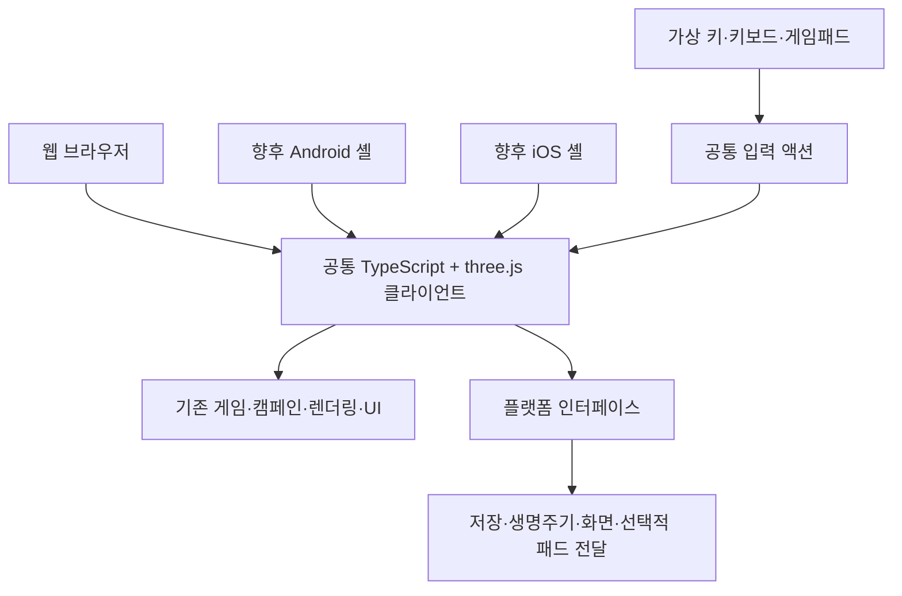

# INKWAVE 웹·안드로이드·아이폰 클라이언트 전환 계획

- [x] D01 기존 클라이언트·터치·게임패드·빌드 구조와 사용자 요구사항을 확인한다.
- [x] D02 공통 기술, 입력 정책, 개발 순서와 모바일 전환 조건을 문서화한다.
- [x] D03 파일별 구현 설계와 검증 시나리오를 32번 문서로 연결한다.
- [x] D04 문서 간 링크·요구사항 누락·현재와 계획의 구분을 검수한다.
- [x] D05 TypeScript·C# 구현, Android SDK 사용과 빌드 도구의 Java 허용 조건을 반영한다.
- [x] D06 공통 클라이언트를 TypeScript + three.js로 확정하고 필요한 플랫폼 구현은 C#을 우선한다.
- [x] D07 스테이지 1 완성 범위를 캠페인 1장 전체인 1-1·1-2·1-3으로 확정한다.
- [x] D08 Xbox 360을 버튼 배치·조작 방식의 기준으로 확정하고 모바일 셸은 스테이지 1 완성 후 검토하도록 정리한다.
- [ ] W00 TypeScript 개발·검사·웹 산출물 생성 경로를 정하고 기존 JavaScript의 단계적 이전을 준비한다.
- [ ] W01 입력 장치 정책과 그래픽 성능 정책을 분리한다.
- [ ] W02 게임패드 상태 관리와 Xbox 360 기준 매핑을 정리한다.
- [ ] W03 PC·모바일 웹에서 사용할 공통 가상 키와 입력 전환을 구현한다.
- [ ] W04 메뉴·지도·전투·포커스 이탈 시 입력을 일관되게 처리한다.
- [ ] W05 웹에서 입력 검증과 스테이지 1 플레이·저장 검증을 완료한다.
- [ ] M01 스테이지 1 완성 후 안드로이드 전환의 필요성과 기기 범위를 검토한다.
- [ ] M02 사용자의 별도 안드로이드 빌드 요청 후 모바일 패키징과 실기기 검증을 진행한다.
- [ ] M03 아이폰 웹 검증과 추후 별도 요청한 iOS 앱 제작·검증을 진행한다.

D는 이번 문서 작성 작업이며, W·M은 이후 실제 구현 작업이다. 문서 작성만으로 구현 항목을 완료 처리하지 않는다. 이 문서의 일련번호는 31이며 [구현 설계](클라이언트-멀티플랫폼-구현설계-32.md)의 일련번호는 32이다. 저장소와 Git 이력에서 확인한 기존 최대 번호 30의 다음 번호를 사용한다.

실제 구현의 세부 태스크·선행 조건·개별 완료 체크는 [33번 상세 구현 계획](클라이언트-캠페인-상세구현계획-33.md)을 따른다. 여러 태스크를 요청받아도 하나를 완료할 때마다 즉시 체크하며, 이 문서의 W·M 상위 항목은 대응하는 세부 작업과 검증을 모두 끝낸 뒤 체크한다.

## 1. 결정과 적용 범위

**공통 게임 클라이언트는 TypeScript + three.js로 확정한다. 직접 작성하는 게임·클라이언트·플랫폼 구현 코드는 TypeScript 또는 C#으로 한다. Android 빌드에 필요한 Java·JDK·공식 빌드 도구는 허용하며 Rust는 도입하지 않는다.** 기존 three.js 게임과 자산을 재사용하고 JavaScript 구현을 단계적으로 TypeScript로 이전해 웹에서 우선 개발한다. 별도 플랫폼 구현이 필요하면 C#을 우선한다. 모바일 셸은 아직 확정하지 않는다.

이번 요청은 계획·구현 설계 문서 작성이다. 게임 코드 변경, 패키지 설치, Android/iOS 프로젝트 생성과 빌드, 배포를 수행하는 요청으로 해석하지 않는다. CI는 사용자가 명시적으로 요청한 경우에만 별도로 다룬다.

### 1.1. 요구사항과 반영 기준

| 사용자 요구사항 | 반영할 동작과 작업 경계 |
|---|---|
| 웹·안드로이드·아이폰을 지원한다. | 웹 공통 코드를 유지하고 모바일 브라우저와 향후 Android/iOS 앱의 실행 환경을 구분한다. |
| 개발 중에는 웹으로 테스트한다. | PC 웹을 기본 반복 개발 환경으로 사용한다. 모바일 브라우저 검증은 네이티브 빌드 없이 필요한 시점에 보완한다. |
| 완성도가 높아진 뒤 모바일 버전을 만든다. | 스테이지 1의 완주·조작·재도전·저장 동작이 웹에서 확인된 뒤 모바일 전환을 검토한다. |
| 안드로이드 빌드는 별도로 요청한다. | 스테이지 1이 완성돼도 자동으로 패키지 설치·플랫폼 생성·안드로이드 빌드를 시작하지 않는다. |
| 게임패드가 없으면 가상 키로 조작한다. | PC 웹·모바일 웹·향후 모바일 앱에서 가상 이동·시점·행동 조작을 제공한다. PC도 자동 표시 대상이다. |
| 연결된 게임패드를 지원한다. | OS와 브라우저 또는 앱에서 인식된 패드를 공통 액션으로 변환한다. Xbox 360 버튼 배치를 기준으로 한다. |
| Rust를 사용하지 않는다. | 직접 작성하는 클라이언트·플랫폼 통합에 Rust, Cargo, Rust 기반 셸·게임 로직을 도입하지 않는다. 빠른 반복 개발과 기존 코드 재사용을 우선한다. |
| 구현 코드는 TypeScript 혹은 C#이다. | 새로 작성·변경하는 게임·클라이언트·플랫폼 구현은 두 언어 범위에서 정한다. Java·JavaScript·Kotlin·Swift로 새 구현을 추가하지 않는다. 브라우저 실행용으로 TypeScript가 생성한 JavaScript는 허용한다. |
| Android 빌드에 사용하는 Java는 허용한다. | 필요한 JDK·SDK·빌드 도구와 도구가 생성하는 코드는 직접 구현하는 언어와 구분한다. Java를 없애려고 Android 빌드 경로를 우회하지 않는다. |
| Android 빌드 때 Android SDK를 사용한다. | 사용자가 처음 말한 ADK는 Android SDK를 뜻한다고 확인했다. 별도 Android 빌드 요청 시 SDK와 필요한 JDK·빌드 도구를 사용한다. |

현재 게임은 JavaScript로 구현되어 있으므로 현황 설명의 `.js` 경로는 그대로 기록한다. 향후 직접 작성할 코드는 TypeScript·C#을 사용하며, 기존 JavaScript는 동작을 보존하면서 단계적으로 TypeScript로 이전한다. HTML·CSS·JSON 같은 UI·리소스·설정은 함께 사용한다. 기존 빌드 도구의 재사용과 새 게임 구현 언어를 구분한다.

키보드·마우스는 기존 PC 개발과 플레이의 보조 입력으로 유지한다. 게임패드가 없을 때 가상 키를 기본 제공한다는 요구를 키보드·마우스로 대체하지 않는다.

### 1.2. 확정한 범위와 이후 결정할 항목

스테이지 1의 범위와 Xbox 360 기준의 의미는 사용자 답변으로 확정했다. 현재 웹 개발 계획에 필요한 사용자 선택은 완료했다.

공통 클라이언트는 TypeScript + three.js로 확정했으며 필요한 플랫폼 구현은 C#을 우선한다. Android 빌드에는 Android SDK를 사용하고 필요한 Java·JDK를 허용한다. 모바일 셸은 모바일 버전을 스테이지 1 완성 후 검토한다는 기존 조건에 따라 M01에서 비교·선정한다. 그때 사용자 선택이 필요하면 하나씩 확인한다.

| 항목 | 결정 상태와 기준 |
|---|---|
| 스테이지 1의 범위 — 확정 | 캠페인 1장 전체인 1-1·1-2·1-3의 완성을 뜻한다. 세 임무의 웹 검증을 완료한 뒤 모바일 전환을 검토한다. |
| Xbox 360 기준의 뜻 — 확정 | 버튼 배치·조작 방식의 기준이다. OS와 브라우저 또는 앱에서 인식되는 호환 게임패드를 지원한다. 실물 Xbox 360 패드의 연결을 모든 기기에서 필수로 요구하지 않는다. |

실제 패드 호환성은 기종·유선/무선 연결·OS·브라우저 또는 앱에서 확인한다. iPhone 검증 때는 [Apple 공식 연결 안내](https://support.apple.com/en-us/111101)를 참고한다. Xbox 360 버튼 배치를 따른다는 결정만으로 특정 실물 패드의 연결 검증을 완료 처리하지 않는다.

## 2. 현재 코드에서 재사용할 수 있는 것

정적 확인 기준은 커밋 `6687c624db31ddf87ccdac58c19045643aa8eddf`이다. 기존 기능이 존재한다는 확인과 실기기에서 새 요구사항이 충족됐다는 확인을 구분한다.

| 현재 구현 | 확인한 상태 | 전환에서 할 일 |
|---|---|---|
| [웹 진입점](../index.html), [메인 루프](../src/main.js) | HTML·ES 모듈·three.js로 실행한다. | 같은 실행 코드를 공통 기반으로 유지한다. |
| [입력 계층](../src/core/input.js) | 키보드·마우스, Gamepad API, 터치 입력을 읽는다. | 장치 인식·전환과 초기화 책임을 명확히 한다. |
| [가상 조작 계층](../src/core/touch.js) | 터치 포인터와 화면의 이동·시점·행동 버튼을 처리한다. | PC의 마우스·펜 입력과 패드 연결/해제에 따른 표시를 보완한다. |
| [플레이어 제어](../src/game/player.js) | 패드·키보드·터치 값을 직접 읽어 행동과 카메라를 갱신한다. | 호환 인터페이스를 유지하면서 공통 액션 소비로 순차 변경한다. |
| [가상 키 스타일](../styles/touch.css) | 화면 조작 버튼과 세로 화면 안내가 있다. | 안전 영역과 PC·모바일 표시 정책을 정리한다. |
| [웹 산출물 생성](../tools/build-dist.py) | `dist/`로 게임 코드·스타일·리소스를 복사한다. | 미래 모바일 셸의 `webDir` 후보로 사용한다. |
| [Electron 실행](../electron/main.cjs) | 같은 웹 게임을 데스크톱 창에서 실행한다. | 이번 웹 우선 개발 경로와 모바일 패키징의 필수 단계로 사용하지 않는다. |

중요한 차이는 세 가지이다. 현재 `shouldUseTouch()`의 자동 판단은 주로 터치 장치를 기준으로 하며, `TouchControls`의 포인터 처리도 `pointerType === 'touch'`를 전제로 한다. 현재 `pollPad()`는 표준 매핑 패드를 우선 선택하지만 비표준 패드도 원시 인덱스로 사용한다. 또한 `main.js`의 `touchMode`가 조작 UI와 낮은 화질·메모리 축소에 함께 쓰인다. 이 상태에서 PC의 가상 키만 켜면 성능 설정까지 모바일 값으로 바뀔 수 있으므로 먼저 정책을 분리한다.

기존 전체 구조 설명은 [1번 문서](서버-클라이언트-기술과-구조-1.md)를 따른다. 1번 문서는 기존 구현의 기록이며, 이 문서와 32번 문서는 새로 적용할 정책과 설계이다.

## 3. 공통 기술과 플랫폼의 역할

| 계층 | 선택 | 선택 이유 |
|---|---|---|
| 게임 로직·3D·UI | TypeScript + three.js를 사용하며 HTML·CSS로 UI를 구성한다. | 사용자가 선택한 공통 클라이언트 방식이며 웹 반복 개발과 기존 게임·자산 재사용을 유지한다. |
| 웹 실행 | 기존 정적 서버와 브라우저를 사용한다. | 모바일 툴체인 없이 조작과 콘텐츠를 개발한다. |
| 모바일 앱 셸 | TypeScript 웹 코드 재사용 경로와 C# 기반 호스트를 비교해 사용자 선택 후 정한다. | 직접 구현할 언어와 Android 빌드 도구를 구분해 기존 게임 재사용·개발 속도를 평가한다. |
| 플랫폼 기능 | 공통 인터페이스 뒤에서 웹 구현과 모바일 구현을 교체한다. | 생명주기·저장·화면·필요시 패드 전달만 플랫폼별로 처리한다. |
| 언어 확장 | 필요가 확인된 최소 플랫폼 코드를 C#으로 우선 작성한다. | WebView에서 제공되지 않는 기능을 보완하며 Java·Rust를 작성 언어로 도입하지 않는다. |

Capacitor의 지원 대상과 기존 웹 앱에 적용할 수 있다는 성격은 [공식 소개](https://capacitorjs.com/docs)에 근거한다. 다만 TypeScript·C#으로 직접 작성해야 하는 플랫폼 확장까지 충족하는지는 별도로 판단하며 채택을 확정하지 않는다. C# 기반 대안과 실제 플랫폼 확장 필요성을 비교한 후 모바일 셸을 선택한다. 구체적인 패키지 버전·최소 OS·빌드 도구도 선택 시 확인한다. 현재 저장소에는 모바일 런타임을 설치하지 않는다.

Capacitor가 3D 로직을 네이티브 게임 엔진으로 바꾸는 것은 아니다. 모바일 앱에서도 WebView의 그래픽·입력·메모리 제약을 검증해야 한다. 웹에서 동작했다는 이유만으로 모바일 앱 성능이나 게임패드 지원을 완료로 판정하지 않는다.

플랫폼 전환이 서버 구조 변경을 뜻하지 않는다. 기존 온라인 중계 구조는 유지하며, 캠페인 진행·성장 데이터는 기존 기획대로 대전과 분리한다. 네이티브 셸이 만드는 Origin·CSP·네트워크 차이는 모바일 통합 단계에서 확인한다.

## 4. 입력 장치 정책

### 4.1. 장치별 기본 동작

| 상황 | 가상 키 | 게임패드와 다른 입력 |
|---|---|---|
| PC 웹에 사용 가능한 패드가 없다. | 기본 표시하며 마우스로 누를 수 있다. | 기존 키보드·마우스도 사용할 수 있다. |
| 모바일 웹·앱에 사용 가능한 패드가 없다. | 기본 표시하며 멀티터치로 조작한다. | 연결된 키보드·마우스는 지원 가능한 범위에서 보조로 사용한다. |
| 패드가 연결됐지만 아직 노출·매핑 확인 전이다. | 계속 표시한다. | 패드 버튼을 눌러 인식을 완료할 수 있게 안내한다. |
| 인식된 패드로 실제 조작한다. | 자동 모드에서는 접어 화면을 확보한다. | Xbox 기준 프롬프트와 패드 입력을 사용한다. |
| 패드를 해제하거나 사용할 수 없게 된다. | 다음 입력 갱신에서 복원한다. | 눌림·이동·조준 값을 지우고 로컬 전투는 일시 정지한다. |
| 사용자가 가상 키를 항상 표시한다. | 패드가 있어도 표시한다. | 동시 입력의 중복 실행을 막는다. |
| 비표준 패드의 매핑이 없다. | 계속 표시한다. | 임의 인덱스를 Xbox 배치라고 가정하지 않는다. 매핑 설정이나 검증된 프로필로 해결한다. |

패드가 없는 동안 가상 키를 완전히 숨겨 조작할 수 없게 만드는 설정은 기본 경로에 두지 않는다. 가상 키의 크기·위치·불투명도와 감도는 조절할 수 있게 한다. 메뉴에서는 전투 가상 키를 비활성화하고 DOM 버튼·메뉴 탐색으로 진행한다.

### 4.2. Xbox 360 기준의 조작 범위

왼쪽 스틱 이동, 오른쪽 스틱 시점, RT 발사, LT 잠수, A 점프·회피, RB 보조 무기, Y 스페셜, Back 지도, Start 일시 정지를 기본 규약으로 둔다. 메뉴에서는 A 확인·B 취소·방향키 이동을 제공한다. [상세 매핑과 상태 전환](클라이언트-멀티플랫폼-구현설계-32.md#4-xbox-360-기준-게임패드)을 구현 기준으로 사용한다.

브라우저가 보고하는 `mapping === 'standard'`와 장치별 매핑을 구분한다. 표준 레이아웃의 인덱스는 [W3C Gamepad 매핑 정의](https://www.w3.org/TR/gamepad/#remapping)에 근거한다. Xbox 표시 규약은 프로젝트의 설계 결정이며 특정 제품명 문자열에만 기능을 허용하는 정책을 사용하지 않는다.

## 5. 웹 우선 개발 순서

| 작업 | 구체적 산출물 | 다음 단계 조건 |
|---|---|---|
| W00 TypeScript 준비 | 컴파일·개발 서버·타입 검사·웹 산출물 생성과 기존 JavaScript의 이전 단위를 정한다. | TypeScript 변경 결과가 웹에서 실행되고 배포 산출물의 모듈·리소스 경로를 보존한다. |
| W01 정책 분리 | 입력 장치 상태, 가상 키 표시, 그래픽 품질을 독립 상태로 만든다. | PC에서 가상 키를 켜도 화질·잉크 아틀라스·메모리가 바뀌지 않는다. |
| W02 게임패드 정리 | 패드 선택·표준 매핑·연결/해제·이전 프레임 초기화를 구현한다. | 연결·해제·다른 패드 재연결에서 유령 입력과 오매핑이 없다. |
| W03 가상 키 확장 | 모바일 멀티터치와 PC 마우스 조작을 공통 액션에 연결한다. | 패드 없이 이동·조준·발사·잠수·점프·특수 행동을 사용할 수 있다. |
| W04 소비 경로 통합 | 전투·메뉴·지도 입력을 컨텍스트로 구분한다. | 메뉴를 누른 입력이 전투에 새지 않고, 포커스 복귀 시 눌림이 남지 않는다. |
| W05 웹 수직 검증 | 1장의 시작·완주·보상·체크포인트·재도전을 연결하고 기록한다. | 아래 스테이지 1 완료 조건을 실제 웹 플레이로 확인한다. |
| M01 모바일 검토 | 웹 측정 결과와 목표 Android 기기·OS·패드 목록을 정리한다. | 모바일 전환의 작업량과 미해결 문제를 판단한다. |
| M02 Android 앱 작업 | 사용자의 별도 요청 후 셸·산출물 동기화·실기기 검증을 수행한다. | 요청한 산출물과 실기기 결과를 확인한다. |
| M03 iPhone 대응 | 공통 코드의 Safari 차이를 확인하고 이후 요청에 맞춰 iOS 앱으로 검증한다. | 아이폰 웹과 앱의 합격 여부를 각각 기록한다. |

W01~W04는 기존 대전의 조작도 보존하면서 작은 변경 단위로 진행한다. 콘텐츠와 저장의 완성은 입력 계층 정리가 대신하지 않으므로 W05에서 [캠페인 기획](PvP-GDD/싱글플레이-PvE-캠페인-기획-2.md)의 진행·보상·저장 구현 상태를 별도로 확인한다.

## 6. 스테이지 1 완성과 모바일 검토 조건

사용자와 확정한 스테이지 1의 완성 범위는 캠페인 1장의 다음 세 임무 전체이다. 첫 임무만 완료한 상태로 모바일 전환 검토 조건을 충족한 것으로 처리하지 않는다.

| 임무 | 실제로 확인할 핵심 |
|---|---|
| [1-1 멈춘 시계 아래](PvP-GDD/campaign/stages/스테이지-1-1-멈춘-시계-아래-3.md) | 도색·잠수·벽오르기·두 중계기 복구·첫 장비 지급을 확인한다. |
| [1-2 지워지는 발자국](PvP-GDD/campaign/stages/스테이지-1-2-지워지는-발자국-4.md) | 기록 회수·고지 접근·롤러 정예의 예고와 재도전을 확인한다. |
| [1-3 광장의 통행금지](PvP-GDD/campaign/stages/스테이지-1-3-광장의-통행금지-5.md) | 우산 대장의 측면 공략·완료·다음 지역 해금과 저장을 확인한다. |

각 임무를 가상 키와 게임패드로 진행하고, 메뉴·지도·장비 정비도 해당 입력으로 사용할 수 있어야 한다. 짧은 입력, 동시 입력, 화면 전환, 패드 해제 후 재개와 저장 복구를 포함한다. 단순 빌드 성공·스크린샷·자동 조종만으로 완료를 표시하지 않는다.

모바일 검토의 선행 조건은 웹에서 재현 가능한 완주, 진행을 막는 입력·저장 오류의 해소, 화면 크기 변경에 대한 가상 키 배치, 성능 측정 기록이다. PC의 가상 키 조작은 모바일 멀티터치 합격의 증거가 아니므로 모바일 브라우저 실기기 검증을 보완한다. 이 검증은 APK를 만드는 작업과 구분한다.

**조건을 충족해도 Android 제작은 자동 시작하지 않는다. 사용자의 별도 안드로이드 빌드 요청이 실제 시작 조건이다.** 요청 전에는 `android/`·`ios/` 생성, 모바일 SDK 설치, Gradle·Xcode 빌드와 모바일 패드 플러그인 설치를 진행하지 않는다.

## 7. 모바일 지원의 구분

| 대상 | 개발·검증 방법 | 현재 상태 |
|---|---|---|
| PC 웹 | 기존 서버와 PC 브라우저로 반복 개발한다. | 코드 기반이 있으며 새 정책 구현·검증은 남아 있다. |
| Android 웹 | Android 브라우저에서 같은 웹 산출물을 실행한다. | 목표 지원 범위이며 새 입력 정책의 실기기 검증은 남아 있다. |
| iPhone 웹 | Safari에서 같은 웹 산출물을 실행한다. | 목표 지원 범위이며 실제 Safari 검증은 남아 있다. |
| Android 앱 | C# 우선 정책에 맞는 셸을 선택해 공통 웹 코드의 실행 방법을 정한다. | 스테이지 1 이후 검토와 별도 빌드 요청을 기다리는 계획이다. |
| iPhone 앱 | 같은 언어 정책으로 공통 웹 코드의 실행 방법을 정한다. | 지원 구조를 준비하며 제작 시점은 별도 요청으로 정한다. |

iOS 앱 제작에는 macOS·Xcode 환경이 필요하다. Windows에서 웹을 개발할 수 있다는 사실과 iOS 앱 빌드 가능 여부를 구분한다. Android 빌드에는 사용자와 확정한 Android SDK를 사용한다. SDK Build Tools는 일반 앱 빌드에 사용하는 공식 도구이며 [Android 공식 도구 문서](https://developer.android.com/tools)를 근거로 한다. 선택한 셸의 실제 SDK 요구사항을 적용하고 빌드에 필요한 Java·JDK는 허용한다.

## 8. 검증과 완료 보고

| 구분 | 확인 내용 | 완료로 부르지 않는 것 |
|---|---|---|
| 문서 검수 | 요구사항·링크·일련번호·현재/계획 구분을 확인한다. | 입력 기능 구현이나 실기기 지원 완료로 보지 않는다. |
| 로컬 동작 검사 | 연결 전환·짧은 탭·트리거·포커스 초기화 등 실제 오류를 잡는 검사를 수행한다. | 인덱스 상수만 복사하는 검사를 충분한 검증으로 보지 않는다. |
| 웹 UI·플레이 | 메뉴부터 1장 완료와 저장 복귀까지 직접 진행한다. | 반응형 화면 에뮬레이션을 모바일 OS 검증으로 보지 않는다. |
| Android 실기기 | 명시적 요청 이후 생성한 앱에서 입력·저장·재개·성능을 확인한다. | APK 생성만으로 지원을 확정하지 않는다. |
| iPhone 실기기 | Safari와 향후 iOS 앱을 각각 확인한다. | Android 통과 결과를 그대로 옮기지 않는다. |

성능의 초기 목표는 PC 웹 60fps, 목표 모바일 기기의 낮은 화질에서 30fps 이상으로 둔다. 이는 확정 사양이 아니라 목표이며, 최초 측정 시 기기·OS·브라우저·해상도·화질·프레임 시간·메모리 증상을 함께 기록한다. 기기 선정 전에는 특정 휴대전화 성능을 보장하지 않는다.

웹 검증 중 발견한 첫 진행 차단 오류는 원인과 재현 절차를 기록하고 수정 후 해당 경로를 다시 확인한다. 대규모 테스트나 임의의 추가 툴체인 도입을 기본 작업으로 확장하지 않는다.

## 9. 문서 관계와 후속 결정

이 문서는 플랫폼·입력 정책과 작업 순서를 정한다. [32번 구현 설계](클라이언트-멀티플랫폼-구현설계-32.md)는 파일별 수정 지점·공통 입력 규약·화면과 모바일 셸 연동 방법을 정한다. [1번 구조 설명](서버-클라이언트-기술과-구조-1.md)은 기준 커밋의 기존 구현을 설명하며, [캠페인 문서](PvP-GDD/싱글플레이-PvE-캠페인-기획-2.md)는 콘텐츠·성장·진행 규칙을 정한다.

다음 구현 요청에서는 확정한 TypeScript + three.js 경로의 W00부터 진행한다. 모바일 셸은 공통 웹 코드 재사용, TypeScript·C# 구현 조건과 공식 Android 빌드 도구 사용을 기준으로 선택한다. 최저 지원 OS, 검증 휴대전화, 실제 패드 모델, 앱 식별자·서명·배포 방식은 모바일 작업을 시작할 때 확정한다. 아이폰을 지원 범위에서 제외하거나 직접 작성하는 구현을 Java·Rust로 변경하지 않는다.

## 10. 이번 문서 작업의 검수 결과

문서 31·32의 요구사항·작업 번호·현재와 계획의 구분을 대조하고 README·기존 구조 설명·캠페인 기획에서 접근할 수 있게 연결했다. 저장소와 Git 이력의 기존 최대 일련번호 30을 확인했다. 문서 33개의 로컬 링크 458건과 문서 앵커 6건, 신규 문서의 코드 블록·공백·체크박스를 검사했다. 기존 그림 29장의 해시도 유지됐다.

문서 작성의 D01~D08을 완료했다. 공통 클라이언트는 TypeScript + three.js로 확정하고 필요한 플랫폼 구현은 C#을 우선한다. Android 빌드에는 Android SDK를 사용하고 필요한 Java·JDK는 허용한다. 스테이지 1 완성 범위는 캠페인 1장 전체인 1-1·1-2·1-3으로 확정했다. Xbox 360은 버튼 배치·조작 방식의 기준이며 기기에서 인식되는 호환 게임패드를 지원한다. 모바일 셸은 스테이지 1 완성 후 M01에서 비교·선정한다. W·M 구현, 웹 실행·패드·모바일 실기기 검증, Android/iOS 빌드, CI 실행은 수행하지 않았다. 외부 기술 근거는 2026-10-17에 확인했으며 실제 모바일 도입 시 요구 버전과 호환성을 다시 확인한다.
