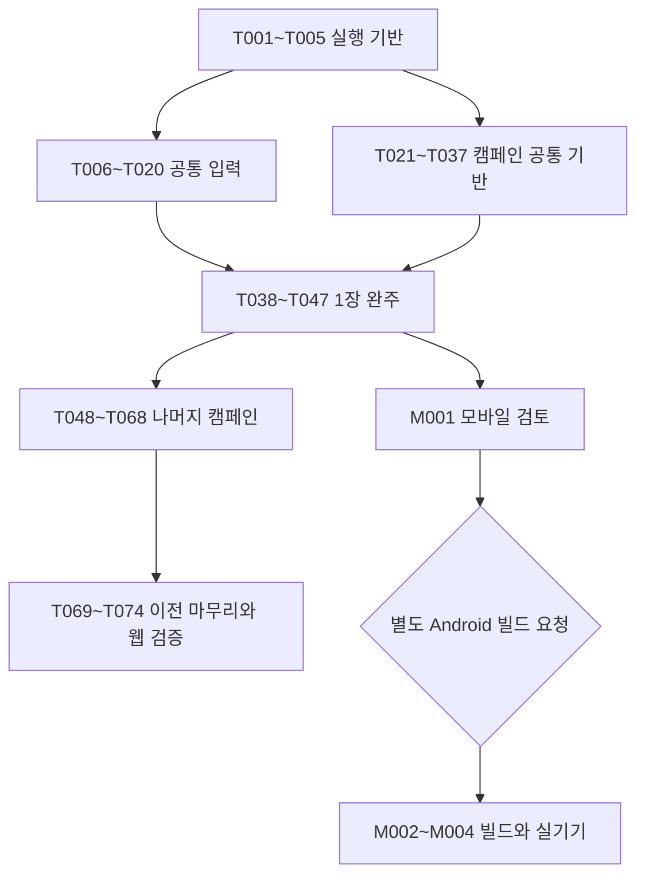

# INKWAVE 클라이언트·캠페인 상세 구현 계획

- [ ] T001 기존 웹 실행과 변경 범위의 기준을 확보한다.
- [ ] T002 TypeScript 컴파일·타입 검사와 three.js 타입 경로를 구성한다.
- [ ] T003 컴파일 결과를 실행하는 웹 개발 경로를 연결한다.
- [ ] T004 배포용 웹 산출물과 정적 리소스 수집을 연결한다.
- [ ] T005 Windows에서 실행할 로컬 검사 명령을 정리한다.
- [ ] T006 입력 계층을 TypeScript로 이전하고 경계 타입을 만든다.
- [ ] T007 입력 장치 정책과 그래픽 성능 정책을 분리한다.
- [ ] T008 입력 설정의 버전 이전을 구현한다.
- [ ] T009 공통 입력 프레임과 행동 소비 순서를 구현한다.
- [ ] T010 게임패드 선택·연결 해제·재연결 상태를 구현한다.
- [ ] T011 Xbox 360 기준 표준 매핑과 아날로그 처리를 구현한다.
- [ ] T012 비표준 패드의 매핑 설정과 복구 경로를 구현한다.
- [ ] T013 모바일 가상 키의 멀티터치와 취소 처리를 구현한다.
- [ ] T014 PC 가상 키의 마우스·펜 조작을 구현한다.
- [ ] T015 가상 키 표시·배치·안전 영역 설정을 구현한다.
- [ ] T016 플레이어 전투 제어를 공통 입력으로 연결한다.
- [ ] T017 메뉴·텍스트 입력·장비 화면의 입력을 연결한다.
- [ ] T018 지도 조작과 전투 입력의 충돌을 제거한다.
- [ ] T019 포커스·화면 방향·패드 해제 시 입력을 초기화한다.
- [ ] T020 웹 입력 체계의 통합 검증을 완료한다.
- [ ] T021 캠페인 정의·식별자·데이터 검증 규칙을 만든다.
- [ ] T022 캠페인 세션과 로딩·종료·자원 해제 경계를 구현한다.
- [ ] T023 기존 지형 위에 캠페인 구역과 오브젝트를 배치한다.
- [ ] T024 목표 상태와 진행 조건의 공통 실행기를 구현한다.
- [ ] T025 복구 단말·안정화·회수·출구를 구현한다.
- [ ] T026 일반 적·출현 예산·공격 예고를 구현한다.
- [ ] T027 캠페인 피해·도색·성장 적용 경계를 구현한다.
- [ ] T028 체크포인트·실패·재도전 상태 복원을 구현한다.
- [ ] T029 캠페인 전용 저장·이전·백업·이어하기를 구현한다.
- [ ] T030 임무 완료 보상의 단일 저장 처리를 구현한다.
- [ ] T031 추첨 시드·특제 보장·상자 중복 방지를 구현한다.
- [ ] T032 모듈·인벤토리·대기함·잠금·분해를 구현한다.
- [ ] T033 레벨·능력치 합산·상한·특성점 지급을 구현한다.
- [ ] T034 특성 배분·선행 조건·무료 재배분을 구현한다.
- [ ] T035 작업장·임무 선택·장비 비교를 구현한다.
- [ ] T036 목표 HUD·통신·기록·보스 예고를 연결한다.
- [ ] T037 이야기·일반 난이도와 전투 조정값을 분리한다.
- [ ] T038 1-1의 동선·전투·선택 경로를 배치한다.
- [ ] T039 1-1의 중계기·체크포인트·첫 보상을 연결한다.
- [ ] T040 1-1을 새 저장과 이어하기로 검수한다.
- [ ] T041 1-2의 고지·기록·선택 경로를 배치한다.
- [ ] T042 롤러 정예의 돌진·휘두름·재정비를 구현한다.
- [ ] T043 1-2의 진행·재도전·보상을 연결하고 검수한다.
- [ ] T044 1-3의 보스장·양측 접근로·입장 체크포인트를 배치한다.
- [ ] T045 우산 대장의 방어·발사·후방 약점·지원 출현을 구현한다.
- [ ] T046 1-3의 완료·서명 보상·다음 지역 해금을 연결한다.
- [ ] T047 캠페인 1장 전체의 웹 완주와 저장 검증을 완료한다.
- [ ] T048 제작·강화·동일 슬롯 강화 이전을 구현한다.
- [ ] T049 지역별 보상 풀·해금·다음 장 전환을 연결한다.
- [ ] T050 2-1 비어 있는 가판대를 구현하고 검수한다.
- [ ] T051 2-2 유리 지붕의 감시자를 구현하고 검수한다.
- [ ] T052 2-3 시장의 마지막 방송을 구현하고 검수한다.
- [ ] T053 3-1 목적지 없는 화물을 구현하고 검수한다.
- [ ] T054 3-2 적재 구역 봉쇄를 구현하고 검수한다.
- [ ] T055 3-3 껍질 속의 명령을 구현하고 검수한다.
- [ ] T056 4-1 끊어진 계류선을 구현하고 검수한다.
- [ ] T057 4-2 돌아오지 않은 작업반을 구현하고 검수한다.
- [ ] T058 4-3 등대 없는 항로를 구현하고 검수한다.
- [ ] T059 5-1 소금 밭의 두 흐름을 구현하고 검수한다.
- [ ] T060 5-2 마르는 길을 구현하고 검수한다.
- [ ] T061 5-3 바람이 멈춘 펌프를 구현하고 검수한다.
- [ ] T062 6-1 닫힌 물길을 구현하고 검수한다.
- [ ] T063 6-2 두 문지기를 구현하고 검수한다.
- [ ] T064 6-3 역류의 관제실을 구현하고 검수한다.
- [ ] T065 7-1 가장 높은 우회로를 구현하고 검수한다.
- [ ] T066 7-2 남은 신호를 구현하고 검수한다.
- [ ] T067 7-3 되찾는 물결을 구현하고 검수한다.
- [ ] T068 엔딩·도전 재진입·수집과 공략 기록을 구현한다.
- [ ] T069 남은 공통·월드 모듈의 TypeScript 이전을 완료한다.
- [ ] T070 남은 전투·캐릭터·효과·오디오 모듈의 TypeScript 이전을 완료한다.
- [ ] T071 남은 화면·진입점·기존 클라이언트 통신 모듈의 TypeScript 이전을 완료한다.
- [ ] T072 전체 캠페인·경제·기존 모드 회귀를 검증한다.
- [ ] T073 PC·모바일 웹 성능과 장시간 전환을 검증한다.
- [ ] T074 웹 구현의 문서·사용법·미검증 항목을 인계한다.
- [ ] M001 1장 완성 후 모바일 전환과 앱 호스트를 검토한다.
- [ ] M002 별도 Android 빌드 요청 후 SDK·호스트·빌드 설정을 구성한다.
- [ ] M003 Android 앱을 빌드하고 설치 가능한 산출물을 확인한다.
- [ ] M004 Android 실기기의 조작·저장·복귀·성능을 검증한다.
- [ ] M005 별도 iOS 앱 제작 요청 후 환경·빌드·아이폰 실기기를 검증한다.

## 1. 이 문서의 사용 범위

이 문서의 일련번호는 33이다. 현재 문서의 최대 번호 32와 Git 이력의 최대 번호 30을 확인해 다음 번호를 발급했다. [31번 전환 계획](클라이언트-멀티플랫폼-전환계획-31.md)은 확정한 방침, [32번 구현 설계](클라이언트-멀티플랫폼-구현설계-32.md)는 입력·플랫폼 계약, 이 문서는 실제 작업 순서와 완료 판정의 기준이다. 세 문서에 공통 정책을 복제해 서로 다른 선택을 만들지 않는다.

공통 게임 클라이언트는 **TypeScript + three.js**이다. 기존 게임·자산을 재사용하고 변경 모듈부터 TypeScript로 이전한다. 직접 작성하는 구현 코드는 TypeScript 또는 필요한 C#으로 제한한다. 새 JavaScript·Java·Kotlin·Swift·Rust 구현을 추가하지 않는다. TypeScript가 생성한 JavaScript, 재사용하는 기존 코드, 의존 라이브러리와 공식 빌드 도구의 코드는 직접 작성한 구현과 구분한다. HTML·CSS·JSON은 화면·설정·리소스에 사용한다. 새 로컬 개발 도구가 필요하면 TypeScript로 작성해 컴파일한 뒤 실행하며 기존 Python·Node 도구는 재사용할 수 있다.

1차 완성 범위는 **캠페인 1장 전체인 1-1·1-2·1-3**의 웹 플레이·저장 검증이다. 2차 범위는 나머지 18개 임무와 엔딩·반복 플레이이다. 모바일 검토는 1차 완료 후 가능하지만 Android 빌드는 사용자의 별도 요청을 기다린다. 아이폰 지원은 유지한다. Xbox 360은 버튼 배치와 조작 방식의 기준이며 기기에서 인식되는 호환 패드를 지원한다. 패드가 없으면 PC 웹·모바일 웹·앱에서 가상 키를 제공한다.

이번 요청은 **상세 계획 문서 작성**이다. 아래 모든 구현 태스크는 미착수이며 문서 작성으로 체크하지 않는다. 향후 서버 변경과 관련한 구현 태스크는 포함하지 않는다. CI 생성·변경·실행·진단, 배포·스토어 제출은 이 계획의 자동 실행 단계가 아니다. 기존 그림 29장과 그림 매니페스트를 유지하며 기획용 그림을 게임의 실제 지형·공격 판정·새 필수 리소스로 사용하지 않는다.

## 2. 태스크별 실행·완료 체크 규칙

제목 바로 아래 목록이 **상태의 원본**이다. 각 상세 절의 ID는 이 목록과 일대일로 연결한다. ID를 재사용하거나 완료한 태스크의 의미를 다른 작업으로 바꾸지 않는다. 요청 예시는 `T001부터 T003까지 구현해라` 또는 `T013 하나만 구현해라`이다.

1. 요청한 태스크와 선행 태스크의 실제 완료 상태를 먼저 확인한다. 선행 조건이 미완료이면 해당 사실과 필요한 작업 범위를 밝히며, 선행 작업을 완료한 것으로 가정하지 않는다.
2. 한 태스크의 구현·필요한 검사·완료 조건을 충족한 즉시 문서 맨 위의 **해당 항목 하나를 `- [x]`로 바꾼다. 다음 태스크를 시작하기 전에 저장한다.** 여러 개를 요청받아도 전체 작업이 끝날 때까지 체크를 미루지 않는다.
3. 예를 들어 T010~T012 중 T010만 통과했다면 T010만 체크한다. T011이 부분 구현 또는 차단 상태이고 T012를 시작하지 않았다면 두 항목은 `- [ ]`로 유지한다. 구현 파일만 추가했거나 자동 검사만 통과한 상태를 실기기 검증 완료로 올리지 않는다.
4. 각 상세 절의 마지막에 완료 근거를 짧게 추가한다. `검증: 명령·결과 / 실제 브라우저·기기·패드 / 남은 제약` 형태를 사용하고 실행하지 않은 검증은 `미실행`으로 적는다. 비밀값·원본 개인정보를 기록하지 않는다. 별도의 작업 로그 문서를 만들지 않는다.
5. 태스크가 크거나 요구 변경이 생기면 구현 전에 `Txxx-A`, `Txxx-B`처럼 하위 태스크를 맨 위 목록과 상세 절에 추가한다. 부모는 모든 하위 작업과 통합 완료 조건을 충족한 뒤 체크한다. 실제 회귀로 완료 조건이 깨졌다면 해당 항목을 다시 열고 이유를 적는다.
6. 이후 작업이 미완료여도 이미 끝난 태스크의 체크를 보존한다. 커밋·push·배포 여부와 태스크 완료는 별도로 보고한다. 막힌 태스크와 관계없는 작업을 진행할 때도 의존성을 확인한다.

단위 검사는 실제 오류를 잡는 입력 정규화·진행 상태·저장·보상 계산 위주로 만든다. CSS 값·정적 문구를 그대로 복사한 검사와 구현 내부 호출 횟수만 검사하는 중복 테스트는 기본으로 추가하지 않는다. 조작감·도달 가능성·게임패드·멀티터치·성능은 실제 실행으로 검증한다.

## 3. 선행 관계와 기존 계획의 대응

| 작업 묶음 | 순서와 의존성 | 31·32번 항목 |
|---|---|---|
| TypeScript 실행 기반 | T001 → T002 → T003·T004 → T005이다. | W00이다. |
| 입력 체계 | T006 이후 정책·프레임을 만들고 장치별 구현·소비자를 연결한 뒤 T020으로 통합한다. | W01~W04이다. |
| 캠페인 공통 기반 | T021~T037을 각 상세 절의 의존성에 따라 구현한다. | W05의 선행 구현이다. |
| 첫 장 | T038~T047이며 T047 통과 전에는 1장 완성으로 표시하지 않는다. | W05 완료 판정이다. |
| 나머지 캠페인 | T048~T068이며 장별·임무별 선행 관계를 따른다. | 캠페인 기획 2~28번을 실제 구현한다. |
| 이전 마무리·최종 검증 | T069~T074이다. 모듈 이전은 해당 기능 태스크 중 먼저 끝낼 수 있다. | 웹 최종 인계이다. |
| 모바일 | T047 이후 M001, 별도 요청 이후 M002~M004, 별도 iOS 요청 이후 M005이다. | M01~M03이다. |

31·32번의 W 항목은 대응하는 상세 태스크와 완료 조건이 **모두** 충족됐을 때만 체크한다. 상세 태스크가 하나 끝났다고 W05 전체를 체크하지 않는다. 모바일 태스크는 웹의 T048 이후 진행을 막는 필수 선행 조건이 아니다. 모바일 요청이 없으면 해당 항목을 미완료로 두고 웹 작업을 계속할 수 있다.

## 4. 현재 코드와 제안할 파일의 구분

현재 기준 커밋은 `6687c624db31ddf87ccdac58c19045643aa8eddf`이다. 현재 [package.json](../package.json)의 `serve`는 Python 정적 서버를 실행하고 `build`는 [파일 복사 도구](../tools/build-dist.py)를 실행한다. `.ts` 컴파일은 아직 없다. [index.html](../index.html)은 `src/main.js`와 저장소에 포함한 three.js import map을 읽는다. 새 도구를 설치하거나 코드·서버를 실행한 결과를 이번 문서 작성의 근거로 주장하지 않는다.

| 현재 진입점 | 구현 시 처리 |
|---|---|
| [src/main.js](../src/main.js), [src/core/ctx.js](../src/core/ctx.js) | 공통 상태·세션·입력 소비 지점을 타입화하고 새 캠페인 수명을 연결한다. |
| [src/core/input.js](../src/core/input.js), [src/core/touch.js](../src/core/touch.js), [styles/touch.css](../styles/touch.css) | 기존 동작을 보존하며 정책·장치·공통 프레임을 분리한다. |
| [src/game/player.js](../src/game/player.js), [src/game/actor.js](../src/game/actor.js), [src/game/match.js](../src/game/match.js) | 이동·무기를 재사용하되 캠페인 세션과 대전 규칙·수치를 분리한다. |
| [src/world/maps.js](../src/world/maps.js), [src/world/level.js](../src/world/level.js), [src/world/paint.js](../src/world/paint.js) | 기존 7개 지형에 임무 배치를 얹고 목표 면적·체크포인트용 상태를 제공한다. |
| [src/boss/bossMode.js](../src/boss/bossMode.js), [src/boss/bossBrain.js](../src/boss/bossBrain.js) | 3장·7장 거대 보스에서 필요한 부분을 재사용하고 솔로 규칙을 별도 구성한다. |
| [src/ui/menus.js](../src/ui/menus.js), [src/ui/hud.js](../src/ui/hud.js), [src/ui/diorama.js](../src/ui/diorama.js) | 캠페인 진입·목표·장비·지도 화면을 공통 입력으로 조작한다. |

이하 `src/campaign/`, `src/platform/`, `src/core/inputFrame.ts`, `tools/client/` 등은 **제안할 경로**이며 현재 존재한다는 뜻이 아니다. 실제 파일을 만들 때 기존 모듈과 중복 책임이 없는지 확인한다. `.js`를 `.ts`로 바꿀 때는 전체 참조와 개발·배포 출력 경로를 함께 갱신한다.

### 4.1. 제안할 데이터와 함수 경계

| 계약 | 최소 필드·책임 | 담당 태스크 |
|---|---|---|
| `InputFrame` | 32번의 액션 에지·이동·시점·커서 단위를 따른다. `buildFrame(context, dt)`와 `endFrame()` 사이에서 한 번 생성·소비한다. | T009이다. |
| `MissionDefinition` | `id`, `chapterId`, `mapId`, `timeOfDay`, 구간·목표·출현·CP·대화·보상 참조를 가진 읽기 전용 정의이다. | T021이다. |
| `CampaignSession` | 현재 `runId`, 상태·목표·구간·소유 자원을 보유하고 `start`, `update`, `retryCheckpoint`, `dispose`를 제공한다. 전역 저장을 직접 덮어쓰지 않는다. | T022이다. |
| `CheckpointSnapshot` | `missionId`, `checkpointId`, 완료 목표·회수 ID·구간 시작 상태·스페셜 시작값·추첨 기록을 직렬화한다. GPU 텍스처나 살아 있는 객체 참조를 저장하지 않는다. | T028이다. |
| `CampaignSave` | `schemaVersion`, `contentVersion`, `revision`, 해금·경험치·특성·재료·인벤토리·대기함·첫 보상·미완료 임무·처리 ID를 가진다. | T029이다. |
| `CompletionRecord` | `completionId`, `runId`, 임무·완료 회차·보상 결과·적용한 추첨 순서와 해금을 저장한다. 같은 ID는 다시 적용하지 않는다. | T030이다. |
| `StoragePort` | `load`, `commit(expectedRevision, operation)`, `export`, `importValidated`의 비동기 성공·실패를 반환한다. UI는 저장 완료 후 확정 상태로 바꾼다. | T029·T030이다. |
| `CampaignStats` | 기본값·레벨·장비·특성을 입력받아 적용값·상한 초과·조건부 효과를 계산한다. 기존 기획의 명칭을 유지한다. | T027·T033이다. |

새 데이터는 저장 가능한 값과 런타임 객체를 구분한다. 미완료 임무의 추첨 기록은 포기해도 재추첨 방지에 필요한 범위를 유지한다. 도색은 같은 구간 시작 상태를 재구성할 수 있는 표면 ID·도색 데이터로 보관하며, GPU 표시와 CPU 판정 복원의 비용·용량은 T028에서 측정한다.

### 4.2. 개발·검사 명령과 출력의 제안

| 명령·경로 | 구현할 역할 |
|---|---|
| `npm run dev` | 최초 컴파일·개발 산출물 준비 후 변경 감시와 웹 서버를 실행한다. 기존 포트 8490을 기본으로 사용한다. |
| `npm run typecheck` | 클라이언트·새 TypeScript 개발 도구의 타입 오류를 검사하고 출력 생성 없이 실패를 반환한다. |
| `npm run test:client` | 각 태스크에서 필요한 상태·보상·저장 행동 검사만 실행한다. |
| `npm run build` | 타입 검사와 컴파일 후 실제 배포 가능한 웹 산출물을 조립한다. |
| `.web-dev/` | 개발용 HTML·컴파일된 `src/`·스타일·리소스·vendor의 동일한 상대 구조를 제공한다. 소스와 구분해 Git 추적에서 제외한다. |
| `.tools/` | 새 TypeScript 개발 도구의 컴파일 출력이다. 직접 작성하는 JS 소스 저장 위치로 사용하지 않는다. |
| `dist/` | 배포·향후 모바일 호스트가 읽는 웹 출력이다. `.web-dev/`와 같은 모듈·리소스 상대 구조를 사용한다. |

이는 T002~T005에서 만들 명령·경로의 설계이며 현재 실행 가능하다는 뜻이 아니다. 기존 `tools/serve.py`는 `--dir`를 지원하므로 컴파일 출력을 제공하는 데 재사용한다. 새 조립·감시 도구를 TypeScript로 만들면 그 도구 자체의 컴파일을 먼저 연결한다. 자산 변경도 개발 출력에 반영하고 Ctrl+C 시 감시·서버 자식 프로세스를 함께 정리한다. 버전과 구체적인 컴파일 옵션은 설치 시 호환성을 확인해 고정한다.

## 5. TypeScript와 웹 실행 기반

### T001 — 기존 웹 실행과 변경 범위의 기준

**선행:** 없음이다. **대상:** `package.json`, `index.html`, 기존 실행·검사 도구와 주요 화면이다.

**구현 방법:** 작업 트리의 기존 변경을 먼저 확인한다. 로컬 웹의 시작 화면·기존 봇 경기·연습·지도·장비 변경을 실행해 기준을 확보한다. 현재 서버 연결 없이 확인할 수 있는 클라이언트 범위와 별도 연결이 필요한 범위를 구분한다. 콘솔 오류와 현재 플랫폼을 기록하고 개발 의존성과 자산 경로를 목록화한다.

**완료·검증:** 기존 웹이 어떤 명령과 포트로 실행되는지 재현할 수 있고 변경 전 오류와 정상 화면이 구분돼야 한다. 기준 오류가 작업을 막으면 미완료로 남긴다. 공개 배포나 기존 서버 변경은 이 태스크의 검증 방법으로 사용하지 않는다.

### T002 — 컴파일·타입 검사·three.js 타입 경로

**선행:** T001이다. **대상:** `tsconfig` 설정, `package.json`·lockfile, 제안 경로 `src/types/`이다.

**구현 방법:** 기존 ES 모듈과 import map을 보존하는 TypeScript 컴파일 경로를 먼저 구성한다. `allowJs`는 이전 기간의 재사용에 사용하고 새 `.ts`에는 엄격한 타입 검사를 적용한다. 컴파일 출력은 소스와 분리하며 오류 시 새 배포 출력을 만들지 않는다. three.js 런타임과 타입 정의의 호환성을 확인하고 `three/addons/`까지 타입을 해석한다. 무차별 `any` 선언이나 프로젝트 전체 검사 해제로 통과시키지 않는다.

**완료·검증:** 실제로 사용할 입력 정책 모듈을 `.ts`로 컴파일할 수 있고 잘못된 액션·필드 타입은 검사에서 실패해야 한다. 잘못된 타입을 고친 뒤 정상 검사와 출력 결과를 확인한다. 타입 오류를 일부러 남긴 파일은 커밋하지 않는다.

### T003 — 웹 개발 경로

**선행:** T002이다. **대상:** 개발 실행 명령, HTML 진입점, 컴파일 출력과 정적 서버 연결이다.

**구현 방법:** 브라우저가 컴파일된 ES 모듈을 읽도록 진입점을 연결한다. 초기 컴파일이 끝나기 전에 서버가 성공 화면을 노출하지 않게 하고 변경 감시·재컴파일·새로고침 절차를 정한다. 소스의 상대 import는 출력의 실제 `.js` 경로와 맞춘다. 시작 화면과 도구 페이지에서 폰트·음원·셰이더·three.js 경로가 같은 방식으로 해석되는지 확인한다.

**완료·검증:** `.ts`의 실제 동작을 변경하고 브라우저에 반영되는 것을 확인한다. 타입 오류 발생 시 진단이 보이며 오래된 성공 출력을 새 결과로 오인하지 않아야 한다. 모바일 SDK 없이 웹 개발 명령만으로 실행해야 한다.

### T004 — 웹 배포 산출물

**선행:** T003이다. **대상:** `build` 명령, 기존 파일 복사 흐름, `dist/`와 import map이다.

**구현 방법:** 타입 검사·컴파일 후 실행 파일과 스타일·리소스·음원 목록·필요한 three.js 확장만 조립한다. 기존 빌드가 `.js` 소스만 스캔하는 점을 수정해 TypeScript에서 가져온 확장 의존성이 빠지지 않게 한다. 기존 배포 설정 보존 규칙을 확인하고 출력 정리는 확인한 전용 디렉터리에만 적용한다. 소스 경로나 `node_modules`를 웹에서 읽는 우회를 두지 않는다.

**완료·검증:** 저장소 루트가 아닌 `dist/`를 별도 정적 서버로 열어 게임과 진단 화면이 실행돼야 한다. 브라우저의 모듈·자산 404와 콘솔 오류를 확인하고 실패한 빌드가 직전 산출물을 새 성공 결과로 표시하지 않는지 확인한다. 실제 배포는 하지 않는다.

### T005 — 로컬 검사 명령

**선행:** T004이다. **대상:** `package.json`, 기존 구문 검사, 제안할 TypeScript 검사·행동 테스트 실행기이다.

**구현 방법:** 타입 검사와 남은 기존 JavaScript 구문 검사를 구분하고 Windows PowerShell에서 실행 가능한 로컬 명령을 제공한다. 필요한 테스트 실행기는 TypeScript로 작성해 실행 가능하게 연결한다. `node --check`를 `.ts` 검증이라고 사용하지 않는다. 기존 POSIX 전용 smoke 명령의 실행 환경을 확인하고 Windows용 검증 경로를 준비한다.

**완료·검증:** 타입·필요한 행동 검사·웹 빌드의 종료 코드가 실패를 전달해야 한다. 경로에 공백이 있어도 입력 인자가 깨지지 않는지 확인한다. CI 설정은 읽거나 수정·실행하지 않으며 모든 명령은 로컬 검증용이다.

## 6. 입력 체계

### T006 — 입력 모듈의 TypeScript 이전

**선행:** T005이다. **대상:** `input.js`·`touch.js`의 `.ts` 이전과 `ctx`의 사용 경계이다.

**구현 방법:** 키·포인터·패드·터치 상태와 기존 `Input` 공개 인터페이스를 타입화한다. 처음에는 기존 소비자와 연결되는 어댑터를 유지한다. 이벤트 등록자를 소유 객체에 묶고 해제 메서드를 제공한다. 같은 이름의 `.js`와 `.ts` 소스가 서로 다른 구현으로 남지 않게 출력과 소스를 구분한다.

**완료·검증:** 기존 키보드·마우스·터치 기본 동작이 유지되고 모듈 재생성 시 이벤트가 두 번 들어오지 않아야 한다. 입력 객체를 여러 번 만들고 해제한 뒤 한 누름이 한 번만 전달되는지 확인한다.

### T007 — 입력 정책과 성능 정책 분리

**선행:** T006이다. **대상:** 제안 `inputPolicy.ts`, 메인 초기화·렌더러·환경 생성의 `touchMode` 참조이다.

**구현 방법:** `hardwareProfile`, `padStatus`, `activeInputSource`, 가상 키의 표시·활성 상태와 컨텍스트를 별도 상태로 만든다. `touchMode`의 화질·그림자·메모리 배율 용도는 기기 성능 상태로 옮긴다. 패드 사용과 가상 키 표시가 성능 설정을 다시 결정하지 않게 한다.

**완료·검증:** PC에서 가상 키를 켜도 모바일 메모리 배율로 바뀌지 않고 모바일에서 패드를 연결해도 높은 화질로 바뀌지 않아야 한다. 저장된 사용자 화질 선택을 유지하고 장치 변경 때 월드가 재생성되지 않는지 확인한다.

### T008 — 입력 설정 이전

**선행:** T007이다. **대상:** 설정 로드·저장, 입력 설정 화면이다.

**구현 방법:** 설정 버전을 두고 기존 `touchControls`를 새 `virtualControls` 정책으로 한 번만 이전한다. `on`은 항상 표시, `auto`·`off`는 새 자동 정책으로 옮기며 패드가 없는 기본 조작을 보장한다. 크기·불투명도·위치·감도는 범위를 검사하고 초기화 기능을 제공한다.

**완료·검증:** 구버전·값 누락·범위 초과·깨진 JSON을 읽었을 때 안전한 기본값으로 복구돼야 한다. 두 번째 실행부터 사용자의 새 설정을 덮어쓰지 않고 기존 프로필·캠페인 저장은 건드리지 않아야 한다.

### T009 — 공통 입력 프레임

**선행:** T006·T007이다. **대상:** 제안 `inputFrame.ts`와 프레임 루프이다.

**구현 방법:** 32번의 이동·시점 변화량·스틱 각속도·지도 커서·메뉴 탐색·액션 에지 계약을 구현한다. 액션마다 `held`·`pressed`·`released`를 보존하고 한 프레임 안의 짧은 탭을 잃지 않는다. 이동은 한 장치를 선택해 길이 1로 제한하며 시점의 `dt`를 한 번만 적용한다. 소비가 끝난 뒤 에지를 정리한다.

**완료·검증:** 두 장치를 함께 써도 이동 속도가 합산되지 않아야 한다. 프레임 사이 down/up, 충전 해제, 30·60·120fps 시점 회전을 비교하는 행동 검사로 탭 손실·중복 발사·프레임 의존 회전을 잡는다.

### T010 — 패드 수명과 선택

**선행:** T009이다. **대상:** 패드 폴링·연결 상태와 활성 장치 안내이다.

**구현 방법:** API 부재·권한 제한·버튼 조작 대기·미매핑·준비 상태를 구분한다. 연결 이벤트와 폴링을 함께 사용하고 선택한 패드의 인덱스와 장치 세션을 유지한다. 해제·교체 때 이전 버튼 배열·보간·트리거·반복 상태를 비운다. 재연결 후 중립 입력을 확인한 뒤 활성화한다.

**완료·검증:** RT를 누른 상태에서 해제하고 다른 패드를 연결해도 자동 발사하지 않아야 한다. 두 패드가 연결됐을 때 첫 장치로 매 프레임 바뀌지 않아야 한다. 가짜 패드 상태로 전이를 검사하고 실제 패드의 연결·해제 결과는 별도로 확인한다.

### T011 — 표준 매핑과 아날로그

**선행:** T010이다. **대상:** 제안 `gamepadMapping.ts`, 감도·데드존 설정이다.

**구현 방법:** `mapping === 'standard'`일 때 32번 Xbox 배치의 버튼·축을 액션으로 변환한다. 스틱은 방사형 데드존과 응답 곡선을 적용하고 트리거는 누름·해제 임계값을 나눈다. Guide 버튼과 진동을 필수 조작으로 사용하지 않는다. OS의 제품명 문자열 하나만으로 패드를 허용하지 않는다.

**완료·검증:** A·B·RT·LT·RB·Y·Back·Start와 양 스틱을 화면에서 확인한다. 데드존 근처 드리프트와 트리거 임계값을 왕복해 버튼 떨림·반복 확인이 없는지 검증한다. Xbox 360 실물 연결 자체를 합격 조건으로 강제하지 않는다.

### T012 — 비표준 매핑

**선행:** T011·T008이다. **대상:** 매핑 프로필과 설정 화면이다.

**구현 방법:** 원시 인덱스를 표준 배치로 추정하는 기존 fallback을 제거한다. 검증된 프로필 또는 사용자 보정에서 각 축·버튼·반전·트리거 범위를 등록하고 충돌·누락을 표시한다. 설정 중 취소·재설정과 가상 키 조작을 유지한다. 한 장치의 보정을 다른 장치에 무조건 적용하지 않는다.

**완료·검증:** 축이 뒤집힌 패드와 다른 버튼 순서를 가진 입력으로 보정을 확인한다. 설정 도중 패드가 끊겨도 화면에서 빠져나올 수 있어야 한다. 미매핑 패드 연결 때문에 가상 키가 숨지 않아야 한다.

### T013 — 모바일 멀티터치

**선행:** T009·T008이다. **대상:** 가상 키 `.ts` 모듈과 포인터 처리이다.

**구현 방법:** `pointerId`별 이동·조준/발사·행동 소유권을 유지한다. 이동과 조준·발사를 동시에 처리하고 짧은 탭을 프레임에 전달한다. `pointercancel`, 창 이탈과 UI 종료에서 해당 포인터를 해제한다. 터치 뒤 호환 마우스 이벤트를 중복 소비하지 않는다. 캡처 정책은 기존 의도와 실기기 결과를 확인해 정한다.

**완료·검증:** 실제 터치 기기에서 이동+시점+발사와 이동+잠수+점프를 확인한다. 손가락이 버튼 밖으로 나가거나 OS 제스처로 취소됐을 때 입력이 고착되지 않아야 한다. 마우스로 모바일 멀티터치 검증을 대신하지 않는다.

### T014 — PC 가상 키

**선행:** T013이다. **대상:** 포인터 종류별 가상 이동·조준·발사 처리이다.

**구현 방법:** 마우스·펜도 가상 버튼을 누를 수 있게 한다. 단일 마우스로 이동과 사격을 할 수 있도록 PC 이동 방향 클릭 유지와 중앙 정지를 구현하고 유지 방향을 시각적으로 표시한다. 터치의 누르고 있는 이동 방식과 구분해 안내한다. 메뉴·포커스 이탈·장치 전환은 방향 유지를 취소한다.

**완료·검증:** 키보드를 쓰지 않고 방향 지정 → 조준·발사 → 중앙 정지가 가능해야 한다. 가상 버튼 클릭이 배경 캔버스 사격으로 중복 전달되지 않고 펜 입력이 이동과 시점을 동시에 차지하지 않아야 한다.

### T015 — 표시·배치·안전 영역

**선행:** T007·T012·T014이다. **대상:** 가상 키 스타일·레이아웃·설정 화면이다.

**구현 방법:** 사용 가능한 패드가 없으면 PC와 모바일 모두 가상 키를 표시한다. 항상 표시 설정과 장치 안내를 제공하되 미세 드리프트로 표시를 반복 전환하지 않는다. HUD·자막·위험 예고를 가리지 않도록 크기·불투명도·위치와 안전 영역을 적용하고 복구 버튼을 둔다.

**완료·검증:** 좁은 화면·넓은 화면·노치 안전 영역과 크기 최솟값/최댓값에서 필수 버튼을 사용할 수 있어야 한다. 초기화가 화면 밖으로 옮긴 버튼을 복구하며 패드 해제 즉시 가상 조작을 사용할 수 있어야 한다.

### T016 — 플레이어 입력 소비

**선행:** T009·T011·T014이다. **대상:** 플레이어 제어 `.ts` 이전과 무기 입력 어댑터이다.

**구현 방법:** 이동·카메라·잠수·점프·발사·보조·스페셜을 공통 프레임에서 소비한다. 기존 무기 실행기의 연사·차지·해제 의미를 보존하고 원시 패드 입력과 공통 액션을 함께 읽지 않는다. 게임패드 에임 보조와 감도는 실제 활성 입력 출처로 판단한다.

**완료·검증:** 슈터 연사, 차저 충전 해제, 롤러 유지, 보조 무기와 스페셜을 각각 확인한다. 입력 어댑터 중복으로 두 번 발사하거나 메뉴 복귀 시 저장된 발사가 발생하지 않아야 한다.

### T017 — 메뉴·텍스트·장비 입력

**선행:** T016이다. **대상:** 메뉴 탐색·설정·장비 화면이다.

**구현 방법:** 메뉴 컨텍스트에서 A 확인·B 취소·방향 이동·LB/RB 탭을 연결한다. 최초 반복 지연과 이후 반복을 실제 `dt`로 계산한다. 텍스트 입력에는 문자를 전달하고 전투 키의 기본 동작 차단을 적용하지 않는다. 연습 장비 진입과 Back 지도 충돌은 화면 컨텍스트·일시 정지 메뉴로 해결한다.

**완료·검증:** 30·60·120fps에서 목록 이동 속도가 일관돼야 한다. 이름 입력 중 이동·발사가 실행되지 않고 확인 버튼을 누른 채 화면이 바뀌어도 다음 화면까지 통과하지 않아야 한다.

### T018 — 지도 입력

**선행:** T017이다. **대상:** 디오라마·HUD 지도·포인터 소유권이다.

**구현 방법:** 지도 컨텍스트에서 커서와 닫기 동작만 소비하고 같은 입력을 카메라에 전달하지 않는다. 가상 지도 버튼은 토글과 명시적 닫기를 제공한다. 기존 대전의 아군 점프는 해당 모드에만 남기고 캠페인 지도에는 목표·체크포인트를 표시한다.

**완료·검증:** 지도를 여닫을 때 잠수·발사·방향 유지가 고착되지 않아야 한다. 지도 조작이 실제 시점을 돌리거나 캠페인에서 존재하지 않는 아군에게 점프하지 않아야 한다.

### T019 — 중단과 복귀

**선행:** T018·T010이다. **대상:** 입력 전체 초기화, 일시 정지, 방향·가시성 이벤트이다.

**구현 방법:** 키·마우스·터치·패드 에지·지도 토글·PC 이동 유지를 한 경로에서 비운다. `blur`, `visibilitychange`, 패드 해제, 모바일 세로 화면 전환을 연결한다. 로컬 캠페인은 안전하게 멈추고 명시적 재개를 기다린다. 온라인 모드에서는 자신의 입력만 중립화하고 다른 참가자 전체를 정지시키지 않는다.

**완료·검증:** 발사·잠수·지도·차지를 유지한 채 탭 전환·패드 해제·회전을 하고 복귀한다. 재개 전 행동이 실행되지 않고 재개 확인 입력도 첫 공격으로 전달되지 않아야 한다.

### T020 — 입력 통합 검증

**선행:** T008~T019이다. **대상:** 32번 T01~T10·T12 중 입력 관련 시나리오와 기존 연습·봇 모드이다.

**구현 방법:** 패드 없음·표준·미매핑·해제·재연결을 PC 가상 키와 실제 멀티터치에서 교차 확인한다. 장치·화질·메뉴·지도·텍스트 전환도 포함한다. 자동 상태 검사와 실제 패드·터치 확인 결과를 별도로 기록하고 실패 사례만 최소 수정 후 다시 검증한다.

**완료·검증:** 필수 입력 조합과 중단·재개를 실제로 확인해야 한다. 실물 패드나 터치 기기가 없으면 해당 검증을 미완료로 남기고 W01~W04 전체 합격을 선언하지 않는다. 화면 캡처와 자동 조종만으로 조작 검증을 완료하지 않는다.

## 7. 캠페인 공통 기반

### T021 — 정의·식별자·데이터 검증

**선행:** T005이다. **대상:** 제안 `src/campaign/definitions.ts`, `data/`, `types.ts`이다.

**구현 방법:** 임무·구간·목표·적 출현·장치·체크포인트·대화·보상에 안정적인 ID를 부여한다. 임무 정의와 실행 중 상태를 분리하고 필수 목표 순서·지도 ID·참조·보상 예외를 검사한다. 숫자는 기존 기획을 한 곳의 데이터로 옮기며 UI와 전투에 중복 하드코딩하지 않는다.

**완료·검증:** 중복 ID·없는 체크포인트·해금 순환·알 수 없는 적·잘못된 확률 합계는 임무 실행 전에 실패해야 한다. 기획 문서의 체크 완료를 데이터 구현 완료로 간주하지 않는다.

### T022 — 캠페인 세션과 자원 수명

**선행:** T021·T006이다. **대상:** 제안 `CampaignSession`, 메인 모드 전환과 기존 `Match` 연결부이다.

**구현 방법:** 작업장·로딩·인트로·전투·일시 정지·실패·결과를 명시적 상태로 만든다. 기존 플레이어·월드·무기는 재사용하되 4대4 자동 스폰·경기 시간·영역 승패 판정을 캠페인에 적용하지 않는다. 세션이 이벤트 구독·적·장치·HUD·효과를 소유하고 종료 시 정리한다. 늦게 끝난 로딩이 종료된 세션에 붙지 않도록 세션 식별자를 확인한다.

**완료·검증:** 임무 시작 중 취소·재시작·작업장 이동을 반복해 중복 캐릭터·잔존 타이머·이전 HUD가 없어야 한다. 캠페인 종료 뒤 기존 연습을 시작해 상태가 섞이지 않는지 확인한다.

### T023 — 캠페인 배치 레이어

**선행:** T022이다. **대상:** 기존 지도·충돌·도색 레벨과 제안 `missionLayout.ts`이다.

**구현 방법:** 기존 7개 배경을 유지하고 캠페인 전용 스폰·구간 경계·엄폐·목표·선택 경로를 데이터로 얹는다. 지형 좌표·높이·유효 도색 면과 실제 충돌을 연결한다. 대칭 대전 지형 전체를 수정해 기존 경로를 망가뜨리지 않는다. 제작 도구의 좌표 표시를 이용해 시작·도착·CP를 검증한다.

**완료·검증:** 기본 달리기·점프·잠수·벽오르기만으로 필수 경로와 선택 경로에 도달해야 한다. 그림에서 보인 장식 벽을 실제 엄폐로 오인하거나 다른 층의 목표를 가동할 수 없어야 한다.

### T024 — 목표 실행기

**선행:** T021·T022이다. **대상:** 제안 `objectives.ts`, 임무 이벤트 계약이다.

**구현 방법:** 잠김·활성·진행·완료 상태와 선행 목표 조건을 구현한다. 적 제압·장치 가동·자료 회수·출구 진입 이벤트를 ID로 처리하고 중복 이벤트를 무시한다. 구간을 물리적으로 건너뛰어도 논리적 선행 조건이 없으면 완료되지 않게 한다. 실패·복원 시 이벤트 재구독과 상태 읽기를 분리한다.

**완료·검증:** B를 A보다 먼저 건드리기, 같은 적 사망 이벤트 두 번 전달, 완료 후 장치 재가동을 검사한다. 필수 조건이 누락되면 출구가 완료되지 않고 현재 필요한 목표를 설명해야 한다.

### T025 — 단말·안정화·회수·출구

**선행:** T023·T024이다. **대상:** 제안 `devices.ts`와 목표 면적 조회이다.

**구현 방법:** 복구는 같은 높이의 유효 표시 면적 60%와 범위 내 2초를 기본으로 한다. 피격·이탈 시 가동 시간만 초기화한다. 안정화는 임무별 누적 시간과 적 점유 조건을 적용하며 일시 중단돼도 누적을 감소시키지 않는다. 회수는 지정 경계 적 제압 후 가능하고 출구는 선행 목표가 모두 끝나야 한다. 상자도 별도 전투 키 없이 범위 유지로 처리한다.

**완료·검증:** 다른 층 도색·원 밖 대기·직접 피격·적 진입을 각각 검사한다. 이미 완료한 단말은 적 재도색으로 취소되지 않아야 한다. 임무별 30초·6초 같은 예외가 전역 기본값에 덮이지 않는지 확인한다.

### T026 — 일반 적과 출현 예산

**선행:** T023·T024이다. **대상:** 기존 봇·캐릭터·무기 재사용 경계, 제안 `enemies/`·`encounters.ts`이다.

**구현 방법:** 사격·도색·방패·감시·포격 역할을 데이터로 구분하고 경계·추적·예고·공격·재정비·사망 상태를 구현한다. 기존 대전 봇을 그대로 캠페인 적으로 돌리지 않는다. 구간별 출현 횟수·동시 상한·일회성 지원 플래그를 관리한다. 길 찾기 실패는 안전 위치 재배치로 복구하고 무한 재소환을 막는다.

**완료·검증:** 지정된 구간 적만 활성화되고 사망한 일반 적이 재출현하지 않아야 한다. 지형 끼임·문 뒤 시야·플레이어 낙하에서 공격 예고와 진행이 멈추지 않는지 확인한다. 예고·정비 중 즉시 공격 취소로 불공정한 피해를 주지 않아야 한다.

### T027 — 피해·도색·성장 적용 경계

**선행:** T026·T016이다. **대상:** 플레이어·무기·피해 이벤트·도색 조회와 제안 전투 계산기이다.

**구현 방법:** 기본 수치와 캠페인 보정을 별도 전투 컨텍스트로 전달한다. 일반·약점·장치·기절 보스 피해 태그를 구분하고 유효 도색만 스페셜을 충전한다. 적 처치·같은 바닥 반복 도색에 독립 경험치·재료 추첨을 추가하지 않는다. 대전용 전역 상수와 프로필에 캠페인 배율을 덮어쓰지 않는다.

**완료·검증:** 같은 면 반복 도색과 적 반복 생성으로 경험치가 증가하지 않아야 한다. 캠페인에서 장비를 바꾼 뒤 기존 대전으로 나가 기본 체력·잉크·피해가 복구되는지 확인한다.

### T028 — 체크포인트와 재도전

**선행:** T025~T027이다. **대상:** 제안 `checkpoints.ts`, 세션 복원 경계이다.

**구현 방법:** CP는 위치만이 아니라 목표·회수 자료·구간 적/장치·임무용 도색·스페셜 시작값·난수 상태를 기록한다. 재도전은 해당 구간을 초기화한 뒤 이전 완료 목표를 복원한다. 체력·잉크를 채우고 안전 대기에서 장비·특성을 바꿀 수 있게 한다. 보스 내부 단계 저장은 각 임무가 지정한 경우에만 허용한다.

**완료·검증:** 이전 구간 자료는 유지하면서 현재 구간 적·장치·도색이 함께 되돌아와야 한다. 재시작을 연속 실행해 이전 탄환·지원 타이머가 남지 않아야 한다. 도색 복원이 GPU 표시와 CPU 판정에서 일치하는지 확인한다.

### T029 — 저장·이전·백업·이어하기

**선행:** T021·T028이다. **대상:** 제안 `save.ts`, `src/platform/storage.ts`, 캠페인 저장 키이다.

**구현 방법:** 기존 `inkwave.profile`·설정은 유지하고 새 캠페인은 IndexedDB의 전용 저장소로 분리한다. `CampaignSave`와 마지막 정상 백업·`revision`을 같은 쓰기 트랜잭션에서 갱신한다. 스키마와 콘텐츠 버전을 구분하고 변환 실패 시 원본을 보존한다. DB 업그레이드가 다른 탭 때문에 막히면 연결 종료·다시 열기 안내를 제공한다. 임무 완료·CP 등 의미 있는 시점에 저장하며 종료 이벤트만 믿지 않는다. 수동 내보내기·가져오기는 JSON의 버전·ID·수치를 검사하고 실패 시 정상 저장을 보존한다. IndexedDB 사용이 거부되면 명시적 실패·임시 플레이 안내를 제공하며 저장 성공으로 숨기지 않는다.

**완료·검증:** 쓰기 거부·용량 부족·깨진 JSON·구버전·지원하지 않는 미래 버전·가져오기 실패를 확인한다. 저장 실패 때 성공으로 표시하거나 기존 정상 저장을 먼저 삭제하지 않아야 한다. 새로고침 후 마지막 확정 상태와 진행 중 CP가 복구돼야 한다.

### T030 — 완료 보상의 단일 저장 처리

**선행:** T029·T024이다. **대상:** 제안 `completion.ts`, 결과 화면과 저장 스냅샷이다.

**구현 방법:** 완료 회차의 처리 ID를 만들고 IndexedDB의 같은 `readwrite` 트랜잭션 안에서 최신 `revision`·처리 ID·임무 시도를 읽는다. 기대 revision과 다르면 오래된 화면의 덮어쓰기를 거절하고, 이미 처리한 ID이면 저장된 결과를 반환한다. 그렇지 않으면 경험치·장비·재료·첫 완료·보장·해금을 순수 계산해 새 스냅샷으로 함께 저장한다. 트랜잭션 안에서 네트워크·타이머·UI 입력을 기다리지 않는다. `complete` 이후에만 메모리의 확정 상태와 결과 화면을 갱신한다. 실패 때 같은 ID·결과로 재시도한다. 다중 탭의 활성 세션 소유권도 같은 저장에서 확인하고 충돌 때 중단·새로고침을 안내한다.

**완료·검증:** 완료 이벤트 두 번·결과 버튼 연타·저장 실패 후 재시도·결과 화면 새로고침·두 탭 완료를 확인한다. 결과를 두 번 지급하거나 미확정 장비만 잃는 상태가 없어야 한다. 오프라인 저장 변조 방지 서버는 추가하지 않는다.

### T031 — 난수·보장·상자 중복 방지

**선행:** T030이다. **대상:** 제안 `loot.ts`, 임무 시도 기록과 지역 풀이다.

**구현 방법:** 무작위 결과를 시드·추첨 순번·상자 ID로 고정한다. 실패·포기·새로고침 후 같은 미완료 임무를 반복해도 상자를 재추첨하지 않게 기록한다. 70/25/5 등급과 9회 연속 미획득 다음 특제 보장을 적용한다. 선택 상자 순서 후 완료 모듈을 추첨하고 확정 세트·보스 서명은 보장 횟수에 넣지 않는다. 포기 시 미확정 보상은 버리되 재추첨 방지 기록은 유지한다.

**완료·검증:** 보장 8·9 경계, 중간 특제, 상자 후 완료 추첨, 첫 보스 확정 서명, 실패·포기를 같은 시드로 검사한다. 같은 상자 ID 중복 전달로 장비나 보장 횟수가 늘지 않아야 한다.

### T032 — 모듈·인벤토리·대기함

**선행:** T031·T027이다. **대상:** 제안 `inventory.ts`, 장비 데이터와 보관 UI이다.

**구현 방법:** 세 슬롯·기본 12종·지역 서명 7종의 정의와 개별 획득 ID를 분리한다. 등급·보조 옵션 중복 금지·강화 단계·잠금·장착을 관리한다. 60칸 보관과 결과 대기함을 만들고 가득 차도 확정 서명·보장 결과를 자동 분해하지 않는다. 분해는 등급별 부품을 지급하고 장착·잠금 아이템을 일괄 선택에서 제외한다.

**완료·검증:** 보관함 가득 참·같은 이름 다른 ID·잠금·장착·분해 연타·저장 실패를 확인한다. 대기함 보상이 재접속 뒤 남고 아이템 이동·분해가 단일 저장 처리로 중복되지 않아야 한다.

### T033 — 레벨·합산·상한

**선행:** T032이다. **대상:** 제안 `growth.ts`, 27번의 경험치 표와 효과 계산기이다.

**구현 방법:** 1~20 경험치 표와 짝수 레벨 특성점 지급을 데이터로 옮긴다. 여러 레벨을 한 번에 넘으면 지나간 모든 짝수 레벨의 미지급 점수를 합산한다. 기본 체력·잉크 기준 가산과 같은 종류 효과의 합산·최종 상한을 적용한다. 지급 경험치와 상한 때문에 실제 적용된 경험치를 결과 카드에서 구분한다.

**완료·검증:** 레벨 경계 전후·여러 레벨 상승·20레벨 초과·보상 재열기를 검사한다. 모든 첫 완료 21개의 12,600 경험치와 상한 12,350의 차이를 임의 재료로 바꾸지 않아야 한다. 장비·특성의 표시값과 적용값이 일치해야 한다.

### T034 — 특성 배분과 재배분

**선행:** T033이다. **대상:** 제안 특성 데이터·배분 화면·전투 반영이다.

**구현 방법:** 기동·제압·순환의 각 효과 2단계와 같은 계열 2점·4점 선행 조건을 적용한다. 사용 가능 점수와 투자 점수 합계를 보존하고 무료 재배분은 안전한 작업장·CP에서 처리한다. 장비 변경과 함께 합산기를 호출하되 전투 중 불필요한 체력 회복·쿨다운 초기화를 만들지 않는다.

**완료·검증:** 점수 부족·잠긴 효과·전체 초기화·복원·저장 실패를 확인한다. 반복 배분으로 점수나 체력이 복제되지 않고 기존 대전에 특성이 남지 않아야 한다.

### T035 — 작업장·선택·장비 비교

**선행:** T034·T017·T029이다. **대상:** 제안 `ui/campaignMenu.ts`, 기존 메뉴 API이다.

**구현 방법:** 새 게임·이어하기·임무 선택·장비·특성·기록·설정 진입을 제공한다. 새 임무는 이야기·다음 목표를 우선하고 재방문은 보상 풀·서명·선택 상자·공명핵을 안내한다. 장비 비교는 옵션 원값·상한 적용값·불이익을 표시한다. 미해금 임무는 이유와 선행 임무를 보여 준다.

**완료·검증:** 가상 키·패드만으로 임무 선택과 장비 변경 후 출전·복귀가 가능해야 한다. 선택 불가 항목에 포커스가 갇히지 않고 저장 실패가 성공 안내에 가려지지 않아야 한다.

### T036 — HUD·통신·기록·보스 예고

**선행:** T035·T024·T026이다. **대상:** 제안 캠페인 HUD·대화 데이터, 기존 HUD·오디오 연동이다.

**구현 방법:** 현재 필수 목표 하나와 완료 요약·선택 상자·미확정 보상을 구분한다. 위험 예고가 시작되면 긴 통신을 미루고 시작·완료 대화는 건너뛰기와 다시 읽기를 제공한다. 모라·틸·아카이브는 기존 외형·초상·자막으로 표현하며 동행 AI·음성 녹음을 새 필수 기능으로 추가하지 않는다.

**완료·검증:** 대화 중 패드 해제·지도·일시 정지·창 크기 변경을 확인한다. 공격 예고와 보스 체력바가 가상 키·자막에 가려지지 않고 건너뛴 대화 때문에 완료·보상이 누락되지 않아야 한다.

### T037 — 난이도 구성

**선행:** T027·T036이다. **대상:** 제안 난이도 프로필과 적·임무 데이터이다.

**구현 방법:** 이야기·일반은 목표 순서·확정보상·해금을 공유한다. 이야기는 일반 대비 적 피해를 25% 낮추고 공격 예고를 늘리며 임의로 별도 체력 배율·필수 적 수를 추가하지 않는다. 초기 수치는 기획 기준으로 시작하고 측정 결과로 바꾼다. 장비·특정 무기·파밍 횟수를 입장 조건으로 추가하지 않는다. 난이도 변경은 작업장 또는 CP에서 현재 구간을 시작 상태로 되돌려 적용한다.

**완료·검증:** 같은 첫 완료에서 두 난이도의 경험치·확정 보상·해금이 같아야 한다. 전투 도중 설정 토글로 적 체력·보상을 반복 초기화하거나 적을 중복 소환하지 않아야 한다.

## 8. 캠페인 1장 — 첫 완주 기준

### T038 — 1-1 공간과 배치

**선행:** T023·T026이다. **근거:** [1-1 기획](PvP-GDD/campaign/stages/스테이지-1-1-멈춘-시계-아래-3.md)이다.

**구현 방법:** 타이드워터 낮 배경에 안전 시작점·계단 아래 A·시계탑 북쪽 B·출구 E·선택 상자 X·CP를 배치한다. 기본 도색·잠수·벽오르기로 이어지는 양 경로와 기획의 구간 적을 놓는다. A 이전에 B로 뛰어들어도 순서를 건너뛰지 않게 논리 경계와 복귀 경로를 둔다.

**완료·검증:** 시작 장비만으로 필수·선택 경로를 직접 이동한다. 장식 충돌·벽 도색·낙하·좁은 통로에서 막힘이 없어야 한다. 정확한 배치 좌표는 실제 지형 확인 후 데이터로 고정한다.

### T039 — 1-1 목표와 첫 보상

**선행:** T038·T025·T028~T037이다.

**구현 방법:** A 복구 → CP 활성 → B 복구 → E 완료를 연결한다. 0/2 안내와 기본 조작 도움말을 단계별로 보여 준다. 첫 완료는 AD01·TK01·BD01 일반 +0 세트를 지급하고 별도 무작위 완료 모듈을 더하지 않는다. 선택 상자 추첨은 별도 유지하고 1-2 해금을 같은 완료 저장에 넣는다.

**완료·검증:** A 복구 뒤 사망하면 A는 완료로 남고 현재 구간만 복원돼야 한다. 첫 완료·반복 완료·상자 포함/미포함에서 26·28번의 보상 수량과 보장 횟수를 비교한다.

### T040 — 1-1 실제 검수

**선행:** T039·T020이다.

**구현 방법:** 새 저장으로 시작해 가상 키와 패드에서 각각 완주한다. A 이후 새로고침·사망·포기·이어하기를 수행하고 상자 재획득과 결과 재열기를 확인한다. 영상 연출이나 자동 조종 대신 실제 조작으로 벽오르기와 회복·재정비를 확인한다.

**완료·검증:** 진행 불능·입력 고착·중복 보상이 없어야 한다. 실제 기기·입력 장치와 재현 문제를 이 절에 기록한다. 통과해도 1장 전체 완료인 T047을 먼저 체크하지 않는다.

### T041 — 1-2 고지와 기록 경로

**선행:** T040이다. **근거:** [1-2 기획](PvP-GDD/campaign/stages/스테이지-1-2-지워지는-발자국-4.md)이다.

**구현 방법:** 같은 광장의 다른 구간에 지워지는 길·두 필수 기록·옆 벽 고지·정예 구역·선택 상자·출구를 배치한다. 경계 적과 기록 회수 조건을 묶고 첫 기록 후·정예 전 CP를 지정한다. 도색병이 퇴로를 바꾸더라도 우회 가능한 공간을 남긴다.

**완료·검증:** 기본 무기의 사거리와 기본 이동으로 두 기록과 선택 상자에 도달해야 한다. 첫 기록 회수 후 죽거나 다음 구간을 먼저 밟아도 잠긴 진행이 잘못 열리지 않아야 한다.

### T042 — 롤러 정예

**선행:** T041·T026이다. **대상:** 제안 `enemies/rollerElite.ts`와 예고 데이터이다.

**구현 방법:** 청소반장의 1초 직선 예고 → 전진 → 넓은 휘두름 1회 → 2초 정비를 상태로 구현한다. 체력 420은 초기 조정값으로 두고 절반 체력에서 도색병 1명을 한 번만 호출한다. 진입 CP에서 공격 준비 상태를 초기화하고 벽에 걸리면 안전하게 경로를 복구한다.

**완료·검증:** 예고를 보고 측면으로 피할 수 있고 뒤를 공격할 시간이 있어야 한다. 장애물에 걸린 정예가 즉시 재공격하거나 영구 무적이 되지 않아야 한다. 실제 타이밍은 1-2 본문의 수치를 대조한다.

### T043 — 1-2 진행과 검수

**선행:** T042·T036이다.

**구현 방법:** 두 필수 기록 → 정예 → 출구 범위 유지 → 완료를 연결한다. 정예에서 실패하면 두 기록은 유지하고 정예·마지막 지원 적만 복원한다. 정예 체력바·공격 예고·무료 특성 재배분 안내와 1-3 해금을 결과에 연결한다.

**완료·검증:** 가상 키와 패드로 각각 완주하고 정예 직전·전투 중 새로고침·사망을 확인한다. 일반 첫 완료 600 경험치·60 부품과 선택 상자의 별도 보상을 대조하며 정예 처치 자체로 경험치를 추가하지 않아야 한다.

### T044 — 1-3 보스장

**선행:** T043이다. **근거:** [1-3 기획](PvP-GDD/campaign/stages/스테이지-1-3-광장의-통행금지-5.md)이다.

**구현 방법:** 시계탑 앞 보스장·양쪽 도색 접근로·엄폐·보스 앞 CP·중앙 단말을 배치한다. 근접 무기도 방패 후방에 접근할 수 있도록 폭과 높이를 확인한다. 입장 연출은 건너뛸 수 있고 본전투 전에 이동·입력 상태를 정리한다.

**완료·검증:** 양쪽 우회로가 유효하고 보스·플레이어가 벽 사이에 영구히 끼지 않아야 한다. 단말을 먼저 찾아가도 보스 처치 전에는 완료되지 않아야 한다.

### T045 — 우산 대장

**선행:** T044·T027이다. **대상:** 제안 `enemies/umbrellaCaptain.ts`이다.

**구현 방법:** 통행대장 바리의 우산 전개·느린 전진·방패 발사·3초 후방 노출·재정비를 명시적 상태로 구현한다. 초기 체력은 1,800으로 두고 정면은 피해 효율을 낮추되 일반 공격으로도 해결 가능하게 한다. 체력 50% 이하에서 양쪽 우회로를 번갈아 압박하고 도색병 지원은 두 번만 배치한다. 체력 경계 이벤트가 매 프레임 재발동하지 않게 하고 그림의 구슬 예고를 별도 새 공격으로 추가하지 않는다.

**완료·검증:** 정면 공략과 측면 공략이 모두 가능하고 측면 접근의 이득이 명확해야 한다. 상태 전환 중 처치·재시작했을 때 방패·지원 적·탄환이 남지 않고 약점 피해가 중복되지 않아야 한다.

### T046 — 1-3 완료와 해금

**선행:** T045·T030~T037이다.

**구현 방법:** 보스 처치 뒤 중앙 단말 가동·완료 대화·결과로 이어진다. 첫 완료의 복구자의 표식 SG01, 보스 기본 무작위 모듈·공명핵·경험치·부품과 시장 해금을 단일 처리한다. 보스 앞 CP 재도전에서 대장·지원·단말을 일관되게 복원한다.

**완료·검증:** 첫 보스 완료는 600 경험치·80 부품·무작위 모듈 1·공명핵 1·확정 SG01이며 보장 횟수에서 확정 서명을 제외해야 한다. 결과 재열기·단말 이벤트 중복·저장 실패 재시도에서 두 번 지급되지 않아야 한다.

### T047 — 1장 전체 완주 판정

**선행:** T040·T043·T046과 T020~T037의 필수 검증이다.

**구현 방법:** 새로운 저장으로 1-1 → 작업장 → 1-2 → 1-3 → 시장 해금까지 가상 키와 패드에서 진행한다. 각 임무에서 CP 재도전·장비/특성 변경·이어하기·완료 저장을 수행한다. PC 가상 키와 실제 모바일 멀티터치를 모두 확인하고 위험 예고·자막·화면 방향·패드 해제를 포함한다.

**완료·검증:** 31번의 1장 완료 조건을 모두 충족하고 진행을 막는 입력·저장 오류가 없어야 한다. 브라우저·기기·패드와 프레임 측정 결과를 남긴다. 이 태스크 완료 후에만 W05를 체크하고 M001 검토를 열 수 있다. Android 빌드는 자동 시작하지 않는다.

## 9. 나머지 캠페인의 공통 확장

### T048 — 제작·강화·강화 이전

**선행:** T047·T032~T035이다. **근거:** [아이템 규칙](PvP-GDD/campaign/systems/아이템-상세-26.md)이다.

**구현 방법:** 기본 설계 제작 40 부품과 획득 서명 재제작 80 부품·공명핵 1을 구현한다. +1/+2/+3은 2·4·6장 보스 해금과 단계 비용 50/90/140을 적용한다. 같은 슬롯의 강화 이전은 원본을 +0으로 되돌리고 대상에 한 번만 적용한다. 대상 단계가 더 높으면 이유를 표시하고 거절한다.

**완료·검증:** 재료 부족·해금 전 강화·다른 슬롯·동일 아이템·잠금·연타·저장 실패를 확인한다. 두 아이템이 동시에 같은 강화 단계를 복제하지 않아야 한다. SG07의 불이익도 강화 배율을 받고 SG06의 지속·간격은 강화로 변하지 않아야 한다.

### T049 — 지역 풀과 해금 연결

**선행:** T048이다. **대상:** 임무·무기·기본 설계·서명·보상 데이터이다.

**구현 방법:** 7개 지역 풀과 첫 임무·보스별 무기·설계·강화 해금을 기획 표에 맞춰 연결한다. 첫 완료와 반복 완료 보상, 일반 임무 14개 선택 상자·기록, 보스 7개 서명을 구분한다. 미구현 다음 임무로 진입하면 오류 대신 현재 제작 범위를 표시한다.

**완료·검증:** 저장 해금을 다시 계산해도 재료·장비가 재지급되지 않아야 한다. 1-1 예외와 첫 보스 서명이 무작위 보장 상태를 바꾸지 않아야 한다. 임무 선택 화면의 풀과 실제 추첨 후보를 비교한다.

## 10. 2~7장의 임무별 구현

아래 각 태스크는 동일한 최소 절차를 따른다. **배치·목표 데이터 작성 → 필요한 적/기믹 구현 → CP·보상·대화 연결 → 실제 검수**이다. 대상은 제안 `src/campaign/data/missions/<임무ID>.ts`와 필요한 적/기믹 모듈이다. 일반 목표 규칙을 복사하지 않고 T024~T031을 사용한다. 각 기획의 3~9절에서 실제 목표 수·순서·시간·적 상한·재시작 범위를 옮기며 그림은 공간 의도의 참고로만 사용한다.

각 임무는 가상 키·패드 완주, 필수 이동의 기본 장비 도달, CP 사망·새로고침, 선택/필수 목표 순서, 첫/반복 보상·다음 해금, 전투 종료 후 자원 해제를 검증한다. 이 공통 검수도 **해당 임무 태스크의 완료 조건**이다. 아래에는 임무 고유 작업과 추가 실패 사례를 적는다. 작업량이 크면 2절 규칙으로 하위 태스크를 먼저 발급하고 한 번에 전체 구현을 완료했다고 처리하지 않는다.

### T050 — 2-1 비어 있는 가판대

**선행:** T049이다. **근거:** [2-1 기획](PvP-GDD/campaign/stages/스테이지-2-1-비어-있는-가판대-6.md)이다.

**구현 방법:** 크로스로드 해질녘에 가판대·전차 엄폐·두 거래 기록함·선택 벽타기 통로를 배치한다. 기록 경계 적과 접근 회수를 연결하고 갈림길 적은 선택한 구간만 활성화한다. A 회수 뒤·B 부근 CP를 둔다. 완료 시 쌍권총·브러시·우산 해금을 저장한다.

**완료·검증:** 필수 기록을 회수해도 운반 감속·무기 제한이 생기지 않아야 한다. 사망 후 앞 기록은 유지하고 지나지 않은 갈림길까지 적이 활성화되지 않는지 확인한다.

### T051 — 2-2 유리 지붕의 감시자

**선행:** T050이다. **근거:** [2-2 기획](PvP-GDD/campaign/stages/스테이지-2-2-유리-지붕의-감시자-7.md)이다.

**구현 방법:** 외곽 중계기 2개·높이별 엄폐·옆 벽 접근·정예 전 CP를 배치한다. 감시 정예는 직선 조준 후 두 발과 2.5초 정비, 절반 체력의 일회 위치 변경을 구현한다. 제압 뒤 지붕 송신기 접근을 연다.

**완료·검증:** 근접 무기로 같은 높이에 도달할 수 있고 지붕 낙하 후 정예 앞에서 재시작해야 한다. 정비 중 즉시 반격·엄폐 관통·위치 변경 반복 발동을 확인한다.

### T052 — 2-3 시장의 마지막 방송

**선행:** T051이다. **근거:** [2-3 기획](PvP-GDD/campaign/stages/스테이지-2-3-시장의-마지막-방송-8.md)이다.

**구현 방법:** 고정 장치 보스에 송신기 3개의 순차 가동과 중심핵 노출을 구현한다. 직선 광선·원형 공격을 순서대로 추가하고 두 번째 가동 뒤 8초 노출을 제공한다. 세 송신기 정지 뒤 핵을 계속 노출한다. 완료 시 SG02·터미널·+1 강화 해금을 저장한다.

**완료·검증:** 보스 재도전은 송신기와 핵 체력을 함께 복원해야 한다. 마지막 송신기 처리 후 무적이 계속 반복되거나 근접 무기가 장치에 닿지 않는 상태가 없어야 한다.

### T053 — 3-1 목적지 없는 화물

**선행:** T052이다. **근거:** [3-1 기획](PvP-GDD/campaign/stages/스테이지-3-1-목적지-없는-화물-9.md)이다.

**구현 방법:** 켈프라인 낮에 컨테이너 우회·중계기 3개·배포 서류·선택 상자를 배치한다. 첫·두 번째 중계기에 CP를 두고 구간별 도색·방패·감시 역할을 결합한다. 거대 보스는 배경 예고만 제공하고 블래스터·활·버킷 해금을 연결한다.

**완료·검증:** 앞서 복구한 중계기를 적이 빼앗지 않아야 한다. 물에 빠지면 최근 CP에서 현재 구간만 재시작하고 배경 보스가 실제 피해·승패에 개입하지 않아야 한다.

### T054 — 3-2 적재 구역 봉쇄

**선행:** T053이다. **근거:** [3-2 기획](PvP-GDD/campaign/stages/스테이지-3-2-적재-구역-봉쇄-10.md)이다.

**구현 방법:** 통로·봉쇄 기록·포수 앞 CP·낮은 접근 경사로를 배치한다. 포격 정예는 1초 예고 뒤 이전 위치로 통 두 개를 시간차 낙하시키고 3초 장전한다. 절반 체력 지원 사격병은 한 번만 호출한다.

**완료·검증:** 낙하 원과 피해 시점이 일치하고 옆으로 피할 공간이 있어야 한다. 정예 재도전 때 지원 호출·낙하 탄환·기록 상태를 지정 범위대로 복원해야 한다.

### T055 — 3-3 껍질 속의 명령

**선행:** T054이다. **근거:** [3-3 기획](PvP-GDD/campaign/stages/스테이지-3-3-껍질-속의-명령-11.md)이다.

**구현 방법:** 기존 HULLBREAKER의 모델·동작을 재사용하되 솔로 세션·초기 체력 18,000·강타/통 낙하/돌진의 세 구간을 별도 프로필로 만든다. 벽 충돌 뒤 약 4초 기절과 낮아지는 배 약점을 제공한다. 소형 게는 정한 상한만 출현하고 이 임무에는 광선·회전을 넣지 않는다. SG03·마리나를 해금한다.

**완료·검증:** 벽 돌진이 플레이어를 벽 사이에 가두지 않고 근접 무기가 기절 약점에 닿아야 한다. 솔로 보정이 기존 보스 모드의 체력·패턴을 바꾸지 않는지 함께 확인한다.

### T056 — 4-1 끊어진 계류선

**선행:** T055이다. **근거:** [4-1 기획](PvP-GDD/campaign/stages/스테이지-4-1-끊어진-계류선-12.md)이다.

**구현 방법:** 할야드 해질녘에 두 계류 안정화 지점·카페리 앞 정비 단말·육지 창고 선택 경로를 배치한다. 두 웨이브와 동시 최대 4명 등 구간 예산을 적용한다. 스피너·검·미츠 해금으로 주 무기 12종 사용을 연결한다.

**완료·검증:** 물 위 특수 이동을 필수로 요구하지 않아야 한다. 안정화 이탈은 누적만 멈추고 사망 때만 지정 CP 상태로 복원돼야 한다. 모든 무기 해금이 캠페인 범위에만 적용되는지 확인한다.

### T057 — 4-2 돌아오지 않은 작업반

**선행:** T056이다. **근거:** [4-2 기획](PvP-GDD/campaign/stages/스테이지-4-2-돌아오지-않은-작업반-13.md)이다.

**구현 방법:** 장비 회수 2곳·옆 선실 우회·수문장 앞 CP를 배치한다. 방패 정예는 느린 전진·1초 예고 방패 발사·3초 측면 노출과 절반 체력의 일회 위치 변경을 구현한다. 완료에 모라의 고백과 원본 기록을 연결한다.

**완료·검증:** 밀어내기·낙하가 회피 불가 조합이 되지 않아야 한다. 물가 반대쪽에도 안전 경로가 있고 두 장비 회수와 정예 재도전의 복원 범위가 일치해야 한다.

### T058 — 4-3 등대 없는 항로

**선행:** T057이다. **근거:** [4-3 기획](PvP-GDD/campaign/stages/스테이지-4-3-등대-없는-항로-14.md)이다.

**구현 방법:** 엄폐 중계점 2개와 서·동 거점을 배치하고 카페리 선체는 고정 엄폐로 사용한다. 스큐의 두 발·3초 정비·조건부 거점 이동을 구현한다. SG04·솔트팬·+2 강화 해금을 완료 저장에 넣는다.

**완료·검증:** 거점 전환 사선을 미리 읽을 수 있고 근접 무기도 도보·잠수로 접근해야 한다. 고정 배를 이동 플랫폼으로 바꾸지 않고 CP 복원 때 보스 위치·중계점 상태를 함께 복원한다.

### T059 — 5-1 소금 밭의 두 흐름

**선행:** T058이다. **근거:** [5-1 기획](PvP-GDD/campaign/stages/스테이지-5-1-소금-밭의-두-흐름-15.md)이다.

**구현 방법:** 솔트팬 낮에 동·서 펌프 안정화·혼합 순환 기록·창고 선택 상자를 배치한다. 펌프 작동은 기존 소품 애니메이션 수준으로 표현하고 안정화 목표·두 웨이브를 연결한다. 완료 뒤 지역 파밍 안내를 연다.

**완료·검증:** 펌프 두 곳의 누적 시간이 섞이지 않고 완료한 지점이 다시 잠기지 않아야 한다. 선택 상자 미회수로 필수 출구가 막히지 않는지 확인한다.

### T060 — 5-2 마르는 길

**선행:** T059이다. **근거:** [5-2 기획](PvP-GDD/campaign/stages/스테이지-5-2-마르는-길-16.md)이다.

**구현 방법:** 안전 연결점 2개와 낮은 살수 장치를 배치한다. 도색 정예와 두 장치의 번갈아 도색·장치 정지 후 2초 정비를 연결한다. 두 장치를 꺼도 정예의 일반 공격은 남기고 무적 조건은 추가하지 않는다.

**완료·검증:** 장치 파괴가 실제 재도색 중단으로 이어져야 한다. 장치·정예·도색을 CP에서 함께 복원하며 장거리 전용 높이의 필수 표적을 두지 않는다.

### T061 — 5-3 바람이 멈춘 펌프

**선행:** T060이다. **근거:** [5-3 기획](PvP-GDD/campaign/stages/스테이지-5-3-바람이-멈춘-펌프-17.md)이다.

**구현 방법:** 솔트와 살수 장치·안전 원을 연결한다. 장치 정지 후 6초 안전 상태로 4초 과열 창을 열고 절반 체력에서 반대 장치·새 원을 활성화한다. 양 장치 처리 뒤 정기 정비 창을 제공해 가동 반복을 끝낸다. SG05·록게이트를 해금한다.

**완료·검증:** 도색과 공격 중 무엇을 할지 선택할 시간이 있어야 한다. 장치 두 개 처리 후 영구 무적·무한 목표 반복이 없고 기본 무기로 작은 안전 면적을 해결할 수 있어야 한다.

### T062 — 6-1 닫힌 물길

**선행:** T061이다. **근거:** [6-1 기획](PvP-GDD/campaign/stages/스테이지-6-1-닫힌-물길-18.md)이다.

**구현 방법:** 록게이트 해질녘에 제어점 3개·낮은 운하 벽·다리 측면 선택 경로를 배치한다. 각 제어점 완료를 CP 저장과 한 상태로 묶는다. 동시 적 예산을 지키고 쌍문지기는 이 임무에서 배경 예고만 제공한다.

**완료·검증:** 낙하 후 최근 제어점 진행과 CP가 서로 다른 상태로 복원되지 않아야 한다. 장식 수문을 실제로 닫아 플레이어를 가두는 새 실패 조건을 만들지 않는다.

### T063 — 6-2 두 문지기

**선행:** T062이다. **근거:** [6-2 기획](PvP-GDD/campaign/stages/스테이지-6-2-두-문지기-19.md)이다.

**구현 방법:** 벽돌 엄폐로 시야를 나눌 수 있는 관제 통로와 두 정예 앞 CP를 배치한다. 방패 360·감시 300을 초기값으로 두고 기존 예고·정비 규칙을 조합한다. 한 명이 남으면 위치만 한 번 바꾸고 새 패턴은 넣지 않는다.

**완료·검증:** 어느 순서로 처치해도 같은 보상을 받으며 한 명의 사망이 다른 적 이벤트에 섞이지 않아야 한다. 지형 끼임 시 체력을 초기화하지 않고 안전 재배치를 수행하고 플레이어 사망 시 두 정예를 함께 복원한다.

### T064 — 6-3 역류의 관제실

**선행:** T063이다. **근거:** [6-3 기획](PvP-GDD/campaign/stages/스테이지-6-3-역류의-관제실-20.md)이다.

**구현 방법:** 제어점 A·B와 수문 조율기 핵을 구현한다. A의 30초 안정화 뒤 B의 안정화·원형 공격을 연결한다. 두 점 완료 뒤 핵을 계속 노출한다. 보스 내부 CP는 두지 않고 SG06·테라스·+3 강화 해금을 완료 저장한다.

**완료·검증:** 이탈 때 진행이 감소하지 않고 사망 시 A·B·핵을 모두 초기화해야 한다. SG06 발동 4초·간격 10초는 발동 시점 기준이며 보조 무기 재사용으로 연장·초기화되지 않아야 한다.

### T065 — 7-1 가장 높은 우회로

**선행:** T064이다. **근거:** [7-1 기획](PvP-GDD/campaign/stages/스테이지-7-1-가장-높은-우회로-21.md)이다.

**구현 방법:** 테라스 기존 dusk 배경에 높이가 다른 중계기 3개·낮은 외벽 우회·돔 옆 CP를 배치한다. 사격·감시·도색·방패 조합을 구간 예산대로 배치하고 최종 접근 통신을 연결한다. 새벽은 이야기 표현으로 처리한다.

**완료·검증:** 필수 벽오르기는 기본 능력으로 가능하고 실패 시 최근 테라스 CP로 복귀해야 한다. 다른 층의 도색이 중계기를 가동하지 않고 높은 목표가 HUD 밖에 영구히 숨지 않아야 한다.

### T066 — 7-2 남은 신호

**선행:** T065이다. **근거:** [7-2 기획](PvP-GDD/campaign/stages/스테이지-7-2-남은-신호-22.md)이다.

**구현 방법:** 고정점 방어 → 지휘관 제압 → 원본 기록 회수를 연결하고 혼합 웨이브 뒤·지휘관 앞 CP를 둔다. 지휘관은 통 두 번·3초 정비를 사용하고 체력 70% 사격병 2명·35% 도색병 1명을 각각 한 번만 호출한다. 지원 중 다음 강한 포격을 늦춘다.

**완료·검증:** 지휘관에서 실패해도 끝낸 방어 웨이브는 반복하지 않아야 한다. 남은 호출 수와 실제 출현 수가 맞고 원본 기록은 완료 전 미확정으로 남아야 한다.

### T067 — 7-3 되찾는 물결

**선행:** T066이다. **근거:** [7-3 기획](PvP-GDD/campaign/stages/스테이지-7-3-되찾는-물결-23.md)이다.

**구현 방법:** 거대 소라게 재사용 프로필에 초기 체력 22,000·세 제어 고리·통제핵을 연결한다. 세 구간에 돌진·광선/소형 게·회전을 순차 도입하되 강한 공격을 겹치지 않는다. 고리는 밝은 번호 표식과 지면 접근 높이를 제공하고 마지막 고리는 안전한 종료 연출에서 처리한다. 공간이 부족하면 기획의 검증된 전투장 대안을 먼저 비교한다.

**완료·검증:** 공격 예고·정비 창·벽 충돌·근접 약점 접근과 최종 CP 재시작을 확인한다. SG07·엔딩·도전 해금이 한 번만 저장돼야 한다. 검증되지 않은 거대 보스 배치를 억지로 유지해 진행 불능을 남기지 않는다.

## 11. 완성·이전 마무리·인계

### T068 — 엔딩과 반복 플레이

**선행:** T067이다. **대상:** 작업장·임무 선택·기록·도전 데이터이다.

**구현 방법:** 복구된 지역은 기존 이미지·설명·대화로 보여 주고 완료 임무 재진입을 연다. 도전은 기존 적 조합·목표 순서의 최대 두 변화와 재료·외형·개인 기록으로 구성한다. 무기별 공략 기록과 선택 기록 14개 수집을 제공하되 무한 레벨·매일 숙제·필수 파밍 입장 제한을 추가하지 않는다.

**완료·검증:** 엔딩 건너뛰기·다시 보기·새로고침 뒤 해금이 유지돼야 한다. 반복 플레이가 첫 완료 보상을 재지급하거나 미수집 기록을 임의로 완료 처리하지 않아야 한다.

### T069 — 공통·월드 TypeScript 이전 마무리

**선행:** T047이다. **대상:** 아직 남은 `src/core`·`src/world`·설정·이벤트 모듈이다.

**구현 방법:** 이미 이전한 모듈은 중복 작업하지 않고 남은 목록을 만든다. 공통 수학·충돌·도색·표면 조회·배치 계약부터 타입화하고 모듈별 출력 참조를 정리한다. 메인 공유 객체를 거대한 `any`로 남기지 않고 도메인별 인터페이스를 제공한다.

**완료·검증:** 해당 소스 범위가 TypeScript 검사에 포함되고 동명 구현 소스가 중복되지 않아야 한다. 도색 CPU/GPU 판정·벽오르기·경사·기존 지도 검사를 실행해 이름 변경만으로 이전을 완료 처리하지 않는다.

### T070 — 전투·캐릭터·효과·오디오 이전 마무리

**선행:** T069이다. **대상:** 남은 `src/game`·`src/boss`·`src/fx`·`src/audio` 모듈이다.

**구현 방법:** 액터 상태·무기 실행기·이벤트 payload·캐릭터 애니메이션·효과 수명·오디오 핸들을 타입화한다. 이종 무기별 데이터를 판별 가능한 계약으로 정리하고 소스·출력 import를 갱신한다. 기존 JS 의존 경계 때문에 임시로 둔 타입 우회는 이 범위에서 제거한다.

**완료·검증:** 12종 무기의 주요 유지/충전/해제 동작, 보스별 프로필, 효과·오디오 해제를 확인한다. 일반 대전과 캠페인에서 시각·사운드 이벤트가 두 번 발생하지 않고 새 전투 구현이 `.js` 소스에 남지 않아야 한다.

### T071 — 화면·진입점·기존 클라이언트 통신 이전 마무리

**선행:** T070이다. **대상:** 남은 `src/ui`·`src/net`·`src/main`·실제 배포 클라이언트 의존 모듈이다.

**구현 방법:** 화면 API·HUD 이벤트·기존 클라이언트 메시지 경계를 타입화하고 모든 실제 클라이언트 소스의 이전 목록을 닫는다. 기존 클라이언트 통신의 직렬화 형식을 보존하며 새 통신 규약을 설계하지 않는다. HTML의 직접 작성 스크립트도 필요한 경우 `.ts` 모듈로 옮긴다. 생성 출력·vendor·개발용 기존 도구는 클라이언트 소스 검사와 구분한다.

**완료·검증:** 미이전 파일과 검사 제외 이유를 확인하고 직접 작성한 배포 클라이언트에 남은 JS 구현이 없어야 한다. 기존 모의 전송과 가능한 기존 통신 확인을 수행하되 실제 연결을 확인하지 못하면 그 한계를 명시한다. 정적 출력만 열어 전체 진입을 확인한다.

### T072 — 전체 캠페인·경제·기존 모드 회귀

**선행:** T068·T071이다. **대상:** 21개 임무, 저장·보상·장비·기존 오프라인 모드이다.

**구현 방법:** 새 저장 첫 완주와 기존 저장 이어하기를 수행한다. 선택 상자 14개·기록·서명 7개·해금·레벨 상한·강화 비용을 기획 표와 대조한다. 실패·포기·CP 복원·보상 재열기·보관함 가득 참을 섞어 확인한다. 기존 영역전·구역전·연습·기존 보스 모드로 돌아가 수치·상태 잔존을 검사한다.

**완료·검증:** 기본 장비·이야기 난이도에서 강제 반복 파밍 없이 엔딩까지 도달해야 한다. 실제 플레이와 계산 검사의 결과를 구분하고 진행 차단·보상 중복·저장 손실이 남으면 완료 처리하지 않는다.

### T073 — 성능과 반복 전환

**선행:** T072이다. **대상:** 실제 PC·모바일 웹, 기존 성능 진단 화면이다.

**구현 방법:** 기기·OS·브라우저·해상도·화질·입력 장치를 고정하고 구간별 프레임 시간·최대 적/효과·반복 로딩 뒤 자원 증가를 측정한다. PC 60fps·목표 모바일 낮은 화질 30fps는 초기 목표로 사용한다. 문제 구간만 그림자·아틀라스·후처리·해상도·동시 효과를 조정한다. 처음 실패하면 원인을 기록하고 수정 후 해당 사례부터 재검증한다.

**완료·검증:** 작업장↔임무·사망↔CP·보스 재시작을 반복해 지속적인 메모리·구독·GPU 자원 증가가 없어야 한다. 측정하지 않은 기기의 성능을 합격으로 선언하지 않고 목표 미달은 수치와 남은 제한으로 보고한다.

### T074 — 웹 인계

**선행:** T073이다. **대상:** README와 31·32·33번의 실제 상태·명령·완료 근거이다.

**구현 방법:** 실제 개발·타입 검사·테스트·웹 산출물 명령과 저장 백업·복원 사용법을 문서화한다. 임시 설계와 실제 파일 경로를 맞추고 태스크별 체크·근거·미해결 항목을 정리한다. 웹 코드 검사·실제 완주·실기기·앱 빌드의 완료를 분리해 인계한다.

**완료·검증:** 문서 명령과 링크가 실제 파일·실행 결과에 맞아야 한다. 사용자 요청 없는 commit·push·배포·모바일 빌드를 웹 인계의 자동 단계로 실행하지 않는다. 조건부 모바일 항목이 남았으면 별도로 명시한다.

## 12. 조건부 모바일 태스크

### M001 — 모바일 전환과 호스트 검토

**선행:** T047이다. **대상:** 목표 기기·OS·입력 목록, 공통 웹 실행과 플랫폼 경계이다.

**구현 방법:** 1장 웹 측정 결과로 실제 병목·저장·생명주기·패드 제약을 정리한다. 공통 TypeScript 산출물을 실행할 셸과 필요한 C# 플랫폼 구현을 비교하고 사용자 선택이 필요하면 하나씩 질문한다. Capacitor를 자동 채택하거나 네이티브 플러그인을 C#으로 그대로 작성할 수 있다고 가정하지 않는다. 모바일에 필요한 추가 상세 태스크는 선택 후 이 목록에 추가한다.

**완료·검증:** 선택한 방식 또는 보류 이유·기기 범위·직접 작성 언어 준수·검증 방법이 기록돼야 한다. 이 검토는 SDK 설치·플랫폼 프로젝트 생성·Android 빌드를 시작하는 허가가 아니다.

### M002 — Android SDK와 호스트 구성

**선행:** M001과 사용자의 별도 Android 빌드 요청이다.

**구현 방법:** 선택한 호스트의 공식 요구사항에 맞는 Android SDK·Build Tools·JDK·빌드 도구 버전을 확인해 고정한다. 앱 식별자·디버그 빌드 범위·서명 보관 방법을 정하고 Android 프로젝트를 생성한다. 직접 작성하는 플랫폼 구현은 TypeScript·C# 조건을 지킨다. 환경 진단에서 키·인증 파일·토큰을 출력하지 않는다.

**완료·검증:** 공통 웹 산출물 경로와 호스트 설정이 맞고 SDK 라이선스·도구 탐색·빌드 의존성 검사가 통과해야 한다. 별도 요청이 없으면 대기 상태로 두며 웹 개발 의존성으로 모바일 SDK를 강제하지 않는다.

### M003 — Android 빌드와 설치 산출물

**선행:** M002이다.

**구현 방법:** 타입 검사·웹 산출물을 먼저 만들고 Android SDK를 사용하는 선택 호스트의 로컬 빌드를 실행한다. 버전·빌드 종류·패키지 ID·대상 아키텍처와 산출물 경로를 기록한다. 요청 범위의 기기에 설치해 최초 부팅과 리소스 로딩을 확인한다. 스토어 제출은 별도 요청으로 둔다.

**완료·검증:** 빌드 성공과 APK 등 산출물의 실제 설치·실행 결과를 구분해 기록한다. 파일 해시와 경로를 제공하고 설치하지 못했다면 설치 완료라고 표시하지 않는다. 기본 화면만 실행한 결과를 게임 전체 실기기 합격으로 보고하지 않는다.

### M004 — Android 실기기 검증

**선행:** M003이다.

**구현 방법:** 가상 키 멀티터치·화면 방향·안전 영역·뒤로 가기·중단/복귀·종료 후 저장을 검증한다. 연결 가능한 패드로 Xbox 배치·축·트리거·해제/재연결을 확인한다. WebView 입력이 부족하면 선택한 호스트의 C# 보완 경로만 공통 프레임에 연결하고 웹/네이티브 입력을 중복 소비하지 않는다.

**완료·검증:** 최소 1장 실제 완주와 저장 복원·패드 전환·성능을 확인한다. T072 이후 콘텐츠가 포함된 빌드라면 추가 임무·최종 보스의 기기 검증 태스크도 발급한다. APK 생성만으로 이 항목을 체크하지 않는다.

### M005 — iOS 환경·빌드·아이폰 검증

**선행:** T047·M001과 별도 iOS 앱 제작 요청, 사용할 macOS·Xcode·서명 환경의 확보이다. Android 완료가 iOS의 기술적 필수 조건은 아니다.

**구현 방법:** 실제 도입 시점의 호스트·Apple 도구 요구사항을 확인하고 환경·앱 식별·빌드·설치·기기 검증을 하위 태스크로 분리한다. 공통 TypeScript 산출물을 재사용하고 가상 키·연결 패드·안전 영역·저장·중단/복귀를 아이폰에서 확인한다. 필요한 직접 플랫폼 구현은 C#을 우선한다.

**완료·검증:** 하위 태스크와 실제 아이폰 완주·복원 검증이 모두 끝나야 체크한다. iPhone 웹 검증과 iOS 앱 빌드·설치·실기기 합격을 각각 기록한다. Windows의 웹 성공이나 Android 합격을 아이폰 검증으로 대체하지 않는다.

## 13. 구현 시 참고할 근거와 첫 요청

기획 수치와 임무의 정확한 규칙은 [캠페인 전체](PvP-GDD/싱글플레이-PvE-캠페인-기획-2.md), [게임플레이](PvP-GDD/campaign/systems/게임플레이-상세-24.md), [NPC·서사](PvP-GDD/campaign/systems/NPC와-서사-상세-25.md), [아이템](PvP-GDD/campaign/systems/아이템-상세-26.md), [성장](PvP-GDD/campaign/systems/성장-상세-27.md), [파밍·보상](PvP-GDD/campaign/systems/파밍과-보상-상세-28.md)을 따른다. 실제 코드와 기획이 충돌하면 임의로 새 규칙을 추가하지 않고 영향과 필요한 선택을 확인한다.

TypeScript의 [allowJs](https://www.typescriptlang.org/tsconfig/allowJs.html)는 점진적 이전, [checkJs](https://www.typescriptlang.org/tsconfig/checkJs.html)는 기존 JavaScript 검사 범위, [noEmitOnError](https://www.typescriptlang.org/tsconfig/noEmitOnError.html)는 오류가 있는 출력 차단의 근거이다. [paths](https://www.typescriptlang.org/tsconfig/paths.html)는 컴파일러의 해석 설정이며 출력 import를 바꾸지 않으므로 브라우저 import map·실제 출력 경로를 별도로 검증한다. 이 기술 근거는 2026-10-17에 확인했으며 설치 버전과 호스트 지원은 실제 해당 태스크 착수 시 확인한다.

웹 캠페인의 단일 저장·revision 검사에는 IndexedDB 트랜잭션을 사용한다. 데이터 변경을 함께 처리하는 원리와 같은 저장소에 겹치는 쓰기 트랜잭션의 순서 보장은 [W3C IndexedDB 트랜잭션 정의](https://www.w3.org/TR/IndexedDB/#transaction-construct)와 [트랜잭션 순서 규칙](https://www.w3.org/TR/IndexedDB/#transaction-scheduling)에 근거한다. 이는 기기 간 동기화·브라우저 데이터 삭제 방지·오프라인 저장 변조 방지를 보장한다는 뜻이 아니다.

첫 구현은 **T001부터 순서대로** 진행한다. 여러 태스크를 요청받아도 각 태스크가 끝날 때마다 맨 위 체크박스와 해당 절의 완료 근거를 즉시 갱신한다. 현재 체크된 구현 항목은 없으며 이 문서 작성·검수와 게임 구현을 구분한다.
